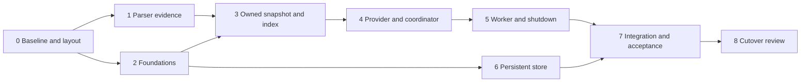

# Cache Migration Plan

How the current parser becomes the signed-off syntax-first cache service.
The specification is [CACHE_ARCHITECTURE.md](CACHE_ARCHITECTURE.md) with its companions [CACHE_CONTRACTS.md](CACHE_CONTRACTS.md), [CACHE_SYNTAX_REGISTRY.md](CACHE_SYNTAX_REGISTRY.md) and [CACHE_EXPERIMENTS.md](CACHE_EXPERIMENTS.md).
Decision labels (R1-R14), milestones, gates (C1-C5, P1-P5) and traces (T, V, X, S, A, W) are defined there.

Drafted 2026-11-04 after whole-specification sign-off (R9).
The user approved this plan and authorised implementation on 2026-11-04.
Approval authorises the phases below in order; it does not approve their results, which still pass through the milestone-6 verdict rules.

## 1. Starting Point

Re-audit of the current code on 2026-11-04.

| Area. | Current state. | Consequence for the migration. |
| --- | --- | --- |
| [module.jai](module.jai) | Parameters `ENABLE_TRIVIA` (default off), `EVALUATE_STRING_ESCAPES`, `INTERN_IDENTIFIERS`, `USE_SIMD`, `TRACK_AST_REUSE`; loads the lexer, parser and resolver. | The service imports the parser with `ENABLE_TRIVIA = true`; the full-featured profile rejects non-trivia builds.  Existing default-parameter users are unaffected. |
| [parser.jai](parser.jai) (about 6,800 lines) | Entry points `parse_file`, `parse_file_edit`, `parse_expression`, `parse_declaration`, `parse_block`, `parse_declaration_block`; `release_parser_tree`.  All nodes live in one `Pool` in `Parsed_Source`; source and filename are borrowed. | The service owns source bytes and the `Parsed_Source` together and releases both on the last lease.  Only `parse_file` is needed initially (whole-file reparse, R1). |
| Compound declarations | Two builders: identifier-led in `parse_declaration_node`, expression-led in `parse_statement`.  The expression-led path discards its operator token; neither records modifier nor separator token indices. | Phase 1 merges them and records every token (R12). |
| `#program_export` | Parsed as trailing declaration metadata, the opposite of the compiler, which only accepts it as a prefix. | Phase 1 parses the prefix form (R12, amended). |
| [resolution.jai](resolution.jai) | `resolve_lexical_references` writes `resolved_declaration` into identifier nodes; scopes and bindings are built during parsing. | The service parses with `resolve_identifiers = false` (E6): published snapshots are never mutated.  Resolution stays available to existing callers and is not part of the initial slice. |
| AST reuse (`parse_file_edit`, `reuse_simple_declaration`, copier) | About 900 production lines and 6,900 test lines. | Not used by the service.  The keep/drop decision stays independent (see [simplify.md](simplify.md) 1a); this plan neither removes nor depends on it. |
| Lexer | `Token`, trivia iteration, SIMD classifiers; `Parser_Token` adds byte offsets under trivia. | Reused as-is through the parser. |
| Tests | [parser_tokens_test.jai](examples/parser_tokens_test.jai) (about 151 procedures), [differential_test.jai](examples/differential_test.jai) with its runner and fixtures, [parse_how_to.jai](examples/parse_how_to.jai), [layout_test.jai](examples/layout_test.jai), [lex_all_files.jai](examples/lex_all_files.jai), [snapshot_oracle.jai](examples/snapshot_oracle.jai), [benchmark_ast_reuse.jai](examples/benchmark_ast_reuse.jai). | All must keep passing after every phase.  `snapshot_oracle.jai` (with its `DIRECTIVE_THIS` fix) is the starting C1 fresh-parse oracle. |
| SDK support | `Pool`, `Bucket_Array`, `Thread` (mutex, semaphore, condition variable), `Text_File_Handler`, `File`, `File_Utilities`; `meow_hash` (128-bit, x64 AES), `xxHash` (32/64-bit only) and `Hash` (FNV, djb2). | Phase 2 wraps `meow_hash` as the R14 content digest. |
| Persistence/service code | None in the module; E7-E13 prototypes live under [examples/](examples/) only. | Everything in phases 2-6 is new code.  Prototypes inform it but are not promoted. |

## 2. Boundaries

| Kept unchanged. | Changed. | New. | Not touched by this plan. |
| --- | --- | --- | --- |
| Lexer; all existing public parse entry points and their tests; resolver; default module parameters. | Compound-declaration builders and their node shape; `#program_export` placement; the registry text describing them. | Service code: canonical values, identities/handles, owned snapshots and projections, declaration-index adapter, provider, coordinator/worker, store, harness host, acceptance runner. | AST-copier keep/drop; semantic queries; evaluator; language server; POSIX store implementation. |

No existing public API breaks.
The only deliberate shape change is the compound-declaration node in phase 1, which is checked against the official compiler through the differential tests.

### Code Location

Service code lives in this repository under `service/`, whose `module.jai` imports the parser with `ENABLE_TRIVIA = true`.
Clients use `#import "Jai_Parser/service"`; a phase-0 compile check confirmed that this nested-module import (and `#import,dir`) resolves and yields a trivia-enabled parser alongside the default-parameter instance.

### Working Rules

- Every phase ends buildable, with all existing tests and the new phase tests passing on the fast x64 backend, and the optimised LLVM build compiling.
- Every new test has an independent oracle and a deliberately broken negative control, per the milestone-6 verdict rules.
- Each phase updates the specification documents only where the code proves them wrong; such changes are listed in the phase's review.
- Commit per phase step; no step mixes a parser shape change with service code.

## 3. Phases

Phases 1 and 2 are independent of each other; phase 6 can proceed alongside phases 4-5 once phase 2 is done.

### Phase 0: Baseline and Layout

1. Run every existing test and record its command, backend and result as the baseline.
2. Settle the service code location with a minimal compiling entry file that imports the parser with trivia enabled.
3. Add the acceptance-case record format and verdict tally (milestone 6) as a small harness library, plus an empty runner that reports `NOT_RUN` for every listed case.

Exit: baseline recorded; empty service entry and runner compile and run.

#### Baseline (2026-11-04)

Jai beta 0.2.030 (2 July 2026), fast x64 backend, run from `examples/`.

| Suite. | Command. | Result. |
| --- | --- | --- |
| Lexer layout. | `jai layout_test.jai -x64 -quiet && ./layout_test.exe` | Pass; SIMD widths 16/32 parity, width 64 skipped (no CPU support). |
| Lexer corpus. | `jai lex_all_files.jai -x64 -quiet && ./lex_all_files.exe` | Pass; 2,239,352 tokens across 712 files. |
| Parser tokens. | `jai parser_tokens_test.jai -x64 -quiet && ./parser_tokens_test.exe` | Pass. |
| How-to corpus. | `jai parse_how_to.jai -x64 -quiet && ./parse_how_to.exe` | Pass; 84/84 files with zero diagnostics. |
| Differential. | `jai differential_runner.jai -x64 -quiet && ./differential_runner.exe --all` | Pass; 4,175/4,175 fixtures, 252 jobs, about 310 s. |
| AST reuse verification. | `jai benchmark_ast_reuse.jai -x64 -quiet -exe verify_ast_reuse - verify-only && ./verify_ast_reuse.exe ../../../examples/invaders` | Pass; deep snapshot/lifetime checks. |
| Acceptance ledger. | `jai cache_acceptance.jai -x64 -quiet && ./cache_acceptance.exe --self-test && ./cache_acceptance.exe` | Pass; 55 cases (47 `NOT_RUN`, 8 `DEFERRED`). |
| Service foundations (phase 2). | `jai service_foundations_test.jai -x64 -quiet && ./service_foundations_test.exe` | Pass on x64 and LLVM. |
| Service snapshot (phase 3). | `jai service_snapshot_test.jai -x64 -quiet && ./service_snapshot_test.exe` | Pass on x64 and LLVM. |
| Service context registry (phase 3). | `jai service_context_test.jai -x64 -quiet && ./service_context_test.exe` | Pass on x64 and LLVM. |
| Service cross-target type-check. | `jai service_cross_check.jai -quiet` | `LINUX -> NONE`; macOS stops in the SDK's `Objective_C` module. |
| Recovery owner sweep (phase 3). | `jai recovery_owner_sweep.jai -x64 -quiet && ./recovery_owner_sweep.exe` | Pass; no unpublished owners across single-token mutations of W2. |

Three pre-existing failures were repaired first:

- `differential_test.jai` called `free` on a `[] string`; now `array_free`.
- `lex_all_files.jai`'s default corpus walk followed a dangling E4 symlink under `examples/.build`; it now passes `visit_symlinks = false`, like its benchmark walk.
- Commit `7a52037` had turned named context-modification fixtures (`,, allocator = x`) into the unnamed shorthand (`,, x`), which the compiler keeps as a plain identifier rather than an assignment.
The named-slot tests now use `logger_data = ...` so named, and unnamed slots are both covered.

### Phase 1: Parser Evidence (R12)

1. **Unified compound builder.**  One shared tail parses comma-separated targets (expressions, with an optional per-target `:` or `=` before a following comma), then the shared operator (`:`, `=` or an assignment-precedence operator).  Both entry points call it.  Record on the compound node the shared operator token index, each target's modifier token index (or none), and each separating comma's token index.  Binding classification becomes a function of recorded tokens: declared when the target carries `:`, or carries no modifier under a shared `:`; otherwise assigned.  Declared targets must be identifiers; anything else is diagnosed.
2. Keep scope-binding registration, notes, metadata and the existing node fields working; update `reuse_simple_declaration`'s compound guard for the new shape.
3. **`#program_export` prefix.**  The compiler, its `Program_Print` module and every corpus use put `#program_export ["name"]` before the declaration, in declaration and imperative contexts; parse that form only and stop accepting it as trailing metadata.
4. Rewrite the registry's compound-route and program-export sections.

Tests: new parser tests covering `a, b := v`, `a, b = v`, `a:, b = v`, `a=, b := v`, `x.y, z[0] = v`, `a, b += v`, missing separator/RHS, non-identifier declared targets; differential fixtures for the same against the compiler; prefix `#program_export` positive fixtures and the rejected trailing form; all existing suites.
If unification breaks compiler agreement in a way that cannot be fixed cleanly, fall back to recording a route field in both builders (R12 fallback) and record the reason.

Exit: all suites pass; registry text matches the code.

### Phase 2: Foundations

1. **Canonical values.**  The milestone-2 `K`/`V` encodings, `SchemaName`/namespace/ID byte types, and canonical ordering helpers.
2. **Content digest (R14).**  One `digest_128` wrapper over `meow_hash`, with its algorithm identifier, streaming and one-shot forms, and fixed expected outputs (including the module's published `big.txt` value) plus a mutated-input negative control.
3. **Identity allocation.**  Service incarnation, per-session counters, exhaustion behaviour (milestone 3), and the generation-checked handle registry (slots, generations, retirement).
4. **Epoch issuer (R10).**  `.jaiParserEpoch` reservation: exclusive lock, increment, atomic replace, flush, head-epoch floor; `UNAVAILABLE` on any failure.
5. **Limits and reservation ledger.**  `LimitRequest` negotiation to effective `Limits`, checked arithmetic, live-plus-reserved accounting, documented implementation ceilings (milestone 2 and 4).

Tests: encoding round-trips and fixed expected bytes; digest expected outputs; allocator/generation stale-handle rejection; issuer ledger across repeated and concurrent process starts, deleted file with surviving head, injected I/O failure; ledger edge cases at exact and one-over limits.

Exit: foundations library passes its tests with negative controls.

### Phase 3: Owned Snapshot and Declaration Index

1. **Owned parse.**  Copy source and filename into a snapshot owner, parse with trivia and `resolve_identifiers = false`, and tie release of the pool, tokens, diagnostics and bytes to the owner.
2. **Snapshot projection.**  `.SYNTAX_SNAPSHOT` envelope: tokens and trivia, node records with snapshot-local IDs per the milestone-1 registry field roles, recovery/synthetic tokens, completeness; `.OPAQUE`-free or conversion failure.
3. **Diagnostics projection.**  `.SYNTAX_DIAGNOSTICS` with origins and the summary record.
4. **Declaration index adapter.**  Authored-edge traversal registry, entries and shared regions, name origins, metadata (`#program_export`), scope-basis provenance, coverage reasons; capability descriptor (`jai-cache-syntax-adapter/1`).
5. **Context registry.**  Schema tuples, parse profile, adapter binding; admission of the implemented tuple only.

Tests (C1 and the milestone-2 qualification checklist): every W1 authored vector and the W2 inventories compare projection against an independent fresh parse via `snapshot_oracle.jai`; producer teardown and poisoning before comparison; registry-route vectors from the syntax registry's discriminating cases; coverage-reason and partial-index vectors.

Exit: C1 passes on W1 and W2; every registry route has a vector or an explicit unsupported/partial disposition.

### Phase 4: Provider and Coordinator (Deterministic)

1. **Source provider.**  Milestone-2 provider admission and the source-capture contract: in-memory and disk providers for the harness host, exact-base byte edit batches, overlay/disk branches, save/reset/delete/rename events, frontiers.
2. **Session and coordinator state.**  The fifteen operations over a session state gate, with tickets, analysis candidates, worlds, queries, waiters, completion entries and reservations.  Task execution goes through an internal executor interface; this phase supplies a deterministic step executor for tests only.
3. **Harness host.**  Implements host confirmation, project-root declaration, the epoch binding and completion draining.

Tests: T1-T8 and V1-V8 with authored event ledgers; operation/error-arm subcases from the milestone-6 API boundary list; unsupported semantic/evaluator queries create no task.

Exit: T and V traces pass under the deterministic executor.

### Phase 5: Worker, Cancellation and Shutdown

1. Replace the test executor with the service-owned compute worker and the reserved shutdown/reaper job (milestone 4), using `Thread` primitives; the deterministic executor remains as a test seam.
2. Condition-variable `Wait`, required/optional FIFOs, cooperative stop points, world supersession, last-consumer removal, mailbox-validated publication, `STOPPED` predicates and surviving-owner lifetime.

Tests: X1-X8 with barriers at each gate/registration/publication/free boundary, both orderings, duplicate and late completions, allocator and provider failures; T1-T8 rerun on the real worker; zero live owned allocations after final release.

Exit: X traces pass with attained barriers; C3 and C5 evidence recorded.

### Phase 6: Persistent Store

1. **Wire codec.**  Strict envelope preflight, typed body grammar, `Text_File_Handler` over a bounded buffer, iterative bounded decoder, canonical encoder.
2. **Records and policy.**  The seven record kinds, `StorePolicy` resolution to `.jaiParserCache`, effective `StoreLimits`.
3. **Native binding.**  `jai-cache-store-local/1` Windows implementation (R11): containment checks, owner lock, create-new staging, no-replace install, head replacement.
4. **Commit, read and recovery.**  Ordered source projection, commit/reconciliation, read pins, recovery offers, GC, maintenance actions and quarantine.
5. **Service wiring.**  Store lane, degradation status and diagnostics; persistence never blocks source acceptance.

Tests: S1-S8 with independently encoded files and root inventories, interruption at every staged/installed/head boundary, corrupt-but-rehashed records, write denial, a second-process owner contender; C4 evidence.

Exit: S traces pass; store failure never breaks source operations.

### Phase 7: Integration and Acceptance

1. Expand the milestone-6 coverage ledger to every supported registry route, operation/error arm, event variant, bound edge and fault boundary.
2. Run A1-A15 over W1-W6, with W3 manifests frozen per R13.
3. Run P1-P5 in two local rounds and assemble the measured results packet for review under R7.

Exit: no `FAIL`, `BLOCKED` or `NOT_RUN` applicable correctness case; no unexplained live ownership; results packet delivered.

### Phase 8: Cutover Review

1. Review the results packet and decide whether the service is the supported entry point for the harness (and later the language server).
2. Update [README.md](README.md) and the specification documents to describe the implemented state; mark qualified items in section 15 of the architecture.
3. Separately, revisit the AST-copier decision with its own measurements; any removal is a later plan.

Exit: user decision recorded.

## 4. Persistence Rollout and Version Rejection

- The store starts at `jai-cache-store/1`; there is no earlier production store to migrate.
- E11/E12 experiment stores are never read: their namespaces and schemas reject.
- An unknown or newer schema is a cache miss with a diagnostic, never an upgrade or overwrite; repair stays explicit (milestone 5).
- Enabling persistence by default (R2) takes effect only from phase 7 onwards; earlier phases test the store in isolated roots.

## 5. Risks and Contingencies

| Risk. | Contingency. |
| --- | --- |
| Compound unification changes compiler agreement or reuse behaviour. | R12 fallback (route field), recorded as an amendment. |
| A registry route cannot be projected exactly. | Partial coverage with its reason, per the registry's limits table; never a silent gap. |
| Threading primitives lack a needed guarantee (for example timed condition waits). | Adjust the executor implementation, keeping the deterministic seam and the X traces unchanged. |
| Native file primitives behave differently from documented assumptions. | Degrade persistence explicitly (R8); source operations continue. |
| Performance deltas are unfavourable. | Report them under R7; the cutover review decides, not this plan. |

## 6. Progress

- [x] Plan approved and implementation authorised (2026-11-04).
- [x] Phase 0: baseline and layout.
	- [x] Record the baseline test results.
	- [x] Settle the service code location.
	- [x] Add the acceptance record format and empty runner ([cache_acceptance.jai](examples/cache_acceptance.jai), with `--self-test`).
- [x] Phase 1: parser evidence.
	- [x] Unify the compound-declaration builders and record operator, modifier and separator tokens.
		- [x] One builder for both routes; `operator_type` now recorded for `+=`-style compounds, checked against the compiler by the differential normaliser.
		- [x] Undeclarable (non-identifier) declared targets diagnosed, matching the compiler's rejection.
		- [x] Parser tests with a negative control; syntax differential section passes with a negative control.
	- [x] Parse `#program_export ["name"]` as a declaration prefix (declaration and imperative contexts); trailing form now diagnosed; parser tests and differential fixtures with a negative control.
	- [x] Update the registry text (compound token evidence and program-export prefix).
	- [x] Run the full baseline suite set (2026-11-05): all suites pass; differential 4,181/4,181 fixtures in 252 jobs; lexer corpus 2,257,532 tokens across 738 files.
- [x] Phase 2: foundations ([service/](service/), tested by [service_foundations_test.jai](examples/service_foundations_test.jai) on x64 and LLVM).
	- [x] Canonical values: `B`/`K`/`V` encoders checked against handwritten byte layouts, canonical order, and a bounded `parse_key` that rejects every truncation, trailing bytes, bad magic/version and oversized field counts.
	- [x] Content digest: `meow_hash` one-shot and streaming forms agree across sizes 0-100,000 and chunkings; single-bit flips change the digest; pinned values for empty and `"abc"` input (regression pins, not published vectors).
	- [x] Identity allocation and handle registry: K-based incarnation/session/world/result/operation identities, counters retiring at `U64_MAX`, slot registry rejecting stale generations, wrong kinds, foreign sessions and double release, and retiring exhausted slots.
	- [x] Epoch issuer: sequential and floored reservations, deleted file restarting above the floor, authority mismatch, eight malformed files, exhaustion, and 4 concurrent processes * 25 reservations yielding unique contiguous epochs.
	Negative control: a shareable lock makes the concurrency check fail.
	- [x] Limits and reservation ledger: `-1`/zero/clamped/below-minimum/invalid negotiation; all-or-nothing reservation at exactly the limit, one over, and with overflowing amounts.
- [ ] Qualify the POSIX epoch issuer (`flock` lock, `fsync`/`F_FULLFSYNC` staging, `rename`, directory flush); deferred until Linux and macOS test environments exist.
	- [x] Type-check the service and foundations test for a Linux x64 target from Windows (`os_target = .LINUX`, no output); negative control: an undeclared call in the POSIX branch fails the check.
	- [ ] Run `service_foundations_test.jai` on Linux x64, including the concurrent-process epoch check.
	- [ ] Type-check and run on macOS; the Windows cross-check stops in the SDK's `Objective_C` module (`#import "macOS"` filename case) before reaching service code.
- [ ] Phase 3: owned snapshot and declaration index.
	- [x] Owned parse ([snapshot.jai](service/snapshot.jai)): source and filename copied into an owner whose pool backs every parse allocation; `resolve_identifiers = false`.
	[service_snapshot_test.jai](examples/service_snapshot_test.jai) poisons and frees the input, releases a sibling owner, then compares with an independent fresh parse through `snapshot_oracle.jai` on 16 W1 seeds and all 86 W2 files (56 tutorials, 8 Invaders, 4 parser, 18 Basic).
	Negative control: an owner that borrows its input fails the comparison.
	- [x] Snapshot projection.
		- [x] Source tokens, synthetic tokens, recovery records, raw diagnostics and parse status ([projection.jai](service/projection.jai)): closed 77-name token-tag registry, checked source slices, value arms per producer route; compared field by field with a fresh parse, plus reconstruction and authored value vectors.
		Negative controls: unknown flag bit, unregistered token value, shifted and widened source slices each fail conversion; altered records fail the comparator.
		- [x] Node and helper field projection from the milestone-1 per-layout registry tables (`jai-cache-authored-nodes/1`, [nodes.jai](service/nodes.jai)).
			- [x] Projector: preorder node and helper IDs, owning-edge sharing rejection, closed source-flag domains, producer enum names, canonical path ordering, checked token-span origins; unregistered kinds fail conversion.
			- [x] Batch 1 layouts: `.DIRECTIVE_THIS`, `Context`, `Ident`, `Note`, `Placeholder` (name qualified against its identifier token), `Unary_Operator`, `Binary_Operator`, `Cast` (prefix/postfix/auto order), `Expression_Query`, `Type_Query`, `Procedure_Call` with argument/context helpers, `Block`, `Declaration`, `Compound_Declaration` (with R12 token evidence), `Comma_Separated_Arguments` with its argument helper, `Literal` (number/boolean/string/uninitialised, struct/array helpers, qualified source `null`) and `Type_Instantiation` (source form from flags and leading token).
			Authored vectors check exact IDs, kinds, references and scalars; invariants check every successful projection; negative controls cover unknown flags, shared children, unknown operators, populated inactive fields, a forged placeholder name and an unregistered kind, plus the invariant checker itself.
			- [x] Batch 2 layouts: `Procedure_Header` (parameter `using` visited before its argument, with its expression an alias to exactly one argument in argument order), `Procedure_Body`, `Return`, `Struct`, `Enum`, `Using`, `If`, `Case`, `While`, `For` (dynamic prefixes in token order), `Loop_Control`, `Defer` and `Push_Context` (no body on the `.DEFER_POP` route); unpopulated note lists must stay empty.
			Authored vectors cover a switch with fallthrough and default cases, a for loop with flags and explicit names, quick lambdas, struct parameters/union/enum flags, ifx and push context; negative controls cover unmatched and reordered parameter usings, populated aggregate notes and a `.DEFER_POP` body.
			Removing the using-before-argument order fails the vectors.
			All 16 W1 seeds now project.
			- [x] Batch 3 layouts: all 20 directives.  Import parameter calls record their callee as an alias to the owning import; arrow `#run` owns its source header and its `expression` may only alias that header's body block; `#insert` orders replacement clauses by source position before its payload; `#code,null`/`#caller_code` and `#caller_location` carry no payload; generated `#insert` expansions fail conversion.
			Type-wrapper form selection now prefers populated fields and skips opening parentheses (W2 exposed `([3] float).[...]`).  Authored vectors cover import/load/library/scope, arrow run, caller location, null and ordinary code, and the parenthesised array type; negative controls cover a foreign import callee, a foreign run expression and a payload on `#code,null`.
			W2: 80 of 86 files project; the other 6 contain `#asm`.
			- [x] Batch 4: `#asm` and its ten helper records.  Statement, operand, size and modifier kinds select their arm; every unselected arm must be empty; embedded value slots are distinct helper occurrences, and unused optional memory components are inactive.
			Vectors cover all four statement kinds, a memory operand, fixed and polymorphic sizes, and ampersand/bang modifiers; negative controls cover a populated second arm, an unknown statement kind and an argument on a bang modifier.
			The unregistered-kind control now injects the compiler-only `.EXTRACT` kind.
			- [x] Run W2 node projection to completion: all 86 W2 files and all 16 W1 seeds project, and the test now treats any conversion failure as an error.
		- Operator fields use the producer's `Operator_Type` names directly under a new `.OPERATOR` field-value arm (2026-11-05), documented in the contract and registry; the two AST-only names left the token-tag registry.  Declared names take precedence over the byte range, since `IS_EQUAL` and the other named values lie in 131-169; a named-operator vector covers this.
		- [x] Envelope assembly (`jai-cache-syntax-snapshot/1`, `project_snapshot` in [snapshot.jai](service/snapshot.jai)): one exact capture of source, root, nodes, helpers, tokens, synthetic tokens, recoveries, raw diagnostics and status, or no envelope if any part fails.
		A rootless parse keeps its tokens with root -1; an injected node failure fails the whole envelope.
		All W1 and W2 checks now go through the envelope.
	- [x] Diagnostics projection (`jai-cache-syntax-diagnostics/1`, [diagnostics.jai](service/diagnostics.jai)): records in emission order with code, severity, UTF-8-checked message, related records and the raw parser observation.
	Primary origins: inserted missing tokens anchor zero-width at their one correlated synthetic token's insertion point; other diagnostics map their token span (empty spans are zero-width anchors); missing or ambiguous correlation is unlocated; out-of-range recovery references fail conversion.
	An independent origin oracle reads the fresh parse's tokens, recoveries and synthetic tokens for all W1 seeds and W2 files (289 diagnostics); vectors cover an end-of-input insertion, a zero-width expected expression and a lexer error; controls cover invalid UTF-8, an out-of-range synthetic reference and an ambiguous correlation.
	Collapsing source spans makes the oracle fail.
	- [x] Declaration index adapter (`jai-cache-syntax-declaration-index/1`, [index.jai](service/index.jai)) over the snapshot envelope, with capability descriptor `jai-cache-syntax-adapter/1`; methods and dispositions are recorded in the registry's "Implemented Adapter Binding".
	Entries follow snapshot preorder, with each compound's binding group emitted on encounter; containers, shared regions, names (spelled, operator, backticked, anonymous slots), enum members along enum and static-if branch routes, `#program_export` occurrences and same-list scope provenance.
	Compound tokens that disagree with the token stream and doubly owned nodes fail conversion; uncorrelated names and metadata, and enum statements without member evidence, become explicit partial reasons.
	Recovery attribution uses parser-captured owners: each recovery record now carries its cursor, its owner (claimed in `finish_node` by the smallest published node around it, or by the statement for its terminator) and a discarded flag set by `parser_restore`; discarded parameter and return nodes return their events with `release_recoveries`.
	Entries on an event's ownership path are `.RECOVERED`, and compound target events skip the bindings; on W1 and W2 every kept event (291) has a published owner and no index is partial.
	Recovery vectors cover a recovered body declaration with a parsed sibling, a missing terminator, shared-payload versus target events and a discarded parameter; controls cover an unpublished owner and an event moved onto a declaration's first token.
	Removing the parameter release fails its vector.
	A mutation sweep over W2 (11,620 single-token deletions, duplications and truncations) found the remaining discard sites (`inline`/`no_inline`, `#bake`, `#procedure_of_call`, prefix casts, assembly values) and three crashes, all fixed with vectors: a `.` or backtick at end of input narrowed EOF to `u8` in the lexer, `add_unexpected_token` ate the end-of-input token, and an assembly value whose expression stopped short of its operand tripped an assert.
	After the fixes the sweep finds no unpublished owner.
	Vectors cover nested containers and directives, zero/one/two-binding and nested compound regions, operator and backticked names, identifier continuations, enum members versus a condition identifier, quick lambdas, using parameters, prefixes, export forms and recovery; invariants recompute owners, containers, provenance, binding counts and recovery statuses on all W1 and W2 files (8,297 entries).
	Negative controls: mismatched modifier and operator tokens, a doubly owned node, a forged producer name, a dropped export flag and a missing member `;`; the invariant checker rejects forged containers, scope tags and region memberships; disabling shared-region containers fails the vectors.
	- [x] Context registry ([context.jai](service/context.jai), tested by [service_context_test.jai](examples/service_context_test.jai) on x64 and LLVM): the implemented `SchemaTuple` and `ConfigurationID`, `PathValue` encodings, the ten-field `jai-cache-syntax-context/1` descriptor, `ContextID` and admission with recomputed identity.
	The producer binds compile-time digests of the parser, lexer and adapter sources, the compiler version and layouts, and the adapter descriptor; profiles and their policy identifiers are recorded in the contracts.
	Controls: each module parameter flipped, a non-boolean byte, forged parser build and adapter descriptor, changed schema/profile/language, resolver and semantic arms, invalid paths, renamed/reordered/missing/extra fields, trailing bytes, wrong tag and a forged identity; alias, base and encoding variants admit with distinct identities.
	Disabling the parameter check fails the controls.
	The cross-target type-check needs `#run,host` for the source digests.
	- [ ] C1 on W1 and W2.
- [ ] Phase 4: provider and coordinator.
	- [ ] Source provider.
	- [ ] Session and coordinator with the deterministic executor.
	- [ ] Harness host.
	- [ ] T1-T8 and V1-V8.
- [ ] Phase 5: worker, cancellation and shutdown.
	- [ ] Compute worker and reaper.
	- [ ] X1-X8.
- [ ] Phase 6: persistent store.
	- [ ] Wire codec.
	- [ ] Records and policy.
	- [ ] Windows native binding.
	- [ ] Commit, read, recovery, GC and maintenance.
	- [ ] Service wiring.
	- [ ] S1-S8.
- [ ] Phase 7: integration and acceptance.
	- [ ] Coverage ledger expansion.
	- [ ] A1-A15 over W1-W6.
	- [ ] P1-P5 results packet.
- [ ] Phase 8: cutover review.
