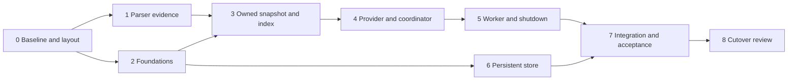

# Cache Migration Plan

How the current parser becomes the signed-off syntax-first cache service.
The specification is [CACHE_ARCHITECTURE.md](CACHE_ARCHITECTURE.md) with its companions [CACHE_CONTRACTS.md](CACHE_CONTRACTS.md), [CACHE_SYNTAX_REGISTRY.md](CACHE_SYNTAX_REGISTRY.md) and [CACHE_EXPERIMENTS.md](CACHE_EXPERIMENTS.md).
Decision labels (R1-R14), milestones, gates (C1-C5, P1-P5) and traces (T, V, X, S, A, W) are defined there.

Drafted 2026-11-04 after whole-specification sign-off (R9).
The user approved this plan and authorised implementation on 2026-11-04.
Approval authorises the phases below in order; it does not approve their results, which still pass through the milestone-6 verdict rules.

## 1. Starting Point

Re-audit of the current code on 2026-11-04.

| Area. | Current state. | Consequence for the migration. |
| --- | --- | --- |
| [module.jai](module.jai) | Parameters `ENABLE_TRIVIA` (default off), `EVALUATE_STRING_ESCAPES`, `INTERN_IDENTIFIERS`, `USE_SIMD`, `TRACK_AST_REUSE`; loads the lexer, parser and resolver. | The service imports the parser with `ENABLE_TRIVIA = true`; the full-featured profile rejects non-trivia builds.  Existing default-parameter users are unaffected. |
| [parser.jai](parser.jai) (about 6,800 lines) | Entry points `parse_file`, `parse_file_edit`, `parse_expression`, `parse_declaration`, `parse_block`, `parse_declaration_block`; `release_parser_tree`.  All nodes live in one `Pool` in `Parsed_Source`; source and filename are borrowed. | The service owns source bytes and the `Parsed_Source` together and releases both on the last lease.  Only `parse_file` is needed initially (whole-file reparse, R1). |
| Compound declarations | Two builders: identifier-led in `parse_declaration_node`, expression-led in `parse_statement`.  The expression-led path discards its operator token; neither records modifier nor separator token indices. | Phase 1 merges them and records every token (R12). |
| `#program_export` | Parsed as trailing declaration metadata, the opposite of the compiler, which only accepts it as a prefix. | Phase 1 parses the prefix form (R12, amended). |
| [resolution.jai](resolution.jai) | `resolve_lexical_references` writes `resolved_declaration` into identifier nodes; scopes and bindings are built during parsing. | The service parses with `resolve_identifiers = false` (E6): published snapshots are never mutated.  Resolution stays available to existing callers and is not part of the initial slice. |
| AST reuse (`parse_file_edit`, `reuse_simple_declaration`, copier) | About 900 production lines and 6,900 test lines. | Not used by the service.  The keep/drop decision stays independent (see [simplify.md](simplify.md) 1a); this plan neither removes nor depends on it. |
| Lexer | `Token`, trivia iteration, SIMD classifiers; `Parser_Token` adds byte offsets under trivia. | Reused as-is through the parser. |
| Tests | [parser_tokens_test.jai](examples/parser_tokens_test.jai) (about 151 procedures), [differential_test.jai](examples/differential_test.jai) with its runner and fixtures, [parse_how_to.jai](examples/parse_how_to.jai), [layout_test.jai](examples/layout_test.jai), [lex_all_files.jai](examples/lex_all_files.jai), [snapshot_oracle.jai](examples/snapshot_oracle.jai), [benchmark_ast_reuse.jai](examples/benchmark_ast_reuse.jai). | All must keep passing after every phase.  `snapshot_oracle.jai` (with its `DIRECTIVE_THIS` fix) is the starting C1 fresh-parse oracle. |
| SDK support | `Pool`, `Bucket_Array`, `Thread` (mutex, semaphore, condition variable), `Text_File_Handler`, `File`, `File_Utilities`; `meow_hash` (128-bit, x64 AES), `xxHash` (32/64-bit only) and `Hash` (FNV, djb2). | Phase 2 wraps `meow_hash` as the R14 content digest. |
| Persistence/service code | None in the module; E7-E13 prototypes live under [examples/](examples/) only. | Everything in phases 2-6 is new code.  Prototypes inform it but are not promoted. |

## 2. Boundaries

| Kept unchanged. | Changed. | New. | Not touched by this plan. |
| --- | --- | --- | --- |
| Lexer; all existing public parse entry points and their tests; resolver; default module parameters. | Compound-declaration builders and their node shape; `#program_export` placement; the registry text describing them. | Service code: canonical values, identities/handles, owned snapshots and projections, declaration-index adapter, provider, coordinator/worker, store, harness host, acceptance runner. | AST-copier keep/drop; semantic queries; evaluator; language server; POSIX store implementation. |

No existing public API breaks.
The only deliberate shape change is the compound-declaration node in phase 1, which is checked against the official compiler through the differential tests.

### Code Location

Service code lives in this repository under `service/`, whose `module.jai` imports the parser with `ENABLE_TRIVIA = true`.
Clients use `#import "Jai_Parser/service"`; a phase-0 compile check confirmed that this nested-module import (and `#import,dir`) resolves and yields a trivia-enabled parser alongside the default-parameter instance.

### Working Rules

- Every phase ends buildable, with all existing tests and the new phase tests passing on the fast x64 backend, and the optimised LLVM build compiling.
- Every new test has an independent oracle and a deliberately broken negative control, per the milestone-6 verdict rules.
- Each phase updates the specification documents only where the code proves them wrong; such changes are listed in the phase's review.
- Commit per phase step; no step mixes a parser shape change with service code.

## 3. Phases

Phases 1 and 2 are independent of each other; phase 6 can proceed alongside phases 4-5 once phase 2 is done.

### Phase 0: Baseline and Layout

1. Run every existing test and record its command, backend and result as the baseline.
2. Settle the service code location with a minimal compiling entry file that imports the parser with trivia enabled.
3. Add the acceptance-case record format and verdict tally (milestone 6) as a small harness library, plus an empty runner that reports `NOT_RUN` for every listed case.

Exit: baseline recorded; empty service entry and runner compile and run.

#### Baseline (2026-11-04)

Jai beta 0.2.030 (2 July 2026), fast x64 backend, run from `examples/`.

| Suite. | Command. | Result. |
| --- | --- | --- |
| Lexer layout. | `jai layout_test.jai -x64 -quiet && ./layout_test.exe` | Pass; SIMD widths 16/32 parity, width 64 skipped (no CPU support). |
| Lexer corpus. | `jai lex_all_files.jai -x64 -quiet && ./lex_all_files.exe` | Pass; 2,239,352 tokens across 712 files. |
| Parser tokens. | `jai parser_tokens_test.jai -x64 -quiet && ./parser_tokens_test.exe` | Pass. |
| How-to corpus. | `jai parse_how_to.jai -x64 -quiet && ./parse_how_to.exe` | Pass; 84/84 files with zero diagnostics. |
| Differential. | `jai differential_runner.jai -x64 -quiet && ./differential_runner.exe --all` | Pass; 4,175/4,175 fixtures, 252 jobs, about 310 s. |
| AST reuse verification. | `jai benchmark_ast_reuse.jai -x64 -quiet -exe verify_ast_reuse - verify-only && ./verify_ast_reuse.exe ../../../examples/invaders` | Pass; deep snapshot/lifetime checks. |
| Acceptance ledger. | `jai cache_acceptance.jai -x64 -quiet && ./cache_acceptance.exe --self-test && ./cache_acceptance.exe` | Pass; 55 cases (47 `NOT_RUN`, 8 `DEFERRED`). |
| Service foundations (phase 2). | `jai service_foundations_test.jai -x64 -quiet && ./service_foundations_test.exe` | Pass on x64 and LLVM. |
| Service snapshot (phase 3). | `jai service_snapshot_test.jai -x64 -quiet && ./service_snapshot_test.exe` | Pass on x64 and LLVM. |
| Service context registry (phase 3). | `jai service_context_test.jai -x64 -quiet && ./service_context_test.exe` | Pass on x64 and LLVM. |
| Service provider model (phase 4). | `jai service_provider_test.jai -x64 -quiet && ./service_provider_test.exe` | Pass on x64 and LLVM. |
| Service coordinator (phase 4). | `jai service_coordinator_test.jai -x64 -quiet && ./service_coordinator_test.exe` | Pass on x64 and LLVM. |
| Service harness host (phase 4). | `jai service_host_test.jai -x64 -quiet && ./service_host_test.exe` | Pass on x64 and LLVM. |
| Service traces T1-T8, V1-V8 (phase 4). | `jai service_traces_test.jai -x64 -quiet && ./service_traces_test.exe` | Pass on x64 and LLVM. |
| Service worker interleavings (phase 5, partial qualification). | `jai service_worker_test.jai -x64 -quiet && ./service_worker_test.exe` | Pass on x64 and optimised LLVM; attained barriers and independent session-allocation ledger.  Remaining qualification is listed below. |
| Service traces on the real worker (phase 5). | `jai service_traces_test.jai -x64 -quiet - real-worker && ./service_traces_test.exe` | T1-T8 and V1-V8 pass on x64 and optimised LLVM, retaining the authored and fresh-parse oracles. |
| Service cross-target type-check. | `jai service_cross_check.jai -quiet` | `LINUX -> NONE`; macOS stops in the SDK's `Objective_C` module. |
| Recovery owner sweep (phase 3). | `jai recovery_owner_sweep.jai -x64 -quiet && ./recovery_owner_sweep.exe` | Pass; no unpublished owners across single-token mutations of W2. |

Three pre-existing failures were repaired first:

- `differential_test.jai` called `free` on a `[] string`; now `array_free`.
- `lex_all_files.jai`'s default corpus walk followed a dangling E4 symlink under `examples/.build`; it now passes `visit_symlinks = false`, like its benchmark walk.
- Commit `7a52037` had turned named context-modification fixtures (`,, allocator = x`) into the unnamed shorthand (`,, x`), which the compiler keeps as a plain identifier rather than an assignment.
The named-slot tests now use `logger_data = ...` so named, and unnamed slots are both covered.

### Phase 1: Parser Evidence (R12)

1. **Unified compound builder.**
One shared tail parses comma-separated targets (expressions, with an optional per-target `:` or `=` before a following comma), then the shared operator (`:`, `=` or an assignment-precedence operator).
Both entry points call it.
Record on the compound node the shared operator token index, each target's modifier token index (or none), and each separating comma's token index.
Binding classification becomes a function of recorded tokens: declared when the target carries `:`, or carries no modifier under a shared `:`; otherwise assigned.
Declared targets must be identifiers; anything else is diagnosed.
2. Keep scope-binding registration, notes, metadata and the existing node fields working; update `reuse_simple_declaration`'s compound guard for the new shape.
3. **`#program_export` prefix.**
The compiler, its `Program_Print` module and every corpus use put `#program_export ["name"]` before the declaration, in declaration and imperative contexts; parse that form only and stop accepting it as trailing metadata.
4. Rewrite the registry's compound-route and program-export sections.

Tests: new parser tests covering `a, b := v`, `a, b = v`, `a:, b = v`, `a=, b := v`, `x.y, z[0] = v`, `a, b += v`, missing separator/RHS, non-identifier declared targets; differential fixtures for the same against the compiler; prefix `#program_export` positive fixtures and the rejected trailing form; all existing suites.
If unification breaks compiler agreement in a way that cannot be fixed cleanly, fall back to recording a route field in both builders (R12 fallback) and record the reason.

Exit: all suites pass; registry text matches the code.

### Phase 2: Foundations

1. **Canonical values.**
The milestone-2 `K`/`V` encodings, `SchemaName`/namespace/ID byte types, and canonical ordering helpers.
2. **Content digest (R14).**
One `digest_128` wrapper over `meow_hash`, with its algorithm identifier, streaming and one-shot forms, and fixed expected outputs (including the module's published `big.txt` value) plus a mutated-input negative control.
3. **Identity allocation.**
Service incarnation, per-session counters, exhaustion behaviour (milestone 3), and the generation-checked handle registry (slots, generations, retirement).
4. **Epoch issuer (R10).**
`.jaiParserEpoch` reservation: exclusive lock, increment, atomic replace, flush, head-epoch floor; `UNAVAILABLE` on any failure.
5. **Limits and reservation ledger.**
`LimitRequest` negotiation to effective `Limits`, checked arithmetic, live-plus-reserved accounting, documented implementation ceilings (milestone 2 and 4).

Tests: encoding round-trips and fixed expected bytes; digest expected outputs; allocator/generation stale-handle rejection; issuer ledger across repeated and concurrent process starts, deleted file with surviving head, injected I/O failure; ledger edge cases at exact and one-over limits.

Exit: foundations library passes its tests with negative controls.

### Phase 3: Owned Snapshot and Declaration Index

1. **Owned parse.**
Copy source and filename into a snapshot owner, parse with trivia and `resolve_identifiers = false`, and tie release of the pool, tokens, diagnostics and bytes to the owner.
2. **Snapshot projection.**
`.SYNTAX_SNAPSHOT` envelope: tokens and trivia, node records with snapshot-local IDs per the milestone-1 registry field roles, recovery/synthetic tokens, completeness; `.OPAQUE`-free or conversion failure.
3. **Diagnostics projection.**
`.SYNTAX_DIAGNOSTICS` with origins and the summary record.
4. **Declaration index adapter.**
Authored-edge traversal registry, entries and shared regions, name origins, metadata (`#program_export`), scope-basis provenance, coverage reasons; capability descriptor (`jai-cache-syntax-adapter/1`).
5. **Context registry.**
Schema tuples, parse profile, adapter binding; admission of the implemented tuple only.

Tests (C1 and the milestone-2 qualification checklist): every W1 authored vector and the W2 inventories compare projection against an independent fresh parse via `snapshot_oracle.jai`; producer teardown and poisoning before comparison; registry-route vectors from the syntax registry's discriminating cases; coverage-reason and partial-index vectors.

Exit: C1 passes on W1 and W2; every registry route has a vector or an explicit unsupported/partial disposition.

### Phase 4: Provider and Coordinator (Deterministic)

1. **Source provider.**
Milestone-2 provider admission and the source-capture contract: in-memory and disk providers for the harness host, exact-base byte edit batches, overlay/disk branches, save/reset/delete/rename events, frontiers.
2. **Session and coordinator state.**
The fifteen operations over a session state gate, with tickets, analysis candidates, worlds, queries, waiters, completion entries and reservations.
Task execution goes through an internal executor interface; this phase supplies a deterministic step executor for tests only.
3. **Harness host.**
Implements host confirmation, project-root declaration, the epoch binding and completion draining.

Tests: T1-T8 and V1-V8 with authored event ledgers; operation/error-arm subcases from the milestone-6 API boundary list; unsupported semantic/evaluator queries create no task.

Exit: T and V traces pass under the deterministic executor.

### Phase 5: Worker, Cancellation and Shutdown

1. Replace the test executor with the service-owned compute worker and the reserved shutdown/reaper job (milestone 4), using `Thread` primitives; the deterministic executor remains as a test seam.
2. Condition-variable `Wait`, required/optional FIFOs, cooperative stop points, world supersession, last-consumer removal, mailbox-validated publication, `STOPPED` predicates and surviving-owner lifetime.

Tests: X1-X8 with barriers at each gate/registration/publication/free boundary, both orderings, duplicate and late completions, allocator and provider failures; T1-T8 rerun on the real worker; zero live owned allocations after final release.

Exit: X traces pass with attained barriers; C3 and C5 evidence recorded.

### Phase 6: Persistent Store

1. **Wire codec.**
Strict envelope preflight, typed body grammar, `Text_File_Handler` over a bounded buffer, iterative bounded decoder, canonical encoder.
2. **Records and policy.**
The seven record kinds, `StorePolicy` resolution to `.jaiParserCache`, effective `StoreLimits`.
3. **Native binding.**
`jai-cache-store-local/1` Windows implementation (R11): containment checks, owner lock, create-new staging, no-replace install, head replacement.
4. **Commit, read and recovery.**
Ordered source projection, commit/reconciliation, read pins, recovery offers, GC, maintenance actions and quarantine.
5. **Service wiring.**
Store lane, degradation status and diagnostics; persistence never blocks source acceptance.

Tests: S1-S8 with independently encoded files and root inventories, interruption at every staged/installed/head boundary, corrupt-but-rehashed records, write denial, a second-process owner contender; C4 evidence.

Exit: S traces pass; store failure never breaks source operations.

### Phase 7: Integration and Acceptance

1. Expand the milestone-6 coverage ledger to every supported registry route, operation/error arm, event variant, bound edge and fault boundary.
2. Run A1-A15 over W1-W6, with W3 manifests frozen per R13.
3. Run P1-P5 in two local rounds and assemble the measured results packet for review under R7.

Exit: no `FAIL`, `BLOCKED` or `NOT_RUN` applicable correctness case; no unexplained live ownership; results packet delivered.

### Phase 8: Cutover Review

1. Review the results packet and decide whether the service is the supported entry point for the harness (and later the language server).
2. Update [README.md](README.md) and the specification documents to describe the implemented state; mark qualified items in section 15 of the architecture.
3. Separately, revisit the AST-copier decision with its own measurements; any removal is a later plan.

Exit: user decision recorded.

## 4. Persistence Rollout and Version Rejection

- The store starts at `jai-cache-store/1`; there is no earlier production store to migrate.
- E11/E12 experiment stores are never read: their namespaces and schemas reject.
- An unknown or newer schema is a cache miss with a diagnostic, never an upgrade or overwrite; repair stays explicit (milestone 5).
- Enabling persistence by default (R2) takes effect only from phase 7 onwards; earlier phases test the store in isolated roots.

## 5. Risks and Contingencies

| Risk. | Contingency. |
| --- | --- |
| Compound unification changes compiler agreement or reuse behaviour. | R12 fallback (route field), recorded as an amendment. |
| A registry route cannot be projected exactly. | Partial coverage with its reason, per the registry's limits table; never a silent gap. |
| Threading primitives lack a needed guarantee (for example timed condition waits). | Adjust the executor implementation, keeping the deterministic seam and the X traces unchanged. |
| Native file primitives behave differently from documented assumptions. | Degrade persistence explicitly (R8); source operations continue. |
| Performance deltas are unfavourable. | Report them under R7; the cutover review decides, not this plan. |

## 6. Progress

- [x] Plan approved and implementation authorised (2026-11-04).
- [x] Phase 0: baseline and layout.
	- [x] Record the baseline test results.
	- [x] Settle the service code location.
	- [x] Add the acceptance record format and empty runner ([cache_acceptance.jai](examples/cache_acceptance.jai), with `--self-test`).
- [x] Phase 1: parser evidence.
	- [x] Unify the compound-declaration builders and record operator, modifier and separator tokens.
		- [x] One builder for both routes; `operator_type` now recorded for `+=`-style compounds, checked against the compiler by the differential normaliser.
		- [x] Undeclarable (non-identifier) declared targets diagnosed, matching the compiler's rejection.
		- [x] Parser tests with a negative control; syntax differential section passes with a negative control.
	- [x] Parse `#program_export ["name"]` as a declaration prefix (declaration and imperative contexts); trailing form now diagnosed; parser tests and differential fixtures with a negative control.
	- [x] Update the registry text (compound token evidence and program-export prefix).
	- [x] Run the full baseline suite set (2026-11-05): all suites pass; differential 4,181/4,181 fixtures in 252 jobs; lexer corpus 2,257,532 tokens across 738 files.
- [x] Phase 2: foundations ([service/](service/), tested by [service_foundations_test.jai](examples/service_foundations_test.jai) on x64 and LLVM).
	- [x] Canonical values: `B`/`K`/`V` encoders checked against handwritten byte layouts, canonical order, and a bounded `parse_key` that rejects every truncation, trailing bytes, bad magic/version and oversized field counts.
	- [x] Content digest: `meow_hash` one-shot and streaming forms agree across sizes 0-100,000 and chunkings; single-bit flips change the digest; pinned values for empty and `"abc"` input (regression pins, not published vectors).
	- [x] Identity allocation and handle registry: K-based incarnation/session/world/result/operation identities, counters retiring at `U64_MAX`, slot registry rejecting stale generations, wrong kinds, foreign sessions and double release, and retiring exhausted slots.
	- [x] Epoch issuer: sequential and floored reservations, deleted file restarting above the floor, authority mismatch, eight malformed files, exhaustion, and 4 concurrent processes * 25 reservations yielding unique contiguous epochs.
	Negative control: a shareable lock makes the concurrency check fail.
	With `TEST_HOOKS`, injected failures at the read, staging-write and replace steps each return `IO_ERROR`, leave the epoch file byte-identical and release the lock; a held lock blocks reservation, and the hooks' `shared_lock` switch lets the same holder through (automated negative control).
	The Linux cross-check type-checks the POSIX hook paths.
	- [x] Limits and reservation ledger: `-1`/zero/clamped/below-minimum/invalid negotiation; all-or-nothing reservation at exactly the limit, one over, and with overflowing amounts.
- [_] Qualify the POSIX epoch issuer (`flock` lock, `fsync`/`F_FULLFSYNC` staging, `rename`, directory flush); deferred until Linux and macOS test environments exist.
	- [x] Type-check the service and foundations test for a Linux x64 target from Windows (`os_target = .LINUX`, no output); negative control: an undeclared call in the POSIX branch fails the check.
	- [_] Run `service_foundations_test.jai` on Linux x64, including the concurrent-process epoch check.
	- [_] Type-check and run on macOS; the Windows cross-check stops in the SDK's `Objective_C` module (`#import "macOS"` filename case) before reaching service code.
- [x] Phase 3: owned snapshot and declaration index.
	- [x] Owned parse ([snapshot.jai](service/snapshot.jai)): source and filename copied into an owner whose pool backs every parse allocation; `resolve_identifiers = false`.
	[service_snapshot_test.jai](examples/service_snapshot_test.jai) poisons and frees the input, releases a sibling owner, then compares with an independent fresh parse through `snapshot_oracle.jai` on 16 W1 seeds and all 86 W2 files (56 tutorials, 8 Invaders, 4 parser, 18 Basic).
	Negative control: an owner that borrows its input fails the comparison.
	- [x] Snapshot projection.
		- [x] Source tokens, synthetic tokens, recovery records, raw diagnostics and parse status ([projection.jai](service/projection.jai)): closed 77-name token-tag registry, checked source slices, value arms per producer route; compared field by field with a fresh parse, plus reconstruction and authored value vectors.
		Negative controls: unknown flag bit, unregistered token value, shifted and widened source slices each fail conversion; altered records fail the comparator.
		- [x] Node and helper field projection from the milestone-1 per-layout registry tables (`jai-cache-authored-nodes/1`, [nodes.jai](service/nodes.jai)).
			- [x] Projector: preorder node and helper IDs, owning-edge sharing rejection, closed source-flag domains, producer enum names, canonical path ordering, checked token-span origins; unregistered kinds fail conversion.
			- [x] Batch 1 layouts: `.DIRECTIVE_THIS`, `Context`, `Ident`, `Note`, `Placeholder` (name qualified against its identifier token), `Unary_Operator`, `Binary_Operator`, `Cast` (prefix/postfix/auto order), `Expression_Query`, `Type_Query`, `Procedure_Call` with argument/context helpers, `Block`, `Declaration`, `Compound_Declaration` (with R12 token evidence), `Comma_Separated_Arguments` with its argument helper, `Literal` (number/boolean/string/uninitialised, struct/array helpers, qualified source `null`) and `Type_Instantiation` (source form from flags and leading token).
			Authored vectors check exact IDs, kinds, references and scalars; invariants check every successful projection; negative controls cover unknown flags, shared children, unknown operators, populated inactive fields, a forged placeholder name and an unregistered kind, plus the invariant checker itself.
			- [x] Batch 2 layouts: `Procedure_Header` (parameter `using` visited before its argument, with its expression an alias to exactly one argument in argument order), `Procedure_Body`, `Return`, `Struct`, `Enum`, `Using`, `If`, `Case`, `While`, `For` (dynamic prefixes in token order), `Loop_Control`, `Defer` and `Push_Context` (no body on the `.DEFER_POP` route); unpopulated note lists must stay empty.
			Authored vectors cover a switch with fallthrough and default cases, a for loop with flags and explicit names, quick lambdas, struct parameters/union/enum flags, ifx and push context; negative controls cover unmatched and reordered parameter usings, populated aggregate notes and a `.DEFER_POP` body.
			Removing the using-before-argument order fails the vectors.
			All 16 W1 seeds now project.
			- [x] Batch 3 layouts: all 20 directives.
			Import parameter calls record their callee as an alias to the owning import; arrow `#run` owns its source header and its `expression` may only alias that header's body block; `#insert` orders replacement clauses by source position before its payload; `#code,null`/`#caller_code` and `#caller_location` carry no payload; generated `#insert` expansions fail conversion.
			Type-wrapper form selection now prefers populated fields and skips opening parentheses (W2 exposed `([3] float).[...]`).
			Authored vectors cover import/load/library/scope, arrow run, caller location, null and ordinary code, and the parenthesised array type; negative controls cover a foreign import callee, a foreign run expression and a payload on `#code,null`.
			W2: 80 of 86 files project; the other 6 contain `#asm`.
			- [x] Batch 4: `#asm` and its ten helper records.
			Statement, operand, size and modifier kinds select their arm; every unselected arm must be empty; embedded value slots are distinct helper occurrences, and unused optional memory components are inactive.
			Vectors cover all four statement kinds, a memory operand, fixed and polymorphic sizes, and ampersand/bang modifiers; negative controls cover a populated second arm, an unknown statement kind and an argument on a bang modifier.
			The unregistered-kind control now injects the compiler-only `.EXTRACT` kind.
			- [x] Run W2 node projection to completion: all 86 W2 files and all 16 W1 seeds project, and the test now treats any conversion failure as an error.
		- Operator fields use the producer's `Operator_Type` names directly under a new `.OPERATOR` field-value arm (2026-11-05), documented in the contract and registry; the two AST-only names left the token-tag registry.
		Declared names take precedence over the byte range, since `IS_EQUAL` and the other named values lie in 131-169; a named-operator vector covers this.
		- [x] Envelope assembly (`jai-cache-syntax-snapshot/1`, `project_snapshot` in [snapshot.jai](service/snapshot.jai)): one exact capture of source, root, nodes, helpers, tokens, synthetic tokens, recoveries, raw diagnostics and status, or no envelope if any part fails.
		A rootless parse keeps its tokens with root -1; an injected node failure fails the whole envelope.
		All W1 and W2 checks now go through the envelope.
	- [x] Diagnostics projection (`jai-cache-syntax-diagnostics/1`, [diagnostics.jai](service/diagnostics.jai)): records in emission order with code, severity, UTF-8-checked message, related records and the raw parser observation.
	Primary origins: inserted missing tokens anchor zero-width at their one correlated synthetic token's insertion point; other diagnostics map their token span (empty spans are zero-width anchors); missing or ambiguous correlation is unlocated; out-of-range recovery references fail conversion.
	An independent origin oracle reads the fresh parse's tokens, recoveries and synthetic tokens for all W1 seeds and W2 files (289 diagnostics); vectors cover an end-of-input insertion, a zero-width expected expression and a lexer error; controls cover invalid UTF-8, an out-of-range synthetic reference and an ambiguous correlation.
	Collapsing source spans makes the oracle fail.
	- [x] Declaration index adapter (`jai-cache-syntax-declaration-index/1`, [index.jai](service/index.jai)) over the snapshot envelope, with capability descriptor `jai-cache-syntax-adapter/1`; methods and dispositions are recorded in the registry's "Implemented Adapter Binding".
	Entries follow snapshot preorder, with each compound's binding group emitted on encounter; containers, shared regions, names (spelled, operator, backticked, anonymous slots), enum members along enum and static-if branch routes, `#program_export` occurrences and same-list scope provenance.
	Compound tokens that disagree with the token stream and doubly owned nodes fail conversion; uncorrelated names and metadata, and enum statements without member evidence, become explicit partial reasons.
	Recovery attribution uses parser-captured owners: each recovery record now carries its cursor, its owner (claimed in `finish_node` by the smallest published node around it, or by the statement for its terminator) and a discarded flag set by `parser_restore`; discarded parameter and return nodes return their events with `release_recoveries`.
	Entries on an event's ownership path are `.RECOVERED`, and compound target events skip the bindings; on W1 and W2 every kept event (291) has a published owner and no index is partial.
	Recovery vectors cover a recovered body declaration with a parsed sibling, a missing terminator, shared-payload versus target events and a discarded parameter; controls cover an unpublished owner and an event moved onto a declaration's first token.
	Removing the parameter release fails its vector.
	A mutation sweep over W2 (11,620 single-token deletions, duplications and truncations) found the remaining discard sites (`inline`/`no_inline`, `#bake`, `#procedure_of_call`, prefix casts, assembly values) and three crashes, all fixed with vectors: a `.` or backtick at end of input narrowed EOF to `u8` in the lexer, `add_unexpected_token` ate the end-of-input token, and an assembly value whose expression stopped short of its operand tripped an assert.
	After the fixes the sweep finds no unpublished owner.
	Vectors cover nested containers and directives, zero/one/two-binding and nested compound regions, operator and backticked names, identifier continuations, enum members versus a condition identifier, quick lambdas, using parameters, prefixes, export forms and recovery; invariants recompute owners, containers, provenance, binding counts and recovery statuses on all W1 and W2 files (8,297 entries).
	Negative controls: mismatched modifier and operator tokens, a doubly owned node, a forged producer name, a dropped export flag and a missing member `;`; the invariant checker rejects forged containers, scope tags and region memberships; disabling shared-region containers fails the vectors.
	- [x] Context registry ([context.jai](service/context.jai), tested by [service_context_test.jai](examples/service_context_test.jai) on x64 and LLVM): the implemented `SchemaTuple` and `ConfigurationID`, `PathValue` encodings, the ten-field `jai-cache-syntax-context/1` descriptor, `ContextID` and admission with recomputed identity.
	The producer binds compile-time digests of the parser, lexer and adapter sources, the compiler version and layouts, and the adapter descriptor; profiles and their policy identifiers are recorded in the contracts.
	Controls: each module parameter flipped, a non-boolean byte, forged parser build and adapter descriptor, changed schema/profile/language, resolver and semantic arms, invalid paths, renamed/reordered/missing/extra fields, trailing bytes, wrong tag and a forged identity; alias, base and encoding variants admit with distinct identities.
	Disabling the parameter check fails the controls.
	The cross-target type-check needs `#run,host` for the source digests.
	- [x] C1 on W1 and W2 (2026-11-06): every W1 seed and all 86 W2 files compare an owned, poisoned-input parse with an independent fresh parse, then check token, node, diagnostics and index projections; registry routes are tallied across every checked projection, and the test fails on a registered kind, helper, enum name or source flag that has neither a vector nor a recorded disposition (registry "C1 Route Coverage").
	New route and flag vectors cover the rare directives, import forms, using filters, `---`, unparsed and pinned assembly arms, modifier flags and a populated backreference; the remaining unobserved names are compiler-only or never set by a builder.
	Negative control: dropping the eight-digit literal vector fails the flag check.
- [x] Phase 4: provider and coordinator.
	- [x] Source provider.
		- [x] Provider model ([provider.jai](service/provider.jai), tested by [service_provider_test.jai](examples/service_provider_test.jai) on x64 and LLVM): descriptor admission for distinct keys and copy-only sources, `DocumentID`/`SourceRevision`/`ProviderRevision`/`ProviderFrontier` recipes, and atomic source batches over separate overlay and disk branches.
		Each batch is staged against private copies and commits every member plus one new frontier, or nothing; the model owns copies of accepted bytes and metadata, and source backings are reference-counted, so a retained capture keeps its bytes (V7).
		Vectors cover an in-order edit chain, a save acknowledgement for an older installation preserving the newer overlay (T3), reset and restore with host confirmations (T4), an invalid member rejecting a valid one (V5), caller buffers reused after acceptance and an absent disk observation.
		Controls: stale frontier, document and source bases; out-of-range edits; reused revisions; duplicate documents and registrations; forged context identity; unregistered and unreferenced contexts; missing, changed, wrong-policy and wrong-platform bindings; foreign document keys and revisions; foreign or mismatched confirmations; a save of different bytes; `RENAME`; provider leases; coherent capture without the capability; a false disk revision claim; missing provenance; and source-byte and batch-event limits.
		Clearing the overlay on any save acknowledgement fails the T3 vector.
		- [x] In-memory and disk providers for the harness host (overlays from host text, disk observations read from the project root).
	- [x] Session and coordinator with the deterministic executor.
		- [x] Coordinator core ([coordinator.jai](service/coordinator.jai), tested by [service_coordinator_test.jai](examples/service_coordinator_test.jai) on x64 and LLVM): all fifteen operations plus `ReadWorld`/`ReadResult`/`ReadSource`, update tickets and waiters, capture-keyed candidate worlds with joins, the head target, query tasks, completion entries in commit order, ledger charges for handles, pending registrations, completion records and in-flight operations, and the reserved first shutdown.
		A candidate's parse task builds each present member's snapshot, declaration index and diagnostic summary before publication; snapshot and index queries answer at once, and diagnostics queries share one task per world and document.
		The deterministic executor dispatches the required FIFO head into a single-use mailbox and delivers it separately, so tests choose the interleaving; `wait` drives it and advances a session clock.
		The test controls (`session_of`, `executor_dispatch`, `executor_deliver`, `executor_run`) compile only with the service module parameter `TEST_HOOKS = true`; a default import exposes neither the executor nor session internals.
		Vectors: T1 (edit, await, query, old results unchanged), T6 (shared waiters, caller cancel, duplicate completion rejected), T7 (supersession of pending updates and query waiters, discarded late result, no reissue), analysis joins and request errors, open-session admission errors, and shutdown at full handle capacity with a producer outliving its deadline; every test ends with the ledger back to the `.SESSION` charge.
		Negative controls run on every test pass through `TEST_HOOKS` fault switches: either the stop request or the publication frontier check alone keeps a late obsolete result out, and dropping both publishes it; keeping unconsumed work leaves the queue non-empty; taking the first shutdown slot from ordinary capacity fails at full capacity.
		- [x] `ResolveNode`/`ResolveToken`/`ResolveRecovery` (`resolve_node`, `resolve_token`, `resolve_recovery`) borrow from any result's own syntax backing with range checks; observations, accepted frontiers and session descriptions are caller-owned copies (`free_observation`, or `,, temp`), and waiters own their stored terminal copies.
		Vectors: an index result resolves its declaration node and a token with no snapshot query held; out-of-range references reject; mutating a returned observation or description leaves the next one unchanged.
		Handles still carry the session identity bytes, which the service keeps for its lifetime.
		Store policy admission (`SessionOptions.store_policy`) moved to phase 6 service wiring; sessions report `.DISABLED` until then.
	- [x] Harness host ([host.jai](service/host.jai), tested by [service_host_test.jai](examples/service_host_test.jai) on x64 and LLVM through the default import, with `wait` driving all work).
	One project root per host: the service incarnation binds an epoch reserved in that root, documents are keyed by contained root-relative paths, and the host issues provider revisions, observation tokens and action-bound confirmations.
	A batch builder reads its bases from one `DescribeSession` snapshot and supplies set/edit overlay, disk observation, save acknowledgement, reset and restore events with their contexts and first bindings; a disk read failure on an existing path is never reported as absence.
	Serial completion dispatch drains in bounded batches, returns at once from a nested call and counts handler failures without redelivering.
	Vectors: fresh epochs and session identities per host, rejected escaping paths, an external disk change under an overlay (old world unchanged), saves of matching and different bytes, reset then confirmed restore, deletion to confirmed absence with an unavailable snapshot query, an unreadable path, and nested dispatch.
	- [x] T1-T8 and V1-V8 ([service_traces_test.jai](examples/service_traces_test.jai), on x64 and LLVM): each trace runs through the harness host with authored expected selections, frontiers and outcomes, and every published syntax result is compared with an independent fresh parse of the authored bytes through `snapshot_oracle.jai`; each ends with the ledger back to the session charge and the session destroyed on release.
	T1 edit and query with a leased old result; T2 stale source base and invalid range rejected atomically, then a full replacement; T3 a late save of B after a byte-identical newer overlay C; T4 reset, restart with a fresh epoch, then a separately confirmed restore; T5 a leased index result outliving its world and ticket, and a stale handle rejected after its slot is reused; T6 one task shared by two waiters with a caller cancel and a rejected duplicate completion; T7 supersession of a pending update, its waiters and running query work with no late publication or reissue; T8 unsupported semantic and evaluation queries creating no work.
	V1 a captured overlay world unchanged through disk events, a save and a reset; V2 not-captured versus confirmed-absent members; V3 later documents not attached to an older world and analysis bound to the current frontier; V4 bytes captured before a concurrent write, labelled immutable rather than coherent; V5 a stale member and an unsupported rename each rejecting the whole batch; V6 an injected member failure (`TEST_HOOKS` `fail_parse_document`) failing the milestone with no mixed head and the accepted source kept, then a retry by `RequestAnalysis`; V7 caller buffers poisoned and freed after acceptance; V8 an unreadable path, shutdown waiting for a running producer, a rejected repeated completion and no source writes.
	Supporting changes: a query for a document the world never captured is now `.UNAVAILABLE`/`.NOT_CAPTURED` instead of an argument error; worlds record their capture consistency (coherent only under one attested capture token across disk observations); `ResultDescription` exposes its backing snapshot; `ack_save` can name the installation it saved.
	Outside phase 4: T5 eviction and rehydration and T8 store denial need the phase-6 store; one parse task covers all of a candidate's members, so V6's out-of-order member completion has no separate interleaving; and no compiler process exists to monitor.
- [ ] Phase 5: worker, cancellation and shutdown.
	- [x] Compute worker and independently progressing reaper ([service/worker.jai](service/worker.jai)); default imports progress without host polling/draining.
	The compute thread is joined outside the session gate before shutdown becomes terminal.
	Execution-backend decision: retain dedicated compute/reaper threads for phase 5 rather than adopting the SDK `Thread_Group`.
	Its per-worker queues and optional work stealing may help future parallel document parsing, but do not replace coordinator admission, required/optional scheduling, cancellation, publication validation or ownership.
	Per-submission `Work_Entry` allocation has no fallible admission result, control-side submission needs serialisation, and group shutdown joins workers without completing queued work or releasing service payloads.
	Reconsider it behind the coordinator when parallel parsing is introduced; keep reaper progress independent of compute-pool capacity.
	- [x] Condition-variable `wait`, integer monotonic deadlines, pinned owner-directory lookup and stable inline handle routing.
	Retirement wakes sleeping calls; generation and session binding are revalidated after waking.
	- [x] Source staging outside the gate overprotected provider copies; bounded `CONCURRENT_ACQUISITIONS` admission and frontier/lifecycle revalidation before commit.
	Shutdown waits for admitted staging and cleanup to unwind.
	- [x] Required/optional FIFO selection and promotion, cooperative checks between documents/parser/conversion phases, mailbox validation, supersession and unconsumed-output discard.
	Optional test work is injected; real store/maintenance chunks remain phase 6.
	- [x] Preallocated first-shutdown control and reserved handles; undrained completions and surviving payload handles do not prevent `STOPPED`.
	- [x] Separate caller outputs and session-owned allocation backing ([service/ownership.jai](service/ownership.jai)); recursive payload/source cleanup runs outside the gate with cleanup pins.
	Final owner release reclaims the tracked heap, and session-private head/source references detach on session release.
	- [x] Keep deterministic execution as a compile-time seam: `TEST_HOOKS = true`; use `REAL_WORKER = true` with hooks to test native execution.
	Barriers, fault controls and aggregate test allocation counters are absent from normal imports.
	- [ ] Complete X1-X8 qualification ([examples/service_worker_test.jai](examples/service_worker_test.jai)).
		- [x] X1: completion before registration, during wait arming and after arming; exact authored source result and retirement revalidation.
		- [x] X2: shared current-world caller cancellation versus completion in both winning orders; independent survivor and exactly two completion records.
		Real-worker T7 also checks obsolete-world cancellation and late delivery.
		- [x] X3: release while waiting, immediate slot reuse, stale generation waking with `INVALID_HANDLE`, and stale lookup after final owner removal.
		- [x] X4: host dispatch re-enters query, retain/release, cancellation and shutdown; nested dispatch defers, a handler failure is not redelivered, and its independently retained payload stays readable.
		- [x] X5: delayed/zero-sized drain, exact handle capacity, reserved shutdown and an automated removed-reservation negative control.
		- [x] X6: required background FIFO under later joined demand, optional fallback/promotion and an automated optional-first negative control; held provider admission does not block unrelated diagnostics compute.
		- [x] X7/X8: quiescing rejects a held source commit, repeated shutdown identity is stable, held parser/publication/cleanup boundaries keep shutdown pending past its deadline, and reaper completion requires no host polling.
		Retained results remain exact after session release.
		- [x] Independent allocator spy reconciles allocation/free addresses and bytes, detects double/wrong-owner release, and reaches zero session-owned allocations after each final release.
		Caller-owned service/host scaffolding and descriptive outputs are outside this ledger; heap sweeping at final destruction does not qualify steady-state byte bounds.
		- [x] Caller-output allocation failures for `drain_completions`, `poll` and `wait`: fail each allocation ordinal through the first successful copy; partial copies reach zero in an independent caller ledger, failures preserve terminal observations and completion charges, and a successful drain preserves authored waiter order.
		- [x] Caller-output interleavings for those three operations: direct reentrant and synchronously blocking allocators permit waiter retirement and immediate slot reuse; a competing drain emits each record once, and stopped-session retirement during drain frees staged outputs and returns `INVALID_HANDLE`.
		Test-only `consume_failed_drain` and `allow_stale_drain_output` controls demonstrate detection of premature consumption and stale-generation delivery.
		- [ ] Add every remaining gate/registration/publication/free ordering and each trace's own discriminating negative control, including owner/execution-backing admission failures.
		Primary trace coverage above is not full milestone-4 qualification; the completed caller-copy export audit does not qualify internal owner allocation.
			- [x] X3 shared-directory lifetime: allocate `service.sessions` through service backing rather than the first session's heap; detach and reset the empty array under the directory gate, then free its storage outside that gate.
			The independent allocation ledger first rejected the original session-owned backing.
			Tests grow the directory, retire the original session before or after its peers, describe surviving sessions, reject the retired handle and repeatedly reopen after final release, with zero retained owned allocations.
			- [x] X3 directory free boundary: directly reentrant and synchronously blocking service-allocator callbacks reopen a session after the old array is detached but before its storage is freed.
			The replacement uses independent backing and remains observable and releasable.
			Test-only `session_owned_directory` restores the wrong owner; the ownership oracle and each free-boundary probe detect it rather than reporting qualification, and control cleanup reaches zero allocations.
			- [x] Make shared-directory growth recoverably fallible and move backing allocation outside the directory gate; qualify allocation failure and concurrent open/retirement admission.
				- [x] `admit_directory` allocates checked candidate backing outside the directory gate, rechecks live capacity under the gate, copies only the current entries, and frees replaced or unused backing outside the gate.
				- [x] Fail the actual backing allocation for empty and full directories; reject with `ADMISSION_DENIED`/`RESOURCE_EXHAUSTED`, join private workers and free the staged description without publishing a handle.
				Existing sessions remain usable, issued identities are not reused, and independent caller/session ledgers reach zero after cleanup.
				- [x] Directly reentrant and synchronously blocking allocation callbacks fill the replacement capacity or retire the entire old directory and reopen it.
				The outer open retries capacity growth or uses the replacement directory without losing registrations; discarded candidates are freed.
				Test-only `retry_failed_directory_allocation` and `reject_changed_directory` controls demonstrate detection of incorrect admission after allocation failure and incorrect rejection after concurrent directory changes.
			- [ ] Qualify the other remaining X1-X8 gate/registration/publication/free orderings and trace-local negative controls after the corresponding owner-allocation boundaries below become recoverable.
			The caller-copy export audit is complete; remaining output risks are internal owner snapshots and backing, not unidentified public-copy routes.
			This item depends on implementation and fault-injection qualification, not external approval or a test environment.
				- [ ] Attain both orderings and discriminating negative controls for remaining provider construction/transfer, source/analysis admission, identity, result, candidate, task and queue allocation boundaries.
				- [ ] Qualify owner-snapshot allocation rejection and cleanup in `describe`, `export_bytes`, `export_observation` and `drain_completions`, preserving coherent copies and exact-handle revalidation.
				- [ ] Qualify terminal observation/completion and free-slot/retirement backing under cancellation, completion, shutdown and release winners, including exhausted-capacity cleanup.
				- [ ] Qualify recoverable worker scratch failure and aggregate byte-limit admission at exact and one-over limits without publication or retained charges on rejection.
				- [ ] Attain the remaining owner allocator allocation/free callbacks in direct and blocking modes, proving gate progress, lifetime protection and trace-local negative-control detection.
		- [ ] Implement recoverable worker scratch/allocation failure with the preallocated `FAILED`/`RESOURCE_LIMIT` outcome.
		The current SDK `array_reserve` asserts on failed reallocation; returning null from the tracked allocator is not a safe service failure boundary.
		- [ ] Enforce aggregate `OWNED_BYTES` and `RETAINED_SOURCE_BYTES`, charge fixed worker/reaper/control backing and reserved scratch before admission, and qualify exact/one-over byte limits.
		Current heap accounting and final sweeping are not quota enforcement.
		- [ ] Complete caller-output staging outside the state gate and revalidation before returning copies or consuming registrations.
			- [x] `drain_completions` snapshots protected observations, allocates checked caller copies outside the gate, then revalidates session and registration generations before consuming only still-undelivered records.
			`poll` and `wait` use the same protected snapshot and checked off-gate export boundary.
			- [x] Qualify blocking, directly reentrant and failing caller allocators for those three operations, including partial-copy cleanup, competing drain and retired-owner pinning.
			- [x] `acquire_result` pending and unsuccessful-terminal observations, terminal `observe_ticket` observations and already-terminal `cancel_waiter` observations use checked off-gate export with generation revalidation.
			The successful result-handle acquisition path is unchanged.
			- [x] Sweep every caller-allocation failure for pending results, cancelled results, published tickets and repeated cancellation of a terminal waiter.
			Independent caller accounting reaches zero, handle and completion charges remain unchanged, and both directly reentrant and synchronously blocking allocators permit retirement with immediate slot reuse; the original call rejects the retired generation with `INVALID_HANDLE`.
			- [x] State-changing `cancel_waiter` stages a prospective caller receipt outside the gate before committing query or update-waiter cancellation.
			Failed caller copies leave the waiter pending; retirement rejects the old generation.
			If a terminal transition wins during copying, the staged receipt is freed outside the gate and the actual terminal outcome is exported with `already_terminal = true`.
			- [x] Query/update cancellation qualification: sweep every caller-allocation failure, including the completion-winner retry; test direct reentry and blocking concurrent retirement/reuse, completion, competing cancellation and shutdown.
			Shared-work survivors remain available, completions are delivered once, and independent caller accounting reaches zero.
			The test-only `cancel_before_output` control demonstrates detection of mutation before a failed copy.
			- [x] `describe_session` builds an owner-allocated snapshot under the gate, copies its root and nested tracked-document fields with checked caller allocation outside the gate, then revalidates the session registration.
			Public `free_description` releases all copied fields; the internal snapshot and rejected/partial caller outputs are freed outside the gate.
			- [x] Description qualification: sweep every caller-allocation failure over disk-only and overlay-over-disk documents, verify independent deep copies of all fields and mutation isolation, and test directly reentrant/blocking callbacks that replace the accepted frontier, request shutdown or release a stopped session.
			Descriptions retain a coherent prior snapshot; retired sessions reject with `INVALID_HANDLE`.
			The test-only `allow_retired_description` control proves the retirement oracle detects skipped revalidation.
			- [x] `acquire_world` pending ticket/waiter/head identities, unsuccessful-terminal observations and published-frontier mismatch bytes use checked off-gate exports with selector-handle/session revalidation.
			Identity/frontier outputs are caller-owned, not owner-heap slices; successful world-handle acquisition and the allocation-free no-head outcome remain unchanged.
			- [x] World-acquisition qualification: fail every caller-allocation ordinal in all six output-bearing selector cases; verify unchanged handle/completion charges, independent copies and zero caller leaks.
			Directly reentrant and blocking callbacks retire/reuse tickets or waiters, stop/release the session, publish work, replace the frontier or request shutdown.
			Returned pending/frontier snapshots stay coherent, subsequent acquisitions see the new outcome, and test-only `allow_stale_byte_export` controls demonstrate detection of skipped handle/session revalidation.
			- [x] `open_session` stages a checked caller-owned description while the session is private, before registering its handle, starting workers or publishing it in the directory.
			Failed copies destroy the private owner without returning a handle; worker-start rejection also frees the staged description.
			Tuple admission checks the single implemented tuple without allocating canonical keys, and temporary session-identity bytes use service backing rather than the caller-output allocator.
			- [x] Open-session qualification: fail each of the five caller-allocation ordinals, verify zero caller/session allocations and no published session on rejection, preserve nonreused issued identities, and check deep-copy independence and mutation isolation on success.
			Directly reentrant and blocking caller allocators inspect the directory and drain an existing session while the new session remains private.
			Empty, duplicate and unsupported tuple sets reject without allocation or identity issuance; injected `fail_worker_startup` covers post-copy rejection cleanup, and test-only `allow_failed_open_output` demonstrates detection of admission despite a failed copy.
			- [x] `submit_source_batch` stages a checked caller-owned `Accepted.frontier` alongside the private provider copy outside the session gate, then revalidates the session registration, lifecycle and accepted frontier before provider commit, ticket registration or candidate dispatch.
			Failed copies return `ADMISSION_DENIED`/`RESOURCE_EXHAUSTED` without changing the provider or retained admission charges.
			The source-admission finaliser frees rejected caller output and the staged provider copy outside the gate before releasing the acquisition reservation.
			- [x] Source-receipt qualification: fail every caller-allocation ordinal through the first successful copy, check unchanged frontier and all live/reserved charges after rejection, verify independent mutable receipt bytes and zero caller leaks, and detect commit despite failed output with test-only `allow_failed_submit_output`.
			Directly reentrant and blocking caller allocators replace the frontier, request shutdown, attempt active-session release or drain competing completions, with both successful and failing copies.
			Concurrent frontier/shutdown changes reject without a ticket and clean staged outputs; active-session release rejects with `ACTIVE_SESSION` while the source admission prevents shutdown completion.
			- [ ] Move the remaining public output paths outside the gate and qualify their allocation failures and revalidation.
				- [x] Stage the `request_analysis` acceptance receipt before operation/handle mutation and qualify copy failures and concurrent revalidation.
					- [x] Snapshot the accepted frontier and validated document identities into owner backing, copy the caller receipt outside the gate, then revalidate the session registration, lifecycle and frontier before taking handle/operation charges or dispatching a candidate.
					Rejected receipts and snapshots are freed outside the gate; successful admission transfers the snapshots to the operation and the receipt to the caller.
					- [x] Fail every caller-allocation ordinal through the first successful copy; require no ticket, unchanged operations/registration slots and live/reserved charges, unchanged provider frontier and zero caller leaks on rejection.
					Successful receipt mutation leaves the operation and provider unchanged; test-only `allow_failed_analysis_output` demonstrates detection of admission despite a failed copy.
					- [x] Directly reentrant and synchronously blocking allocators replace the frontier, request shutdown, stop/release the session, complete held work, drain competing completions, reject active-session release or consume the last handle slot with a competing analysis.
					Successful/failing copies exercise stale-session, lifecycle, frontier and resource revalidation, with zero retained allocations after cleanup; test-only `skip_analysis_frontier_check` demonstrates detection of obsolete-frontier admission.
				- [ ] Stage and qualify the other remaining descriptive outputs and provider receipts.
					- [x] Export `request_analysis` missing-document, unknown-document and duplicate-document diagnostics through checked off-gate `Path_Step` array allocation, then revalidate the session registration before returning the caller-owned path.
					Failed copies return `ADMISSION_DENIED`/`RESOURCE_EXHAUSTED` without admitting an operation or ticket; retired generations return `INVALID_HANDLE` and discard the staged path outside the gate.
					- [x] Sweep every diagnostic allocation ordinal through the first successful copy for all three errors, check unchanged operations/registration slots and live/reserved charges, and verify independent mutable path arrays and zero caller leaks.
					Directly reentrant and blocking allocators change the frontier, request shutdown, drain completions, reject active-session release or retire the session and immediately reuse its slot through `retain` on a surviving world.
					Live sessions retain the prior coherent diagnostic after frontier/lifecycle changes; retired sessions reject the old generation.
					Test-only `allow_failed_argument_error` and `allow_stale_argument_error` demonstrate detection of missing-path failure handling and stale diagnostic delivery.
					- [x] Stage and qualify `query` terminal-observation copies outside the gate.
						- [x] Route uncaptured-document, unsupported semantic/evaluation, absent-source and obsolete-world diagnostic outcomes through the existing checked observation exporter.
						Snapshot under the gate, copy outside it and revalidate the supplied world registration before returning; retired generations reject with `INVALID_HANDLE` and rejected/partial outputs are freed outside the gate.
						- [x] Sweep every caller-allocation ordinal through the first successful copy in all five cases, require unchanged operations/registration slots and live/reserved charges, and verify authored terminal outcomes, independent mutable fields, distinct successful operation identities and zero caller leaks.
						- [x] Directly reentrant and synchronously blocking allocators replace sources, request shutdown, reject active-session release, drain completions, retire/reuse the queried world slot or stop/release every owner handle.
						Live worlds retain coherent prior observations; retired handles reject with `INVALID_HANDLE` even after partial-copy failure.
						The owner-retirement probe reaches zero session allocations, and test-only `allow_failed_terminal_query` and `allow_stale_terminal_query` demonstrate detection of incomplete successful output and stale-generation delivery in both callback modes.
					- [x] Migrate and qualify the coordinator/provider diagnostic caller exports listed below.
						- [x] Export `read_source` range errors and out-of-range `resolve_node`, `resolve_token` and `resolve_recovery` diagnostics through checked off-gate path allocation and result-registration revalidation.
						Each resolver keeps its call pin through bounds checking and export; successful source/record access retains its borrowed-output semantics.
						- [x] Sweep every caller-allocation ordinal through the first successful diagnostic copy for reversed/past-end source ranges and node/token/recovery bounds, across snapshot, diagnostic and declaration-index result handles.
						Check valid borrowed source/node/token reads, independent mutable path arrays, unchanged operations/registration slots and live/reserved charges, zero caller leaks and the existing `allow_failed_argument_error` negative control.
						- [x] Directly reentrant and blocking allocators replace sources, request shutdown, reject active-session release, drain completions, retire/reuse the exact result slot or release every owner handle.
						Live results retain the coherent prior range diagnostic; retired results return `INVALID_HANDLE` even after caller-copy failure.
						Full owner retirement reaches zero owned allocations, and `allow_stale_argument_error` demonstrates stale-result delivery detection in both callback modes.
						- [x] Export `acquire_world` workspace-selector, `wait` clock-identity and `drain_completions` maximum diagnostics through checked off-gate path allocation and supplied-handle revalidation.
						The shared exporter supports the two-`FIELD` `deadline.clock_identity` path alongside its existing single-field and indexed paths.
						Invalid wait deadlines revalidate the ticket, waiter or shutdown generation before returning diagnostic storage.
						- [x] Sweep every diagnostic allocation ordinal through the first successful copy for workspace, maximum and all three wait-handle cases; require unchanged operations/registration slots, completions and live/reserved charges, independent mutable paths and zero caller leaks.
						The existing `allow_failed_argument_error` control detects missing diagnostic storage after allocation failure.
						- [x] Directly reentrant and blocking allocators change sources, request shutdown, drain completions, reject active-session release, retire/reuse the exact supplied session/ticket/waiter/shutdown slot or release every owner handle.
						Retired generations return `INVALID_HANDLE` with the original handle kind even if copying fails; retained replacement worlds remain readable and full owner retirement reaches zero owned allocations.
						`allow_stale_argument_error` detects stale diagnostic delivery in both callback modes.
						- [x] Qualify pre-owner `open_session` validation diagnostics for missing `workspace`, `provider_namespace` and `host_authority`, and invalid `requested_limits`.
						Checked path construction uses the invocation's current `context.allocator`, not an inherited `context.cache_service_output_allocator`, before identity issuance, directory admission or worker startup.
						The pinned exporter shares the checked builder while preserving off-gate allocation and exact-registration revalidation.
						- [x] Sweep each pre-owner diagnostic allocation through the first successful copy, require independent mutable paths, no issued session identity or owner allocation, and zero caller leaks.
						Test-only `allow_failed_open_argument` and `cached_open_argument_allocator` controls demonstrate detection of missing diagnostic storage and inherited-allocator misuse.
						- [x] Directly reentrant and synchronously blocking diagnostic allocators inspect the directory and drain an existing session's completions, with and without copy failure.
						All four validation cases reject without issuing a new session identity or publishing an owner, and all caller/owner allocations are reclaimed.
						- [x] Qualify provider-model and context-registration diagnostic exports through the coordinator.
						`try_output_operation_error` checks caller allocations for the full `path` and optional `document`, preserves static path names and error metadata, and frees partial copies on failure.
						Private `open_session` context rejection copies its error before destroying the owner; `submit_source_batch` frees internal staging paths and exports caller-owned diagnostics outside the state gate.
						- [x] Sweep every caller-allocation ordinal through the first successful copy for invalid/duplicate private-open contexts and eleven batch cases: session binding, missing events, context encoding/duplication, duplicate events, source context, document mismatch, unsupported event, capability, source limit and version.
						Require independent mutable path/document storage, preserved metadata, unchanged frontier/context registrations/operations/slots/completions and live/reserved charges, no active admission after return and zero caller leaks.
						Existing `allow_failed_open_output` and `allow_failed_argument_error` controls expose incomplete diagnostic delivery.
						- [x] Directly reentrant and synchronously blocking context-error allocations inspect the directory and drain an existing session without publishing the private owner.
						Batch-error allocations change sources, request shutdown, reject active-session release or drain completions, across successful and partial failed copies.
						Frontier/lifecycle revalidation keeps precedence over staged diagnostics, and rejected caller paths/documents are freed by the off-gate source-admission finaliser before returning the acquisition charge.
						Provider validation/staging allocations remain infallible internal work; these caller-export tests do not qualify their recovery or aggregate quotas.
					- [x] Audit other public outputs and enumerate additional unchecked allocation/export boundaries (2026-11-09).
						- [x] Trace caller-owned payload returns from `open_session`, `describe_session`, `submit_source_batch`, `request_analysis`, terminal `observe_ticket`, descriptive `acquire_world`, terminal `query`, `poll`, `wait`, unsuccessful `acquire_result`, `cancel_waiter` and `drain_completions` to their checked exporters.
						The remaining allocation risk on their successful handle-return paths is owner backing, not an additional caller-copy allocator.
						- [x] Finish the handle-only and borrowed-accessor route audit, including `retain`, `release`, `request_shutdown`, world/result accessors and their registration/result/operation builder functions.
						`Handle.session` borrows immutable owner identity bytes; successful `read_world`, `read_result`, `read_source`, `resolve_node`, `resolve_token` and `resolve_recovery` return protected backing without caller-copy allocation.
						Their registration must remain retained while borrowed data is used; the call pin alone does not extend a borrow after the call returns.
						- [x] Record concrete owner snapshot, identity, registration, result and task allocation boundaries, and separate recoverable admission work from caller-export qualification.
						All fifteen interface operations and the borrowed accessors have an identified output route.
						No additional unchecked caller-copy return was found in this coordinator audit.
						Private `invalid`, `invalid_element` and `copy_observation` have no callers; the coordinator's two `describe` calls explicitly select owner backing.
						Unused helper definitions are not live public-export gaps.
						Standalone provider/context builders and harness utilities are outside this interface-route closure; their allocation recovery remains unqualified.

						| Output Route | Caller Export | Remaining Allocation Boundary |
						| --- | --- | --- |
						| `open_session`, `describe_session` | Checked `try_output_description`; checked validation/context errors | Private `Session`/provider/control construction and `describe` owner snapshots |
						| `submit_source_batch`, `request_analysis` | Checked `Accepted.frontier` and diagnostic copies | Remaining provider batch/metadata/provider-revision/frontier construction, context parsing/payload allocation and source candidate backing, analysis `new_update_operation` and ticket registration; source ticket/object/document-array/identity/list, staging `Provider_Model` object/document-pointer/context-array/cloned-state/used-revision, batch state-pointer/context-reference/admitted-context lists, staging diagnostic path reservation/rejection copies, per-event `Document_State` object/`used_revisions` list, `Source_Backing` object/source-byte copies/source-revision keys, edit intermediate byte arrays/size arithmetic and private/live pool-list transfer backing are checked before admission/provider commit |
						| `observe_ticket`, `acquire_world` | Checked observations/frontier bytes; borrowed identity in returned handles | Checked `new_waiter` registration/list backing and successful `acquire_world_handle` registration; owner terminal snapshots remain unqualified |
						| `query`, `acquire_result` | Checked terminal/pending observations; borrowed identity in returned handles | Non-immediate `issue_operation`, diagnostic-worker `new_result` and pending `Operation`/`Task`/key/queue backing; immediate-result object/identity/registration, waiter registration/list backing and successful `acquire_result` registration are checked |
						| `poll`, `wait`, `cancel_waiter`, `drain_completions` | Checked observations, records and diagnostic paths | Owner snapshots, `resolve_waiter` terminal observations/completion arrays and drain bookkeeping |
						| `retain`, `request_shutdown` | Handles only, with borrowed `Handle.session` | Checked `retain`/repeated-shutdown registration and private first-shutdown registration/identity backing; pending completion/retirement storage and owner callbacks remain unqualified |
						| `release` | Scalar status/errors | `release_handle` free-slot growth, retirement queues, terminal observation creation and cleanup backing |
						| World/result/source/node/token/recovery accessors | Borrowed backing; checked range paths | No new caller-copy allocation on successful access |

					- [ ] Make owner snapshots recoverably fallible in `describe`, `export_bytes`, `export_observation` and `drain_completions`, preserving coherent snapshots, call pins and checked caller-copy cleanup.
					- [ ] Stage checked identity materialisation for `issue_session`, `issue_operation`, `issue_world` and `issue_result`; their counter-exhaustion bool does not qualify `make_key` allocation failure.
					Ignored identity failures in analysis `new_update_operation`, `start_candidate` and diagnostic-worker `new_result` also need explicit admission/failure handling without identity reuse.
					First `request_shutdown` now checks token exhaustion before committing reservations or changing lifecycle.
					Immediate-result `query` now stages canonical result identity backing and commits operation/result tokens only after checked allocation and exact-world revalidation; other identity routes remain unqualified.
					- [ ] Stage checked registration backing for `register_handle`, `register` and `new_waiter` before ledger/reference/generation mutation; qualify `observe_ticket`, successful world/result acquisition, `query`, `retain` and repeated shutdown requests.
						- [x] Add shared checked registration backing preparation and route `retain` through it before taking `LIVE_HANDLES`, incrementing world/result references or issuing a generation.
						`prepare_registration_backing` allocates candidate slot/pointer arrays and a `Registration` object outside the state gate, then copies only the current descriptors under the gate.
						`finish_registration_backing` frees replaced/unused/partial backing outside the gate.
						The caller revalidates its exact source handle after preparation and cleanup, and retries if concurrent registration consumed capacity.
						Existing free slots require no allocation; fresh registrations append into prepared capacity without allocating.
						The dedicated first-shutdown slot remains non-live and excluded from ordinary free-slot admission.
						- [x] Sweep every fresh-array/object allocation through success for retained `WORLD` and `RESULT` handles; qualify zero-allocation free-slot reuse, correct generations, unchanged ledger/reference/registry state after failure and zero final owner allocations.
						- [x] Directly reentrant and synchronously blocking registration allocation probes replace sources, request shutdown, reject active-session release, drain completions, retire/reuse the exact source slot, fill candidate capacity, exhaust handle quota or stop/release the whole owner.
						Sweep both initial and retry allocation ordinals after competing growth; surviving competitor/replacement handles remain readable.
						Retired source generations return `INVALID_HANDLE` even on partial backing failure, and full-owner retirement attains each failure ordinal while the original call pin protects cleanup.
						The `allow_stale_retain_registration` negative control detects retained-handle delivery after source-generation retirement in both callback modes and both handle kinds.
						- [x] Apply checked backing preparation and exact-session/resource revalidation to repeated `request_shutdown` registrations before incrementing shutdown references or handle charges.
						The request revalidates its supplied `SESSION` generation after off-gate preparation and cleanup, retries when competing registrations consume candidate capacity, and checks current `LIVE_HANDLES` room before preparation and at final admission.
						Repeated requests remain valid in `DRAINING` and `STOPPED`, including completion during allocation.
						They share the first shutdown operation and identity without issuing another token, even at counter exhaustion.
						- [x] Sweep fresh-array/object allocation failures through success for draining and stopped sessions; verify unchanged registry generations, free-list count, all charges, shutdown references and identity on rejection, plus zero-allocation free-slot reuse and full-quota rejection.
						- [x] Directly reentrant and synchronously blocking probes drain completions, repeat shutdown, finish draining, consume candidate capacity through world retains or shutdown requests, exhaust quota, retire/reuse the supplied session slot or release the entire owner.
						Attain every initial and retry failure ordinal, check callback-relative reference/handle charges, stable identity/counter, readable competitor/replacement handles and zero final owner allocations.
						Retired sessions return `INVALID_HANDLE`/`SESSION` even on partial backing failure.
						The `allow_stale_shutdown_registration` negative control detects stale-session shutdown delivery in both callback modes, with the original call pin protecting full-owner cleanup.
						- [x] Stage `new_waiter` registration and waiter-list backing before waiter ledger/reference/generation mutation; qualify pending `observe_ticket` and diagnostic `query` admission.
						`prepare_waiter_backing` allocates a candidate `Slot_Reference` array outside the state gate, refreshes the exact source registration before accessing the current operation, and copies only its current waiter list under the gate.
						Replaced, unused and partial list backing is freed outside the gate; `new_waiter` revalidates again after cleanup and retries either registration or list preparation when competing calls consume capacity.
						A retired ticket operation need not survive allocation: the source `TICKET` is looked up again before its operation is accessed.
						The call pin alone only protects the owner.
						Ticket completion wins over backing failure or lifecycle changes and returns a checked terminal observation without admitting a waiter.
						Retired source generations reject with `INVALID_HANDLE` and their original handle kind.
						Diagnostic queries retain a temporary world reference while staging, return it through `release_world` on rejection, and commit `IN_FLIGHT_OPERATIONS` together with waiter charges only after backing is ready.
						Shutdown rejects fresh query admission; frontier replacement returns the existing `WORLD_SUPERSEDED` terminal cancellation rather than starting obsolete work.
						- [x] Sweep every registration-array/object and waiter-list allocation through success for pending tickets and diagnostic queries, including free-slot reuse, exact generations, unchanged free-list/retired flags and all ledger/reference state on failure.
						Full `LIVE_HANDLES`, `PENDING_REGISTRATIONS`, `COMPLETION_RECORDS` and query `IN_FLIGHT_OPERATIONS` quotas reject before tracked backing allocation.
						Ticket observation preserves the original operation identity counter; query identities are not reused after rejection.
						- [x] Directly reentrant and synchronously blocking probes run at registration and waiter-list allocation, drain completions, finish or supersede tickets, request shutdown, replace the frontier, fill registration/list capacity, exhaust waiter quotas, retire/reuse the source slot or release the entire owner.
						Attain initial and retry failure ordinals, require callback-relative waiter charges, readable competitor/replacement handles and zero final owner allocations.
						Full-owner retirement attains partial registration and list failures while the call pin protects cleanup.
						`allow_failed_waiter_backing` detects admission after a rejected backing allocation; `allow_stale_waiter_source` detects delivery through a retired source generation in both callback modes and both handle kinds.
						- [ ] Apply checked registration admission to successful `acquire_world`, `acquire_result`, immediate result `query` and source/analysis ticket registration, coordinating with their remaining result/operation/provider commit boundaries.
							- [x] Apply checked registration admission to successful `acquire_world`, preserving source revalidation and world references.
								- [x] Prepare shared checked registration backing before handle charges or generation mutation for head-session, published-ticket and published-update-waiter selectors.
								`acquire_world_handle` holds the initially selected world with a temporary reference across off-gate preparation and cleanup, then revalidates the exact supplied `SESSION`, `TICKET` or `WAITER` generation.
								Capacity races retry with current quota checks.
								Rejection returns the temporary reference through `release_world`; success transfers it to the admitted registration.
								Head/frontier replacement does not change the selected coherent world.
								Valid selectors remain usable through shutdown; retired source generations reject even after partial backing failure.
								- [x] Sweep every array/object allocation through success for all three selectors, including allocation-free slot reuse and full handle-quota rejection.
								Require unchanged registry generations/free-list flags, all charges, references and identity counters on failure; verify selected identity/source bytes and zero final owner allocations.
								- [x] Qualify direct and synchronously blocking allocation callbacks that drain completions, request shutdown, replace the head, consume candidate capacity, exhaust quota, retire/reuse each exact selector or release the entire owner.
								Attain initial/retry failures, preserve readable competitor/replacement handles and check callback-relative reference/handle accounting.
								A completed shutdown may release its reserved `IN_FLIGHT_OPERATIONS` capacity when lifecycle reaches `STOPPED`.
								Retire all selected-world registrations and replace its head while old-world handles keep the owner alive; prove last-reference transfer on success and retirement on rejection.
								Full-owner retirement attains every partial allocation failure while the original call pin protects cleanup.
								`allow_stale_world_registration` detects stale-selector delivery for all three selector kinds in both callback modes; `retry_failed_world_registration` detects admission after an actual rejected backing allocation.
							- [x] Apply checked registration admission to successful `acquire_result`, preserving terminal-result readiness and references.
								- [x] Prepare shared checked registration backing before handle charges or generation mutation, protecting the selected result with a temporary reference across off-gate allocation and cleanup.
								Revalidate the exact original `WAITER` generation after preparation, retry consumed capacity and recheck current handle quota before admission.
								Source retirement rejects even after partial backing failure; valid terminal waiters remain usable through shutdown or frontier replacement.
								Success transfers the temporary reference to the new `RESULT` registration; rejection uses `release_result` so the last reference also releases its world.
								Pending and unsuccessful-terminal export routes remain unchanged.
								- [x] Reuse the registration fixture to sweep every fresh-array/object allocation through success, plus allocation-free slot reuse and full handle-quota rejection.
								Require unchanged registry generations/free-list flags, all charges and references on failure, preserved terminal `AVAILABLE` readiness, unchanged operation/world/result identity counters and zero final owner allocations.
								- [x] Qualify direct and synchronously blocking callbacks that drain completions, request shutdown, replace the frontier, consume candidate capacity, exhaust quota, retire/reuse the exact waiter slot or release the entire owner.
								Attain initial/retry allocation failures, check callback-relative references and charges, verify the acquired registration points to the originally selected result and preserve readable competitor/replacement handles.
								Release both terminal waiters during allocation to leave only the temporary result reference; prove stale-source rejection releases the result's world reference.
								Full-owner retirement attains every partial allocation failure while the original call pin protects cleanup.
								`allow_stale_result_registration` detects retired-waiter delivery in both callback modes; `retry_failed_result_registration` detects admission after an actual rejected backing allocation.
							- [x] Stage immediate result `query` registration alongside its remaining `new_result` backing boundary.
								- [x] Route all three supported immediate result kinds through `start_immediate_result`, replacing the unchecked immediate `new_result` call with staged registration, result-object and canonical identity backing.
								`Immediate_Result_Backing` uses checked `prepare_immediate_result_backing` allocation outside the state gate and `finish_immediate_result_backing` cleanup outside it.
								Hold the selected world temporarily, revalidate the exact `WORLD` generation after off-gate steps, retry consumed capacity and recheck lifecycle, handle quota and both token counters before admission.
								Reject after freeing partial/unused result backing and revalidate again after cleanup; return the temporary reference through `release_world`.
								Success transfers it to the result and publishes into prepared registration capacity.
								Immediate answers reserve their logical operation token without allocating unused operation-identity bytes.
								The existing canonical framing reserves the result token field; commit writes the current token only after all backing is ready, with each byte masked before conversion.
								- [x] Sweep every registration-array/object, result-object and result-identity allocation through success for `SYNTAX_SNAPSHOT`, `SYNTAX_DIAGNOSTICS` and `SYNTAX_DECLARATION_INDEX`, including free-slot reuse.
								Require unchanged registry generations/free-list flags, all charges, world references and identity counters on rejection.
								Success issues exactly one operation/result token, preserves the selected world and has the existing canonical result identity.
								Full handle quota or operation/result counter exhaustion rejects before tracked allocation.
								The last valid result token has canonical high-byte encoding, retires at `U64_MAX` and rejects a second query without issuing an operation token.
								- [x] Qualify direct and synchronously blocking probes at registration, result-object and identity allocation that drain completions, request shutdown, replace the frontier, consume capacity, exhaust quota/counters, issue a competing immediate result, retire/reuse the exact source slot or release the entire owner.
								Attain initial and retry failures, check callback-relative charges/references/counters, preserve readable competitor/replacement handles and use the current result token after competing issuance.
								Replace the head and release every old-world registration while the owner survives; prove last-world-reference retirement on stale rejection.
								Full-owner retirement attains partial registration/object/identity failures while the original call pin protects cleanup.
								Final owner ledgers are zero.
								`allow_stale_immediate_result` detects retired-world delivery at all three callback stages in both modes; `retry_failed_immediate_result` detects admission after each actual rejected registration/object/identity allocation.
								Pending and unsuccessful-terminal query paths are unchanged.
								Diagnostic-worker `new_result`, non-immediate operation identities and pending operation/task/key/queue backing remain unqualified.
							- [ ] Stage source-submission ticket registration before provider commit and coordinate operation/candidate backing.
								- [x] Prepare checked source ticket registration before source-admission charges and provider staging; revalidate the exact `SESSION`, lifecycle and expected frontier after off-gate backing allocation/cleanup.
								`prepare_source_ticket_registration` checks current handle/operation/acquisition quotas before preparing backing.
								Closed sessions retain `SERVICE_CLOSED` precedence over full quota; retired sessions reject with `INVALID_HANDLE`/`SESSION` even after partial allocation failure.
								`submit_source_batch_attempt` keeps the provider copy and receipt private, then checks registration readiness before `commit_provider_copy`.
								If receipt callbacks consume prepared capacity, reject that private attempt for retry, free its provider copy/output and release `LIVE_HANDLES`, `IN_FLIGHT_OPERATIONS`, `CONCURRENT_ACQUISITIONS` and `active_admissions` before preparing more registration backing.
								The outer submission retries after cleanup with current session/lifecycle/frontier checks, including when backing is already ready.
								No unpublished operation charge is held across ticket-backing callbacks.
								- [x] Sweep fresh-array/object backing failures through success, free-slot reuse and full handle/operation/acquisition quota rejection.
								Registration rejection precedes receipt allocation/provider commit and preserves provider frontier, operation/identity counters, registry generations/free-list flags and all live/reserved charges.
								Success has the correct ticket generation and publishes the submitted source; final owner/caller ledgers are zero.
								- [x] Qualify direct and synchronously blocking backing callbacks that drain completions, request shutdown, replace the frontier, fill candidate registration capacity, exhaust quota, retire/reuse the exact session slot or release the entire owner.
								Attain initial/retry partial failures, require no source `active_admissions` at backing callbacks, preserve callback-relative handle/acquisition charges and readable competitor/replacement handles, and reject stale sessions while the original call pin protects cleanup.
								Consume registration capacity from the caller receipt allocator; require discarded private output/provider staging and returned admission charges before checked retry.
								A retry failure does not publish the staged frontier; success produces a second independent receipt copy.
								`retry_failed_source_registration` detects provider admission after each rejected backing allocation.
								`allow_stale_source_registration` detects skipped session revalidation through incorrect `SERVICE_CLOSED` rather than `INVALID_HANDLE` precedence; lifecycle validation still prevents admission.
								- [ ] Stage checked accepted-document/frontier and operation-identity/object/list backing before source provider commit; handle identity exhaustion without publishing the provider or issuing a ticket.
									- [x] Prepare checked `Source_Update_Backing` for the `Operation` object, accepted-document pointer array and canonical operation identity before source charges/provider staging.
									`prepare_source_update_backing` performs checked allocations outside the state gate.
									Partial/unused backing is freed outside it by `finish_source_update_backing`; allocation rejection revalidates the exact session, lifecycle and frontier after partial cleanup.
									Accepted document identities and the accepted frontier retain their existing provider-storage ownership.
									Populate sorted pointers from the validated private provider immediately before commit, rather than allocating redundant document byte copies.
									Commit the current operation token only after backing, receipt and registry are ready and the source is revalidated.
									Fill the staged canonical token field, initialise the prepared object and transfer backing into the operation at provider commit.
									Preserve prepared operation backing across discarded receipt-capacity attempts.
									Check source quotas even with ready registry capacity, and check token exhaustion both before update preparation and before provider commit.
									- [x] Sweep object/document-array/identity allocation failures through success across array-growth/object-only/free-slot ticket scenarios, preserving provider frontier, all charges, operation/identity counters and registry generations on rejection.
									Verify canonical operation identity and the published submitted source.
									`retry_failed_source_update` detects admission after each actual rejected update-backing allocation; final caller/owner ledgers are zero.
									- [x] Qualify direct and synchronously blocking callbacks at each update-backing allocation that drain, shut down, replace the frontier, consume ticket capacity, exhaust quota/counters, issue a competing result, retire/reuse the session or release the owner.
									Require no active source admission during those callbacks and use the current operation token after competing issuance.
									Attain partial failures with full-owner retirement while the call pin protects cleanup.
									Initial counter exhaustion avoids update-backing/receipt allocation.
									Receipt-time counter exhaustion rejects before provider publication and returns all charges; the final valid token has canonical high-byte encoding and retires without wraparound or second admission.
									- [x] Prepare checked `session.operations` list capacity before source provider commit, retry after capacity races and qualify failure/cleanup/revalidation without publishing the provider.
									`prepare_source_operation_backing` allocates a candidate pointer array outside the state gate, then copies only the current operation list under the gate.
									Discard backing made obsolete by competing growth; free unused/replaced storage outside the gate and revalidate the exact `SESSION`, lifecycle and frontier after cleanup.
									The submission wrapper prepares list capacity before source charges/provider staging and retries with current quota/counter/registry checks.
									Receipt callbacks that consume list capacity discard the private provider/receipt attempt and return all source charges before checked list retry, retaining prepared operation-object/document-array/identity backing.
									The final append uses prepared current capacity before any further state-gate release.
									Sweep the actual list-allocation rejection through success across all ticket-capacity scenarios, preserving provider frontier, operation counts, registry generations and all charges/counters on rejection.
									Direct and synchronously blocking allocation/real-free callbacks cover shutdown, frontier replacement, quota/counter exhaustion, registry/list growth, competing identities, exact session reuse and full-owner retirement.
									Competing analysis tickets remain readable and their completed operations survive copying the current list; final caller/owner ledgers are zero.
									Attain initial and receipt-retry list failures, require no active source admission or unpublished source charge at retry allocation, and verify a second independent receipt only on successful retry.
									Consume list capacity during each object/document-array/identity allocation callback to qualify preserved backing across wrapper retries.
									`retry_failed_source_operation` detects admission after actual rejected list allocation; `allow_stale_source_operation` detects skipped exact-session validation after allocation and cleanup in both callback modes.
									- [ ] Prepare checked provider-owned accepted-frontier/document backing and qualify its construction/transfer failures before closing this backing parent; prepared operation pointers do not qualify provider storage.
										- [x] Prepare checked `Source_Provider_Backing` for the private staging `Provider_Model` object before source charges/provider cloning.
										`prepare_source_provider_backing` performs the single checked owner allocation outside the state gate; revalidate the exact `SESSION`, lifecycle and expected frontier afterward and retry with current quotas/counters/registry/list capacity.
										`stage_provider_copy` initialises the prepared object from the current validated provider rather than allocating it under the gate.
										Transfer object ownership to the private source attempt only after charges are taken; `finish_source_admission` releases consumed staging through existing `release_provider_copy` cleanup outside the state gate.
										Unused prepared objects are released outside the gate by `finish_source_provider_backing` under the original call pin.
										Discarded receipt-capacity attempts release their staging object and all admission charges before preparing another; operation-object/document-array/identity backing remains prepared across retry.
										- [x] Sweep actual staging-object allocation rejection through success for array-growth/object-only/free-slot ticket scenarios, with no receipt/provider publication or charge/counter/generation mutation on rejection.
										Full handle/operation/acquisition quota rejects without tracked provider-object allocation.
										Qualify direct and synchronously blocking allocation callbacks that drain, shut down, replace the frontier, consume registry/list capacity, exhaust quota/counters, issue competing identities, retire/reuse the exact session or release the owner.
										Attain initial and receipt-retry object rejection for both registry and operation-list capacity races, requiring no active source admission or unpublished source charges at retry allocation, unchanged callback-relative provider/counter state on failure, and a second independent receipt only on success.
										Successful tickets retain canonical current-token identity and publish the submitted source; competitor handles remain readable and final caller/owner ledgers are zero.
										`retry_failed_source_provider` detects admission after actual rejected object allocation; `allow_stale_source_provider` detects skipped exact-session revalidation in both callback modes.
										- [x] Prepare checked staging document-pointer and context arrays, refreshing provider counts after callbacks and qualifying failure/retry/cleanup before cloning.
										`Source_Provider_Backing.documents` and `Source_Provider_Backing.contexts` reserve checked container storage without copying provider pointers or contents across allocation callbacks.
										`prepare_source_provider_arrays` snapshots counts, allocates missing candidates outside the state gate, then installs only candidates sufficient for current provider counts under the gate.
										Discard undersized candidates, free partial/unused/replaced backing outside the gate and revalidate the exact `SESSION`, lifecycle and frontier after cleanup.
										The wrapper retries insufficient capacities with current quota/counter/registry/list checks before source charges.
										`stage_provider_copy` initialises dynamic-array descriptors from prepared storage and copies current provider contents under the gate without clone-container growth.
										Consumed arrays follow existing private-provider release or accepted-provider ownership; discarded receipt-capacity attempts return all admission charges before preparing new arrays.
										Sweep both allocation failures through success across all ticket-capacity cases, with unchanged frontier, charges, counters and generations on rejection and canonical identity/submitted-source publication on success.
										Qualify direct and synchronously blocking callbacks at both allocations and actual partial document-array cleanup, including shutdown/frontier/quota/counter/capacity/competing-identity/session reuse/full-owner retirement.
										A separate guarded failure probe attains context allocation rejection without counting nested cleanup-job allocations; exact-source validation runs after that cleanup.
										Registry/list receipt races attain initial and retry failures, require no active source charge at retry allocation, and deliver a second independent receipt only on success.
										Helper-scoped count growth discards stale-sized candidates and retries both current counts in both callback modes; restore original test-model counts before normal fixture work.
										Empty clone arrays and full source quotas make no tracked array allocation; final caller/owner ledgers are zero.
										`retry_failed_source_provider_arrays` detects admission after actual rejected array allocation; `allow_stale_source_provider_arrays` detects skipped exact-session validation after allocation and partial cleanup.
										- [x] Prepare checked cloned `Document_State` objects and used-revision arrays with source-reference rollback before provider staging can reject recoverably.
											- [x] Prepare checked uninitialised `Document_State` objects before source charges, replacing the clone builder's unchecked object allocation.
											`Source_Provider_Backing.states_count` tracks the private prepared prefix in the existing document-pointer backing.
											`prepare_source_provider_states` allocates objects outside the state gate using only a count snapshot; provider pointers, revision entries and source references are not copied or retained during preparation.
											Copy that prefix when checked container capacity grows; trim surplus objects outside the gate when provider counts shrink, and require the prepared count to match the current provider count before admission.
											On allocation failure, `finish_source_provider_states` releases partial objects outside the gate before exact-session/lifecycle/frontier revalidation.
											Unused prepared objects are freed by provider-backing cleanup; consumed objects receive current provider fields and source references under the gate in `stage_provider_copy`, then follow existing provider commit/release ownership.
											Revision-array staging and qualification are tracked below; these object allocations alone do not qualify revision/source-reference ownership.
											- [x] Sweep object rejection through success across ticket-capacity cases and both allocation stages in a real two-document provider, preserving frontier, charges, counters and generations on rejection.
											Direct and synchronously blocking allocation/partial-object cleanup callbacks cover drain, shutdown, frontier replacement, registry/list capacity, quota/counter exhaustion, competing identities, exact session reuse and full-owner retirement.
											A guarded probe attains second-object rejection and actual first-object cleanup; revalidate the exact source after cleanup.
											Registry/list receipt races return all private admission charges before checked object retry; retry rejection does not publish the provider, and only success delivers a second independent receipt.
											Helper-scoped count growth preserves the uninitialised prefix across array replacement, allocates only the missing object and trims only the surplus after restoring original test-model counts.
											Prepared objects contain no source pointers or revision entries; empty and full-quota paths make no tracked object allocation, and final caller/owner ledgers are zero.
											`retry_failed_source_provider_states` detects admission after actual rejected object allocation; `allow_stale_source_provider_states` detects skipped exact-session revalidation after allocation and partial cleanup.
											- [x] Prepare checked used-revision arrays, refresh per-document revision counts without holding provider pointers across callbacks, and qualify source-reference transfer/rollback before closing this parent.
												- [x] Qualify first/second-document revision allocation and actual partial-buffer cleanup callbacks before source admission.
												Reuse the existing source matrix with a real second provider document, in direct and synchronously blocking callback modes.
												Sweep rejection through success and verify shutdown/frontier/capacity/quota/counter/competing-identity/session reuse/full-owner retirement behaviour, with unchanged admission charges and no provider commit on rejection.
												Force second-buffer rejection with a guarded allocation probe; the first real buffer free runs the cleanup callback before exact-session/lifecycle/frontier revalidation.
												`allow_stale_source_provider_revisions` detects skipped exact-session validation after both allocation and partial cleanup.
												Revision preparation revalidates after each document, so owner retirement stops at the retiring callback instead of allocating the remaining prefix.
												Final caller/owner ledgers are zero; deferred candidate cleanup stays in an ordinary helper to avoid nested `defer` expansion leaking the state gate.
												- [x] Attain a failed-allocation retry negative control and verify empty/full-quota paths at the revision allocator.
												`retry_failed_source_provider_revisions` deliberately retries after actual first/second-buffer rejection in a real two-document provider; the control detects eventual forbidden admission and requires the rejected prefix to be allocated again.
												Normal rejection sweeps still return `RESOURCE_EXHAUSTED`; the test-only control is cleared before normal fixture cleanup.
												Track the revision allocator alongside existing backing probes under full handle, in-flight-operation and concurrent-acquisition quotas: rejection makes no tracked backing allocation or provider commit and leaves charges unchanged.
												Helper-scoped empty-provider and nonempty-provider/empty-revision-list cases use a failing revision allocator, retain no revision backing and preserve counters and admission charges.
												Restore temporary fixture counts before normal provider work and release all prepared objects/containers; final caller/owner ledgers are zero.
												- [x] Qualify current revision-count refresh, stale candidate discard, replacement and surplus cleanup without retaining provider pointers across callbacks.
												Direct and synchronously blocking callbacks grow the current revision list during allocation, forcing stale candidate discard; actual unused-buffer cleanup grows it again before the next count snapshot.
												Replacement keeps the prepared object but frees the previous buffer outside the gate; cleanup reentry invalidates capacity readiness and requires another current-count allocation.
												A real second document supplies an allocated surplus buffer: shrink only helper-scoped fixture counts, trim that buffer/object, preserve the first object and buffer, and refresh the retained prefix after cleanup grows its revision count.
												Restore the document count and recreate only the missing object/revision backing before restoring revision counts and normal provider work.
												Prepared descriptors contain no revision entries or source pointers; the current overlay source reference count, admission charges and identity counters remain unchanged, and final caller/owner ledgers are zero.
												- [x] Qualify registry/list receipt-capacity retry allocation failures after private admission charges are returned, including source-reference transfer/rollback on discarded attempts.
												A real two-document provider supplies both initial and retry revision-buffer allocations; direct and synchronously blocking registry/list capacity races sweep each allocation failure through success.
												The retry callback sees no active admission and restored source concurrency/in-flight charges; failed attempts preserve frontier and counters apart from explicitly competing operations.
												Retain a published sentinel world through the normal handle API so an unchanged second-document source has an object-lifetime guarantee beyond the call pin.
												Caller-output snapshots observe one private-clone source reference and one active admission; retry preparation and API return observe the original source-reference count after discarded-provider cleanup or successful transfer.
												Direct caller receipt-allocation rejection also restores source references, handle/in-flight/concurrency charges and frontier without retrying or returning a receipt.
												Successful publication preserves the submitted source bytes, and the sentinel world remains readable after competing handles retire; release all temporary worlds through the normal retirement-aware handle path, with zero final caller/owner ledgers.
										- [ ] Make batch pool/source/document/context/revision/frontier construction checked, preserving private ownership and rejection cleanup.
											- [x] Complete checked batch `Pool` object qualification before closing this construction item.
												- [x] Replace unchecked batch `Pool` object allocation and verify declared defaults, root rejection cleanup and ordinary source atomicity.
												`try_source_batch_pool` checks the single object allocation and initialises a default `Pool`, preserving nonzero bucket/oversized/alignment settings.
												The worker allocates outside the state gate; allocation rejection returns `RESOURCE_EXHAUSTED` through existing private-provider/admission cleanup without publishing a frontier or receipt.
												The public `apply_source_batch` signature remains unchanged and also uses checked root allocation; internal `apply_source_batch_with_storage` adopts the prepared object into existing discard/commit ownership.
												Existing ticket-array/object/reuse cases sweep rejection through success, checking provider frontier, charges, counters, registrations, generations, canonical identities and submitted source bytes; final caller/owner ledgers are zero.
												- [x] Qualify batch `Pool` object allocator callbacks, exact-session/lifecycle/frontier revalidation, private/retry cleanup and allocation-free quota paths.
													- [x] Qualify direct/blocking pool-root allocation callbacks with active private admission, lifecycle/frontier precedence, competing identities, counter exhaustion, registry/list capacity retries and full-quota allocation-free rejection.
													Initial/retry allocation rejection restores private handle/concurrency charges, preserves rejected frontiers and returns no receipt; successful retries issue canonical identities and publish normally, with zero final caller/owner ledgers.
													- [x] Prove the initial pool-root failed-allocation rejection oracle detects a forbidden retry and successful publication.
													The test-only `retry_failed_source_batch_pool` fault retries a rejected root allocation; the existing failure-control matrix requires a returned ticket, exactly two root allocation attempts and a published update, while the normal rejection sweep remains terminal.
													- [x] Qualify failed-allocation negative controls at registry/list capacity-retry pool-root allocations.
													Direct and synchronously blocking callbacks consume registry or operation-list capacity during the first private attempt; reject the second pool-root allocation after that attempt is discarded.
													Normal rejection stops at exactly two allocations with no ticket/frontier receipt, unchanged provider frontier and identity counters, and returned private handle/concurrency charges.
													With `retry_failed_source_batch_pool`, require exactly three allocations and detect the forbidden accepted ticket, canonical operation identity and published result.
													Clear the fault before normal cleanup; competing handles remain readable and final caller/owner ledgers are zero.
													- [x] Qualify pool-root exact-session/lifetime handling.
													Direct and synchronously blocking pool callbacks verify that session release rejects with `ACTIVE_SESSION` in both `OPEN` and `DRAINING`; a zero-deadline shutdown wait remains pending while the private admission is held.
													The original session stays describable and its retained world readable.
													Normal shutdown completes only after callback/admission cleanup unwinds.
													The test-only `allow_active_session_release` control permits premature release through the ordinary release path, then a retained world reuses the actual session slot with a new generation.
													The outer submission rejects with `INVALID_HANDLE`/`SESSION`, including root-allocation rejection; `allow_stale_source_batch_pool` detects skipped final revalidation through incorrect `SERVICE_CLOSED` precedence.
													Keep the shutdown handle until submission returns, clear both controls before normal cleanup and await shutdown outside the allocator callback.
													Surviving handles and the call pin protect cleanup; private charges return, replacement handles stay readable and final caller/owner ledgers are zero.
													- [x] Qualify actual pool-root cleanup callbacks and source-reference rollback on discarded/retry attempts.
														- [x] Observe the exact root deallocation on caller-receipt rejection and discarded registry-capacity attempts, with direct/blocking session-gate progress and borrowed-world access.
														The independent allocator spy captures the root's actual `Owned_Allocation` backing, checks that it is live when `.FREE` arrives, and records the matched free only after delegate release and ledger removal.
														Disarm the one-shot probe even when its callback is deliberately suppressed, so later address reuse cannot masquerade as another root free.
														Suppressed-probe controls detect missing callback coverage while still requiring the real free.
														The free callback sees one active admission and acquisition charge but already-returned private handle charges; API return restores the acquisition baseline.
														Retried publication and competing-world readability pass, with zero final caller/owner ledgers.
														- [x] Observe operation-list capacity retry root frees with direct/blocking session-gate progress, borrowed-world access and trace-local missing-callback controls.
														The receipt allocator fills the operation list with real completed analyses, discarding the first root before successful retry/publication with exactly two root allocations and two receipts.
														The exact first root frees once; callback handle charges include competing tickets but exclude the returned private charge.
														Release all competing tickets normally and require zero final caller/owner ledgers.
														- [x] Observe validation-discard root frees after a real source is staged, with direct/blocking session-gate progress, borrowed-world access and trace-local missing-callback controls.
														A duplicate second event rejects after the first event stages its source.
														The exact root frees once without retry; the callback still sees the private handle charge and active acquisition, unlike later receipt-rejection/retry cleanup.
														API return restores charges without a ticket or frontier mutation, returns the exact duplicate-event diagnostic and frees caller error copies through their allocator; final caller/owner ledgers are zero.
														- [x] Qualify owner-allocating and retain/release cleanup callbacks with trace-local missing-callback and held-heap controls.
														`owned_allocate` unlinks retired backing and updates accounting under `Owned_Heap.gate`, then invokes its delegate free after unlocking, including old backing replaced by a successful resize.
														Direct/blocking callbacks allocate and free fresh owner-backed storage, retain/release a real world handle and preserve the original borrowed world across receipt rejection, registry/list retries and staged validation discard.
														Each path's held-heap control reacquires the actual heap lock at the delegate-free probe, signals callback entry and detects blocked allocating progress with a bounded wait; release the lock and require normal completion before joining the thread.
														Suppressed-callback controls detect missing allocation/mutation coverage separately.
														Exact root-free counts, admission charges, retry publication, diagnostic cleanup and zero final caller/owner ledgers remain required.
														This closes root cleanup for the tested allocation/free and retain/release actions, not arbitrary delegate reentry: delegate allocation still occurs under the heap lock, and final owner sweeping and other owner boundaries remain separately unqualified.
														- [x] Qualify explicit source-reference rollback on discarded/retry attempts, caller-receipt rejection and subsequent root rejection, including successful transfer/readability with normally retained sentinel handles.
														Direct/blocking registry and operation-list receipt-capacity races sweep initial/retry pool-root rejection through success with a real second provider document and normally retained sentinel world.
														Pool retry callbacks and caller-output snapshots observe one private-clone source retain and one active admission; rejected and accepted API returns restore the original source-reference baseline and private charges.
														Caller receipt-allocation rejection also restores source references without retry or publication.
														Successful updates preserve the submitted bytes, and the sentinel's unchanged source remains readable after competing handles retire.
														The test-only one-shot `retain_source_batch_reference` control deliberately preserves one extra source reference during cleanup.
														The oracle detects it during retry and after return; balance it with `release_source` before normal sentinel/fixture teardown, with zero final caller/owner ledgers.
												- [x] Obtain passing full worker gates on x64 and optimised LLVM after the existing description fixture's coloured disk paths versus plain written paths are reconciled.
											- [ ] Make pool-block growth and remaining batch source/document/context/revision/frontier allocations checked, qualifying each rejection and ownership transfer.
												- [x] Check per-event `Document_State` object allocation before source acquisition, preserving default initialisation and rejection cleanup.
												`stage_event` checks one object through `try_output_array` and registers it with private staging only after allocation succeeds.
												First-event rejection and second-event rejection after a real source is staged return `ADMISSION_DENIED`/`RESOURCE_EXHAUSTED`, without a ticket, caller receipt, frontier/provider mutation, identity consumption or retained admission charges.
												The existing registration array/object/reuse cases cover tracked first documents and newly tracked second documents through success; rejected calls restore the original source reference count and final caller/owner ledgers are zero.
												- [x] Reserve checked per-event `used_revisions` backing for the existing entries and one appended revision before source acquisition.
												`try_source_batch_revisions` checks count/byte overflow and allocation, copies the previous entries without changing their backing, and installs independent dynamic-array storage with its allocator.
												Empty and existing-list rejection preserve ownership; successful copies retain all entries and append without another allocation.
												First/second-event failure sweeps restore source references and private charges after partial staging, preserve frontier/registrations/counters and return no receipt; successful batches publish the first source and retain the newly tracked second source bytes.
												- [x] Qualify per-event state allocation callbacks, lifecycle/exact-session/frontier revalidation and trace-local failure/retry/cleanup controls beyond the initial rejection sweep.
													- [x] Qualify initial direct/blocking state-allocation frontier/lifecycle/exact-session winners with trace-local controls.
													The callback sees one active private admission and can replace the source frontier or request shutdown, including when its allocation rejects; normal calls return `BASE_MISMATCH`/`FRONTIER` or `SERVICE_CLOSED`, without accepting the outer source.
													`allow_stale_source_batch_storage` detects skipped frontier validation through forbidden admission/publication; `prefer_failed_source_batch_storage` detects incorrect `RESOURCE_EXHAUSTED` precedence after shutdown.
													Normal release rejects with `ACTIVE_SESSION` before and after shutdown; a zero-deadline wait remains `DRAINING` until private admission unwinds, with readable retained worlds.
													The test-only `allow_active_session_release` control retires the actual session slot and reuses it with a new generation through a surviving world; normal revalidation returns `INVALID_HANDLE`/`SESSION` even on allocation rejection, while `allow_stale_source_batch_pool` exposes wrong `SERVICE_CLOSED` precedence.
													Clear controls before awaiting the kept shutdown and releasing surviving handles; private charges return and final caller/owner ledgers are zero.
													- [x] Qualify state-allocation rejection during registry/list receipt-capacity retries, with trace-local forbidden failed-allocation retry controls.
													Direct/blocking receipt callbacks consume registry or operation-list capacity after the first private event state is staged; sweep initial and retry state-allocation rejection through successful publication.
													Normal rejection stops at exactly one or two allocations, returns no ticket/frontier receipt, preserves provider pool ownership/frontier and restores private charges relative to the explicitly competing handles/operations.
													The shared `retry_failed_source_batch_storage` fault deliberately retries the isolated state-allocation failure: initial failure publishes after exactly two allocations, while receipt-retry failure publishes after exactly three, exposing the forbidden retry.
													A successful capacity retry allocates exactly two caller receipt copies, discarding the first and returning only the second; rejected retry allocates only the discarded first copy and returns no receipt.
													Controls clear before normal teardown; published source bytes, retained/competing-world readability and zero final caller/owner ledgers pass.
													- [x] Qualify exact staged-state frees on discarded/retry attempts and cleanup-time lifecycle/session callbacks with trace-local controls.
														- [x] Observe exact temporary staged-state frees for tracked-document merges and validation discard, including receipt-rejection and registry/list retry flows.
														Capture the first per-event state allocation's actual owner header, disarm its one-shot probe when that live address reaches the delegate free, and record one free only after delegate release and independent ledger removal.
														The tracked-document merge frees this temporary object before the final admission decision and caller receipt, so callbacks still observe the private handle charge and one active admission/acquisition, before receipt-capacity competitors exist.
														Direct/blocking callbacks allocate/free fresh owner storage, read the retained world and retain/release a real world handle.
														Suppressed callbacks detect missing observation while the actual free still occurs; held-heap controls detect blocked allocating progress before unlocking and requiring normal completion.
														Retried publication preserves exact submitted bytes; validation diagnostics, caller-output cleanup, returned private charges and zero final caller/owner ledgers pass without assuming the freed address remains unused.
														- [x] Observe adopted newly tracked document-state frees on discarded/retry attempts with exact owner-header controls.
														A new document survives private-provider merge; its exact first state allocation frees on validation discard, caller-receipt rejection or discarded registry/list receipt attempts.
														Validation retains the private handle charge, while later attempt cleanup observes that charge returned and accounts for competing handles; one admission/acquisition remains active.
														Direct/blocking owner allocation/free and world retain/release reentry, omitted-callback controls and held-heap controls pass with one completed exact free.
														Successful retries preserve the new provider document's exact bytes without requiring it to be a configured world member; rejected calls leave it absent and final caller/owner ledgers are zero.
														- [x] Qualify lifecycle/exact-session winners at actual state frees, preserving the distinction between pre-decision temporary-state merge and later discarded-provider cleanup.
														Direct/blocking tracked/adopted state callbacks verify `ACTIVE_SESSION` before/after shutdown and a pending `DRAINING` zero-deadline wait; separate test-only premature-release jobs retire/reuse the actual session slot through surviving worlds.
														Pre-decision merge/validation frees yield `SERVICE_CLOSED` or `INVALID_HANDLE`/`SESSION`.
														Adopted-state cleanup after a fixed caller-receipt rejection preserves `RESOURCE_EXHAUSTED`; cleanup of a discarded capacity attempt stops its requested retry with shutdown/stale-session rejection before another state allocation.
														Suppressed-callback controls still require the real free and expose missing lifecycle work; they do not inject incorrect return values or establish every shutdown winning order.
														Clear controls before awaiting kept shutdown and releasing surviving handles; exact free counts, charges, readability and zero final ledgers remain required.
												- [x] Qualify per-event revision-list allocation callbacks, receipt-capacity retries and trace-local failure/cleanup controls beyond the initial rejection sweep.
													- [x] Qualify initial direct/blocking revision-list frontier/lifecycle/exact-session winners with trace-local controls.
													The dedicated revision hook runs after the private event state is registered, and before its sources are acquired; allocation success/rejection preserves the same frontier/shutdown/exact-session precedence as the state hook.
													Paired skipped-frontier, wrong-shutdown-precedence and skipped-session controls expose forbidden publication or the wrong rejection; normal active-session release/shutdown guards, readable retained/replacement worlds and zero final caller/owner ledgers pass in direct/blocking modes.
													- [x] Qualify revision-list rejection during registry/list receipt-capacity retries, with trace-local forbidden failed-allocation retry controls.
													The same direct/blocking registry/list capacity races use the isolated revision hook after event-state registration, sweeping initial and retry revision-list rejection through successful publication.
													Normal rejection stops at allocation one/two; paired shared retry-fault controls publish after exactly two/three allocations instead, with exact caller-receipt counts, preserved rejected frontier/pool ownership and returned private charges.
													Submitted bytes and retained/competing handles remain readable after controls clear, and final caller/owner ledgers are zero.
													- [x] Qualify exact revision-list frees on discarded/retry attempts and cleanup-time lifecycle/session callbacks with trace-local controls.
														- [x] Observe exact per-event revision-list backing frees on validation discard, caller-receipt rejection and registry/list capacity retries.
														Capture the first isolated revision allocation's actual owner header; the list is adopted with private state rather than freed with the temporary state object.
														Validation-discard callbacks retain the private handle charge; later receipt-rejection/retry cleanup has returned that charge and observes explicitly competing handles instead, while admission/acquisition remains active.
														Direct/blocking allocation/free and world retain/release reentry, omitted-callback controls and held-heap blocking controls pass with one exact completed free, correct charges, readable published bytes and zero final caller/owner ledgers.
														- [x] Qualify lifecycle/exact-session winners at actual revision-list frees, distinguishing validation discard from post-decision admission finalisation.
														Direct/blocking callbacks verify normal `ACTIVE_SESSION` release guards and pending `DRAINING` shutdown; separate test-only premature-release jobs retire/reuse the actual session slot while surviving worlds protect lifetime.
														Validation-discard callbacks change the final result to `SERVICE_CLOSED` or `INVALID_HANDLE`/`SESSION`.
														Later caller-receipt cleanup preserves the fixed `RESOURCE_EXHAUSTED` result; discarded capacity-attempt cleanup stops the requested retry before another revision allocation.
														Paired omitted-callback controls require the actual free while exposing missing lifecycle work.
														Clear controls before awaiting kept shutdown and releasing surviving handles; exact free counts, charges, readability and zero final caller/owner ledgers pass.
												- [x] Qualify explicit state/revision construction source-reference rollback on discarded/retry attempts with normally retained sentinel worlds.
												A second provider document supplies an unchanged source held through the normal world-handle API; isolated state and revision hooks sweep initial/retry allocation rejection through publication during direct/blocking registry/list receipt-capacity races, plus caller receipt rejection without a capacity race.
												Retry allocation and caller-output snapshots observe one private-clone source retain and one active admission; normal API return restores the original reference count after rejection, discarded attempts or successful transfer.
												The existing one-shot `retain_source_batch_reference` fault exposes exactly one extra reference during retry and after return; balance it with `release_source` before normal sentinel teardown.
												Submitted and unchanged sentinel bytes remain readable after competitors retire, with zero final caller/owner ledgers.
												- [ ] Check pool-block growth and pooled document/path/context/identity copies with rejection cleanup.
												- [ ] Check source backing object/bytes/revision construction across overlay, disk and edit events.
													- [x] Check `Source_Backing` object allocation before source acquisition, preserving rejection cleanup across inline, disk and edit routes.
													`new_source` checks one object with the private source allocator and returns `ADMISSION_DENIED`/`RESOURCE_EXHAUSTED` through staging on rejection.
													`EDIT_OVERLAY` checks the returned pointer before replacing its previous source.
													First/second-event rejection through success preserves rejected frontier, original source identity/reference count, document count, registrations, counters and charges without caller receipt allocation; final caller/owner ledgers are zero.
													- [x] Check copied source-byte allocation and release the uninstalled backing object when copying rejects.
													The byte copy uses `try_output_bytes`; empty source copying performs no byte allocation.
													First/second-event failure sweeps qualify cleanup after partial staging, including successful empty-source publication.
													Dedicated edit/disk failure sweeps cover both isolated object and byte-copy hooks.
													Successful edit publication preserves submitted bytes; successful disk observation preserves exact disk bytes without overriding an existing selected overlay.
													- [x] Check source revision-identity construction and its rejected partial-object/byte cleanup.
													The private builder supplies stack-local version/byte-count fields and the source digest to `try_output_key`; a rejected identity allocation frees the copied bytes and uninstalled object before reporting `ADMISSION_DENIED`/`RESOURCE_EXHAUSTED`.
													Isolated first/second-event overlay, empty-source, edit and disk sweeps qualify rejection through success across registration array/object/reuse cases.
													Disk validation compares the checked identity with the existing canonical helper; rejected frontier, source identity/references, registrations/counters and charges remain unchanged, with zero final caller/owner ledgers.
													- [ ] Qualify source-object allocation callbacks, lifecycle/session/frontier winners, receipt retries and actual-free controls beyond the initial rejection sweeps.
													- [ ] Qualify source-byte allocation callbacks, lifecycle/session/frontier winners, receipt retries and actual-free controls beyond the initial rejection sweeps.
													- [ ] Qualify source revision-identity allocation callbacks, lifecycle/session/frontier winners, receipt retries and actual-free controls beyond the initial rejection sweeps.
													- [x] Check edit intermediate byte arrays and arithmetic before final source construction.
													`stage_edited_source` borrows the unchanged input, checks each intermediate allocation and frees replaced/final scratch storage on success or rejection.
													`try_source_edit_size` validates nonnegative sizes and bounds before subtraction/addition; numeric maximum, overflow, exact-limit, over-limit, invalid-removal and empty-result checks pass without large allocations.
													First/second intermediate rejection and sequential edits preserve the existing admission invariants; a successful empty edit performs no scratch allocation.
													Final caller/owner ledgers are zero, including rejection after earlier scratch was acquired.
													- [ ] Qualify edit intermediate allocation callbacks, lifecycle/session/frontier winners, receipt retries and actual-free controls beyond the initial rejection sweeps.
												- [ ] Check staging pointer/path/context/reference arrays and final provider document/context/frontier commit backing.
													- [x] Reserve checked staging state-pointer backing before event state acquisition.
													After context registration validation, reserve one pointer per validated batch event with `try_output_array`; install its allocator/capacity in the empty staging list so each event's state append requires no growth.
													Isolated one/two-event allocation rejection through publication preserves frontier, original source identity/references, document count, registrations/counters and charges without caller receipt allocation; final caller/owner ledgers are zero.
													- [x] Reserve checked staging context-reference backing before event validation.
													`try_source_batch_references` checks doubling and byte-size overflow, then reserves two reference slots per event.
													`stage_event` and `stage_disk` are the only callers of `known_context`, each at most once per event; future callers must preserve or revise this bound.
													Helper tests cover negative/overflow counts without allocator calls, empty storage, allocation rejection and filling reserved capacity without growth.
													One/two-event overlay and full two-reference disk cases qualify admission rollback; reference rejection also frees the already-reserved state list, with zero final caller/owner ledgers.
													- [ ] Qualify staging state-pointer allocation callbacks, lifecycle/session/frontier winners, receipt retries and actual-free controls beyond the initial rejection sweeps.
													- [ ] Qualify staging context-reference allocation callbacks, lifecycle/session/frontier winners, receipt retries and actual-free controls beyond the initial rejection sweeps.
													- [x] Check admitted staging context-array backing and its rejected registration cleanup.
													Reserve one checked `Admitted_Context` slot per registration before parsing; an empty list performs no list allocation.
													Admit copied identity/descriptor/path data explicitly into the batch pool, so rejection discards those bytes with the root and successful transfer keeps them alive.
													`set_allocators` configures a pool's delegate but does not redirect `context.allocator`; the explicit pool override is required for this lifetime.
													Empty/nonempty context-list sweeps and later construction rejection preserve existing admission invariants and zero final caller/owner ledgers.
													- [x] Check staging diagnostic path-array backing and rejection payload cleanup.
													Reserve the current maximum of four `Path_Step` entries before batch validation, then copy rejection paths with `try_output_array`.
													Either allocation failure returns `ADMISSION_DENIED`/`RESOURCE_EXHAUSTED` without allocating an error path; future deeper diagnostics must revise the reservation bound.
													Single/two-event success and isolated reservation/copy rejection sweeps pass.
													A four-step disk-context error verifies unchanged provider/source/registration/counter/charge state and exact caller-owned diagnostics after successful copying; final caller/owner ledgers are zero.
													- [ ] Qualify staging admitted-context list allocation callbacks, lifecycle/session/frontier winners, receipt retries and actual-free controls beyond the initial rejection sweeps.
													- [ ] Qualify staging diagnostic path reservation/copy callbacks, lifecycle/session/frontier winners, receipt retries and actual-free controls beyond the initial rejection sweeps.
													- [ ] Check context-admission parsing/canonical scratch allocation and pooled identity/descriptor/path copying before treating context construction as fallible.
													- [ ] Check final provider document/context/frontier commit backing before provider mutation.
										- [x] Prepare checked provider pool-transfer capacity and qualify construction/transfer rollback before closing provider storage or combined source admission.
											- [x] Check private batch pool-list growth before provider state mutation, preserving existing pool pointers on allocation rejection.
											`try_source_batch_storage` checks empty/full list growth, copies only existing pool pointers and installs replacement backing only after allocation succeeds; spare capacity performs no allocation.
											`apply_source_batch_with_storage` checks this capacity after private batch validation but before document/context/frontier commit.
											Failure discards staged sources and the root with `ADMISSION_DENIED`/`RESOURCE_EXHAUSTED`.
											- [x] Prepare checked live provider pool-transfer backing outside the state gate and install it only after admission revalidation.
											Capture the required live capacity before private staging; when growth is needed, allocate independent replacement backing outside the gate and revalidate the exact session, lifecycle and accepted frontier before commit.
											Commit copies the current pool pointers into prepared backing without allocation and transfers the staged root; the ordinary admission finaliser frees rejected/replaced list backing and the emptied private list outside the gate.
											Empty/full helper rejection sweeps and real submissions filling live capacity reject either private-list or live-transfer allocation without changing live pool backing/frontier/counters or retaining private charges.
											Direct/blocking live-transfer callbacks replace the source frontier; normal calls reject with `BASE_MISMATCH`/`FRONTIER`, while `allow_stale_source_batch_storage` detects skipped final frontier validation through forbidden admission/publication.
											Successful transfers preserve submitted bytes, original retained worlds stay readable and final caller/owner ledgers are zero.
											- [x] Qualify transfer allocation and cleanup under lifecycle and exact-session callback winners.
												- [x] Qualify shutdown during live-transfer allocation, including allocation rejection and a trace-local error-precedence control.
												Direct/blocking callbacks request shutdown and release its handle without waiting for the active private source admission.
												Allocation success or rejection returns `SERVICE_CLOSED`, without a source ticket, provider frontier/pool-list mutation or retained private charges.
												The test-only `prefer_failed_source_batch_storage` control deliberately returns `RESOURCE_EXHAUSTED` ahead of shutdown on transfer rejection; the oracle detects this wrong precedence without committing a source after shutdown.
												- [x] Qualify exact-session retirement/reuse during transfer allocation with trace-local controls.
												Direct/blocking live-transfer callbacks use the existing test-only `allow_active_session_release` fault to release the session during an admitted source attempt, then retain a surviving world into the actual session slot with a new generation.
												Normal final revalidation returns `INVALID_HANDLE`/`SESSION` even when transfer allocation rejects; the existing `allow_stale_source_batch_pool` fault detects skipped exact-session validation through incorrect `SERVICE_CLOSED` precedence.
												Keep the shutdown handle during the callback, clear faults before normal cleanup and await shutdown only after submission returns.
												Replacement/retained worlds stay readable, private charges return and final caller/owner ledgers are zero.
												- [x] Qualify lifecycle and exact-session winners during actual transfer-list cleanup callbacks.
												At each exact private-list, rejected-candidate or replaced-live-list free, direct/blocking callbacks verify normal session release rejects with `ACTIVE_SESSION` before and after shutdown, while a zero-deadline wait remains `DRAINING` until admitted cleanup unwinds.
												Separate `allow_active_session_release` controls retire the actual session slot and reuse its generation through a surviving world; keep the shutdown handle until submission returns, clear the fault, then await shutdown and release surviving handles normally.
												These frees occur after the final submission decision: accepted tickets remain accepted and readable after retirement, with publication or `SHUTDOWN` cancellation as appropriate; prior caller-receipt rejection remains `RESOURCE_EXHAUSTED` without a ticket or frontier mutation.
												Suppressed-callback controls detect missing allocation/mutation/lifecycle coverage while still requiring the real free.
												They qualify observation coverage, not an injected incorrect post-cleanup return or deterministic attainment of both compute/shutdown winning orders.
											- [x] Qualify transfer allocation rejection during registry/list receipt-capacity retries with failed-allocation retry controls.
											Direct/blocking receipt allocators consume registry or operation-list capacity after the first private/live list allocations; sweep initial and retry private-list/live-transfer rejection through successful transfer.
											Normal initial/retry failures stop at allocation ordinals one through four, preserve provider ownership/frontier and source operation identity, and restore private charges relative to explicitly competing handles/analyses.
											`retry_failed_source_batch_storage` deliberately retries after actual allocation rejection.
											Initial private/live failures then admit at exactly three/four allocations; retry private/live failures admit at exactly five/six, exposing forbidden successful publication.
											Clear controls before normal cleanup; published bytes, retained-world readability and zero final caller/owner ledgers remain required.
											- [x] Qualify transfer-specific source-reference rollback using normally retained sentinel worlds.
											A real second document supplies a published sentinel world retained through the normal handle API.
											Fill live pool capacity through ordinary first-document updates before installing the transfer allocation probe.
											Direct/blocking registry/list receipt-capacity races sweep initial/retry private-list and live-transfer rejection through success; caller receipt rejection is also covered without a capacity race.
											Retry allocation and caller-output snapshots observe one private-clone source retain and active admission; normal API return restores the original source-reference baseline and private charges after discarded attempts, rejection or successful transfer.
											Paired `retain_source_batch_reference` controls expose exactly one extra reference during retry and after return, then balance it through `release_source` before normal handle teardown.
											Submitted bytes and unchanged sentinel bytes remain readable after competitors retire, with zero final caller/owner ledgers.
											- [x] Attain direct/blocking transfer-list replacement and discarded-backing free callbacks with trace-local controls.
											The independent allocator spy captures the exact owner header for the emptied private list or rejected live candidate from its allocation; the replaced live-list header is identified before submission.
											Disarm the one-shot probe when that live address reaches the delegate free, then record exactly one free only after delegate release and ledger removal.
											Do not depend on the address staying unused after return.
											Direct/blocking callbacks allocate/free fresh owner-backed storage and retain/release a real world while one admission/acquisition remains active; handle charges already reflect the final acceptance/rejection decision.
											Replaced headers release only list backing, not the transferred pool objects.
											Published bytes, retained-world readability, caller-error cleanup, restored admission charges and zero final caller/owner ledgers pass in normal and suppressed-callback cases.
								- [ ] Stage checked candidate/world/member/task/key/queue backing before source provider commit, or prepare a joined existing candidate without mutating live state.
								- [ ] Qualify the combined provider/operation/candidate admission boundary against each remaining allocation failure, callback revalidation and rollback before closing this parent.
								The staging `Provider_Model` object, document-pointer/context clone arrays, cloned `Document_State` objects, cloned used-revision arrays, per-event `Document_State` objects/`used_revisions` lists and private/live pool-list transfer backing are checked, including source-reference rollback; remaining batch construction and `start_candidate` recovery remain incomplete.
								Analysis still uses unchecked `new_update_operation`; checked source ticket/object/document-array/identity/list backing does not make all source admission fallible.
							- [ ] Stage analysis-request ticket registration alongside operation/candidate admission.
						Analysis ticket `register` still uses infallible SDK growth.
						Checked source ticket preparation does not qualify remaining operation/candidate/provider backing, owner allocator callbacks or aggregate byte quotas.
					- [ ] Complete allocation-free first shutdown under injected exhaustion, including pending completion and retirement pressure.
						- [x] Physically prepare the first shutdown registration and operation-identity backing during private `open_session` admission.
						`prepare_shutdown_backing` makes six checked owner allocations: two-slot `registry.slots`, two-entry `session.registrations`, two `Registration` objects, `shutdown_control` and canonical identity bytes.
						The session slot starts at generation one; the dedicated shutdown slot remains non-live and absent from `free_slots` until first activation, so ordinary registrations cannot consume it.
						`try_output_key` uses existing canonical framing helpers within checked fixed-capacity backing.
						`issue_shutdown_identity` writes only the final eight token bytes when shutdown is requested, preserving prior operation ordering and checking counter exhaustion before state mutation.
						- [x] Fail each reserve allocation through the first successful preparation, require no description allocation or published handle on rejection, and check nonreused session identities and zero caller/owner ledgers after cleanup.
						Idle and handle-saturated sessions activate the original slot without tracked owner allocation while such allocations are rejected; canonical identity bytes, generation, unchanged registry/registration counts and retained-world readability are checked.
						The `allocate_shutdown_backing` negative control detects the old allocating identity/registration path.
						Counter exhaustion preserves lifecycle, reservations and the non-live slot; the final valid token has the canonical encoding without wraparound.
						- [ ] Prove allocation-free first shutdown with pending waiter completions and retirement queues after their remaining terminal/cleanup backing tasks below are implemented.
						This reserve increment does not qualify `resolve_waiter`, retirement/free-slot growth, repeated shutdown registration or all owner allocator callbacks.
					- [ ] Stage checked result/operation/candidate/task/key/queue backing before admission or provider commit in `query`, `submit_source_batch`, `request_analysis`, `new_update_operation`, `new_result` and `start_candidate`; rollback charges/references and reject without publication on failure.
					- [ ] Preallocate or recoverably stage `resolve_waiter` terminal observation/completion storage before terminal/detachment mutation, including cancellation, completion and shutdown winners.
					- [ ] Make `release_handle` free-slot growth and `retired_worlds`/`retired_outputs`/`retired_sources` queue admission allocation-safe, including shutdown/release at exhausted capacity.
					Owner delegate allocation/free callbacks still require the outstanding no-host-callback-under-gate qualification; checked caller exporters alone do not close it.
			Internal owner/snapshot/control allocation itself also lacks a recoverable failure boundary.
			The service-wide no-host-callback-under-gate contract remains open.
	- [x] Rerun T1-T8/V1-V8 on the real worker with the phase-4 fresh-parse oracle; delayed cases use attained barriers instead of executing another worker in the harness.
	- [x] Regression evidence (2026-11-06): service worker/host/coordinator/provider/snapshot/context/foundations pass on x64 and optimised LLVM; parser tokens, SIMD layout/parity, lexer corpus and 84/84 tutorials pass on x64; compiler differential passes 4,181/4,181 fixtures across 252 jobs; Invaders AST deep snapshot/lifetime baseline passes.
	Linux type-check passes; macOS retains the known SDK `Objective_C`/`macos` filename-case failure.
	- [x] Caller-output increment verification: worker allocation/interleaving/negative-control suite, coordinator and default-import host pass on x64 and optimised LLVM; deterministic and real-worker T1-T8/V1-V8 pass on both backends with the unchanged fresh-parse oracle.
	Earlier broad parser and foreign-target evidence above was not rerun for this increment.
	- [x] Read-only acquisition/ticket/cancellation increment: the extended worker allocation-failure and retirement matrix, coordinator, default-import host and deterministic/native T1-T8/V1-V8 pass on x64 and optimised LLVM.
	No producer-allocation or byte-budget requirement is closed by this evidence.
	- [x] State-changing cancellation increment: worker failure/retry/winner/negative-control matrix, coordinator, default-import host and deterministic/native T1-T8/V1-V8 pass on x64 and optimised LLVM.
	Caller-copy failure atomicity does not qualify internal owner-allocation recovery or byte quotas.
	- [x] Session-description increment: worker deep-copy failure/isolation/interleaving/negative-control suite, coordinator, default-import host and deterministic/native T1-T8/V1-V8 pass on x64 and optimised LLVM.
	`open_session` description admission and internal snapshot-allocation failure remain unqualified.
	- [x] World-acquisition output increment: worker failure/retirement/snapshot/negative-control matrix, coordinator, default-import host and deterministic/native T1-T8/V1-V8 pass on x64 and optimised LLVM.
	Internal allocation recovery and byte quotas remain unqualified.
	- [x] Open-session output increment: worker admission/failure/reentry/startup-rejection/negative-control matrix, coordinator, default-import host and deterministic/native T1-T8/V1-V8 pass on x64 and optimised LLVM.
	Internal owner/control allocation recovery and byte quotas remain unqualified.
	- [x] Shared-directory lifetime increment: worker growth/retirement/reopen/free-reentry/negative-control matrix, coordinator, default-import host and deterministic/native T1-T8/V1-V8 pass on x64 and optimised LLVM.
	Directory-growth failure admission, internal allocation recovery and byte quotas remain unqualified.
	- [x] Shared-directory admission increment: worker empty/full allocation-failure, capacity-retry, retirement/reopen and negative-control matrix, coordinator, default-import host and deterministic/native T1-T8/V1-V8 pass on x64 and optimised LLVM.
	Internal owner/snapshot/control allocation recovery, byte quotas, remaining public outputs and the other X-ordering requirements remain open.
	Broad parser and foreign-target regressions were not rerun for this increment.
	- [x] Source-submission receipt increment: worker failure/admission/isolation/callback/negative-control matrix, coordinator, default-import host and deterministic/native T1-T8/V1-V8 pass on x64 and optimised LLVM.
	Analysis-request receipts, other public outputs, internal allocation recovery, byte quotas and the remaining X-ordering requirements remain open.
	Broad parser and foreign-target regressions were not rerun for this increment.
	- [x] Analysis-request receipt increment: worker failure/admission/isolation/retirement/capacity/completion/negative-control matrix, coordinator, default-import host and deterministic/native T1-T8/V1-V8 pass on x64 and optimised LLVM.
	Other public outputs, internal owner/snapshot/control/scratch allocation recovery, byte quotas and the remaining X-ordering requirements remain open.
	Broad parser and foreign-target regressions were not rerun for this increment.
	- [x] Analysis argument-diagnostic increment: worker missing/unknown/duplicate path failure, isolation, frontier/shutdown/drain/retirement/reuse and negative-control matrix, coordinator, default-import host and deterministic/native T1-T8/V1-V8 pass on x64 and optimised LLVM.
	Remaining query outputs and other diagnostic/provider paths, internal allocation recovery, byte quotas and the remaining X-ordering requirements remain open.
	Broad parser and foreign-target regressions were not rerun for this increment.
	- [x] Terminal-query output increment: worker five-case allocation-failure/isolation/no-admission/source/shutdown/world-reuse/owner-retirement/negative-control matrix, coordinator, default-import host and deterministic/native T1-T8/V1-V8 pass on x64 and optimised LLVM.
	Remaining diagnostic/provider paths and output audit, internal allocation recovery, byte quotas and the remaining X-ordering requirements remain open.
	Broad parser and foreign-target regressions were not rerun for this increment.
	- [x] Result-access diagnostic increment: worker five-case/all-result-kind allocation-failure/isolation/borrowed-read/source/shutdown/result-reuse/owner-retirement/negative-control matrix, coordinator, default-import host and deterministic/native T1-T8/V1-V8 pass on x64 and optimised LLVM.
	Other coordinator/provider diagnostic paths and output audit, internal allocation recovery, byte quotas and the remaining X-ordering requirements remain open.
	Broad parser and foreign-target regressions were not rerun for this increment.
	- [x] Pinned coordinator diagnostic increment: worker workspace/deadline/maximum failure/isolation/completion-preservation/handle-reuse/owner-retirement/negative-control matrix, coordinator, default-import host and deterministic/native T1-T8/V1-V8 pass on x64 and optimised LLVM.
	- [x] Pre-owner diagnostic increment: worker missing-field/invalid-limit failure, path-isolation, caller-allocator ownership, no-identity/no-owner admission, direct/blocking reentry and negative-control cases, coordinator, default-import host and deterministic/native T1-T8/V1-V8 pass on x64 and optimised LLVM.
	Remaining provider/context diagnostics and output audit, internal allocation recovery, byte quotas and other X-ordering requirements remain open.
	Broad parser and foreign-target regressions were not rerun for this increment.
	Pre-owner session validation and provider/context diagnostic exports, output audit, internal allocation recovery, byte quotas and remaining X-ordering requirements remain open.
	Broad parser and foreign-target regressions were not rerun for this increment.
	- [x] Provider/context diagnostic increment: worker private-owner lifetime, eleven batch-error payloads, allocation-failure/isolation/no-admission/reentry/revalidation/negative-control matrix, coordinator, default-import host, standalone provider and deterministic/native T1-T8/V1-V8 pass on x64 and optimised LLVM.
	Public-output audit, internal owner/provider/snapshot/control/scratch allocation recovery, byte quotas and other X-ordering requirements remain open.
	Broad parser and foreign-target regressions were not rerun for this increment.
	- [ ] Close C3/C5 evidence only after the remaining allocation/admission and X-trace requirements above pass.
	- [x] Complete source-batch pool-root qualification with allocating/mutating cleanup reentry and discriminating held-heap controls.
	Checked root allocation/default initialisation and ticket-backing failure atomicity pass in focused worker `- batch-pool` mode on x64 and optimised LLVM (2026-11-10).
	Standalone provider, coordinator, default-import host and deterministic/native T1-T8/V1-V8 pass on both backends.
	At that checkpoint, the full x64 worker run stopped at `test_description_output_failures` because written plain disk paths and observed ANSI-coloured names differed; those existing fixture edits were preserved.
	The subsequent callback/quota increment below passes the full worker gates on both backends; focused mode remains opt-in.
	At that checkpoint, batch pool-object qualification, pool-block/source/document/context/revision/frontier construction, pool transfer, source candidate and combined admission, analysis and other Phase 5/`C3`/`C5` requirements remained open.
	Broad parser and foreign-target regressions were not rerun.
	- [x] Checked staging context-list increment (2026-11-10): reserve checked registration capacity before parsing and explicitly pool-own admitted identity/descriptor/path data for batch-root discard or transfer.
	Empty registration lists allocate no list backing; nonempty list rejection/publication and subsequent construction failures preserve admission invariants.
	Pool-block and context parser/payload allocation themselves remain unchecked.
	- [x] Checked staging diagnostic-path increment (2026-11-10): reserve the four-step current path bound before validation and check the rejection-path copy, returning a literal resource rejection if either allocation fails.
	Single/two-event success and a disk-context diagnostic sweep distinguish reservation failure, copy failure and exact caller error delivery; rejected frontier, source identity/references, document count, registrations/counters and charges are unchanged, with zero final caller/owner ledgers.
	Immediate focused x64 checks after both edits and full x64/optimised LLVM worker, standalone provider, coordinator, default-import host and deterministic/native T1-T8/V1-V8 gates pass; the historical waiter-charge assertion did not recur.
	Staging list/path backing is checked, not fully callback-qualified.
	Final provider document/context/frontier commit backing, pool-block/pooled metadata allocation, context parsing/canonical scratch storage, source/edit/list/path callback qualification and broader candidate/combined admission, analysis, owner/scratch/quota/X requirements remain open, as do Phase 5 and `C3`/`C5`.
	The public `apply_source_batch` signature remains unchanged; context-list/path allocators are optional internal `apply_source_batch_with_storage` parameters.
	Broad parser, differential and foreign-target regressions were not rerun for these increments.
	- [x] Checked staging state-pointer increment (2026-11-10): reserve one pointer per validated batch event before acquiring event states, using checked byte-size allocation and an owner-consistent empty dynamic header.
	One/two-event rejection-through-success sweeps cover registration array/object/reuse cases while preserving frontier, source identity/references, document count, registrations/counters and charges without caller receipt allocation on rejection.
	- [x] Checked staging context-reference increment (2026-11-10): reserve the two-reference-per-event upper bound with checked count doubling and byte-size overflow; event and disk context validation append without further growth.
	Negative/overflow/empty helper checks, allocation rejection, reserved-capacity filling and actual overlay/disk submissions pass.
	Rejection releases the earlier state-list reservation, and final caller/owner ledgers are zero.
	Immediate focused x64 checks after both edits and full x64/optimised LLVM worker, standalone provider, coordinator, default-import host and deterministic/native T1-T8/V1-V8 gates pass; the historical waiter-charge assertion did not recur.
	These two lists are allocation-checked, not fully callback-qualified.
	At that checkpoint, staging context/path backing, final provider document/context/frontier commit backing, pool-block/pooled metadata copies, source/edit/list callback qualification and broader candidate/combined admission, analysis, owner/scratch/quota/X requirements remained open, as did Phase 5 and `C3`/`C5`.
	The public `apply_source_batch` signature remains unchanged; list allocators are optional internal `apply_source_batch_with_storage` parameters.
	Broad parser, differential and foreign-target regressions were not rerun for these increments.
	- [x] Checked source revision-identity increment (2026-11-10): the private source builder uses stack-local scalar fields with `try_output_key`, removing unchecked canonical-key/scalar allocation from this construction path.
	Identity rejection releases the copied source bytes and uninstalled object; isolated first/second-event overlay, empty-source, edit and disk sweeps preserve frontier, source identity/references, registrations/counters and charges through rejection and successful publication.
	Disk revision comparison retains canonical compatibility.
	- [x] Checked edit-intermediate increment (2026-11-10): borrow the immutable input and allocate each intermediate result with checked owner storage, freeing replaced/final scratch on every exit before overlay installation.
	Checked size arithmetic rejects invalid, over-limit and overflowing results before allocation.
	First/second intermediate allocation rejection, sequential publication and allocation-free empty edit results pass, with zero final caller/owner ledgers.
	Focused x64 checks after both edits pass; the edit fixture's initial unsupported slice expression was corrected before the successful rerun, without executing a stale binary.
	Full x64/optimised LLVM worker, standalone provider, coordinator, default-import host and deterministic/native T1-T8/V1-V8 gates pass; the historical waiter-charge assertion did not recur.
	Source object/byte/identity and edit scratch construction are checked, not fully callback-qualified.
	At that checkpoint, their lifecycle/session/frontier/retry/actual-free controls, pool-block/pooled metadata copies, staging/final provider commit backing, candidate/combined admission, analysis and broader owner/scratch/quota/X requirements remained open, as did Phase 5 and `C3`/`C5`.
	The public `apply_source_batch` and `source_revision_of` helpers remain unchanged; identity/edit allocators are optional internal `apply_source_batch_with_storage` parameters.
	Broad parser, differential and foreign-target regressions were not rerun for these increments.
	- [x] Checked source-object increment (2026-11-10): replace unchecked `Source_Backing` creation in the shared private source builder with checked object allocation and literal resource rejection; edited overlays check failure before replacing their previous source.
	Real first/second-event overlay failure sweeps and edit/disk rejection sweeps cover registration array/object/reuse cases through success, preserving frontier, original source identity/references, document count, registrations/counters and private charges after rejection.
	- [x] Checked source-byte increment (2026-11-10): replace unchecked source-byte copying with `try_output_bytes`, free the uninstalled object on copy failure and preserve allocation-free empty-byte copying.
	Partial-batch rejection, successful empty-source publication and edit/disk object/copy failures pass; admitted disk bytes remain exact while an existing overlay keeps selection precedence, and final caller/owner ledgers are zero.
	Focused x64 checks after both edits and the event-route follow-up pass.
	Full x64/optimised LLVM worker, standalone provider, coordinator, default-import host and deterministic/native T1-T8/V1-V8 gates pass; the historical waiter-charge assertion did not recur.
	At that checkpoint, only source objects and their byte copies were newly checked: source revision identities, edit scratch arrays/arithmetic, pool-block/pooled metadata copies, staging/final provider commit backing and source object/byte callback qualification remained open, along with candidate/combined admission, analysis, broader owner/scratch/quota/X requirements, Phase 5 and `C3`/`C5`.
	The public `apply_source_batch` signature remains unchanged; source allocators are optional internal `apply_source_batch_with_storage` parameters.
	Broad parser, differential and foreign-target regressions were not rerun for these increments.
	- [x] Revision-list free lifecycle increment (2026-11-10): direct/blocking exact-free callbacks exercise normal shutdown/release guards and controlled actual session-slot retirement/reuse, with paired missing-callback controls.
	Validation discard changes final rejection precedence; post-decision receipt cleanup preserves the fixed resource error, while discarded capacity-attempt cleanup stops retry before another revision allocation.
	Surviving worlds protect lifetime; faults clear before normal await/handle teardown and final caller/owner ledgers are zero.
	- [x] Construction source-reference rollback increment (2026-11-10): normally retained second-document sentinel worlds qualify both state and revision hooks across initial/retry allocation rejection, direct/blocking registry/list receipt retries, caller receipt rejection and successful publication.
	Transient clone reference/admission snapshots and post-return baseline restoration pass; paired one-shot retained-reference controls expose and balance exactly one extra reference before normal sentinel teardown.
	Submitted bytes and unchanged sentinel bytes remain readable after competing handles retire, with zero final caller/owner ledgers.
	Focused x64 checks after both edits and full x64/optimised LLVM worker, coordinator, default-import host and deterministic/native T1-T8/V1-V8 gates pass.
	The listed state/revision allocation/free qualification and explicit construction reference rollback are complete.
	At that checkpoint, pool-block/pooled metadata copies, source object/bytes/revision identities, staging arrays and final provider document/context/frontier commit backing remained unchecked, along with candidate/combined admission, analysis, broader owner/scratch/quota/X requirements, Phase 5 and `C3`/`C5`.
	No production files were edited and the historical waiter-charge assertion did not recur.
	Omitted callbacks detect missing observation, not deliberately incorrect post-cleanup return values or every shutdown winning order.
	Broad parser, differential, standalone provider and foreign-target regressions were not rerun for these test-only increments.
	- [x] Adopted new-document state free increment (2026-11-10): capture the exact first state owner header for a newly tracked document that survives private merge, then observe its disposal on validation discard, caller-receipt rejection and discarded registry/list receipt attempts.
	Direct/blocking allocating/handle reentry, suppressed-callback and held-heap controls pass with timing-correct private charges, one actual completed free and zero final caller/owner ledgers.
	Successful retries preserve exact new-provider bytes; the unreferenced document need not appear in the configured world.
	- [x] State-free lifecycle/exact-session increment (2026-11-10): tracked and adopted state frees run direct/blocking shutdown guards and controlled actual session-slot retirement/reuse, with paired omitted-callback controls.
	Pre-decision merge/validation frees change final rejection precedence; later adopted-state receipt cleanup preserves the already-fixed resource error, while cleanup of a discarded receipt-capacity attempt stops the requested retry before another state allocation.
	Normal release stays `ACTIVE_SESSION` and zero-deadline shutdown stays pending `DRAINING` during admitted cleanup; faults clear before normal await/handle teardown, surviving worlds remain readable and final ledgers are zero.
	Focused x64 checks after both edits and full x64/optimised LLVM worker, coordinator, default-import host and deterministic/native T1-T8/V1-V8 gates pass.
	No production files were edited and the historical waiter-charge assertion did not recur.
	At that checkpoint, the listed state allocation/free qualification was complete, but revision-list cleanup lifecycle/session winners, remaining batch construction, combined admission, analysis, broader owner/scratch/quota/X requirements, Phase 5 and `C3`/`C5` remained open.
	Suppressed callbacks qualify missing-observation detection, not deliberately incorrect post-cleanup return values; explicit transient source-reference rollback was not newly qualified by these tests.
	Broad parser, differential, standalone provider and foreign-target regressions were not rerun for these test-only increments.
	- [x] Exact staged-state free increment (2026-11-10): observe the first temporary per-event state owner-header free across tracked-document merge, validation discard, caller-receipt rejection and registry/list receipt-retry flows.
	The merge free precedes the final admission decision/receipt: callbacks see the private handle charge before competitors are created, unlike deferred transfer-list cleanup.
	- [x] Exact revision-list free increment (2026-11-10): observe the first per-event revision backing owner-header free across validation discard, caller-receipt rejection and registry/list receipt retries.
	The revision list survives temporary-state merge; validation cleanup keeps the private handle charge, while later attempt cleanup observes returned private handle charges and explicitly competing handles.
	Both boundaries use exact live owner-header matching, one-shot disarming and free completion recorded after delegate release plus independent ledger removal, without post-return address-absence assumptions.
	Direct/blocking callbacks allocate/free owner storage, read retained worlds and retain/release real world handles; omitted-callback controls still require the actual free, and held-heap controls detect blocked allocating progress before unlocking and requiring completion.
	Exact submitted bytes on retry publication, validation diagnostics, caller cleanup, admission charges and zero final caller/owner ledgers pass.
	Focused x64 checks after each edit and full x64/optimised LLVM worker, coordinator, default-import host and deterministic/native T1-T8/V1-V8 gates pass.
	No production files were edited and the historical waiter-charge assertion did not recur.
	At that checkpoint, adopted newly tracked state frees and cleanup-time lifecycle/exact-session winners remained open; the observed temporary-state and revision frees did not close their broader parents.
	Other batch construction, combined admission, analysis, broader owner/scratch/quota/X requirements, Phase 5 and `C3`/`C5` remain open.
	Broad parser, differential, standalone provider and foreign-target regressions were not rerun for these test-only increments.
	- [x] Per-event state receipt-retry increment (2026-11-10): direct/blocking registry and operation-list receipt-capacity races sweep initial/retry state-allocation rejection through successful publication.
	Normal failures stop at allocation one/two without an accepted ticket or frontier receipt; the shared `retry_failed_source_batch_storage` fault detects forbidden retries through successful publication after exactly two initial-control or three receipt-retry-control allocations.
	- [x] Per-event revision-list receipt-retry increment (2026-11-10): run the same failure/control cases through the dedicated revision hook after event-state registration.
	Exact allocation/receipt counts, unchanged rejected provider pool ownership/frontier, identity accounting for competing operations, returned private charges, submitted bytes and readable retained/competing worlds pass for both boundaries, with zero final caller/owner ledgers.
	Focused x64 checks after each increment and full x64/optimised LLVM worker, coordinator, default-import host and deterministic/native T1-T8/V1-V8 gates pass.
	The historical waiter-charge assertion did not recur; no production files were edited for these increments.
	At that checkpoint, receipt-capacity retry rejection and forbidden failed-allocation retry controls were complete for the tested single-event state/revision boundaries, while exact cleanup callbacks and their lifecycle/session controls remained open.
	Other batch construction, combined admission, analysis, broader owner/scratch/quota/X requirements, Phase 5 and `C3`/`C5` remain open.
	Broad parser, differential, standalone provider and foreign-target regressions were not rerun for these test-only increments.
	- [x] Per-event state callback increment (2026-11-10): reuse the existing admission winner oracle at the dedicated state-allocation hook, with direct/blocking frontier replacement, shutdown and actual session-slot retirement/reuse callbacks.
	Normal allocation success/rejection returns frontier, shutdown or exact-session rejection before committing the outer source; shared skipped-frontier, wrong-shutdown-precedence and skipped-session faults detect forbidden publication or incorrect errors.
	Ordinary release remains `ACTIVE_SESSION` in `OPEN`/`DRAINING`, with zero-deadline shutdown still pending while the private admission is active.
	- [x] Per-event revision-list callback increment (2026-11-10): run the same winner/control cases at the isolated revision hook after state registration and before event-source acquisition.
	Callbacks observe one active admission; rejected calls return private charges, keep retained worlds readable and preserve the provider frontier/pool list except for the explicitly competing replacement.
	Controlled retirement retains shutdown until submission returns, clears faults before normal teardown and preserves replacement-world access; final caller/owner ledgers are zero.
	Focused x64 checks after both edits and full x64/optimised LLVM worker, coordinator, default-import host and deterministic/native T1-T8/V1-V8 gates pass.
	The historical waiter-charge assertion did not recur; no production files were edited for these increments.
	At that checkpoint, initial state/revision callback winner qualification was complete, but registry/list receipt retries, forbidden failed-allocation retry controls and exact state/revision cleanup callbacks remained open.
	Other batch construction, combined admission, analysis, broader owner/scratch/quota/X requirements, Phase 5 and `C3`/`C5` remain open.
	Broad parser, differential, standalone provider and foreign-target regressions were not rerun for these test-only increments.
	- [x] Per-event state allocation increment (2026-11-10): replace unchecked `New(Document_State)` in `stage_event` with checked object allocation, preserving defaults and the existing private-staging cleanup path.
	Dedicated test-only owner-allocation hooks reject first or newly tracked second event construction after the first source has staged; normal registration array/object/reuse cases sweep each rejection through successful submission.
	Rejected calls preserve provider frontier/document count, original source identity/reference count, registration generations, operation/world/result counters and resource charges, without caller receipt allocation.
	- [x] Per-event revision-list allocation increment (2026-11-10): allocate independent checked `used_revisions` storage for the existing entries plus one new revision before source acquisition, eliminating unchecked clone growth and final append growth for this list.
	Helper tests cover empty/existing lists, rejected copies, preserved entries, allocation-free append and count/byte overflow without allocator calls.
	Real first/second-event rejection sweeps restore source references and all private charges after partial staging; successful batches publish the submitted first-source bytes and retain exact newly tracked second-source bytes, with zero final caller/owner ledgers.
	Focused x64 checks after both edits and the partial-batch coverage pass.
	Full x64/optimised LLVM worker, standalone provider, coordinator, default-import host and deterministic/native T1-T8/V1-V8 gates pass; the historical waiter-charge assertion did not recur.
	At that checkpoint, per-event state/revision callback controls and receipt-capacity retry qualification remained open, as did pool-block/source/metadata/context/revision-identity/frontier construction, combined admission, analysis, broader owner/scratch/quota/X requirements, Phase 5 and `C3`/`C5`.
	The public `apply_source_batch` signature remains unchanged; optional allocator parameters are internal to `apply_source_batch_with_storage`.
	Broad parser, differential and foreign-target regressions were not rerun for these increments.
	- [x] Actual transfer-list free increment (2026-11-10): exact owner-header probes observe emptied private-list, caller-rejected live-candidate and replaced-live-list backing frees once each, including direct/blocking owner allocation/free and world retain/release reentry.
	Paired suppressed-callback controls detect missing probe coverage while still requiring actual delegate release; independent ledger removal records completion and avoids address-reuse assumptions.
	- [x] Transfer cleanup lifecycle/exact-session increment (2026-11-10): the same three exact frees run normal active-session release/shutdown guards and test-only actual session-slot retirement/reuse, in direct/blocking modes with paired observation controls.
	Cleanup callbacks occur after the final admission decision: accepted tickets survive with publication or shutdown cancellation, while prior receipt rejection preserves its resource error and no frontier commit.
	Readable surviving handles protect lifetime; faults clear before normal shutdown/handle teardown and final caller/owner ledgers are zero.
	Focused x64 checks after both increments and full x64/optimised LLVM worker, coordinator, default-import host and deterministic/native T1-T8/V1-V8 gates pass.
	The historical waiter-charge assertion did not recur; no production files were edited for these increments.
	Checked pool-transfer capacity and its listed rollback/callback qualification are complete.
	At that checkpoint, pool-block/source/document/context/revision/frontier construction, candidate/combined admission, analysis, broader owner/scratch/quota/X requirements, Phase 5 and `C3`/`C5` remained open.
	The cleanup controls qualify exact-free observation and the tested reentrant actions, not arbitrary allocator callbacks, deliberately incorrect post-cleanup returns or deterministic proof of both compute/shutdown winning orders.
	Broad parser, differential and foreign-target regressions were not rerun for these increments.
	- [x] Pool-transfer exact-session allocation increment (2026-11-10): direct/blocking transfer callbacks exercise actual session-slot retirement/reuse through the existing test-only premature-release fault, sweeping allocation success/rejection.
	Final revalidation rejects the old generation with `INVALID_HANDLE`/`SESSION`; paired skipped-revalidation controls expose wrong `SERVICE_CLOSED` precedence.
	Surviving handles and the call pin protect cleanup, private charges return and final caller/owner ledgers are zero.
	Await the retained shutdown only after submission returns and controls are cleared; replacement and original worlds remain readable through normal handle access.
	- [x] Pool-transfer source-reference rollback increment (2026-11-10): real second-document sentinel handles qualify direct/blocking registry/list receipt retries, caller receipt rejection and initial/retry private-list/live-transfer allocation failures through successful publication.
	Transient clone reference/admission snapshots and post-return baseline restoration pass; paired one-shot retained-reference controls expose and balance exactly one extra reference before normal sentinel teardown.
	Published submitted bytes and unchanged sentinel bytes remain readable after competing handles retire; final caller/owner ledgers are zero.
	Focused x64 checks after both increments and full x64/optimised LLVM worker, coordinator, default-import host and deterministic/native T1-T8/V1-V8 gates pass.
	The historical waiter-charge assertion did not recur; no coordinator or other production files were edited for these increments.
	At that checkpoint, transfer lifecycle/exact-session cleanup and actual transfer-list replacement/discard free callbacks remained open, together with broader batch construction/provider/source/combined admission, analysis, Phase 5 and `C3`/`C5` requirements.
	Broad parser, differential and foreign-target regressions were not rerun for these increments.
	- [x] Pool-transfer shutdown allocation increment (2026-11-10): direct/blocking live-transfer callbacks request shutdown without awaiting the active source admission, sweeping allocation success/rejection with `SERVICE_CLOSED` precedence.
	Rejected calls preserve provider pool ownership/frontier, issue only the shutdown identity and return source private charges; retained worlds remain readable and final ledgers are zero.
	Paired `prefer_failed_source_batch_storage` controls expose incorrect `RESOURCE_EXHAUSTED` precedence while still rejecting the source, without unsafe post-shutdown publication.
	- [x] Pool-transfer receipt-retry rejection/control increment (2026-11-10): direct/blocking registry/list capacity races sweep both initial and retry private-list/live-transfer allocations through rejection and successful publication.
	Normal failures stop at the exact rejected ordinal; `retry_failed_source_batch_storage` detects forbidden retries through successful admission at three/four initial-control allocations or five/six receipt-retry-control allocations.
	Competing handles/operation identities are accounted separately, provider pool ownership/frontier stay unchanged after normal rejection, submitted bytes survive successful transfer and all caller/owner ledgers reach zero.
	Focused x64 checks after each increment and the lifecycle-control refinement pass; full x64/optimised LLVM worker, coordinator, default-import host and deterministic/native T1-T8/V1-V8 gates pass.
	The historical waiter-charge assertion did not recur and was not changed.
	At that checkpoint, transfer exact-session allocation, lifecycle/exact-session cleanup, explicit source-reference rollback and actual transfer-list free callbacks remained open, together with broader batch construction/provider/source/combined admission, analysis, Phase 5 and `C3`/`C5` requirements.
	Broad parser, differential and foreign-target regressions were not rerun for these increments.
	- [x] Private batch pool-list growth increment (2026-11-10): replace unchecked ownership-list growth with `try_source_batch_storage` after validation and before provider document/context/frontier mutation.
	Empty/full rejection preserves the existing pointer list and capacity, subsequent growth preserves every pool pointer, and spare capacity performs no allocation.
	Real source submissions reject private-list allocation without live provider mutation or retained admission charges.
	- [x] Live provider pool-transfer backing increment (2026-11-10): prepare independent checked replacement backing outside the state gate before caller receipt export, revalidate admission and install it only at commit.
	Private-list and live-transfer allocation failures return `RESOURCE_EXHAUSTED` without a ticket or frontier mutation; ordinary off-gate finalisation releases private/rejected/replaced list backing without releasing transferred pools twice.
	Direct/blocking transfer allocation callbacks publish a competing source; the outer call rejects its stale frontier, and paired `allow_stale_source_batch_storage` controls demonstrate detection of forbidden admission.
	Published submitted bytes and original retained-world readability pass, with zero final caller/owner ledgers.
	Focused x64 checks after both implementation increments and the callback/control extension pass; full x64/optimised LLVM worker, standalone provider, coordinator, default-import host and deterministic/native T1-T8/V1-V8 gates pass.
	At that checkpoint, pool-transfer qualification remained open for lifecycle/exact-session winners, receipt-capacity retry allocation controls, explicit source-reference rollback and actual transfer-list cleanup callbacks.
	Pool-block/source/document/context/revision/frontier construction, combined admission, analysis, broader owner/scratch/quota/X requirements, Phase 5 and `C3`/`C5` remained open.
	Broad parser, differential and foreign-target regressions were not rerun for these increments.
	- [x] Owner delegate-free lock increment (2026-11-10): unlink/account retired backing under the heap lock, then call the delegate free outside it; preserve checked allocation failure and replacement ownership.
	Direct/blocking receipt-rejection root-free callbacks allocate/free fresh storage through the same owner allocator, with independent exact-free and zero-ledger accounting and missing-callback controls.
	- [x] Batch `Pool` root mutating cleanup/control increment (2026-11-10): extend allocating callbacks with actual world-handle retain/release across receipt rejection, registry/list retries and staged validation discard.
	Each path passes direct/blocking callbacks, paired missing-callback controls and a bounded held-heap control that reproduces blocked progress before unlocking and requiring successful callback completion.
	The held lock is injected by the exact-free spy, not by changing production session lifetime or retaining a blocked thread after return.
	The original world remains readable and all temporary handles/storage retire normally.
	Focused x64 checks after each increment and full x64/optimised LLVM worker, coordinator, default-import host and deterministic/native T1-T8/V1-V8 gates pass.
	The historical waiter-charge assertion did not recur; it was not changed or qualified as fixed.
	The checked root-object, root callback and root cleanup qualification items are complete; pool-block/source/document/context/revision/frontier construction, provider pool transfer, source/combined admission, analysis, broader owner/scratch/quota/X requirements, Phase 5 and `C3`/`C5` remain open.
	Delegate allocation still runs under the owner heap lock; these free-boundary probes do not qualify arbitrary allocator reentry or final owner-sweep callbacks.
	Broad parser, differential and foreign-target regressions were not rerun for these increments.
	- [x] Batch `Pool` root operation-list retry free increment (2026-11-10): extend the actual-free probe to receipt-time operation-list capacity races, including direct/blocking callbacks and paired suppressed-callback controls.
	The first root's exact delegate free occurs once with private handle charges already returned, competing tickets retained and one active acquisition; the second root publishes successfully, then all tickets retire normally.
	- [x] Batch `Pool` root staged validation-discard free increment (2026-11-10): duplicate the second event after a real first source is staged, then observe the exact root free once in direct/blocking modes with paired suppressed-callback controls.
	This earlier cleanup still holds its private handle charge and active acquisition; API return restores the baseline without admission/frontier mutation and delivers the exact duplicate-event diagnostic.
	Both increments preserve borrowed-world readability and require zero final caller/owner ledgers.
	Controls qualify missing-probe detection, not deliberately gate-held production-free detection.
	Focused x64 checks after each increment and full x64/optimised LLVM worker, coordinator, default-import host and deterministic/native T1-T8/V1-V8 gates pass.
	The historical waiter-charge assertion did not recur; it was not changed or qualified as fixed.
	At that checkpoint, allocating/mutating cleanup reentry remained open because owner heap serialisation across delegate calls was not qualified by borrowed reads; pool-root qualification, broader pool/provider/source/combined admission, analysis, Phase 5 and `C3`/`C5` remained open.
	Broad parser, differential and foreign-target regressions were not rerun for these increments.
	- [x] Batch `Pool` root source-reference rollback increment (2026-11-10): direct/blocking registry/list capacity races, initial/retry root rejection, receipt-copy rejection and successful source transfer pass with a normally retained second-document sentinel world.
	Transient root/receipt snapshots observe one private clone retain and active admission; normal API return restores baseline references and private charges.
	Published submitted bytes and unchanged sentinel bytes remain readable.
	One-shot retained-reference controls expose exactly one extra source reference, including its effect on the retry snapshot, and balance that reference through the normal source helper before handle teardown.
	Final caller/owner ledgers are zero.
	Focused x64 and full x64/optimised LLVM worker suites, coordinator, default-import host and deterministic/native T1-T8/V1-V8 pass.
	The first full LLVM worker run hit the previously observed waiter-charge assertion outside the pool matrix; the unchanged binary passed on rerun.
	That unrelated intermittency was not changed or qualified as fixed.
	At that checkpoint, mutating/allocating cleanup reentry and remaining discard-path free controls remained open, together with root qualification, broader pool/provider/source/combined admission, analysis, Phase 5 and `C3`/`C5` requirements.
	Broad parser, differential and foreign-target regressions were not rerun for this increment.
	- [x] Batch `Pool` root actual-free observation increment (2026-11-10): independent address-matched delegate-free probes attain caller-receipt rejection and discarded registry-capacity attempts in direct and synchronously blocking modes.
	The probe acquires the session gate and reads a retained world before the actual root deallocation; exact free-event accounting avoids relying on the address remaining unused after a retry.
	Suppressed-callback controls detect missing probe coverage while the actual root still frees exactly once.
	Callback/private-charge snapshots, successful retried publication, competing-world readability and zero final caller/owner ledgers pass.
	Focused pool and full worker suites, coordinator, default-import host and deterministic/native T1-T8/V1-V8 pass on x64 and optimised LLVM.
	At that checkpoint, mutating/allocating cleanup reentry, other discard/retry free paths and explicit source-reference rollback remained open, together with root qualification, broader pool/provider/source/combined admission, analysis, Phase 5 and `C3`/`C5` requirements.
	Broad parser, differential and foreign-target regressions were not rerun for this increment.
	- [x] Batch `Pool` root exact-session/lifetime increment (2026-11-10): direct/blocking callbacks reject normal session release before and after a shutdown request, observe pending `DRAINING` shutdown and preserve original-session observability and retained-world readability.
	The test-only premature-release control retires the actual session registration through the ordinary release path and immediately reuses its slot through a world retain; final source revalidation returns `INVALID_HANDLE`/`SESSION` even after root-allocation rejection.
	The stale-session control deliberately produces `SERVICE_CLOSED` instead, demonstrating detection of skipped exact-session validation.
	Shutdown is awaited only after submission returns and controls are cleared, not while the allocation callback holds its admission.
	Private charges return, replacement handles remain readable and final caller/owner ledgers are zero.
	Focused x64 and full x64/optimised LLVM worker suites, coordinator, default-import host and deterministic/native T1-T8/V1-V8 pass.
	At that checkpoint, actual root cleanup callbacks and explicit discarded/retry source-reference rollback remained open, together with the broader pool/provider/source/combined admission, analysis, Phase 5 and `C3`/`C5` requirements.
	Broad parser, differential and foreign-target regressions were not rerun for this increment.
	- [x] Batch `Pool` root capacity-retry rejection-control increment (2026-11-10): direct/blocking registry and operation-list capacity races attain second-root allocation rejection after discarding the initial private attempt.
	Normal mode rejects at exactly two allocations without a ticket/frontier receipt or provider/counter mutation and returns private handle/concurrency charges; the test-only retry control instead requires exactly three allocations and detects forbidden admission, canonical operation identity and publication.
	Competing handles remain readable, faults are cleared before normal cleanup, and final caller/owner ledgers are zero.
	Focused pool and full worker suites, coordinator, default-import host and deterministic/native T1-T8/V1-V8 pass on x64 and optimised LLVM.
	At that checkpoint, exact-session/lifetime handling, actual root cleanup callbacks and explicit discarded/retry source-reference rollback remained open, together with the broader pool/provider/source/combined admission, analysis, Phase 5 and `C3`/`C5` requirements.
	Broad parser, differential and foreign-target regressions were not rerun for this increment.
	- [x] Batch `Pool` root initial-rejection-control increment (2026-11-10): the test-only forbidden retry after a rejected root allocation is detected by the shared failure-control matrix through its accepted ticket, exact allocation count and published result.
	Normal root rejection remains terminal in the paired failure sweep; final caller/owner ledgers are zero.
	Focused x64 and full x64/optimised LLVM worker suites, coordinator, default-import host and deterministic/native T1-T8/V1-V8 pass.
	At that checkpoint, capacity-retry rejection controls, exact-session/lifetime handling, actual root cleanup callbacks and explicit discarded/retry source-reference rollback remained open, together with the broader pool/provider/source/combined admission, analysis, Phase 5 and `C3`/`C5` requirements.
	Broad parser, differential and foreign-target regressions were not rerun for this increment.
	- [x] Batch `Pool` root callback/quota increment (2026-11-10): direct/blocking drain, shutdown, frontier replacement, competing operation identity, operation-counter exhaustion and registry/list capacity races pass, sweeping initial/retry allocation rejection through success.
	Callbacks observe one active private admission; returned handle/concurrency charges are reconciled against that charged snapshot, rejected attempts preserve frontier/identity state, and successful publication uses canonical identities.
	Full handle/in-flight/concurrency quotas reject before any tracked pool-root allocation; final caller/owner ledgers are zero.
	Focused x64 and full x64/optimised LLVM worker suites, coordinator, default-import host and deterministic/native T1-T8/V1-V8 pass.
	At that checkpoint, exact-session/lifetime handling, pool-root cleanup callbacks, failed-allocation negative controls and explicit discarded/retry source-reference rollback remained open, together with the broader pool/provider/source/combined admission, analysis, Phase 5 and `C3`/`C5` requirements.
	Broad parser and foreign-target regressions were not rerun for this increment.
	- [x] Source-provider revision receipt-retry/reference-rollback increment (2026-11-10): real two-document initial/retry allocation sweeps, direct/blocking registry/list capacity races, released admission charges, private-clone/reference-baseline snapshots, caller receipt-allocation rejection and successful source transfer/readability pass on x64 and optimised LLVM.
	Worker, coordinator, default-import host and deterministic/native T1-T8/V1-V8 pass on both backends.
	Final caller/owner ledgers are zero; temporary world handles use normal retirement-aware release.
	The cloned document-state/used-revision item is complete.
	Provider batch/source/revision/frontier construction, pool transfer, source candidate/world/member/task/key/queue backing, combined admission, analysis and remaining owner/terminal/retirement/quota/X requirements remain open, as do Phase 5 and `C3`/`C5`.
	Broad parser and foreign-target regressions were not rerun for this increment.
	- [x] Source-provider revision count-refresh/cleanup increment (2026-11-10): direct/blocking allocation-count growth, stale candidate discard, unused/replaced-buffer cleanup reentry, retained-prefix readiness refresh, real second-document surplus trim and missing-backing recreation pass on x64 and optimised LLVM.
	Worker, coordinator, default-import host and deterministic/native T1-T8/V1-V8 pass on both backends.
	Preparation retains no source references or revision entries and preserves admission charges and counters.
	At that checkpoint, only the refresh/cleanup leaf was complete; registry/list receipt-capacity retry allocation failures and source-reference transfer/rollback remained open, together with the revision/provider/source/combined admission parents, analysis, Phase 5 and `C3`/`C5`.
	Broad parser and foreign-target regressions were not rerun for this increment.
	- [x] Source-provider revision rejection-control/empty-quota increment (2026-11-10): attained failed-allocation retry control at both document buffers, empty-provider and empty-revision-list allocation-free preparation, and full source-quota revision-allocation/frontier/charge checks pass on x64 and optimised LLVM.
	Worker, coordinator, default-import host and deterministic/native T1-T8/V1-V8 pass on both backends.
	At that checkpoint, only the control/empty-quota leaf was complete; current revision-count refresh, unused/replaced/surplus cleanup, registry/list receipt retries and source-reference transfer/rollback remained open.
	The revision parent, provider/source/combined admission, analysis, Phase 5 and `C3`/`C5` remain open.
	Broad parser and foreign-target regressions were not rerun for this increment.
	- [x] Source-provider revision callback/partial-cleanup increment (2026-11-10): direct/blocking first/second-document allocation and real partial-buffer free callbacks, rejection/provider-frontier/charge/counter/canonical-identity checks, lifecycle/frontier/capacity/quota/session reuse/full-owner retirement and attained stale-session controls pass on x64 and optimised LLVM.
	Coordinator, default-import host and deterministic/native T1-T8/V1-V8 pass on both backends.
	One x64 run hit the previously observed waiter-ledger assertion outside the revision matrix; it was left unchanged and the rerun passed.
	At that checkpoint, revision-count refresh, unused/replaced/surplus cleanup, failed-allocation retry controls, empty/quota revision paths and receipt-retry/source-reference rollback qualification remained open.
	The revision parent, provider/source/combined admission, analysis, Phase 5 and `C3`/`C5` remain open.
	Broad parser and foreign-target regressions were not rerun for this increment.
	- [x] Source-provider cloned-state object increment (2026-11-09): checked object failure atomicity across ticket-capacity cases, direct/blocking first/second allocation and partial real-free callbacks with a real two-document provider, prefix preservation/current-count retry/surplus trim, empty/quota allocation-free paths, lifecycle/frontier/capacity/quota/counter/identity/session reuse/full-owner retirement, released-charge registry/list receipt retries and attained failed-admission/stale-session controls pass on x64 and optimised LLVM.
	Coordinator, default-import host and deterministic/native T1-T8/V1-V8 pass on both backends.
	Only cloned object allocation is complete; used-revision arrays/source-reference rollback, batch/source/frontier construction, provider pool transfer and candidate/world/member/task/key/queue admission remain open.
	The document-state/revision parent has an explicit unchecked revision child; provider storage, source-operation/source-admission parents, combined admission, analysis and other Phase 5 requirements, `C3`/`C5` remain open.
	Broad parser and foreign-target regressions were not rerun for this increment.
	- [x] Source-provider clone-array increment (2026-11-09): checked document-pointer/context allocation atomicity across ticket-capacity cases, direct/blocking two-stage allocation and partial real-free reentry, current-count stale-candidate discard/retry, empty/quota allocation-free paths, source lifecycle/frontier/capacity/quota/counter/identity/session reuse/full-owner retirement, released-charge registry/list receipt retries and attained failed-admission/stale-session controls pass on x64 and optimised LLVM.
	Coordinator, default-import host and deterministic/native T1-T8/V1-V8 pass on both backends.
	Clone-container preparation completes only this leaf; checked cloned `Document_State` objects/revision arrays, batch/source/frontier construction, provider pool transfer and candidate/world/member/task/key/queue admission remain open.
	Provider storage, source-operation/source-admission parents, combined admission, analysis and other Phase 5 requirements, `C3`/`C5` remain open.
	Broad parser and foreign-target regressions were not rerun for this increment.
	- [x] Source-provider staging-object increment (2026-11-09): checked object rejection/provider-frontier/charge/generation/canonical-identity atomicity across ticket-capacity cases, allocation-free quota rejection, direct/blocking lifecycle/frontier/capacity/quota/counter/competing-identity/session reuse/full-owner retirement, registry/list receipt-capacity released-charge retry and attained failed-admission/stale-session controls pass on x64 and optimised LLVM.
	Coordinator, default-import host and deterministic/native T1-T8/V1-V8 pass on both backends.
	Only the private staging object is now checked; document/context clone containers, document-state/revision backing, batch/source/frontier construction, pool transfer and candidate/world/member/task/key/queue recovery remain unqualified.
	Provider storage and source-operation/source-admission parents, combined admission, analysis and other Phase 5 requirements, `C3`/`C5` remain open.
	Broad parser and foreign-target regressions were not rerun for this increment.
	- [x] Source-operation list increment (2026-11-09): checked list allocation failure/provider-frontier/charge/generation/identity atomicity across ticket-capacity cases, direct/blocking allocation and real-free reentry, current-list copying/obsolete backing cleanup, session/full-owner retirement, consumed capacity during all update-backing stages, receipt-capacity private-attempt cleanup/released-charge retry and attained failed-admission/stale-session controls pass on x64 and optimised LLVM.
	Coordinator, default-import host and deterministic/native T1-T8/V1-V8 pass on both backends.
	Checked list capacity completes that leaf only.
	Provider-owned frontier/document construction and transfer, source candidate/world/member/task/key/queue recovery, combined admission qualification, analysis admission and other Phase 5 requirements stay open.
	The source-operation backing parent has an explicit unchecked provider-storage child; source admission, Phase 5 and `C3`/`C5` remain open.
	Broad parser and foreign-target regressions were not rerun for this increment.
	- [x] Source-update backing increment (2026-11-09): worker object/document-array/identity failure atomicity across ticket-capacity cases, canonical operation identities, three-stage direct/blocking reentry, frontier/shutdown/quota/counter races, competing token issuance, session/full-owner retirement, initial/receipt-late exhaustion, final-token encoding and attained failed-admission controls pass on x64 and optimised LLVM.
	Coordinator, default-import host and deterministic/native T1-T8/V1-V8 pass on both backends.
	Source operation-list/provider/candidate recovery and combined admission qualification, analysis admission, other owner identity/control/scratch recovery, terminal/retirement backing, aggregate quotas and remaining X requirements stay open.
	The source-operation backing parent, source-admission parent, Phase 5 and `C3`/`C5` remain open.
	Broad parser and foreign-target regressions were not rerun for this increment.
	- [x] Source-ticket preparation increment (2026-11-09): worker array/object/reuse failure/provider-frontier/charge/generation/identity atomicity, allocation-free quota rejection, direct/blocking shutdown/frontier/capacity/session reuse/full-owner retirement, receipt-capacity private-attempt cleanup/released-charge retry and attained backing/revalidation controls pass on x64 and optimised LLVM.
	Coordinator, default-import host and deterministic/native T1-T8/V1-V8 pass on both backends; coordinator shutdown/limits confirms closed-session error precedence.
	Source-admission operation/identity/document/candidate/provider recovery, analysis ticket admission, diagnostic-worker `new_result`, non-immediate identities, terminal/retirement backing, aggregate quotas and remaining X requirements stay open.
	The source-admission parent, Phase 5 and `C3`/`C5` remain open.
	Broad parser and foreign-target regressions were not rerun for this increment.
	- [x] Immediate-result admission increment (2026-11-09): worker all-kind registration/object/identity/reuse failure atomicity, allocation-free quota/counter exhaustion, canonical final token, three-stage direct/blocking callbacks, capacity retry, competing token issuance, shutdown/frontier/source reuse/last-world/full-owner retirement and attained stale-delivery/failed-admission controls pass on x64 and optimised LLVM.
	Coordinator, default-import host and deterministic/native T1-T8/V1-V8 pass on both backends.
	Source/analysis ticket admission, diagnostic-worker `new_result`, non-immediate identities and other owner allocation recovery, terminal/retirement backing, aggregate quotas and remaining X requirements stay open.
	Phase 5 and `C3`/`C5` remain open.
	Broad parser and foreign-target regressions were not rerun for this increment.
	- [x] Successful-result registration increment (2026-11-09): worker array/object/reuse failure atomicity, preserved terminal readiness and identity counters, allocation-free quota rejection, shutdown/frontier replacement, capacity retry, exact-waiter reuse, last-reference/full-owner retirement and attained stale-delivery/failed-admission negative controls pass on x64 and optimised LLVM.
	Coordinator, default-import host and deterministic/native T1-T8/V1-V8 pass on both backends.
	Immediate-result `query` and source/analysis ticket registration, other owner allocation recovery, terminal/retirement backing, aggregate quotas and remaining X requirements stay open.
	Phase 5 and `C3`/`C5` remain open.
	Broad parser and foreign-target regressions were not rerun for this increment.
	- [x] Successful-world registration increment (2026-11-09): worker three-selector array/object/reuse failure atomicity, allocation-free quota rejection, coherent selection across shutdown/head replacement, capacity retry, selector reuse, last-reference/full-owner retirement and attained stale-delivery/failed-admission negative controls pass on x64 and optimised LLVM.
	Coordinator, default-import host and deterministic/native T1-T8/V1-V8 pass on both backends.
	Successful result acquisition, immediate-result query and source/analysis ticket registration, other owner allocation recovery, terminal/retirement backing, aggregate quotas and remaining X requirements stay open.
	Phase 5 and `C3`/`C5` remain open.
	Broad parser and foreign-target regressions were not rerun for this increment.
	- [x] Waiter registration/list increment (2026-11-09): worker pending-ticket/diagnostic-query array/object/list/reuse failure atomicity, operation/handle/pending/completion quota rejection, completion/frontier winners, registration/list capacity retries, exact-source reuse/full-owner retirement and failed-admission/stale-delivery negative-control matrix pass on x64 and optimised LLVM.
	Coordinator, default-import host and deterministic/native T1-T8/V1-V8 pass on both backends.
	Successful world/result acquisition, immediate-result query and source/analysis ticket registration, other owner allocation recovery, terminal/retirement backing, aggregate quotas and remaining X requirements stay open.
	Broad parser and foreign-target regressions were not rerun for this increment.
	- [x] Repeated-shutdown registration increment (2026-11-09): worker draining/stopped array/object/reuse failure atomicity, shared identity/counter exhaustion, allocation-free quota rejection, completion/capacity retry/session reuse/owner retirement and stale-delivery negative-control matrix, coordinator, default-import host and deterministic/native T1-T8/V1-V8 pass on x64 and optimised LLVM.
	Waiter/acquisition/query/ticket registration, other owner allocation recovery, terminal/retirement backing, aggregate quotas and remaining X requirements stay open.
	Broad parser and foreign-target regressions were not rerun for this increment.
	- [x] Retain-registration increment (2026-11-09): worker array/object/reuse failure atomicity, source-generation/owner retirement, capacity retry/quota and stale-delivery negative-control matrix, coordinator, default-import host and deterministic/native T1-T8/V1-V8 pass on x64 and optimised LLVM.
	Repeated shutdown, waiter/acquisition/query/ticket registration, other owner allocation recovery, terminal/retirement backing, aggregate quotas and remaining X requirements stay open.
	Broad parser and foreign-target regressions were not rerun for this increment.
	- [x] First-shutdown physical reserve increment (2026-11-09): worker reserve-allocation failure sweep, idle/full-handle allocation-forbidden activation, canonical ordering/exhaustion and allocating negative controls, coordinator, default-import host and deterministic/native T1-T8/V1-V8 pass on x64 and optimised LLVM.
	Pending completion/retirement allocation safety, ordinary registration admission, other owner allocation recovery, aggregate quotas and remaining X requirements stay open.
	Broad parser and foreign-target regressions were not rerun for this increment.
	- [x] Public-output audit (2026-11-09): inspected all fifteen coordinator operations, borrowed accessors, checked exporters and their owner/registration/identity builder functions.
	No new caller-copy return gap was found; concrete owner snapshot, identity, registration, shutdown reserve, candidate/task, terminal completion and retirement allocation tasks are listed above.
	Documentation-only increment; no runtime code changed or executable regressions rerun.
	Prior backend evidence is unchanged, not new allocation-recovery qualification.
	Phase 5 remains open; no allocation-failure contract amendment has been made.
- [ ] Phase 6: persistent store.
	- [ ] Wire codec.
	- [ ] Records and policy.
	- [ ] Windows native binding.
	- [ ] Commit, read, recovery, GC and maintenance.
	- [ ] Service wiring.
		- [ ] Store policy admission (`SessionOptions.store_policy`) and store status in `DescribeSession`.
	- [ ] S1-S8.
		- [ ] Phase-4 store branches: T5 eviction and rehydration, T8 store-write denial and corrupt artifacts.
- [ ] Phase 7: integration and acceptance.
	- [ ] Coverage ledger expansion.
	- [ ] A1-A15 over W1-W6.
	- [ ] P1-P5 results packet.
- [ ] Phase 8: cutover review.
