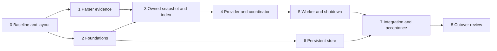

# Cache Migration Plan

How the current parser becomes the signed-off syntax-first cache service.
The specification is [CACHE_ARCHITECTURE.md](CACHE_ARCHITECTURE.md) with its companions [CACHE_CONTRACTS.md](CACHE_CONTRACTS.md), [CACHE_SYNTAX_REGISTRY.md](CACHE_SYNTAX_REGISTRY.md) and [CACHE_EXPERIMENTS.md](CACHE_EXPERIMENTS.md).
Decision labels (R1-R14), milestones, gates (C1-C5, P1-P5) and traces (T, V, X, S, A, W) are defined there.

Drafted 2026-11-04 after whole-specification sign-off (R9).
The user approved this plan and authorised implementation on 2026-11-04.
Approval authorises the phases below in order; it does not approve their results, which still pass through the milestone-6 verdict rules.

## 1. Starting Point

Re-audit of the current code on 2026-11-04.

| Area. | Current state. | Consequence for the migration. |
| --- | --- | --- |
| [module.jai](module.jai) | Parameters `ENABLE_TRIVIA` (default off), `EVALUATE_STRING_ESCAPES`, `INTERN_IDENTIFIERS`, `USE_SIMD`, `TRACK_AST_REUSE`; loads the lexer, parser and resolver. | The service imports the parser with `ENABLE_TRIVIA = true`; the full-featured profile rejects non-trivia builds.  Existing default-parameter users are unaffected. |
| [parser.jai](parser.jai) (about 6,800 lines) | Entry points `parse_file`, `parse_file_edit`, `parse_expression`, `parse_declaration`, `parse_block`, `parse_declaration_block`; `release_parser_tree`.  All nodes live in one `Pool` in `Parsed_Source`; source and filename are borrowed. | The service owns source bytes and the `Parsed_Source` together and releases both on the last lease.  Only `parse_file` is needed initially (whole-file reparse, R1). |
| Compound declarations | Two builders: identifier-led in `parse_declaration_node`, expression-led in `parse_statement`.  The expression-led path discards its operator token; neither records modifier nor separator token indices. | Phase 1 merges them and records every token (R12). |
| `#program_export` | Parsed as trailing declaration metadata, the opposite of the compiler, which only accepts it as a prefix. | Phase 1 parses the prefix form (R12, amended). |
| [resolution.jai](resolution.jai) | `resolve_lexical_references` writes `resolved_declaration` into identifier nodes; scopes and bindings are built during parsing. | The service parses with `resolve_identifiers = false` (E6): published snapshots are never mutated.  Resolution stays available to existing callers and is not part of the initial slice. |
| AST reuse (`parse_file_edit`, `reuse_simple_declaration`, copier) | About 900 production lines and 6,900 test lines. | Not used by the service.  The keep/drop decision stays independent (see [simplify.md](simplify.md) 1a); this plan neither removes nor depends on it. |
| Lexer | `Token`, trivia iteration, SIMD classifiers; `Parser_Token` adds byte offsets under trivia. | Reused as-is through the parser. |
| Tests | [parser_tokens_test.jai](examples/parser_tokens_test.jai) (about 151 procedures), [differential_test.jai](examples/differential_test.jai) with its runner and fixtures, [parse_how_to.jai](examples/parse_how_to.jai), [layout_test.jai](examples/layout_test.jai), [lex_all_files.jai](examples/lex_all_files.jai), [snapshot_oracle.jai](examples/snapshot_oracle.jai), [benchmark_ast_reuse.jai](examples/benchmark_ast_reuse.jai). | All must keep passing after every phase.  `snapshot_oracle.jai` (with its `DIRECTIVE_THIS` fix) is the starting C1 fresh-parse oracle. |
| SDK support | `Pool`, `Bucket_Array`, `Thread` (mutex, semaphore, condition variable), `Text_File_Handler`, `File`, `File_Utilities`; `meow_hash` (128-bit, x64 AES), `xxHash` (32/64-bit only) and `Hash` (FNV, djb2). | Phase 2 wraps `meow_hash` as the R14 content digest. |
| Persistence/service code | None in the module; E7-E13 prototypes live under [examples/](examples/) only. | Everything in phases 2-6 is new code.  Prototypes inform it but are not promoted. |

## 2. Boundaries

| Kept unchanged. | Changed. | New. | Not touched by this plan. |
| --- | --- | --- | --- |
| Lexer; all existing public parse entry points and their tests; resolver; default module parameters. | Compound-declaration builders and their node shape; `#program_export` placement; the registry text describing them. | Service code: canonical values, identities/handles, owned snapshots and projections, declaration-index adapter, provider, coordinator/worker, store, harness host, acceptance runner. | AST-copier keep/drop; semantic queries; evaluator; language server; POSIX store implementation. |

No existing public API breaks.
The only deliberate shape change is the compound-declaration node in phase 1, which is checked against the official compiler through the differential tests.

### Code Location

Service code lives in this repository under `service/`, whose `module.jai` imports the parser with `ENABLE_TRIVIA = true`.
Clients use `#import "Jai_Parser/service"`; a phase-0 compile check confirmed that this nested-module import (and `#import,dir`) resolves and yields a trivia-enabled parser alongside the default-parameter instance.

### Working Rules

- Every phase ends buildable, with all existing tests and the new phase tests passing on the fast x64 backend, and the optimised LLVM build compiling.
- Every new test has an independent oracle and a deliberately broken negative control, per the milestone-6 verdict rules.
- Each phase updates the specification documents only where the code proves them wrong; such changes are listed in the phase's review.
- Commit per phase step; no step mixes a parser shape change with service code.

## 3. Phases

Phases 1 and 2 are independent of each other; phase 6 can proceed alongside phases 4-5 once phase 2 is done.

### Phase 0: Baseline and Layout

1. Run every existing test and record its command, backend and result as the baseline.
2. Settle the service code location with a minimal compiling entry file that imports the parser with trivia enabled.
3. Add the acceptance-case record format and verdict tally (milestone 6) as a small harness library, plus an empty runner that reports `NOT_RUN` for every listed case.

Exit: baseline recorded; empty service entry and runner compile and run.

#### Baseline (2026-11-04)

Jai beta 0.2.030 (2 July 2026), fast x64 backend, run from `examples/`.

| Suite. | Command. | Result. |
| --- | --- | --- |
| Lexer layout. | `jai layout_test.jai -x64 -quiet && ./layout_test.exe` | Pass; SIMD widths 16/32 parity, width 64 skipped (no CPU support). |
| Lexer corpus. | `jai lex_all_files.jai -x64 -quiet && ./lex_all_files.exe` | Pass; 2,239,352 tokens across 712 files. |
| Parser tokens. | `jai parser_tokens_test.jai -x64 -quiet && ./parser_tokens_test.exe` | Pass. |
| How-to corpus. | `jai parse_how_to.jai -x64 -quiet && ./parse_how_to.exe` | Pass; 84/84 files with zero diagnostics. |
| Differential. | `jai differential_runner.jai -x64 -quiet && ./differential_runner.exe --all` | Pass; 4,175/4,175 fixtures, 252 jobs, about 310 s. |
| AST reuse verification. | `jai benchmark_ast_reuse.jai -x64 -quiet -exe verify_ast_reuse - verify-only && ./verify_ast_reuse.exe ../../../examples/invaders` | Pass; deep snapshot/lifetime checks. |
| Acceptance ledger. | `jai cache_acceptance.jai -x64 -quiet && ./cache_acceptance.exe --self-test && ./cache_acceptance.exe` | Pass; 55 cases (47 `NOT_RUN`, 8 `DEFERRED`). |
| Service foundations (phase 2). | `jai service_foundations_test.jai -x64 -quiet && ./service_foundations_test.exe` | Pass on x64 and LLVM. |
| Service snapshot (phase 3). | `jai service_snapshot_test.jai -x64 -quiet && ./service_snapshot_test.exe` | Pass on x64 and LLVM. |
| Service context registry (phase 3). | `jai service_context_test.jai -x64 -quiet && ./service_context_test.exe` | Pass on x64 and LLVM. |
| Service provider model (phase 4). | `jai service_provider_test.jai -x64 -quiet && ./service_provider_test.exe` | Pass on x64 and LLVM. |
| Service coordinator (phase 4). | `jai service_coordinator_test.jai -x64 -quiet && ./service_coordinator_test.exe` | Pass on x64 and LLVM. |
| Service harness host (phase 4). | `jai service_host_test.jai -x64 -quiet && ./service_host_test.exe` | Pass on x64 and LLVM. |
| Service traces T1-T8, V1-V8 (phase 4). | `jai service_traces_test.jai -x64 -quiet && ./service_traces_test.exe` | Pass on x64 and LLVM. |
| Service worker interleavings (phase 5, partial qualification). | `jai service_worker_test.jai -x64 -quiet && ./service_worker_test.exe` | Pass on x64 and optimised LLVM; attained barriers and independent session-allocation ledger.  Remaining qualification is listed below. |
| Service traces on the real worker (phase 5). | `jai service_traces_test.jai -x64 -quiet - real-worker && ./service_traces_test.exe` | T1-T8 and V1-V8 pass on x64 and optimised LLVM, retaining the authored and fresh-parse oracles. |
| Service cross-target type-check. | `jai service_cross_check.jai -quiet` | `LINUX -> NONE`; macOS stops in the SDK's `Objective_C` module. |
| Recovery owner sweep (phase 3). | `jai recovery_owner_sweep.jai -x64 -quiet && ./recovery_owner_sweep.exe` | Pass; no unpublished owners across single-token mutations of W2. |

Three pre-existing failures were repaired first:

- `differential_test.jai` called `free` on a `[] string`; now `array_free`.
- `lex_all_files.jai`'s default corpus walk followed a dangling E4 symlink under `examples/.build`; it now passes `visit_symlinks = false`, like its benchmark walk.
- Commit `7a52037` had turned named context-modification fixtures (`,, allocator = x`) into the unnamed shorthand (`,, x`), which the compiler keeps as a plain identifier rather than an assignment.
The named-slot tests now use `logger_data = ...` so named, and unnamed slots are both covered.

### Phase 1: Parser Evidence (R12)

1. **Unified compound builder.**
One shared tail parses comma-separated targets (expressions, with an optional per-target `:` or `=` before a following comma), then the shared operator (`:`, `=` or an assignment-precedence operator).
Both entry points call it.
Record on the compound node the shared operator token index, each target's modifier token index (or none), and each separating comma's token index.
Binding classification becomes a function of recorded tokens: declared when the target carries `:`, or carries no modifier under a shared `:`; otherwise assigned.
Declared targets must be identifiers; anything else is diagnosed.
2. Keep scope-binding registration, notes, metadata and the existing node fields working; update `reuse_simple_declaration`'s compound guard for the new shape.
3. **`#program_export` prefix.**
The compiler, its `Program_Print` module and every corpus use put `#program_export ["name"]` before the declaration, in declaration and imperative contexts; parse that form only and stop accepting it as trailing metadata.
4. Rewrite the registry's compound-route and program-export sections.

Tests: new parser tests covering `a, b := v`, `a, b = v`, `a:, b = v`, `a=, b := v`, `x.y, z[0] = v`, `a, b += v`, missing separator/RHS, non-identifier declared targets; differential fixtures for the same against the compiler; prefix `#program_export` positive fixtures and the rejected trailing form; all existing suites.
If unification breaks compiler agreement in a way that cannot be fixed cleanly, fall back to recording a route field in both builders (R12 fallback) and record the reason.

Exit: all suites pass; registry text matches the code.

### Phase 2: Foundations

1. **Canonical values.**
The milestone-2 `K`/`V` encodings, `SchemaName`/namespace/ID byte types, and canonical ordering helpers.
2. **Content digest (R14).**
One `digest_128` wrapper over `meow_hash`, with its algorithm identifier, streaming and one-shot forms, and fixed expected outputs (including the module's published `big.txt` value) plus a mutated-input negative control.
3. **Identity allocation.**
Service incarnation, per-session counters, exhaustion behaviour (milestone 3), and the generation-checked handle registry (slots, generations, retirement).
4. **Epoch issuer (R10).**
`.jaiParserEpoch` reservation: exclusive lock, increment, atomic replace, flush, head-epoch floor; `UNAVAILABLE` on any failure.
5. **Limits and reservation ledger.**
`LimitRequest` negotiation to effective `Limits`, checked arithmetic, live-plus-reserved accounting, documented implementation ceilings (milestone 2 and 4).

Tests: encoding round-trips and fixed expected bytes; digest expected outputs; allocator/generation stale-handle rejection; issuer ledger across repeated and concurrent process starts, deleted file with surviving head, injected I/O failure; ledger edge cases at exact and one-over limits.

Exit: foundations library passes its tests with negative controls.

### Phase 3: Owned Snapshot and Declaration Index

1. **Owned parse.**
Copy source and filename into a snapshot owner, parse with trivia and `resolve_identifiers = false`, and tie release of the pool, tokens, diagnostics and bytes to the owner.
2. **Snapshot projection.**
`.SYNTAX_SNAPSHOT` envelope: tokens and trivia, node records with snapshot-local IDs per the milestone-1 registry field roles, recovery/synthetic tokens, completeness; `.OPAQUE`-free or conversion failure.
3. **Diagnostics projection.**
`.SYNTAX_DIAGNOSTICS` with origins and the summary record.
4. **Declaration index adapter.**
Authored-edge traversal registry, entries and shared regions, name origins, metadata (`#program_export`), scope-basis provenance, coverage reasons; capability descriptor (`jai-cache-syntax-adapter/1`).
5. **Context registry.**
Schema tuples, parse profile, adapter binding; admission of the implemented tuple only.

Tests (C1 and the milestone-2 qualification checklist): every W1 authored vector and the W2 inventories compare projection against an independent fresh parse via `snapshot_oracle.jai`; producer teardown and poisoning before comparison; registry-route vectors from the syntax registry's discriminating cases; coverage-reason and partial-index vectors.

Exit: C1 passes on W1 and W2; every registry route has a vector or an explicit unsupported/partial disposition.

### Phase 4: Provider and Coordinator (Deterministic)

1. **Source provider.**
Milestone-2 provider admission and the source-capture contract: in-memory and disk providers for the harness host, exact-base byte edit batches, overlay/disk branches, save/reset/delete/rename events, frontiers.
2. **Session and coordinator state.**
The fifteen operations over a session state gate, with tickets, analysis candidates, worlds, queries, waiters, completion entries and reservations.
Task execution goes through an internal executor interface; this phase supplies a deterministic step executor for tests only.
3. **Harness host.**
Implements host confirmation, project-root declaration, the epoch binding and completion draining.

Tests: T1-T8 and V1-V8 with authored event ledgers; operation/error-arm subcases from the milestone-6 API boundary list; unsupported semantic/evaluator queries create no task.

Exit: T and V traces pass under the deterministic executor.

### Phase 5: Worker, Cancellation and Shutdown

1. Replace the test executor with the service-owned compute worker and the reserved shutdown/reaper job (milestone 4), using `Thread` primitives; the deterministic executor remains as a test seam.
2. Condition-variable `Wait`, required/optional FIFOs, cooperative stop points, world supersession, last-consumer removal, mailbox-validated publication, `STOPPED` predicates and surviving-owner lifetime.

Tests: X1-X8 with barriers at each gate/registration/publication/free boundary, both orderings, duplicate and late completions, allocator and provider failures; T1-T8 rerun on the real worker; zero live owned allocations after final release.

Exit: X traces pass with attained barriers; C3 and C5 evidence recorded.

### Phase 6: Persistent Store

1. **Wire codec.**
Strict envelope preflight, typed body grammar, `Text_File_Handler` over a bounded buffer, iterative bounded decoder, canonical encoder.
2. **Records and policy.**
The seven record kinds, `StorePolicy` resolution to `.jaiParserCache`, effective `StoreLimits`.
3. **Native binding.**
`jai-cache-store-local/1` Windows implementation (R11): containment checks, owner lock, create-new staging, no-replace install, head replacement.
4. **Commit, read and recovery.**
Ordered source projection, commit/reconciliation, read pins, recovery offers, GC, maintenance actions and quarantine.
5. **Service wiring.**
Store lane, degradation status and diagnostics; persistence never blocks source acceptance.

Tests: S1-S8 with independently encoded files and root inventories, interruption at every staged/installed/head boundary, corrupt-but-rehashed records, write denial, a second-process owner contender; C4 evidence.

Exit: S traces pass; store failure never breaks source operations.

### Phase 7: Integration and Acceptance

1. Expand the milestone-6 coverage ledger to every supported registry route, operation/error arm, event variant, bound edge and fault boundary.
2. Run A1-A15 over W1-W6, with W3 manifests frozen per R13.
3. Run P1-P5 in two local rounds and assemble the measured results packet for review under R7.

Exit: no `FAIL`, `BLOCKED` or `NOT_RUN` applicable correctness case; no unexplained live ownership; results packet delivered.

### Phase 8: Cutover Review

1. Review the results packet and decide whether the service is the supported entry point for the harness (and later the language server).
2. Update [README.md](README.md) and the specification documents to describe the implemented state; mark qualified items in section 15 of the architecture.
3. Separately, revisit the AST-copier decision with its own measurements; any removal is a later plan.

Exit: user decision recorded.

## 4. Persistence Rollout and Version Rejection

- The store starts at `jai-cache-store/1`; there is no earlier production store to migrate.
- E11/E12 experiment stores are never read: their namespaces and schemas reject.
- An unknown or newer schema is a cache miss with a diagnostic, never an upgrade or overwrite; repair stays explicit (milestone 5).
- Enabling persistence by default (R2) takes effect only from phase 7 onwards; earlier phases test the store in isolated roots.

## 5. Risks and Contingencies

| Risk. | Contingency. |
| --- | --- |
| Compound unification changes compiler agreement or reuse behaviour. | R12 fallback (route field), recorded as an amendment. |
| A registry route cannot be projected exactly. | Partial coverage with its reason, per the registry's limits table; never a silent gap. |
| Threading primitives lack a needed guarantee (for example timed condition waits). | Adjust the executor implementation, keeping the deterministic seam and the X traces unchanged. |
| Native file primitives behave differently from documented assumptions. | Degrade persistence explicitly (R8); source operations continue. |
| Performance deltas are unfavourable. | Report them under R7; the cutover review decides, not this plan. |

## 6. Progress

- [x] Plan approved and implementation authorised (2026-11-04).
- [x] Phase 0: baseline and layout.
	- [x] Record the baseline test results.
	- [x] Settle the service code location.
	- [x] Add the acceptance record format and empty runner ([cache_acceptance.jai](examples/cache_acceptance.jai), with `--self-test`).
- [x] Phase 1: parser evidence.
	- [x] Unify the compound-declaration builders and record operator, modifier and separator tokens.
		- [x] One builder for both routes; `operator_type` now recorded for `+=`-style compounds, checked against the compiler by the differential normaliser.
		- [x] Undeclarable (non-identifier) declared targets diagnosed, matching the compiler's rejection.
		- [x] Parser tests with a negative control; syntax differential section passes with a negative control.
	- [x] Parse `#program_export ["name"]` as a declaration prefix (declaration and imperative contexts); trailing form now diagnosed; parser tests and differential fixtures with a negative control.
	- [x] Update the registry text (compound token evidence and program-export prefix).
	- [x] Run the full baseline suite set (2026-11-05): all suites pass; differential 4,181/4,181 fixtures in 252 jobs; lexer corpus 2,257,532 tokens across 738 files.
- [x] Phase 2: foundations ([service/](service/), tested by [service_foundations_test.jai](examples/service_foundations_test.jai) on x64 and LLVM).
	- [x] Canonical values: `B`/`K`/`V` encoders checked against handwritten byte layouts, canonical order, and a bounded `parse_key` that rejects every truncation, trailing bytes, bad magic/version and oversized field counts.
	- [x] Content digest: `meow_hash` one-shot and streaming forms agree across sizes 0-100,000 and chunkings; single-bit flips change the digest; pinned values for empty and `"abc"` input (regression pins, not published vectors).
	- [x] Identity allocation and handle registry: K-based incarnation/session/world/result/operation identities, counters retiring at `U64_MAX`, slot registry rejecting stale generations, wrong kinds, foreign sessions and double release, and retiring exhausted slots.
	- [x] Epoch issuer: sequential and floored reservations, deleted file restarting above the floor, authority mismatch, eight malformed files, exhaustion, and 4 concurrent processes * 25 reservations yielding unique contiguous epochs.
	Negative control: a shareable lock makes the concurrency check fail.
	With `TEST_HOOKS`, injected failures at the read, staging-write and replace steps each return `IO_ERROR`, leave the epoch file byte-identical and release the lock; a held lock blocks reservation, and the hooks' `shared_lock` switch lets the same holder through (automated negative control).
	The Linux cross-check type-checks the POSIX hook paths.
	- [x] Limits and reservation ledger: `-1`/zero/clamped/below-minimum/invalid negotiation; all-or-nothing reservation at exactly the limit, one over, and with overflowing amounts.
- [_] Qualify the POSIX epoch issuer (`flock` lock, `fsync`/`F_FULLFSYNC` staging, `rename`, directory flush); deferred until Linux and macOS test environments exist.
	- [x] Type-check the service and foundations test for a Linux x64 target from Windows (`os_target = .LINUX`, no output); negative control: an undeclared call in the POSIX branch fails the check.
	- [_] Run `service_foundations_test.jai` on Linux x64, including the concurrent-process epoch check.
	- [_] Type-check and run on macOS; the Windows cross-check stops in the SDK's `Objective_C` module (`#import "macOS"` filename case) before reaching service code.
- [x] Phase 3: owned snapshot and declaration index.
	- [x] Owned parse ([snapshot.jai](service/snapshot.jai)): source and filename copied into an owner whose pool backs every parse allocation; `resolve_identifiers = false`.
	[service_snapshot_test.jai](examples/service_snapshot_test.jai) poisons and frees the input, releases a sibling owner, then compares with an independent fresh parse through `snapshot_oracle.jai` on 16 W1 seeds and all 86 W2 files (56 tutorials, 8 Invaders, 4 parser, 18 Basic).
	Negative control: an owner that borrows its input fails the comparison.
	- [x] Snapshot projection.
		- [x] Source tokens, synthetic tokens, recovery records, raw diagnostics and parse status ([projection.jai](service/projection.jai)): closed 77-name token-tag registry, checked source slices, value arms per producer route; compared field by field with a fresh parse, plus reconstruction and authored value vectors.
		Negative controls: unknown flag bit, unregistered token value, shifted and widened source slices each fail conversion; altered records fail the comparator.
		- [x] Node and helper field projection from the milestone-1 per-layout registry tables (`jai-cache-authored-nodes/1`, [nodes.jai](service/nodes.jai)).
			- [x] Projector: preorder node and helper IDs, owning-edge sharing rejection, closed source-flag domains, producer enum names, canonical path ordering, checked token-span origins; unregistered kinds fail conversion.
			- [x] Batch 1 layouts: `.DIRECTIVE_THIS`, `Context`, `Ident`, `Note`, `Placeholder` (name qualified against its identifier token), `Unary_Operator`, `Binary_Operator`, `Cast` (prefix/postfix/auto order), `Expression_Query`, `Type_Query`, `Procedure_Call` with argument/context helpers, `Block`, `Declaration`, `Compound_Declaration` (with R12 token evidence), `Comma_Separated_Arguments` with its argument helper, `Literal` (number/boolean/string/uninitialised, struct/array helpers, qualified source `null`) and `Type_Instantiation` (source form from flags and leading token).
			Authored vectors check exact IDs, kinds, references and scalars; invariants check every successful projection; negative controls cover unknown flags, shared children, unknown operators, populated inactive fields, a forged placeholder name and an unregistered kind, plus the invariant checker itself.
			- [x] Batch 2 layouts: `Procedure_Header` (parameter `using` visited before its argument, with its expression an alias to exactly one argument in argument order), `Procedure_Body`, `Return`, `Struct`, `Enum`, `Using`, `If`, `Case`, `While`, `For` (dynamic prefixes in token order), `Loop_Control`, `Defer` and `Push_Context` (no body on the `.DEFER_POP` route); unpopulated note lists must stay empty.
			Authored vectors cover a switch with fallthrough and default cases, a for loop with flags and explicit names, quick lambdas, struct parameters/union/enum flags, ifx and push context; negative controls cover unmatched and reordered parameter usings, populated aggregate notes and a `.DEFER_POP` body.
			Removing the using-before-argument order fails the vectors.
			All 16 W1 seeds now project.
			- [x] Batch 3 layouts: all 20 directives.
			Import parameter calls record their callee as an alias to the owning import; arrow `#run` owns its source header and its `expression` may only alias that header's body block; `#insert` orders replacement clauses by source position before its payload; `#code,null`/`#caller_code` and `#caller_location` carry no payload; generated `#insert` expansions fail conversion.
			Type-wrapper form selection now prefers populated fields and skips opening parentheses (W2 exposed `([3] float).[...]`).
			Authored vectors cover import/load/library/scope, arrow run, caller location, null and ordinary code, and the parenthesised array type; negative controls cover a foreign import callee, a foreign run expression and a payload on `#code,null`.
			W2: 80 of 86 files project; the other 6 contain `#asm`.
			- [x] Batch 4: `#asm` and its ten helper records.
			Statement, operand, size and modifier kinds select their arm; every unselected arm must be empty; embedded value slots are distinct helper occurrences, and unused optional memory components are inactive.
			Vectors cover all four statement kinds, a memory operand, fixed and polymorphic sizes, and ampersand/bang modifiers; negative controls cover a populated second arm, an unknown statement kind and an argument on a bang modifier.
			The unregistered-kind control now injects the compiler-only `.EXTRACT` kind.
			- [x] Run W2 node projection to completion: all 86 W2 files and all 16 W1 seeds project, and the test now treats any conversion failure as an error.
		- Operator fields use the producer's `Operator_Type` names directly under a new `.OPERATOR` field-value arm (2026-11-05), documented in the contract and registry; the two AST-only names left the token-tag registry.
		Declared names take precedence over the byte range, since `IS_EQUAL` and the other named values lie in 131-169; a named-operator vector covers this.
		- [x] Envelope assembly (`jai-cache-syntax-snapshot/1`, `project_snapshot` in [snapshot.jai](service/snapshot.jai)): one exact capture of source, root, nodes, helpers, tokens, synthetic tokens, recoveries, raw diagnostics and status, or no envelope if any part fails.
		A rootless parse keeps its tokens with root -1; an injected node failure fails the whole envelope.
		All W1 and W2 checks now go through the envelope.
	- [x] Diagnostics projection (`jai-cache-syntax-diagnostics/1`, [diagnostics.jai](service/diagnostics.jai)): records in emission order with code, severity, UTF-8-checked message, related records and the raw parser observation.
	Primary origins: inserted missing tokens anchor zero-width at their one correlated synthetic token's insertion point; other diagnostics map their token span (empty spans are zero-width anchors); missing or ambiguous correlation is unlocated; out-of-range recovery references fail conversion.
	An independent origin oracle reads the fresh parse's tokens, recoveries and synthetic tokens for all W1 seeds and W2 files (289 diagnostics); vectors cover an end-of-input insertion, a zero-width expected expression and a lexer error; controls cover invalid UTF-8, an out-of-range synthetic reference and an ambiguous correlation.
	Collapsing source spans makes the oracle fail.
	- [x] Declaration index adapter (`jai-cache-syntax-declaration-index/1`, [index.jai](service/index.jai)) over the snapshot envelope, with capability descriptor `jai-cache-syntax-adapter/1`; methods and dispositions are recorded in the registry's "Implemented Adapter Binding".
	Entries follow snapshot preorder, with each compound's binding group emitted on encounter; containers, shared regions, names (spelled, operator, backticked, anonymous slots), enum members along enum and static-if branch routes, `#program_export` occurrences and same-list scope provenance.
	Compound tokens that disagree with the token stream and doubly owned nodes fail conversion; uncorrelated names and metadata, and enum statements without member evidence, become explicit partial reasons.
	Recovery attribution uses parser-captured owners: each recovery record now carries its cursor, its owner (claimed in `finish_node` by the smallest published node around it, or by the statement for its terminator) and a discarded flag set by `parser_restore`; discarded parameter and return nodes return their events with `release_recoveries`.
	Entries on an event's ownership path are `.RECOVERED`, and compound target events skip the bindings; on W1 and W2 every kept event (291) has a published owner and no index is partial.
	Recovery vectors cover a recovered body declaration with a parsed sibling, a missing terminator, shared-payload versus target events and a discarded parameter; controls cover an unpublished owner and an event moved onto a declaration's first token.
	Removing the parameter release fails its vector.
	A mutation sweep over W2 (11,620 single-token deletions, duplications and truncations) found the remaining discard sites (`inline`/`no_inline`, `#bake`, `#procedure_of_call`, prefix casts, assembly values) and three crashes, all fixed with vectors: a `.` or backtick at end of input narrowed EOF to `u8` in the lexer, `add_unexpected_token` ate the end-of-input token, and an assembly value whose expression stopped short of its operand tripped an assert.
	After the fixes the sweep finds no unpublished owner.
	Vectors cover nested containers and directives, zero/one/two-binding and nested compound regions, operator and backticked names, identifier continuations, enum members versus a condition identifier, quick lambdas, using parameters, prefixes, export forms and recovery; invariants recompute owners, containers, provenance, binding counts and recovery statuses on all W1 and W2 files (8,297 entries).
	Negative controls: mismatched modifier and operator tokens, a doubly owned node, a forged producer name, a dropped export flag and a missing member `;`; the invariant checker rejects forged containers, scope tags and region memberships; disabling shared-region containers fails the vectors.
	- [x] Context registry ([context.jai](service/context.jai), tested by [service_context_test.jai](examples/service_context_test.jai) on x64 and LLVM): the implemented `SchemaTuple` and `ConfigurationID`, `PathValue` encodings, the ten-field `jai-cache-syntax-context/1` descriptor, `ContextID` and admission with recomputed identity.
	The producer binds compile-time digests of the parser, lexer and adapter sources, the compiler version and layouts, and the adapter descriptor; profiles and their policy identifiers are recorded in the contracts.
	Controls: each module parameter flipped, a non-boolean byte, forged parser build and adapter descriptor, changed schema/profile/language, resolver and semantic arms, invalid paths, renamed/reordered/missing/extra fields, trailing bytes, wrong tag and a forged identity; alias, base and encoding variants admit with distinct identities.
	Disabling the parameter check fails the controls.
	The cross-target type-check needs `#run,host` for the source digests.
	- [x] C1 on W1 and W2 (2026-11-06): every W1 seed and all 86 W2 files compare an owned, poisoned-input parse with an independent fresh parse, then check token, node, diagnostics and index projections; registry routes are tallied across every checked projection, and the test fails on a registered kind, helper, enum name or source flag that has neither a vector nor a recorded disposition (registry "C1 Route Coverage").
	New route and flag vectors cover the rare directives, import forms, using filters, `---`, unparsed and pinned assembly arms, modifier flags and a populated backreference; the remaining unobserved names are compiler-only or never set by a builder.
	Negative control: dropping the eight-digit literal vector fails the flag check.
- [x] Phase 4: provider and coordinator.
	- [x] Source provider.
		- [x] Provider model ([provider.jai](service/provider.jai), tested by [service_provider_test.jai](examples/service_provider_test.jai) on x64 and LLVM): descriptor admission for distinct keys and copy-only sources, `DocumentID`/`SourceRevision`/`ProviderRevision`/`ProviderFrontier` recipes, and atomic source batches over separate overlay and disk branches.
		Each batch is staged against private copies and commits every member plus one new frontier, or nothing; the model owns copies of accepted bytes and metadata, and source backings are reference-counted, so a retained capture keeps its bytes (V7).
		Vectors cover an in-order edit chain, a save acknowledgement for an older installation preserving the newer overlay (T3), reset and restore with host confirmations (T4), an invalid member rejecting a valid one (V5), caller buffers reused after acceptance and an absent disk observation.
		Controls: stale frontier, document and source bases; out-of-range edits; reused revisions; duplicate documents and registrations; forged context identity; unregistered and unreferenced contexts; missing, changed, wrong-policy and wrong-platform bindings; foreign document keys and revisions; foreign or mismatched confirmations; a save of different bytes; `RENAME`; provider leases; coherent capture without the capability; a false disk revision claim; missing provenance; and source-byte and batch-event limits.
		Clearing the overlay on any save acknowledgement fails the T3 vector.
		- [x] In-memory and disk providers for the harness host (overlays from host text, disk observations read from the project root).
	- [x] Session and coordinator with the deterministic executor.
		- [x] Coordinator core ([coordinator.jai](service/coordinator.jai), tested by [service_coordinator_test.jai](examples/service_coordinator_test.jai) on x64 and LLVM): all fifteen operations plus `ReadWorld`/`ReadResult`/`ReadSource`, update tickets and waiters, capture-keyed candidate worlds with joins, the head target, query tasks, completion entries in commit order, ledger charges for handles, pending registrations, completion records and in-flight operations, and the reserved first shutdown.
		A candidate's parse task builds each present member's snapshot, declaration index and diagnostic summary before publication; snapshot and index queries answer at once, and diagnostics queries share one task per world and document.
		The deterministic executor dispatches the required FIFO head into a single-use mailbox and delivers it separately, so tests choose the interleaving; `wait` drives it and advances a session clock.
		The test controls (`session_of`, `executor_dispatch`, `executor_deliver`, `executor_run`) compile only with the service module parameter `TEST_HOOKS = true`; a default import exposes neither the executor nor session internals.
		Vectors: T1 (edit, await, query, old results unchanged), T6 (shared waiters, caller cancel, duplicate completion rejected), T7 (supersession of pending updates and query waiters, discarded late result, no reissue), analysis joins and request errors, open-session admission errors, and shutdown at full handle capacity with a producer outliving its deadline; every test ends with the ledger back to the `.SESSION` charge.
		Negative controls run on every test pass through `TEST_HOOKS` fault switches: either the stop request or the publication frontier check alone keeps a late obsolete result out, and dropping both publishes it; keeping unconsumed work leaves the queue non-empty; taking the first shutdown slot from ordinary capacity fails at full capacity.
		- [x] `ResolveNode`/`ResolveToken`/`ResolveRecovery` (`resolve_node`, `resolve_token`, `resolve_recovery`) borrow from any result's own syntax backing with range checks; observations, accepted frontiers and session descriptions are caller-owned copies (`free_observation`, or `,, temp`), and waiters own their stored terminal copies.
		Vectors: an index result resolves its declaration node and a token with no snapshot query held; out-of-range references reject; mutating a returned observation or description leaves the next one unchanged.
		Handles still carry the session identity bytes, which the service keeps for its lifetime.
		Store policy admission (`SessionOptions.store_policy`) moved to phase 6 service wiring; sessions report `.DISABLED` until then.
	- [x] Harness host ([host.jai](service/host.jai), tested by [service_host_test.jai](examples/service_host_test.jai) on x64 and LLVM through the default import, with `wait` driving all work).
	One project root per host: the service incarnation binds an epoch reserved in that root, documents are keyed by contained root-relative paths, and the host issues provider revisions, observation tokens and action-bound confirmations.
	A batch builder reads its bases from one `DescribeSession` snapshot and supplies set/edit overlay, disk observation, save acknowledgement, reset and restore events with their contexts and first bindings; a disk read failure on an existing path is never reported as absence.
	Serial completion dispatch drains in bounded batches, returns at once from a nested call and counts handler failures without redelivering.
	Vectors: fresh epochs and session identities per host, rejected escaping paths, an external disk change under an overlay (old world unchanged), saves of matching and different bytes, reset then confirmed restore, deletion to confirmed absence with an unavailable snapshot query, an unreadable path, and nested dispatch.
	- [x] T1-T8 and V1-V8 ([service_traces_test.jai](examples/service_traces_test.jai), on x64 and LLVM): each trace runs through the harness host with authored expected selections, frontiers and outcomes, and every published syntax result is compared with an independent fresh parse of the authored bytes through `snapshot_oracle.jai`; each ends with the ledger back to the session charge and the session destroyed on release.
	T1 edit and query with a leased old result; T2 stale source base and invalid range rejected atomically, then a full replacement; T3 a late save of B after a byte-identical newer overlay C; T4 reset, restart with a fresh epoch, then a separately confirmed restore; T5 a leased index result outliving its world and ticket, and a stale handle rejected after its slot is reused; T6 one task shared by two waiters with a caller cancel and a rejected duplicate completion; T7 supersession of a pending update, its waiters and running query work with no late publication or reissue; T8 unsupported semantic and evaluation queries creating no work.
	V1 a captured overlay world unchanged through disk events, a save and a reset; V2 not-captured versus confirmed-absent members; V3 later documents not attached to an older world and analysis bound to the current frontier; V4 bytes captured before a concurrent write, labelled immutable rather than coherent; V5 a stale member and an unsupported rename each rejecting the whole batch; V6 an injected member failure (`TEST_HOOKS` `fail_parse_document`) failing the milestone with no mixed head and the accepted source kept, then a retry by `RequestAnalysis`; V7 caller buffers poisoned and freed after acceptance; V8 an unreadable path, shutdown waiting for a running producer, a rejected repeated completion and no source writes.
	Supporting changes: a query for a document the world never captured is now `.UNAVAILABLE`/`.NOT_CAPTURED` instead of an argument error; worlds record their capture consistency (coherent only under one attested capture token across disk observations); `ResultDescription` exposes its backing snapshot; `ack_save` can name the installation it saved.
	Outside phase 4: T5 eviction and rehydration and T8 store denial need the phase-6 store; one parse task covers all of a candidate's members, so V6's out-of-order member completion has no separate interleaving; and no compiler process exists to monitor.
- [ ] Phase 5: worker, cancellation and shutdown.
	- [x] Compute worker and independently progressing reaper ([service/worker.jai](service/worker.jai)); default imports progress without host polling/draining.
	The compute thread is joined outside the session gate before shutdown becomes terminal.
	Execution-backend decision: retain dedicated compute/reaper threads for phase 5 rather than adopting the SDK `Thread_Group`.
	Its per-worker queues and optional work stealing may help future parallel document parsing, but do not replace coordinator admission, required/optional scheduling, cancellation, publication validation or ownership.
	Per-submission `Work_Entry` allocation has no fallible admission result, control-side submission needs serialisation, and group shutdown joins workers without completing queued work or releasing service payloads.
	Reconsider it behind the coordinator when parallel parsing is introduced; keep reaper progress independent of compute-pool capacity.
	- [x] Condition-variable `wait`, integer monotonic deadlines, pinned owner-directory lookup and stable inline handle routing.
	Retirement wakes sleeping calls; generation and session binding are revalidated after waking.
	- [x] Source staging outside the gate overprotected provider copies; bounded `CONCURRENT_ACQUISITIONS` admission and frontier/lifecycle revalidation before commit.
	Shutdown waits for admitted staging and cleanup to unwind.
	- [x] Required/optional FIFO selection and promotion, cooperative checks between documents/parser/conversion phases, mailbox validation, supersession and unconsumed-output discard.
	Optional test work is injected; real store/maintenance chunks remain phase 6.
	- [x] Preallocated first-shutdown control and reserved handles; undrained completions and surviving payload handles do not prevent `STOPPED`.
	- [x] Separate caller outputs and session-owned allocation backing ([service/ownership.jai](service/ownership.jai)); recursive payload/source cleanup runs outside the gate with cleanup pins.
	Final owner release reclaims the tracked heap, and session-private head/source references detach on session release.
	- [x] Keep deterministic execution as a compile-time seam: `TEST_HOOKS = true`; use `REAL_WORKER = true` with hooks to test native execution.
	Barriers, fault controls and aggregate test allocation counters are absent from normal imports.
	- [ ] Complete X1-X8 qualification ([examples/service_worker_test.jai](examples/service_worker_test.jai)).
		- [x] X1: completion before registration, during wait arming and after arming; exact authored source result and retirement revalidation.
		- [x] X2: shared current-world caller cancellation versus completion in both winning orders; independent survivor and exactly two completion records.
		Real-worker T7 also checks obsolete-world cancellation and late delivery.
		- [x] X3: release while waiting, immediate slot reuse, stale generation waking with `INVALID_HANDLE`, and stale lookup after final owner removal.
		- [x] X4: host dispatch re-enters query, retain/release, cancellation and shutdown; nested dispatch defers, a handler failure is not redelivered, and its independently retained payload stays readable.
		- [x] X5: delayed/zero-sized drain, exact handle capacity, reserved shutdown and an automated removed-reservation negative control.
		- [x] X6: required background FIFO under later joined demand, optional fallback/promotion and an automated optional-first negative control; held provider admission does not block unrelated diagnostics compute.
		- [x] X7/X8: quiescing rejects a held source commit, repeated shutdown identity is stable, held parser/publication/cleanup boundaries keep shutdown pending past its deadline, and reaper completion requires no host polling.
		Retained results remain exact after session release.
		- [x] Independent allocator spy reconciles allocation/free addresses and bytes, detects double/wrong-owner release, and reaches zero session-owned allocations after each final release.
		Caller-owned service/host scaffolding and descriptive outputs are outside this ledger; heap sweeping at final destruction does not qualify steady-state byte bounds.
		- [x] Caller-output allocation failures for `drain_completions`, `poll` and `wait`: fail each allocation ordinal through the first successful copy; partial copies reach zero in an independent caller ledger, failures preserve terminal observations and completion charges, and a successful drain preserves authored waiter order.
		- [x] Caller-output interleavings for those three operations: direct reentrant and synchronously blocking allocators permit waiter retirement and immediate slot reuse; a competing drain emits each record once, and stopped-session retirement during drain frees staged outputs and returns `INVALID_HANDLE`.
		Test-only `consume_failed_drain` and `allow_stale_drain_output` controls demonstrate detection of premature consumption and stale-generation delivery.
		- [ ] Add every remaining gate/registration/publication/free ordering and each trace's own discriminating negative control, including owner/execution-backing admission failures.
		Primary trace coverage above is not full milestone-4 qualification; the completed caller-copy export audit does not qualify internal owner allocation.
			- [x] X3 shared-directory lifetime: allocate `service.sessions` through service backing rather than the first session's heap; detach and reset the empty array under the directory gate, then free its storage outside that gate.
			The independent allocation ledger first rejected the original session-owned backing.
			Tests grow the directory, retire the original session before or after its peers, describe surviving sessions, reject the retired handle and repeatedly reopen after final release, with zero retained owned allocations.
			- [x] X3 directory free boundary: directly reentrant and synchronously blocking service-allocator callbacks reopen a session after the old array is detached but before its storage is freed.
			The replacement uses independent backing and remains observable and releasable.
			Test-only `session_owned_directory` restores the wrong owner; the ownership oracle and each free-boundary probe detect it rather than reporting qualification, and control cleanup reaches zero allocations.
			- [x] Make shared-directory growth recoverably fallible and move backing allocation outside the directory gate; qualify allocation failure and concurrent open/retirement admission.
				- [x] `admit_directory` allocates checked candidate backing outside the directory gate, rechecks live capacity under the gate, copies only the current entries, and frees replaced or unused backing outside the gate.
				- [x] Fail the actual backing allocation for empty and full directories; reject with `ADMISSION_DENIED`/`RESOURCE_EXHAUSTED`, join private workers and free the staged description without publishing a handle.
				Existing sessions remain usable, issued identities are not reused, and independent caller/session ledgers reach zero after cleanup.
				- [x] Directly reentrant and synchronously blocking allocation callbacks fill the replacement capacity or retire the entire old directory and reopen it.
				The outer open retries capacity growth or uses the replacement directory without losing registrations; discarded candidates are freed.
				Test-only `retry_failed_directory_allocation` and `reject_changed_directory` controls demonstrate detection of incorrect admission after allocation failure and incorrect rejection after concurrent directory changes.
			- [ ] Qualify the other remaining X1-X8 gate/registration/publication/free orderings and trace-local negative controls after the corresponding owner-allocation boundaries below become recoverable.
			The caller-copy export audit is complete; remaining output risks are internal owner snapshots and backing, not unidentified public-copy routes.
			This item depends on implementation and fault-injection qualification, not external approval or a test environment.
				- [ ] Attain both orderings and discriminating negative controls for remaining provider construction/transfer, source/analysis admission, identity, result, candidate, task and queue allocation boundaries.
				- [ ] Qualify owner-snapshot allocation rejection and cleanup in `describe`, `export_bytes`, `export_observation` and `drain_completions`, preserving coherent copies and exact-handle revalidation.
				- [ ] Qualify terminal observation/completion and free-slot/retirement backing under cancellation, completion, shutdown and release winners, including exhausted-capacity cleanup.
				- [ ] Qualify recoverable worker scratch failure and aggregate byte-limit admission at exact and one-over limits without publication or retained charges on rejection.
				- [ ] Attain the remaining owner allocator allocation/free callbacks in direct and blocking modes, proving gate progress, lifetime protection and trace-local negative-control detection.
		- [ ] Implement recoverable worker scratch/allocation failure with the preallocated `FAILED`/`RESOURCE_LIMIT` outcome.
		The current SDK `array_reserve` asserts on failed reallocation; returning null from the tracked allocator is not a safe service failure boundary.
		- [ ] Enforce aggregate `OWNED_BYTES` and `RETAINED_SOURCE_BYTES`, charge fixed worker/reaper/control backing and reserved scratch before admission, and qualify exact/one-over byte limits.
		Current heap accounting and final sweeping are not quota enforcement.
		- [ ] Complete caller-output staging outside the state gate and revalidation before returning copies or consuming registrations.
			- [x] `drain_completions` snapshots protected observations, allocates checked caller copies outside the gate, then revalidates session and registration generations before consuming only still-undelivered records.
			`poll` and `wait` use the same protected snapshot and checked off-gate export boundary.
			- [x] Qualify blocking, directly reentrant and failing caller allocators for those three operations, including partial-copy cleanup, competing drain and retired-owner pinning.
			- [x] `acquire_result` pending and unsuccessful-terminal observations, terminal `observe_ticket` observations and already-terminal `cancel_waiter` observations use checked off-gate export with generation revalidation.
			The successful result-handle acquisition path is unchanged.
			- [x] Sweep every caller-allocation failure for pending results, cancelled results, published tickets and repeated cancellation of a terminal waiter.
			Independent caller accounting reaches zero, handle and completion charges remain unchanged, and both directly reentrant and synchronously blocking allocators permit retirement with immediate slot reuse; the original call rejects the retired generation with `INVALID_HANDLE`.
			- [x] State-changing `cancel_waiter` stages a prospective caller receipt outside the gate before committing query or update-waiter cancellation.
			Failed caller copies leave the waiter pending; retirement rejects the old generation.
			If a terminal transition wins during copying, the staged receipt is freed outside the gate and the actual terminal outcome is exported with `already_terminal = true`.
			- [x] Query/update cancellation qualification: sweep every caller-allocation failure, including the completion-winner retry; test direct reentry and blocking concurrent retirement/reuse, completion, competing cancellation and shutdown.
			Shared-work survivors remain available, completions are delivered once, and independent caller accounting reaches zero.
			The test-only `cancel_before_output` control demonstrates detection of mutation before a failed copy.
			- [x] `describe_session` builds an owner-allocated snapshot under the gate, copies its root and nested tracked-document fields with checked caller allocation outside the gate, then revalidates the session registration.
			Public `free_description` releases all copied fields; the internal snapshot and rejected/partial caller outputs are freed outside the gate.
			- [x] Description qualification: sweep every caller-allocation failure over disk-only and overlay-over-disk documents, verify independent deep copies of all fields and mutation isolation, and test directly reentrant/blocking callbacks that replace the accepted frontier, request shutdown or release a stopped session.
			Descriptions retain a coherent prior snapshot; retired sessions reject with `INVALID_HANDLE`.
			The test-only `allow_retired_description` control proves the retirement oracle detects skipped revalidation.
			- [x] `acquire_world` pending ticket/waiter/head identities, unsuccessful-terminal observations and published-frontier mismatch bytes use checked off-gate exports with selector-handle/session revalidation.
			Identity/frontier outputs are caller-owned, not owner-heap slices; successful world-handle acquisition and the allocation-free no-head outcome remain unchanged.
			- [x] World-acquisition qualification: fail every caller-allocation ordinal in all six output-bearing selector cases; verify unchanged handle/completion charges, independent copies and zero caller leaks.
			Directly reentrant and blocking callbacks retire/reuse tickets or waiters, stop/release the session, publish work, replace the frontier or request shutdown.
			Returned pending/frontier snapshots stay coherent, subsequent acquisitions see the new outcome, and test-only `allow_stale_byte_export` controls demonstrate detection of skipped handle/session revalidation.
			- [x] `open_session` stages a checked caller-owned description while the session is private, before registering its handle, starting workers or publishing it in the directory.
			Failed copies destroy the private owner without returning a handle; worker-start rejection also frees the staged description.
			Tuple admission checks the single implemented tuple without allocating canonical keys, and temporary session-identity bytes use service backing rather than the caller-output allocator.
			- [x] Open-session qualification: fail each of the five caller-allocation ordinals, verify zero caller/session allocations and no published session on rejection, preserve nonreused issued identities, and check deep-copy independence and mutation isolation on success.
			Directly reentrant and blocking caller allocators inspect the directory and drain an existing session while the new session remains private.
			Empty, duplicate and unsupported tuple sets reject without allocation or identity issuance; injected `fail_worker_startup` covers post-copy rejection cleanup, and test-only `allow_failed_open_output` demonstrates detection of admission despite a failed copy.
			- [x] `submit_source_batch` stages a checked caller-owned `Accepted.frontier` alongside the private provider copy outside the session gate, then revalidates the session registration, lifecycle and accepted frontier before provider commit, ticket registration or candidate dispatch.
			Failed copies return `ADMISSION_DENIED`/`RESOURCE_EXHAUSTED` without changing the provider or retained admission charges.
			The source-admission finaliser frees rejected caller output and the staged provider copy outside the gate before releasing the acquisition reservation.
			- [x] Source-receipt qualification: fail every caller-allocation ordinal through the first successful copy, check unchanged frontier and all live/reserved charges after rejection, verify independent mutable receipt bytes and zero caller leaks, and detect commit despite failed output with test-only `allow_failed_submit_output`.
			Directly reentrant and blocking caller allocators replace the frontier, request shutdown, attempt active-session release or drain competing completions, with both successful and failing copies.
			Concurrent frontier/shutdown changes reject without a ticket and clean staged outputs; active-session release rejects with `ACTIVE_SESSION` while the source admission prevents shutdown completion.
			- [ ] Move the remaining public output paths outside the gate and qualify their allocation failures and revalidation.
				- [x] Stage the `request_analysis` acceptance receipt before operation/handle mutation and qualify copy failures and concurrent revalidation.
					- [x] Snapshot the accepted frontier and validated document identities into owner backing, copy the caller receipt outside the gate, then revalidate the session registration, lifecycle and frontier before taking handle/operation charges or dispatching a candidate.
					Rejected receipts and snapshots are freed outside the gate; successful admission transfers the snapshots to the operation and the receipt to the caller.
					- [x] Fail every caller-allocation ordinal through the first successful copy; require no ticket, unchanged operations/registration slots and live/reserved charges, unchanged provider frontier and zero caller leaks on rejection.
					Successful receipt mutation leaves the operation and provider unchanged; test-only `allow_failed_analysis_output` demonstrates detection of admission despite a failed copy.
					- [x] Directly reentrant and synchronously blocking allocators replace the frontier, request shutdown, stop/release the session, complete held work, drain competing completions, reject active-session release or consume the last handle slot with a competing analysis.
					Successful/failing copies exercise stale-session, lifecycle, frontier and resource revalidation, with zero retained allocations after cleanup; test-only `skip_analysis_frontier_check` demonstrates detection of obsolete-frontier admission.
				- [ ] Stage and qualify the other remaining descriptive outputs and provider receipts.
					- [x] Export `request_analysis` missing-document, unknown-document and duplicate-document diagnostics through checked off-gate `Path_Step` array allocation, then revalidate the session registration before returning the caller-owned path.
					Failed copies return `ADMISSION_DENIED`/`RESOURCE_EXHAUSTED` without admitting an operation or ticket; retired generations return `INVALID_HANDLE` and discard the staged path outside the gate.
					- [x] Sweep every diagnostic allocation ordinal through the first successful copy for all three errors, check unchanged operations/registration slots and live/reserved charges, and verify independent mutable path arrays and zero caller leaks.
					Directly reentrant and blocking allocators change the frontier, request shutdown, drain completions, reject active-session release or retire the session and immediately reuse its slot through `retain` on a surviving world.
					Live sessions retain the prior coherent diagnostic after frontier/lifecycle changes; retired sessions reject the old generation.
					Test-only `allow_failed_argument_error` and `allow_stale_argument_error` demonstrate detection of missing-path failure handling and stale diagnostic delivery.
					- [x] Stage and qualify `query` terminal-observation copies outside the gate.
						- [x] Route uncaptured-document, unsupported semantic/evaluation, absent-source and obsolete-world diagnostic outcomes through the existing checked observation exporter.
						Snapshot under the gate, copy outside it and revalidate the supplied world registration before returning; retired generations reject with `INVALID_HANDLE` and rejected/partial outputs are freed outside the gate.
						- [x] Sweep every caller-allocation ordinal through the first successful copy in all five cases, require unchanged operations/registration slots and live/reserved charges, and verify authored terminal outcomes, independent mutable fields, distinct successful operation identities and zero caller leaks.
						- [x] Directly reentrant and synchronously blocking allocators replace sources, request shutdown, reject active-session release, drain completions, retire/reuse the queried world slot or stop/release every owner handle.
						Live worlds retain coherent prior observations; retired handles reject with `INVALID_HANDLE` even after partial-copy failure.
						The owner-retirement probe reaches zero session allocations, and test-only `allow_failed_terminal_query` and `allow_stale_terminal_query` demonstrate detection of incomplete successful output and stale-generation delivery in both callback modes.
					- [x] Migrate and qualify the coordinator/provider diagnostic caller exports listed below.
						- [x] Export `read_source` range errors and out-of-range `resolve_node`, `resolve_token` and `resolve_recovery` diagnostics through checked off-gate path allocation and result-registration revalidation.
						Each resolver keeps its call pin through bounds checking and export; successful source/record access retains its borrowed-output semantics.
						- [x] Sweep every caller-allocation ordinal through the first successful diagnostic copy for reversed/past-end source ranges and node/token/recovery bounds, across snapshot, diagnostic and declaration-index result handles.
						Check valid borrowed source/node/token reads, independent mutable path arrays, unchanged operations/registration slots and live/reserved charges, zero caller leaks and the existing `allow_failed_argument_error` negative control.
						- [x] Directly reentrant and blocking allocators replace sources, request shutdown, reject active-session release, drain completions, retire/reuse the exact result slot or release every owner handle.
						Live results retain the coherent prior range diagnostic; retired results return `INVALID_HANDLE` even after caller-copy failure.
						Full owner retirement reaches zero owned allocations, and `allow_stale_argument_error` demonstrates stale-result delivery detection in both callback modes.
						- [x] Export `acquire_world` workspace-selector, `wait` clock-identity and `drain_completions` maximum diagnostics through checked off-gate path allocation and supplied-handle revalidation.
						The shared exporter supports the two-`FIELD` `deadline.clock_identity` path alongside its existing single-field and indexed paths.
						Invalid wait deadlines revalidate the ticket, waiter or shutdown generation before returning diagnostic storage.
						- [x] Sweep every diagnostic allocation ordinal through the first successful copy for workspace, maximum and all three wait-handle cases; require unchanged operations/registration slots, completions and live/reserved charges, independent mutable paths and zero caller leaks.
						The existing `allow_failed_argument_error` control detects missing diagnostic storage after allocation failure.
						- [x] Directly reentrant and blocking allocators change sources, request shutdown, drain completions, reject active-session release, retire/reuse the exact supplied session/ticket/waiter/shutdown slot or release every owner handle.
						Retired generations return `INVALID_HANDLE` with the original handle kind even if copying fails; retained replacement worlds remain readable and full owner retirement reaches zero owned allocations.
						`allow_stale_argument_error` detects stale diagnostic delivery in both callback modes.
						- [x] Qualify pre-owner `open_session` validation diagnostics for missing `workspace`, `provider_namespace` and `host_authority`, and invalid `requested_limits`.
						Checked path construction uses the invocation's current `context.allocator`, not an inherited `context.cache_service_output_allocator`, before identity issuance, directory admission or worker startup.
						The pinned exporter shares the checked builder while preserving off-gate allocation and exact-registration revalidation.
						- [x] Sweep each pre-owner diagnostic allocation through the first successful copy, require independent mutable paths, no issued session identity or owner allocation, and zero caller leaks.
						Test-only `allow_failed_open_argument` and `cached_open_argument_allocator` controls demonstrate detection of missing diagnostic storage and inherited-allocator misuse.
						- [x] Directly reentrant and synchronously blocking diagnostic allocators inspect the directory and drain an existing session's completions, with and without copy failure.
						All four validation cases reject without issuing a new session identity or publishing an owner, and all caller/owner allocations are reclaimed.
						- [x] Qualify provider-model and context-registration diagnostic exports through the coordinator.
						`try_output_operation_error` checks caller allocations for the full `path` and optional `document`, preserves static path names and error metadata, and frees partial copies on failure.
						Private `open_session` context rejection copies its error before destroying the owner; `submit_source_batch` frees internal staging paths and exports caller-owned diagnostics outside the state gate.
						- [x] Sweep every caller-allocation ordinal through the first successful copy for invalid/duplicate private-open contexts and eleven batch cases: session binding, missing events, context encoding/duplication, duplicate events, source context, document mismatch, unsupported event, capability, source limit and version.
						Require independent mutable path/document storage, preserved metadata, unchanged frontier/context registrations/operations/slots/completions and live/reserved charges, no active admission after return and zero caller leaks.
						Existing `allow_failed_open_output` and `allow_failed_argument_error` controls expose incomplete diagnostic delivery.
						- [x] Directly reentrant and synchronously blocking context-error allocations inspect the directory and drain an existing session without publishing the private owner.
						Batch-error allocations change sources, request shutdown, reject active-session release or drain completions, across successful and partial failed copies.
						Frontier/lifecycle revalidation keeps precedence over staged diagnostics, and rejected caller paths/documents are freed by the off-gate source-admission finaliser before returning the acquisition charge.
						Provider validation/staging allocations remain infallible internal work; these caller-export tests do not qualify their recovery or aggregate quotas.
					- [x] Audit other public outputs and enumerate additional unchecked allocation/export boundaries (2026-11-09).
						- [x] Trace caller-owned payload returns from `open_session`, `describe_session`, `submit_source_batch`, `request_analysis`, terminal `observe_ticket`, descriptive `acquire_world`, terminal `query`, `poll`, `wait`, unsuccessful `acquire_result`, `cancel_waiter` and `drain_completions` to their checked exporters.
						The remaining allocation risk on their successful handle-return paths is owner backing, not an additional caller-copy allocator.
						- [x] Finish the handle-only and borrowed-accessor route audit, including `retain`, `release`, `request_shutdown`, world/result accessors and their registration/result/operation builder functions.
						`Handle.session` borrows immutable owner identity bytes; successful `read_world`, `read_result`, `read_source`, `resolve_node`, `resolve_token` and `resolve_recovery` return protected backing without caller-copy allocation.
						Their registration must remain retained while borrowed data is used; the call pin alone does not extend a borrow after the call returns.
						- [x] Record concrete owner snapshot, identity, registration, result and task allocation boundaries, and separate recoverable admission work from caller-export qualification.
						All fifteen interface operations and the borrowed accessors have an identified output route.
						No additional unchecked caller-copy return was found in this coordinator audit.
						Private `invalid`, `invalid_element` and `copy_observation` have no callers; the coordinator's two `describe` calls explicitly select owner backing.
						Unused helper definitions are not live public-export gaps.
						Standalone provider/context builders and harness utilities are outside this interface-route closure; their allocation recovery remains unqualified.

						| Output Route | Caller Export | Remaining Allocation Boundary |
						| --- | --- | --- |
						| `open_session`, `describe_session` | Checked `try_output_description`; checked validation/context errors | Private `Session`/provider/control construction and `describe` owner snapshots |
						| `submit_source_batch`, `request_analysis` | Checked `Accepted.frontier` and diagnostic copies | Combined analysis admission qualification remains; analysis ticket/document/frontier/operation/capture/world/task/key/queue/join backing, source candidate backing, source ticket/object/document-array/identity/list, staging `Provider_Model` object/document-pointer/context-array/cloned-state/used-revision, batch state-pointer/context-reference/admitted-context lists, allocation-free bounded descriptor/path/identity field views and build-time expected compiler/adapter/fixed-tag canonical bytes, checked batch context identity/descriptor/three-path payload copies, staging diagnostic path reservation/rejection copies, final private provider document/context capacity and frontier key/token preparation, shared pooled document/path/context-reference/provenance/provider-revision copies, per-event `Document_State` object/`used_revisions` list, `Source_Backing` object/source-byte copies/source-revision keys, edit intermediate byte arrays/size arithmetic and private/live pool-list transfer backing are checked before admission/provider commit |
						| `observe_ticket`, `acquire_world` | Checked observations/frontier bytes; borrowed identity in returned handles | Checked `new_waiter` registration/list backing and successful `acquire_world_handle` registration; owner terminal snapshots remain unqualified |
						| `query`, `acquire_result` | Checked terminal/pending observations; borrowed identity in returned handles | Non-immediate `issue_operation`, diagnostic-worker `new_result` and pending `Operation`/`Task`/key/queue backing; immediate-result object/identity/registration, waiter registration/list backing and successful `acquire_result` registration are checked |
						| `poll`, `wait`, `cancel_waiter`, `drain_completions` | Checked observations, records and diagnostic paths | Owner snapshots, `resolve_waiter` terminal observations/completion arrays and drain bookkeeping |
						| `retain`, `request_shutdown` | Handles only, with borrowed `Handle.session` | Checked `retain`/repeated-shutdown registration and private first-shutdown registration/identity backing; pending completion/retirement storage and owner callbacks remain unqualified |
						| `release` | Scalar status/errors | `release_handle` free-slot growth, retirement queues, terminal observation creation and cleanup backing |
						| World/result/source/node/token/recovery accessors | Borrowed backing; checked range paths | No new caller-copy allocation on successful access |

					- [ ] Make owner snapshots recoverably fallible in `describe`, `export_bytes`, `export_observation` and `drain_completions`, preserving coherent snapshots, call pins and checked caller-copy cleanup.
					- [ ] Stage checked identity materialisation for `issue_session`, `issue_operation`, `issue_world` and `issue_result`; their counter-exhaustion bool does not qualify `make_key` allocation failure.
					Ignored identity failures in legacy `new_update_operation` and diagnostic-worker `new_result` also need explicit admission/failure handling without identity reuse.
					First `request_shutdown` now checks token exhaustion before committing reservations or changing lifecycle.
					Immediate-result `query` now stages canonical result identity backing and commits operation/result tokens only after checked allocation and exact-world revalidation; other identity routes remain unqualified.
					- [ ] Stage checked registration backing for `register_handle`, `register` and `new_waiter` before ledger/reference/generation mutation; qualify `observe_ticket`, successful world/result acquisition, `query`, `retain` and repeated shutdown requests.
						- [x] Add shared checked registration backing preparation and route `retain` through it before taking `LIVE_HANDLES`, incrementing world/result references or issuing a generation.
						`prepare_registration_backing` allocates candidate slot/pointer arrays and a `Registration` object outside the state gate, then copies only the current descriptors under the gate.
						`finish_registration_backing` frees replaced/unused/partial backing outside the gate.
						The caller revalidates its exact source handle after preparation and cleanup, and retries if concurrent registration consumed capacity.
						Existing free slots require no allocation; fresh registrations append into prepared capacity without allocating.
						The dedicated first-shutdown slot remains non-live and excluded from ordinary free-slot admission.
						- [x] Sweep every fresh-array/object allocation through success for retained `WORLD` and `RESULT` handles; qualify zero-allocation free-slot reuse, correct generations, unchanged ledger/reference/registry state after failure and zero final owner allocations.
						- [x] Directly reentrant and synchronously blocking registration allocation probes replace sources, request shutdown, reject active-session release, drain completions, retire/reuse the exact source slot, fill candidate capacity, exhaust handle quota or stop/release the whole owner.
						Sweep both initial and retry allocation ordinals after competing growth; surviving competitor/replacement handles remain readable.
						Retired source generations return `INVALID_HANDLE` even on partial backing failure, and full-owner retirement attains each failure ordinal while the original call pin protects cleanup.
						The `allow_stale_retain_registration` negative control detects retained-handle delivery after source-generation retirement in both callback modes and both handle kinds.
						- [x] Apply checked backing preparation and exact-session/resource revalidation to repeated `request_shutdown` registrations before incrementing shutdown references or handle charges.
						The request revalidates its supplied `SESSION` generation after off-gate preparation and cleanup, retries when competing registrations consume candidate capacity, and checks current `LIVE_HANDLES` room before preparation and at final admission.
						Repeated requests remain valid in `DRAINING` and `STOPPED`, including completion during allocation.
						They share the first shutdown operation and identity without issuing another token, even at counter exhaustion.
						- [x] Sweep fresh-array/object allocation failures through success for draining and stopped sessions; verify unchanged registry generations, free-list count, all charges, shutdown references and identity on rejection, plus zero-allocation free-slot reuse and full-quota rejection.
						- [x] Directly reentrant and synchronously blocking probes drain completions, repeat shutdown, finish draining, consume candidate capacity through world retains or shutdown requests, exhaust quota, retire/reuse the supplied session slot or release the entire owner.
						Attain every initial and retry failure ordinal, check callback-relative reference/handle charges, stable identity/counter, readable competitor/replacement handles and zero final owner allocations.
						Retired sessions return `INVALID_HANDLE`/`SESSION` even on partial backing failure.
						The `allow_stale_shutdown_registration` negative control detects stale-session shutdown delivery in both callback modes, with the original call pin protecting full-owner cleanup.
						- [x] Stage `new_waiter` registration and waiter-list backing before waiter ledger/reference/generation mutation; qualify pending `observe_ticket` and diagnostic `query` admission.
						`prepare_waiter_backing` allocates a candidate `Slot_Reference` array outside the state gate, refreshes the exact source registration before accessing the current operation, and copies only its current waiter list under the gate.
						Replaced, unused and partial list backing is freed outside the gate; `new_waiter` revalidates again after cleanup and retries either registration or list preparation when competing calls consume capacity.
						A retired ticket operation need not survive allocation: the source `TICKET` is looked up again before its operation is accessed.
						The call pin alone only protects the owner.
						Ticket completion wins over backing failure or lifecycle changes and returns a checked terminal observation without admitting a waiter.
						Retired source generations reject with `INVALID_HANDLE` and their original handle kind.
						Diagnostic queries retain a temporary world reference while staging, return it through `release_world` on rejection, and commit `IN_FLIGHT_OPERATIONS` together with waiter charges only after backing is ready.
						Shutdown rejects fresh query admission; frontier replacement returns the existing `WORLD_SUPERSEDED` terminal cancellation rather than starting obsolete work.
						- [x] Sweep every registration-array/object and waiter-list allocation through success for pending tickets and diagnostic queries, including free-slot reuse, exact generations, unchanged free-list/retired flags and all ledger/reference state on failure.
						Full `LIVE_HANDLES`, `PENDING_REGISTRATIONS`, `COMPLETION_RECORDS` and query `IN_FLIGHT_OPERATIONS` quotas reject before tracked backing allocation.
						Ticket observation preserves the original operation identity counter; query identities are not reused after rejection.
						- [x] Directly reentrant and synchronously blocking probes run at registration and waiter-list allocation, drain completions, finish or supersede tickets, request shutdown, replace the frontier, fill registration/list capacity, exhaust waiter quotas, retire/reuse the source slot or release the entire owner.
						Attain initial and retry failure ordinals, require callback-relative waiter charges, readable competitor/replacement handles and zero final owner allocations.
						Full-owner retirement attains partial registration and list failures while the call pin protects cleanup.
						`allow_failed_waiter_backing` detects admission after a rejected backing allocation; `allow_stale_waiter_source` detects delivery through a retired source generation in both callback modes and both handle kinds.
						- [x] Resolve the waiter-charge inspection race with deterministic pending/terminal orderings and state-aware accounting (2026-11-13).
						A returned pending waiter can complete before the next locked inspection; handle liveness does not imply a retained `PENDING_REGISTRATIONS` charge.
						The oracle derives `LIVE_HANDLES`, `PENDING_REGISTRATIONS` and `COMPLETION_RECORDS` contributions from live, pending and undelivered registration state in the same locked snapshot, retaining exact assertions and failure-only diagnostics.
						`SELECTED` barriers force a newly admitted query to remain pending through inspection or become terminal before inspection, across direct/blocking callbacks at allocation ordinals one/four and rejection sweeps.
						Terminal cases require `AVAILABLE`, no operation waiter links, one matching delivered completion, an empty second drain and exact charge restoration after release; pending cases require their charge until the barrier is released.
						Both orderings pass on x64 and optimised LLVM without production changes; this resolves the observed test-oracle defect, not the remaining terminal-storage allocation-safety tasks.
						- [ ] Apply checked registration admission to successful `acquire_world`, `acquire_result`, immediate result `query` and source/analysis ticket registration, coordinating with their remaining result/operation/provider commit boundaries.
							- [x] Apply checked registration admission to successful `acquire_world`, preserving source revalidation and world references.
								- [x] Prepare shared checked registration backing before handle charges or generation mutation for head-session, published-ticket and published-update-waiter selectors.
								`acquire_world_handle` holds the initially selected world with a temporary reference across off-gate preparation and cleanup, then revalidates the exact supplied `SESSION`, `TICKET` or `WAITER` generation.
								Capacity races retry with current quota checks.
								Rejection returns the temporary reference through `release_world`; success transfers it to the admitted registration.
								Head/frontier replacement does not change the selected coherent world.
								Valid selectors remain usable through shutdown; retired source generations reject even after partial backing failure.
								- [x] Sweep every array/object allocation through success for all three selectors, including allocation-free slot reuse and full handle-quota rejection.
								Require unchanged registry generations/free-list flags, all charges, references and identity counters on failure; verify selected identity/source bytes and zero final owner allocations.
								- [x] Qualify direct and synchronously blocking allocation callbacks that drain completions, request shutdown, replace the head, consume candidate capacity, exhaust quota, retire/reuse each exact selector or release the entire owner.
								Attain initial/retry failures, preserve readable competitor/replacement handles and check callback-relative reference/handle accounting.
								A completed shutdown may release its reserved `IN_FLIGHT_OPERATIONS` capacity when lifecycle reaches `STOPPED`.
								Retire all selected-world registrations and replace its head while old-world handles keep the owner alive; prove last-reference transfer on success and retirement on rejection.
								Full-owner retirement attains every partial allocation failure while the original call pin protects cleanup.
								`allow_stale_world_registration` detects stale-selector delivery for all three selector kinds in both callback modes; `retry_failed_world_registration` detects admission after an actual rejected backing allocation.
							- [x] Apply checked registration admission to successful `acquire_result`, preserving terminal-result readiness and references.
								- [x] Prepare shared checked registration backing before handle charges or generation mutation, protecting the selected result with a temporary reference across off-gate allocation and cleanup.
								Revalidate the exact original `WAITER` generation after preparation, retry consumed capacity and recheck current handle quota before admission.
								Source retirement rejects even after partial backing failure; valid terminal waiters remain usable through shutdown or frontier replacement.
								Success transfers the temporary reference to the new `RESULT` registration; rejection uses `release_result` so the last reference also releases its world.
								Pending and unsuccessful-terminal export routes remain unchanged.
								- [x] Reuse the registration fixture to sweep every fresh-array/object allocation through success, plus allocation-free slot reuse and full handle-quota rejection.
								Require unchanged registry generations/free-list flags, all charges and references on failure, preserved terminal `AVAILABLE` readiness, unchanged operation/world/result identity counters and zero final owner allocations.
								- [x] Qualify direct and synchronously blocking callbacks that drain completions, request shutdown, replace the frontier, consume candidate capacity, exhaust quota, retire/reuse the exact waiter slot or release the entire owner.
								Attain initial/retry allocation failures, check callback-relative references and charges, verify the acquired registration points to the originally selected result and preserve readable competitor/replacement handles.
								Release both terminal waiters during allocation to leave only the temporary result reference; prove stale-source rejection releases the result's world reference.
								Full-owner retirement attains every partial allocation failure while the original call pin protects cleanup.
								`allow_stale_result_registration` detects retired-waiter delivery in both callback modes; `retry_failed_result_registration` detects admission after an actual rejected backing allocation.
							- [x] Stage immediate result `query` registration alongside its remaining `new_result` backing boundary.
								- [x] Route all three supported immediate result kinds through `start_immediate_result`, replacing the unchecked immediate `new_result` call with staged registration, result-object and canonical identity backing.
								`Immediate_Result_Backing` uses checked `prepare_immediate_result_backing` allocation outside the state gate and `finish_immediate_result_backing` cleanup outside it.
								Hold the selected world temporarily, revalidate the exact `WORLD` generation after off-gate steps, retry consumed capacity and recheck lifecycle, handle quota and both token counters before admission.
								Reject after freeing partial/unused result backing and revalidate again after cleanup; return the temporary reference through `release_world`.
								Success transfers it to the result and publishes into prepared registration capacity.
								Immediate answers reserve their logical operation token without allocating unused operation-identity bytes.
								The existing canonical framing reserves the result token field; commit writes the current token only after all backing is ready, with each byte masked before conversion.
								- [x] Sweep every registration-array/object, result-object and result-identity allocation through success for `SYNTAX_SNAPSHOT`, `SYNTAX_DIAGNOSTICS` and `SYNTAX_DECLARATION_INDEX`, including free-slot reuse.
								Require unchanged registry generations/free-list flags, all charges, world references and identity counters on rejection.
								Success issues exactly one operation/result token, preserves the selected world and has the existing canonical result identity.
								Full handle quota or operation/result counter exhaustion rejects before tracked allocation.
								The last valid result token has canonical high-byte encoding, retires at `U64_MAX` and rejects a second query without issuing an operation token.
								- [x] Qualify direct and synchronously blocking probes at registration, result-object and identity allocation that drain completions, request shutdown, replace the frontier, consume capacity, exhaust quota/counters, issue a competing immediate result, retire/reuse the exact source slot or release the entire owner.
								Attain initial and retry failures, check callback-relative charges/references/counters, preserve readable competitor/replacement handles and use the current result token after competing issuance.
								Replace the head and release every old-world registration while the owner survives; prove last-world-reference retirement on stale rejection.
								Full-owner retirement attains partial registration/object/identity failures while the original call pin protects cleanup.
								Final owner ledgers are zero.
								`allow_stale_immediate_result` detects retired-world delivery at all three callback stages in both modes; `retry_failed_immediate_result` detects admission after each actual rejected registration/object/identity allocation.
								Pending and unsuccessful-terminal query paths are unchanged.
								Diagnostic-worker `new_result`, non-immediate operation identities and pending operation/task/key/queue backing remain unqualified.
							- [ ] Stage source-submission ticket registration before provider commit and coordinate operation/candidate backing.
								- [x] Prepare checked source ticket registration before source-admission charges and provider staging; revalidate the exact `SESSION`, lifecycle and expected frontier after off-gate backing allocation/cleanup.
								`prepare_source_ticket_registration` checks current handle/operation/acquisition quotas before preparing backing.
								Closed sessions retain `SERVICE_CLOSED` precedence over full quota; retired sessions reject with `INVALID_HANDLE`/`SESSION` even after partial allocation failure.
								`submit_source_batch_attempt` keeps the provider copy and receipt private, then checks registration readiness before `commit_provider_copy`.
								If receipt callbacks consume prepared capacity, reject that private attempt for retry, free its provider copy/output and release `LIVE_HANDLES`, `IN_FLIGHT_OPERATIONS`, `CONCURRENT_ACQUISITIONS` and `active_admissions` before preparing more registration backing.
								The outer submission retries after cleanup with current session/lifecycle/frontier checks, including when backing is already ready.
								No unpublished operation charge is held across ticket-backing callbacks.
								- [x] Sweep fresh-array/object backing failures through success, free-slot reuse and full handle/operation/acquisition quota rejection.
								Registration rejection precedes receipt allocation/provider commit and preserves provider frontier, operation/identity counters, registry generations/free-list flags and all live/reserved charges.
								Success has the correct ticket generation and publishes the submitted source; final owner/caller ledgers are zero.
								- [x] Qualify direct and synchronously blocking backing callbacks that drain completions, request shutdown, replace the frontier, fill candidate registration capacity, exhaust quota, retire/reuse the exact session slot or release the entire owner.
								Attain initial/retry partial failures, require no source `active_admissions` at backing callbacks, preserve callback-relative handle/acquisition charges and readable competitor/replacement handles, and reject stale sessions while the original call pin protects cleanup.
								Consume registration capacity from the caller receipt allocator; require discarded private output/provider staging and returned admission charges before checked retry.
								A retry failure does not publish the staged frontier; success produces a second independent receipt copy.
								`retry_failed_source_registration` detects provider admission after each rejected backing allocation.
								`allow_stale_source_registration` detects skipped session revalidation through incorrect `SERVICE_CLOSED` rather than `INVALID_HANDLE` precedence; lifecycle validation still prevents admission.
								- [ ] Stage checked accepted-document/frontier and operation-identity/object/list backing before source provider commit; handle identity exhaustion without publishing the provider or issuing a ticket.
									- [x] Prepare checked `Source_Update_Backing` for the `Operation` object, accepted-document pointer array and canonical operation identity before source charges/provider staging.
									`prepare_source_update_backing` performs checked allocations outside the state gate.
									Partial/unused backing is freed outside it by `finish_source_update_backing`; allocation rejection revalidates the exact session, lifecycle and frontier after partial cleanup.
									Accepted document identities and the accepted frontier retain their existing provider-storage ownership.
									Populate sorted pointers from the validated private provider immediately before commit, rather than allocating redundant document byte copies.
									Commit the current operation token only after backing, receipt and registry are ready and the source is revalidated.
									Fill the staged canonical token field, initialise the prepared object and transfer backing into the operation at provider commit.
									Preserve prepared operation backing across discarded receipt-capacity attempts.
									Check source quotas even with ready registry capacity, and check token exhaustion both before update preparation and before provider commit.
									- [x] Sweep object/document-array/identity allocation failures through success across array-growth/object-only/free-slot ticket scenarios, preserving provider frontier, all charges, operation/identity counters and registry generations on rejection.
									Verify canonical operation identity and the published submitted source.
									`retry_failed_source_update` detects admission after each actual rejected update-backing allocation; final caller/owner ledgers are zero.
									- [x] Qualify direct and synchronously blocking callbacks at each update-backing allocation that drain, shut down, replace the frontier, consume ticket capacity, exhaust quota/counters, issue a competing result, retire/reuse the session or release the owner.
									Require no active source admission during those callbacks and use the current operation token after competing issuance.
									Attain partial failures with full-owner retirement while the call pin protects cleanup.
									Initial counter exhaustion avoids update-backing/receipt allocation.
									Receipt-time counter exhaustion rejects before provider publication and returns all charges; the final valid token has canonical high-byte encoding and retires without wraparound or second admission.
									- [x] Prepare checked `session.operations` list capacity before source provider commit, retry after capacity races and qualify failure/cleanup/revalidation without publishing the provider.
									`prepare_source_operation_backing` allocates a candidate pointer array outside the state gate, then copies only the current operation list under the gate.
									Discard backing made obsolete by competing growth; free unused/replaced storage outside the gate and revalidate the exact `SESSION`, lifecycle and frontier after cleanup.
									The submission wrapper prepares list capacity before source charges/provider staging and retries with current quota/counter/registry checks.
									Receipt callbacks that consume list capacity discard the private provider/receipt attempt and return all source charges before checked list retry, retaining prepared operation-object/document-array/identity backing.
									The final append uses prepared current capacity before any further state-gate release.
									Sweep the actual list-allocation rejection through success across all ticket-capacity scenarios, preserving provider frontier, operation counts, registry generations and all charges/counters on rejection.
									Direct and synchronously blocking allocation/real-free callbacks cover shutdown, frontier replacement, quota/counter exhaustion, registry/list growth, competing identities, exact session reuse and full-owner retirement.
									Competing analysis tickets remain readable and their completed operations survive copying the current list; final caller/owner ledgers are zero.
									Attain initial and receipt-retry list failures, require no active source admission or unpublished source charge at retry allocation, and verify a second independent receipt only on successful retry.
									Consume list capacity during each object/document-array/identity allocation callback to qualify preserved backing across wrapper retries.
									`retry_failed_source_operation` detects admission after actual rejected list allocation; `allow_stale_source_operation` detects skipped exact-session validation after allocation and cleanup in both callback modes.
									- [ ] Prepare checked provider-owned accepted-frontier/document backing and qualify its construction/transfer failures before closing this backing parent; prepared operation pointers do not qualify provider storage.
										- [x] Prepare checked `Source_Provider_Backing` for the private staging `Provider_Model` object before source charges/provider cloning.
										`prepare_source_provider_backing` performs the single checked owner allocation outside the state gate; revalidate the exact `SESSION`, lifecycle and expected frontier afterward and retry with current quotas/counters/registry/list capacity.
										`stage_provider_copy` initialises the prepared object from the current validated provider rather than allocating it under the gate.
										Transfer object ownership to the private source attempt only after charges are taken; `finish_source_admission` releases consumed staging through existing `release_provider_copy` cleanup outside the state gate.
										Unused prepared objects are released outside the gate by `finish_source_provider_backing` under the original call pin.
										Discarded receipt-capacity attempts release their staging object and all admission charges before preparing another; operation-object/document-array/identity backing remains prepared across retry.
										- [x] Sweep actual staging-object allocation rejection through success for array-growth/object-only/free-slot ticket scenarios, with no receipt/provider publication or charge/counter/generation mutation on rejection.
										Full handle/operation/acquisition quota rejects without tracked provider-object allocation.
										Qualify direct and synchronously blocking allocation callbacks that drain, shut down, replace the frontier, consume registry/list capacity, exhaust quota/counters, issue competing identities, retire/reuse the exact session or release the owner.
										Attain initial and receipt-retry object rejection for both registry and operation-list capacity races, requiring no active source admission or unpublished source charges at retry allocation, unchanged callback-relative provider/counter state on failure, and a second independent receipt only on success.
										Successful tickets retain canonical current-token identity and publish the submitted source; competitor handles remain readable and final caller/owner ledgers are zero.
										`retry_failed_source_provider` detects admission after actual rejected object allocation; `allow_stale_source_provider` detects skipped exact-session revalidation in both callback modes.
										- [x] Prepare checked staging document-pointer and context arrays, refreshing provider counts after callbacks and qualifying failure/retry/cleanup before cloning.
										`Source_Provider_Backing.documents` and `Source_Provider_Backing.contexts` reserve checked container storage without copying provider pointers or contents across allocation callbacks.
										`prepare_source_provider_arrays` snapshots counts, allocates missing candidates outside the state gate, then installs only candidates sufficient for current provider counts under the gate.
										Discard undersized candidates, free partial/unused/replaced backing outside the gate and revalidate the exact `SESSION`, lifecycle and frontier after cleanup.
										The wrapper retries insufficient capacities with current quota/counter/registry/list checks before source charges.
										`stage_provider_copy` initialises dynamic-array descriptors from prepared storage and copies current provider contents under the gate without clone-container growth.
										Consumed arrays follow existing private-provider release or accepted-provider ownership; discarded receipt-capacity attempts return all admission charges before preparing new arrays.
										Sweep both allocation failures through success across all ticket-capacity cases, with unchanged frontier, charges, counters and generations on rejection and canonical identity/submitted-source publication on success.
										Qualify direct and synchronously blocking callbacks at both allocations and actual partial document-array cleanup, including shutdown/frontier/quota/counter/capacity/competing-identity/session reuse/full-owner retirement.
										A separate guarded failure probe attains context allocation rejection without counting nested cleanup-job allocations; exact-source validation runs after that cleanup.
										Registry/list receipt races attain initial and retry failures, require no active source charge at retry allocation, and deliver a second independent receipt only on success.
										Helper-scoped count growth discards stale-sized candidates and retries both current counts in both callback modes; restore original test-model counts before normal fixture work.
										Empty clone arrays and full source quotas make no tracked array allocation; final caller/owner ledgers are zero.
										`retry_failed_source_provider_arrays` detects admission after actual rejected array allocation; `allow_stale_source_provider_arrays` detects skipped exact-session validation after allocation and partial cleanup.
										- [x] Prepare checked cloned `Document_State` objects and used-revision arrays with source-reference rollback before provider staging can reject recoverably.
											- [x] Prepare checked uninitialised `Document_State` objects before source charges, replacing the clone builder's unchecked object allocation.
											`Source_Provider_Backing.states_count` tracks the private prepared prefix in the existing document-pointer backing.
											`prepare_source_provider_states` allocates objects outside the state gate using only a count snapshot; provider pointers, revision entries and source references are not copied or retained during preparation.
											Copy that prefix when checked container capacity grows; trim surplus objects outside the gate when provider counts shrink, and require the prepared count to match the current provider count before admission.
											On allocation failure, `finish_source_provider_states` releases partial objects outside the gate before exact-session/lifecycle/frontier revalidation.
											Unused prepared objects are freed by provider-backing cleanup; consumed objects receive current provider fields and source references under the gate in `stage_provider_copy`, then follow existing provider commit/release ownership.
											Revision-array staging and qualification are tracked below; these object allocations alone do not qualify revision/source-reference ownership.
											- [x] Sweep object rejection through success across ticket-capacity cases and both allocation stages in a real two-document provider, preserving frontier, charges, counters and generations on rejection.
											Direct and synchronously blocking allocation/partial-object cleanup callbacks cover drain, shutdown, frontier replacement, registry/list capacity, quota/counter exhaustion, competing identities, exact session reuse and full-owner retirement.
											A guarded probe attains second-object rejection and actual first-object cleanup; revalidate the exact source after cleanup.
											Registry/list receipt races return all private admission charges before checked object retry; retry rejection does not publish the provider, and only success delivers a second independent receipt.
											Helper-scoped count growth preserves the uninitialised prefix across array replacement, allocates only the missing object and trims only the surplus after restoring original test-model counts.
											Prepared objects contain no source pointers or revision entries; empty and full-quota paths make no tracked object allocation, and final caller/owner ledgers are zero.
											`retry_failed_source_provider_states` detects admission after actual rejected object allocation; `allow_stale_source_provider_states` detects skipped exact-session revalidation after allocation and partial cleanup.
											- [x] Prepare checked used-revision arrays, refresh per-document revision counts without holding provider pointers across callbacks, and qualify source-reference transfer/rollback before closing this parent.
												- [x] Qualify first/second-document revision allocation and actual partial-buffer cleanup callbacks before source admission.
												Reuse the existing source matrix with a real second provider document, in direct and synchronously blocking callback modes.
												Sweep rejection through success and verify shutdown/frontier/capacity/quota/counter/competing-identity/session reuse/full-owner retirement behaviour, with unchanged admission charges and no provider commit on rejection.
												Force second-buffer rejection with a guarded allocation probe; the first real buffer free runs the cleanup callback before exact-session/lifecycle/frontier revalidation.
												`allow_stale_source_provider_revisions` detects skipped exact-session validation after both allocation and partial cleanup.
												Revision preparation revalidates after each document, so owner retirement stops at the retiring callback instead of allocating the remaining prefix.
												Final caller/owner ledgers are zero; deferred candidate cleanup stays in an ordinary helper to avoid nested `defer` expansion leaking the state gate.
												- [x] Attain a failed-allocation retry negative control and verify empty/full-quota paths at the revision allocator.
												`retry_failed_source_provider_revisions` deliberately retries after actual first/second-buffer rejection in a real two-document provider; the control detects eventual forbidden admission and requires the rejected prefix to be allocated again.
												Normal rejection sweeps still return `RESOURCE_EXHAUSTED`; the test-only control is cleared before normal fixture cleanup.
												Track the revision allocator alongside existing backing probes under full handle, in-flight-operation and concurrent-acquisition quotas: rejection makes no tracked backing allocation or provider commit and leaves charges unchanged.
												Helper-scoped empty-provider and nonempty-provider/empty-revision-list cases use a failing revision allocator, retain no revision backing and preserve counters and admission charges.
												Restore temporary fixture counts before normal provider work and release all prepared objects/containers; final caller/owner ledgers are zero.
												- [x] Qualify current revision-count refresh, stale candidate discard, replacement and surplus cleanup without retaining provider pointers across callbacks.
												Direct and synchronously blocking callbacks grow the current revision list during allocation, forcing stale candidate discard; actual unused-buffer cleanup grows it again before the next count snapshot.
												Replacement keeps the prepared object but frees the previous buffer outside the gate; cleanup reentry invalidates capacity readiness and requires another current-count allocation.
												A real second document supplies an allocated surplus buffer: shrink only helper-scoped fixture counts, trim that buffer/object, preserve the first object and buffer, and refresh the retained prefix after cleanup grows its revision count.
												Restore the document count and recreate only the missing object/revision backing before restoring revision counts and normal provider work.
												Prepared descriptors contain no revision entries or source pointers; the current overlay source reference count, admission charges and identity counters remain unchanged, and final caller/owner ledgers are zero.
												- [x] Qualify registry/list receipt-capacity retry allocation failures after private admission charges are returned, including source-reference transfer/rollback on discarded attempts.
												A real two-document provider supplies both initial and retry revision-buffer allocations; direct and synchronously blocking registry/list capacity races sweep each allocation failure through success.
												The retry callback sees no active admission and restored source concurrency/in-flight charges; failed attempts preserve frontier and counters apart from explicitly competing operations.
												Retain a published sentinel world through the normal handle API so an unchanged second-document source has an object-lifetime guarantee beyond the call pin.
												Caller-output snapshots observe one private-clone source reference and one active admission; retry preparation and API return observe the original source-reference count after discarded-provider cleanup or successful transfer.
												Direct caller receipt-allocation rejection also restores source references, handle/in-flight/concurrency charges and frontier without retrying or returning a receipt.
												Successful publication preserves the submitted source bytes, and the sentinel world remains readable after competing handles retire; release all temporary worlds through the normal retirement-aware handle path, with zero final caller/owner ledgers.
										- [ ] Make batch pool/source/document/context/revision/frontier construction checked, preserving private ownership and rejection cleanup.
											- [x] Complete checked batch `Pool` object qualification before closing this construction item.
												- [x] Replace unchecked batch `Pool` object allocation and verify declared defaults, root rejection cleanup and ordinary source atomicity.
												`try_source_batch_pool` checks the single object allocation and initialises a default `Pool`, preserving nonzero bucket/oversized/alignment settings.
												The worker allocates outside the state gate; allocation rejection returns `RESOURCE_EXHAUSTED` through existing private-provider/admission cleanup without publishing a frontier or receipt.
												The public `apply_source_batch` signature remains unchanged and also uses checked root allocation; internal `apply_source_batch_with_storage` adopts the prepared object into existing discard/commit ownership.
												Existing ticket-array/object/reuse cases sweep rejection through success, checking provider frontier, charges, counters, registrations, generations, canonical identities and submitted source bytes; final caller/owner ledgers are zero.
												- [x] Qualify batch `Pool` object allocator callbacks, exact-session/lifecycle/frontier revalidation, private/retry cleanup and allocation-free quota paths.
													- [x] Qualify direct/blocking pool-root allocation callbacks with active private admission, lifecycle/frontier precedence, competing identities, counter exhaustion, registry/list capacity retries and full-quota allocation-free rejection.
													Initial/retry allocation rejection restores private handle/concurrency charges, preserves rejected frontiers and returns no receipt; successful retries issue canonical identities and publish normally, with zero final caller/owner ledgers.
													- [x] Prove the initial pool-root failed-allocation rejection oracle detects a forbidden retry and successful publication.
													The test-only `retry_failed_source_batch_pool` fault retries a rejected root allocation; the existing failure-control matrix requires a returned ticket, exactly two root allocation attempts and a published update, while the normal rejection sweep remains terminal.
													- [x] Qualify failed-allocation negative controls at registry/list capacity-retry pool-root allocations.
													Direct and synchronously blocking callbacks consume registry or operation-list capacity during the first private attempt; reject the second pool-root allocation after that attempt is discarded.
													Normal rejection stops at exactly two allocations with no ticket/frontier receipt, unchanged provider frontier and identity counters, and returned private handle/concurrency charges.
													With `retry_failed_source_batch_pool`, require exactly three allocations and detect the forbidden accepted ticket, canonical operation identity and published result.
													Clear the fault before normal cleanup; competing handles remain readable and final caller/owner ledgers are zero.
													- [x] Qualify pool-root exact-session/lifetime handling.
													Direct and synchronously blocking pool callbacks verify that session release rejects with `ACTIVE_SESSION` in both `OPEN` and `DRAINING`; a zero-deadline shutdown wait remains pending while the private admission is held.
													The original session stays describable and its retained world readable.
													Normal shutdown completes only after callback/admission cleanup unwinds.
													The test-only `allow_active_session_release` control permits premature release through the ordinary release path, then a retained world reuses the actual session slot with a new generation.
													The outer submission rejects with `INVALID_HANDLE`/`SESSION`, including root-allocation rejection; `allow_stale_source_batch_pool` detects skipped final revalidation through incorrect `SERVICE_CLOSED` precedence.
													Keep the shutdown handle until submission returns, clear both controls before normal cleanup and await shutdown outside the allocator callback.
													Surviving handles and the call pin protect cleanup; private charges return, replacement handles stay readable and final caller/owner ledgers are zero.
													- [x] Qualify actual pool-root cleanup callbacks and source-reference rollback on discarded/retry attempts.
														- [x] Observe the exact root deallocation on caller-receipt rejection and discarded registry-capacity attempts, with direct/blocking session-gate progress and borrowed-world access.
														The independent allocator spy captures the root's actual `Owned_Allocation` backing, checks that it is live when `.FREE` arrives, and records the matched free only after delegate release and ledger removal.
														Disarm the one-shot probe even when its callback is deliberately suppressed, so later address reuse cannot masquerade as another root free.
														Suppressed-probe controls detect missing callback coverage while still requiring the real free.
														The free callback sees one active admission and acquisition charge but already-returned private handle charges; API return restores the acquisition baseline.
														Retried publication and competing-world readability pass, with zero final caller/owner ledgers.
														- [x] Observe operation-list capacity retry root frees with direct/blocking session-gate progress, borrowed-world access and trace-local missing-callback controls.
														The receipt allocator fills the operation list with real completed analyses, discarding the first root before successful retry/publication with exactly two root allocations and two receipts.
														The exact first root frees once; callback handle charges include competing tickets but exclude the returned private charge.
														Release all competing tickets normally and require zero final caller/owner ledgers.
														- [x] Observe validation-discard root frees after a real source is staged, with direct/blocking session-gate progress, borrowed-world access and trace-local missing-callback controls.
														A duplicate second event rejects after the first event stages its source.
														The exact root frees once without retry; the callback still sees the private handle charge and active acquisition, unlike later receipt-rejection/retry cleanup.
														API return restores charges without a ticket or frontier mutation, returns the exact duplicate-event diagnostic and frees caller error copies through their allocator; final caller/owner ledgers are zero.
														- [x] Qualify owner-allocating and retain/release cleanup callbacks with trace-local missing-callback and held-heap controls.
														`owned_allocate` unlinks retired backing and updates accounting under `Owned_Heap.gate`, then invokes its delegate free after unlocking, including old backing replaced by a successful resize.
														Direct/blocking callbacks allocate and free fresh owner-backed storage, retain/release a real world handle and preserve the original borrowed world across receipt rejection, registry/list retries and staged validation discard.
														Each path's held-heap control reacquires the actual heap lock at the delegate-free probe, signals callback entry and detects blocked allocating progress with a bounded wait; release the lock and require normal completion before joining the thread.
														Suppressed-callback controls detect missing allocation/mutation coverage separately.
														Exact root-free counts, admission charges, retry publication, diagnostic cleanup and zero final caller/owner ledgers remain required.
														This closes root cleanup for the tested allocation/free and retain/release actions, not arbitrary delegate reentry: delegate allocation still occurs under the heap lock, and final owner sweeping and other owner boundaries remain separately unqualified.
														- [x] Qualify explicit source-reference rollback on discarded/retry attempts, caller-receipt rejection and subsequent root rejection, including successful transfer/readability with normally retained sentinel handles.
														Direct/blocking registry and operation-list receipt-capacity races sweep initial/retry pool-root rejection through success with a real second provider document and normally retained sentinel world.
														Pool retry callbacks and caller-output snapshots observe one private-clone source retain and one active admission; rejected and accepted API returns restore the original source-reference baseline and private charges.
														Caller receipt-allocation rejection also restores source references without retry or publication.
														Successful updates preserve the submitted bytes, and the sentinel's unchanged source remains readable after competing handles retire.
														The test-only one-shot `retain_source_batch_reference` control deliberately preserves one extra source reference during cleanup.
														The oracle detects it during retry and after return; balance it with `release_source` before normal sentinel/fixture teardown, with zero final caller/owner ledgers.
												- [x] Obtain passing full worker gates on x64 and optimised LLVM after the existing description fixture's coloured disk paths versus plain written paths are reconciled.
											- [ ] Make pool-block growth and remaining batch source/document/context/revision/frontier allocations checked, qualifying each rejection and ownership transfer.
												- [x] Check per-event `Document_State` object allocation before source acquisition, preserving default initialisation and rejection cleanup.
												`stage_event` checks one object through `try_output_array` and registers it with private staging only after allocation succeeds.
												First-event rejection and second-event rejection after a real source is staged return `ADMISSION_DENIED`/`RESOURCE_EXHAUSTED`, without a ticket, caller receipt, frontier/provider mutation, identity consumption or retained admission charges.
												The existing registration array/object/reuse cases cover tracked first documents and newly tracked second documents through success; rejected calls restore the original source reference count and final caller/owner ledgers are zero.
												- [x] Reserve checked per-event `used_revisions` backing for the existing entries and one appended revision before source acquisition.
												`try_source_batch_revisions` checks count/byte overflow and allocation, copies the previous entries without changing their backing, and installs independent dynamic-array storage with its allocator.
												Empty and existing-list rejection preserve ownership; successful copies retain all entries and append without another allocation.
												First/second-event failure sweeps restore source references and private charges after partial staging, preserve frontier/registrations/counters and return no receipt; successful batches publish the first source and retain the newly tracked second source bytes.
												- [x] Qualify per-event state allocation callbacks, lifecycle/exact-session/frontier revalidation and trace-local failure/retry/cleanup controls beyond the initial rejection sweep.
													- [x] Qualify initial direct/blocking state-allocation frontier/lifecycle/exact-session winners with trace-local controls.
													The callback sees one active private admission and can replace the source frontier or request shutdown, including when its allocation rejects; normal calls return `BASE_MISMATCH`/`FRONTIER` or `SERVICE_CLOSED`, without accepting the outer source.
													`allow_stale_source_batch_storage` detects skipped frontier validation through forbidden admission/publication; `prefer_failed_source_batch_storage` detects incorrect `RESOURCE_EXHAUSTED` precedence after shutdown.
													Normal release rejects with `ACTIVE_SESSION` before and after shutdown; a zero-deadline wait remains `DRAINING` until private admission unwinds, with readable retained worlds.
													The test-only `allow_active_session_release` control retires the actual session slot and reuses it with a new generation through a surviving world; normal revalidation returns `INVALID_HANDLE`/`SESSION` even on allocation rejection, while `allow_stale_source_batch_pool` exposes wrong `SERVICE_CLOSED` precedence.
													Clear controls before awaiting the kept shutdown and releasing surviving handles; private charges return and final caller/owner ledgers are zero.
													- [x] Qualify state-allocation rejection during registry/list receipt-capacity retries, with trace-local forbidden failed-allocation retry controls.
													Direct/blocking receipt callbacks consume registry or operation-list capacity after the first private event state is staged; sweep initial and retry state-allocation rejection through successful publication.
													Normal rejection stops at exactly one or two allocations, returns no ticket/frontier receipt, preserves provider pool ownership/frontier and restores private charges relative to the explicitly competing handles/operations.
													The shared `retry_failed_source_batch_storage` fault deliberately retries the isolated state-allocation failure: initial failure publishes after exactly two allocations, while receipt-retry failure publishes after exactly three, exposing the forbidden retry.
													A successful capacity retry allocates exactly two caller receipt copies, discarding the first and returning only the second; rejected retry allocates only the discarded first copy and returns no receipt.
													Controls clear before normal teardown; published source bytes, retained/competing-world readability and zero final caller/owner ledgers pass.
													- [x] Qualify exact staged-state frees on discarded/retry attempts and cleanup-time lifecycle/session callbacks with trace-local controls.
														- [x] Observe exact temporary staged-state frees for tracked-document merges and validation discard, including receipt-rejection and registry/list retry flows.
														Capture the first per-event state allocation's actual owner header, disarm its one-shot probe when that live address reaches the delegate free, and record one free only after delegate release and independent ledger removal.
														The tracked-document merge frees this temporary object before the final admission decision and caller receipt, so callbacks still observe the private handle charge and one active admission/acquisition, before receipt-capacity competitors exist.
														Direct/blocking callbacks allocate/free fresh owner storage, read the retained world and retain/release a real world handle.
														Suppressed callbacks detect missing observation while the actual free still occurs; held-heap controls detect blocked allocating progress before unlocking and requiring normal completion.
														Retried publication preserves exact submitted bytes; validation diagnostics, caller-output cleanup, returned private charges and zero final caller/owner ledgers pass without assuming the freed address remains unused.
														- [x] Observe adopted newly tracked document-state frees on discarded/retry attempts with exact owner-header controls.
														A new document survives private-provider merge; its exact first state allocation frees on validation discard, caller-receipt rejection or discarded registry/list receipt attempts.
														Validation retains the private handle charge, while later attempt cleanup observes that charge returned and accounts for competing handles; one admission/acquisition remains active.
														Direct/blocking owner allocation/free and world retain/release reentry, omitted-callback controls and held-heap controls pass with one completed exact free.
														Successful retries preserve the new provider document's exact bytes without requiring it to be a configured world member; rejected calls leave it absent and final caller/owner ledgers are zero.
														- [x] Qualify lifecycle/exact-session winners at actual state frees, preserving the distinction between pre-decision temporary-state merge and later discarded-provider cleanup.
														Direct/blocking tracked/adopted state callbacks verify `ACTIVE_SESSION` before/after shutdown and a pending `DRAINING` zero-deadline wait; separate test-only premature-release jobs retire/reuse the actual session slot through surviving worlds.
														Pre-decision merge/validation frees yield `SERVICE_CLOSED` or `INVALID_HANDLE`/`SESSION`.
														Adopted-state cleanup after a fixed caller-receipt rejection preserves `RESOURCE_EXHAUSTED`; cleanup of a discarded capacity attempt stops its requested retry with shutdown/stale-session rejection before another state allocation.
														Suppressed-callback controls still require the real free and expose missing lifecycle work; they do not inject incorrect return values or establish every shutdown winning order.
														Clear controls before awaiting kept shutdown and releasing surviving handles; exact free counts, charges, readability and zero final ledgers remain required.
												- [x] Qualify per-event revision-list allocation callbacks, receipt-capacity retries and trace-local failure/cleanup controls beyond the initial rejection sweep.
													- [x] Qualify initial direct/blocking revision-list frontier/lifecycle/exact-session winners with trace-local controls.
													The dedicated revision hook runs after the private event state is registered, and before its sources are acquired; allocation success/rejection preserves the same frontier/shutdown/exact-session precedence as the state hook.
													Paired skipped-frontier, wrong-shutdown-precedence and skipped-session controls expose forbidden publication or the wrong rejection; normal active-session release/shutdown guards, readable retained/replacement worlds and zero final caller/owner ledgers pass in direct/blocking modes.
													- [x] Qualify revision-list rejection during registry/list receipt-capacity retries, with trace-local forbidden failed-allocation retry controls.
													The same direct/blocking registry/list capacity races use the isolated revision hook after event-state registration, sweeping initial and retry revision-list rejection through successful publication.
													Normal rejection stops at allocation one/two; paired shared retry-fault controls publish after exactly two/three allocations instead, with exact caller-receipt counts, preserved rejected frontier/pool ownership and returned private charges.
													Submitted bytes and retained/competing handles remain readable after controls clear, and final caller/owner ledgers are zero.
													- [x] Qualify exact revision-list frees on discarded/retry attempts and cleanup-time lifecycle/session callbacks with trace-local controls.
														- [x] Observe exact per-event revision-list backing frees on validation discard, caller-receipt rejection and registry/list capacity retries.
														Capture the first isolated revision allocation's actual owner header; the list is adopted with private state rather than freed with the temporary state object.
														Validation-discard callbacks retain the private handle charge; later receipt-rejection/retry cleanup has returned that charge and observes explicitly competing handles instead, while admission/acquisition remains active.
														Direct/blocking allocation/free and world retain/release reentry, omitted-callback controls and held-heap blocking controls pass with one exact completed free, correct charges, readable published bytes and zero final caller/owner ledgers.
														- [x] Qualify lifecycle/exact-session winners at actual revision-list frees, distinguishing validation discard from post-decision admission finalisation.
														Direct/blocking callbacks verify normal `ACTIVE_SESSION` release guards and pending `DRAINING` shutdown; separate test-only premature-release jobs retire/reuse the actual session slot while surviving worlds protect lifetime.
														Validation-discard callbacks change the final result to `SERVICE_CLOSED` or `INVALID_HANDLE`/`SESSION`.
														Later caller-receipt cleanup preserves the fixed `RESOURCE_EXHAUSTED` result; discarded capacity-attempt cleanup stops the requested retry before another revision allocation.
														Paired omitted-callback controls require the actual free while exposing missing lifecycle work.
														Clear controls before awaiting kept shutdown and releasing surviving handles; exact free counts, charges, readability and zero final caller/owner ledgers pass.
												- [x] Qualify explicit state/revision construction source-reference rollback on discarded/retry attempts with normally retained sentinel worlds.
												A second provider document supplies an unchanged source held through the normal world-handle API; isolated state and revision hooks sweep initial/retry allocation rejection through publication during direct/blocking registry/list receipt-capacity races, plus caller receipt rejection without a capacity race.
												Retry allocation and caller-output snapshots observe one private-clone source retain and one active admission; normal API return restores the original reference count after rejection, discarded attempts or successful transfer.
												The existing one-shot `retain_source_batch_reference` fault exposes exactly one extra reference during retry and after return; balance it with `release_source` before normal sentinel teardown.
												Submitted and unchanged sentinel bytes remain readable after competitors retire, with zero final caller/owner ledgers.
												- [ ] Check pool-block growth and pooled document/path/context/identity copies with rejection cleanup.
													- [x] Check shared `own` metadata copies and their pool growth, preserving staged source ownership on rejection.
													`try_source_batch_metadata_storage` checks allocation/header/alignment sizes and supplies ordinary blocks through checked allocation before the SDK pool cycles into them.
													The current SDK ordinary-growth path dereferences a failed allocation; this local adapter avoids that path without changing the SDK.
													Oversized allocation rejection and empty/reused storage remain checked.
													`own` records the first resource rejection and stops later metadata copies.
													Overlay/disk metadata is prepared before replacing the old selection; uninstalled sources are released, new-document binding failure stops staging and final provider revisions are checked before list insertion.
													Helper tests cover initial/growth rejection, unchanged prior bytes/cursor after failed growth, reset/reuse without allocation, oversized rejection, byte-size overflow, overwrite stamping and zero final allocator storage.
													Real overlay/new-document/edit/disk sweeps preserve frontier/counter/source references/registrations/charges through rejection and publication, with zero final caller/owner ledgers.
													- [x] Extend checked batch pool allocation and payload copying to admitted context identities/descriptors/paths.
													`validate_context_registration` returns validated borrowed views; batch staging copies the identity, descriptor and three path byte strings through `own`, stopping at the first rejection before appending the context.
													The existing public `admit_context` remains an owning wrapper with unchanged behaviour.
													The two-event metadata sweep now covers thirteen allocation points, including all five context copies and later event rejection.
													Failure preserves context count along with frontier/counter/source/registration/charge state; publication checks exact bytes and independent backing for all five fields, with zero final caller/owner ledgers.
													- [x] Qualify shared and admitted-context metadata allocation callbacks, lifecycle/session/frontier winners, receipt retries and actual-free controls beyond the initial rejection sweeps.
														- [x] Qualify single-overlay shared metadata allocation-three callbacks and lifecycle/session/frontier winners.
														Reuse the isolated metadata allocator with one baseline sweeping all three allocation rejections and sixteen direct/blocking action/control groups targeting allocation three.
														Frontier replacement, requested shutdown, staging-shutdown protection and exact session retirement/reuse exercise existing winner controls; exact allocation counts, private admission charges, provider atomicity, successful bytes, retained-world readability and final zero caller/owner ledgers pass.
														- [x] Qualify single-overlay shared metadata allocation-one/two callbacks and lifecycle/session/frontier winners.
														`metadata_callback_at` selects either earlier allocation without changing the three-allocation attempt count; the default still targets allocation three.
														Thirty-four groups cover one rejection-sweep baseline and sixteen direct/blocking action/control groups per ordinal; rejection at or after the selected boundary retains exact counts, winner precedence, private charges, provider atomicity, successful bytes, retained-world readability and zero final caller/owner ledgers.
														- [x] Qualify first-event `EDIT_OVERLAY` shared metadata callbacks and lifecycle/session/frontier winners at all three allocation ordinals.
														The existing full-range edit fixture supplies the current source revision and exact final bytes; isolated metadata hooks target ordinals one/two/three independently of source-object, byte, revision-identity and edit-scratch allocations.
														Fifty-one groups cover one rejection-sweep baseline and sixteen direct/blocking action/control groups per ordinal, preserving exact allocation counts, winner precedence, private charges, provider atomicity, retained-world readability and zero final caller/owner ledgers.
														- [x] Qualify `OBSERVE_DISK` shared metadata callbacks and lifecycle/session/frontier winners at all four allocation ordinals.
														The disk fixture preserves the selected overlay while validating exact installed disk bytes/revision, unchanged disk backing after rejection, cleared live links after retirement and retained-world readability.
														Sixty-eight groups cover one rejection-sweep baseline and sixteen direct/blocking action/control groups per ordinal, preserving exact allocation counts, winner precedence, private charges, provider atomicity and zero final caller/owner ledgers.
														- [x] Qualify later-event `EDIT_OVERLAY` shared metadata callbacks after prior staging acquisition.
														The fixture first stages a new document, then edits the existing document; thirteen isolated metadata allocations are swept, with callbacks at ordinals eleven/twelve/thirteen targeting the later event's overlay revision, source context and final provider revision.
														Fifty-one groups cover one rejection-sweep baseline and sixteen direct/blocking action/control groups per selected ordinal, preserving exact counts, winner precedence, private charges, provider atomicity, exact two-document publication, retained-world readability and zero final caller/owner ledgers.
														- [x] Qualify later-event `SET_OVERLAY` shared metadata callbacks after prior staging acquisition.
														The generalised `later_event` fixture first stages a new document, then replaces the existing document's overlay; thirteen isolated metadata allocations are swept, with callbacks at ordinals eleven/twelve/thirteen targeting the later event's overlay revision, source context and final provider revision.
														Fifty-one groups preserve exact allocation counts, direct/blocking winner precedence and negative controls, private charges, provider atomicity, exact two-document publication, retained-world readability and zero final caller/owner ledgers.
														- [x] Qualify later-event `OBSERVE_DISK` shared metadata callback routes after prior staging acquisition.
														The fixture first stages a new document, then observes disk backing for the existing document; fourteen isolated metadata allocations are swept, with callbacks at ordinals eleven/twelve/thirteen/fourteen targeting the later disk event after earlier staging acquisition.
														Sixty-eight groups preserve exact allocation counts, direct/blocking winner precedence and negative controls, private charges, provider atomicity, exact two-document publication with the existing overlay still selected, exact installed disk bytes/revision, unchanged disk backing on rejection, cleared live links after retirement, retained-world readability and zero final caller/owner ledgers.
														- [x] Qualify admitted-context identity metadata callbacks and lifecycle/session/frontier winners.
														`stage_batch` copies the admitted identity at metadata ordinal one before the descriptor, paths and document events; the two-event fixture selects that callback boundary independently of its later-event metadata allocations.
														Seventeen groups cover a thirteen-allocation rejection-sweep baseline and sixteen direct/blocking action/control groups, preserving exact counts, winner precedence, private charges, provider atomicity, exact two-document publication, retained-world readability and zero final caller/owner ledgers.
														Successful metadata publication also verifies exact admitted identity/descriptor/path bytes and independent backing against the borrowed registration, reusing the existing rejection fixture's deep-copy oracle.
														- [x] Qualify admitted-context descriptor metadata callbacks and lifecycle/session/frontier winners.
														Metadata ordinal two copies the admitted descriptor after identity acquisition and before path/document staging; seventeen groups cover the rejection-sweep baseline and direct/blocking action/control matrix with exact committed-context deep-copy checks.
														- [x] Qualify admitted-context path metadata callbacks and lifecycle/session/frontier winners.
														Metadata ordinals three/four/five copy the visible filename, visible directory and relative base respectively, after identity/descriptor acquisition; fifty-one groups cover rejection sweeps and direct/blocking action/control matrices with exact path bytes and independent backing.
														Both slices preserve exact allocation counts, winner precedence, private charges, provider/context atomicity, two-document publication, retained-world readability and zero final caller/owner ledgers.
														- [x] Qualify shared/admitted-context metadata receipt-capacity retries and rejected-allocation retry controls.
															- [x] Qualify single-event `SET_OVERLAY` shared metadata receipt-capacity retries.
															Four direct/blocking registration/operation-capacity matrices sweep rejection across both three-allocation staging attempts, verifying six total allocations on successful retry, callback gate progress, output allocation counts, provider/frontier atomicity, exact published bytes, retained-world readability and zero final caller/owner ledgers.
															- [x] Qualify single-event `EDIT_OVERLAY` shared metadata receipt-capacity retries.
															Four direct/blocking registration/operation-capacity matrices sweep rejection across both three-allocation metadata staging attempts, verifying six total allocations on successful retry, callback gate progress, output allocation counts, provider/frontier atomicity, exact edited bytes, retained-world readability and zero final caller/owner ledgers.
															- [x] Qualify single-event `OBSERVE_DISK` shared metadata receipt-capacity retries.
															Four direct/blocking registration/operation-capacity matrices sweep rejection across both four-allocation metadata staging attempts, verifying eight total allocations on successful retry, callback gate progress, output allocation counts, provider/frontier atomicity, exact installed disk bytes/revision, preserved overlay selection, unchanged disk backing on rejection, retained-world readability and zero final caller/owner ledgers.
															- [x] Qualify admitted-context metadata receipt-capacity retries with later-event `SET_OVERLAY`.
															Four direct/blocking registration/operation-capacity matrices sweep rejection across both thirteen-allocation staging attempts, verifying twenty-six allocations on successful retry, unchanged document/context counts on rejection, exact deep copies of admitted context and new-document metadata, exact two-document publication, callback gate progress, returned private charges, retained-world readability and zero final caller/owner ledgers.
															- [x] Qualify admitted-context metadata receipt-capacity retries with later-event `EDIT_OVERLAY`.
															Four direct/blocking registration/operation-capacity matrices sweep rejection across both thirteen-allocation staging attempts, verifying twenty-six allocations on successful retry, unchanged document/context counts on rejection, exact context/new-document metadata deep copies, exact two-document publication with edited bytes, callback gate progress, restored private charges, retained-world readability and zero final caller/owner ledgers.
															- [x] Qualify admitted-context metadata receipt-capacity retries with later-event `OBSERVE_DISK`.
															Four direct/blocking registration/operation-capacity matrices sweep rejection across both fourteen-allocation staging attempts, verifying twenty-eight allocations on successful retry, unchanged document/context counts and original disk backing on rejection, exact context/new-document metadata deep copies, exact installed disk bytes/revision with preserved overlay selection, exact two-document publication, callback gate progress, restored private charges, retained-world readability and zero final caller/owner ledgers.
															- [x] Qualify shared/admitted-context metadata rejected-allocation retry controls.
																- [x] Qualify single-event `SET_OVERLAY` shared metadata rejected-allocation retry controls.
																One standalone control and four direct/blocking registration/operation-capacity controls sweep three rejection ordinals each, detecting forbidden admission with exactly four/five/six allocations after initial rejection and seven/eight/nine after receipt-retry rejection.
																Existing ordinary rejection matrices stop at the rejected ordinal; controls require exact published bytes, callback gate progress and caller receipt counts for capacity races, restored private charges, retained-world readability and zero final caller/owner ledgers.
																- [x] Qualify single-event `EDIT_OVERLAY` shared metadata rejected-allocation retry controls.
																One standalone control and four direct/blocking registration/operation-capacity controls sweep three rejection ordinals each, detecting forbidden admission with exactly four/five/six allocations after initial rejection and seven/eight/nine after receipt-retry rejection.
																Existing ordinary edit rejection matrices stop at the rejected ordinal; controls require exact edited bytes, output callback gate progress and caller receipt counts for capacity races, restored private charges, retained-world readability and zero final caller/owner ledgers.
																- [x] Qualify single-event `OBSERVE_DISK` shared metadata rejected-allocation retry controls.
																One standalone control and four direct/blocking registration/operation-capacity controls sweep four rejection ordinals each, detecting forbidden admission with exactly five/six/seven/eight allocations after initial rejection and nine/ten/eleven/twelve after receipt-retry rejection.
																Existing ordinary disk rejection matrices stop at the rejected ordinal and preserve original disk backing; controls require exact installed disk bytes/revision, preserved overlay selection, output callback gate progress and caller receipt counts for capacity races, restored private charges, retained-world readability and zero final caller/owner ledgers.
																- [x] Qualify admitted-context metadata rejected-allocation retry controls with later-event `SET_OVERLAY`.
																One standalone control and four direct/blocking registration/operation-capacity controls sweep thirteen rejection ordinals each, detecting forbidden admission with exactly fourteen through twenty-six allocations after initial rejection and twenty-seven through thirty-nine after receipt-retry rejection.
																Existing ordinary rejection matrices stop at the rejected ordinal and preserve document/context counts; controls require exactly one new document/context, independent admitted-context and new-document metadata backing, exact two-document publication, output callback gate progress and caller receipt counts for capacity races, restored private charges, retained-world readability and zero final caller/owner ledgers.
																- [x] Qualify admitted-context metadata rejected-allocation retry controls with later-event `EDIT_OVERLAY`.
																One standalone control and four direct/blocking registration/operation-capacity controls sweep thirteen rejection ordinals each, detecting forbidden admission with exactly fourteen through twenty-six allocations after initial rejection and twenty-seven through thirty-nine after receipt-retry rejection.
																Existing ordinary edit rejection matrices stop at the rejected ordinal and preserve document/context counts; controls require exactly one new document/context, independent admitted-context and new-document metadata backing, exact two-document publication with edited bytes, output callback gate progress and caller receipt counts for capacity races, restored private charges, retained-world readability and zero final caller/owner ledgers.
																- [x] Qualify admitted-context metadata rejected-allocation retry controls with later-event `OBSERVE_DISK`.
																One standalone control and four direct/blocking registration/operation-capacity controls sweep fourteen rejection ordinals each, detecting forbidden admission with exactly fifteen through twenty-eight allocations after initial rejection and twenty-nine through forty-two after receipt-retry rejection.
																Existing ordinary disk rejection matrices stop at the rejected ordinal and preserve document/context counts and original disk backing; controls require exactly one new document/context, independent metadata backing, exact installed disk bytes/revision with preserved overlay selection, exact two-document publication, output callback gate progress and caller receipt counts for capacity races, restored private charges, retained-world readability and zero final caller/owner ledgers.
														- [x] Qualify discarded-attempt metadata source-reference rollback with retained-sentinel controls.
															- [x] Qualify single-event `SET_OVERLAY` shared metadata source-reference rollback with retained-sentinel controls.
															Twelve direct/blocking groups cover caller-receipt rejection and registration/operation-capacity retries, each with ordinary and deliberate extra-reference controls; forty fixture attempts include all six initial/retry metadata rejection ordinals, success and the beyond-range sentinel.
															The unchanged second document is held through a real world handle; callback four observes its reference count with the retried private clone alive, while caller-copy snapshots and post-return counts distinguish exactly one deliberately retained reference and verify ordinary rollback.
															Three allocations per staging attempt and six on successful capacity retry are exact; controls balance their extra reference before teardown, published and sentinel bytes remain exact, private charges return and final caller/owner ledgers are zero.
															- [x] Qualify single-event `EDIT_OVERLAY` shared metadata source-reference rollback with retained-sentinel controls.
															Twelve direct/blocking groups cover caller-receipt rejection and registration/operation-capacity retries with ordinary and deliberate extra-reference controls; forty fixture attempts cover all six metadata rejection ordinals, success and the beyond-range sentinel.
															The metadata hook excludes edit scratch allocations; three metadata allocations per attempt, retry callback four and six allocations on successful capacity retry remain exact.
															Sentinel references restore after ordinary cleanup, the extra-reference control is detected and balanced, edited and sentinel bytes remain exact, private charges return and final caller/owner ledgers are zero.
															- [x] Qualify single-event `OBSERVE_DISK` shared metadata source-reference rollback with retained-sentinel controls.
															Twelve direct/blocking groups cover caller-receipt rejection and registration/operation-capacity retries with ordinary and deliberate extra-reference controls; forty-eight fixture attempts cover all eight metadata rejection ordinals, success and the beyond-range sentinel.
															Four metadata allocations per attempt, retry callback five and eight allocations on successful capacity retry remain exact; sentinel reference snapshots distinguish the private clone and deliberate extra reference, with ordinary restoration and explicit control balancing before teardown.
															Successful admission installs exact disk bytes/revision while preserving overlay selection; rejection preserves the original disk backing, sentinel bytes remain exact, private charges return and final caller/owner ledgers are zero.
															- [x] Qualify admitted-context metadata source-reference rollback with later-event `SET_OVERLAY` and retained-sentinel controls.
															Twelve direct/blocking groups cover caller-receipt rejection and registration/operation-capacity retries with ordinary and deliberate extra-reference controls; 120 fixture attempts cover all twenty-six initial/retry metadata rejection ordinals, success and the beyond-range sentinel.
															Thirteen metadata allocations per attempt, retry callback fourteen and twenty-six allocations on successful capacity retry remain exact; callback/caller-copy/post-return snapshots distinguish private-clone cleanup and the deliberate extra reference, which controls explicitly balance before teardown.
															Successful admission adds exactly one document/context with independent metadata backing and exact two-document publication; rejection preserves document/context counts and omits the added document.
															The separate retained sentinel remains readable, private charges return and final caller/owner ledgers are zero.
															- [x] Qualify admitted-context metadata source-reference rollback with later-event `EDIT_OVERLAY` and retained-sentinel controls.
															Twelve direct/blocking groups cover caller-receipt rejection and registration/operation-capacity retries with ordinary and deliberate extra-reference controls; 120 fixture attempts cover all twenty-six initial/retry metadata rejection ordinals, success and the beyond-range sentinel.
															The full-range edit targets the existing document in the second event, leaving the first event's new document/context intact; the isolated metadata hook excludes edit scratch allocations, preserving thirteen allocations per attempt, retry callback fourteen and twenty-six allocations on successful capacity retry.
															Reference snapshots require ordinary restoration or exactly one deliberately retained reference, which controls explicitly balance.
															Exact document/context counts, independent metadata backing, two-document publication, retained-sentinel bytes, returned private charges and zero final caller/owner ledgers remain asserted.
															- [x] Qualify admitted-context metadata source-reference rollback with later-event `OBSERVE_DISK` and retained-sentinel controls.
															Twelve direct/blocking groups cover caller-receipt rejection and registration/operation-capacity retries with ordinary and deliberate extra-reference controls; 128 fixture attempts cover all twenty-eight initial/retry metadata rejection ordinals, success and the beyond-range sentinel.
															Disk preparation and verification target the existing document in the second event; fourteen metadata allocations per attempt, retry callback fifteen and twenty-eight allocations on successful capacity retry remain exact.
															Reference snapshots require ordinary restoration or exactly one deliberately retained reference, which controls explicitly balance.
															Successful admission adds exactly one document/context with independent metadata backing and installs exact disk bytes/revision while preserving overlay selection and exact two-document publication; rejection preserves document/context counts and the original disk backing.
															Retained-sentinel bytes, returned private charges and zero final caller/owner ledgers remain asserted; all six metadata reference-rollback routes are now qualified.
														- [x] Qualify actual shared/admitted-context metadata frees with allocating/mutating reentry and discriminating controls.
															- [x] Qualify single-event `SET_OVERLAY` metadata pool-block frees after caller-receipt rejection, registration/operation-capacity retry and validation rejection.
															Twenty cases cover direct/blocking allocating/mutating reentry, suppressed-callback controls and held-heap controls across four cleanup scenarios.
															The first metadata hook captures the actual `Pool.memblock_size` allocation, not the requested metadata slice; exactly one tracked block free is required, with three metadata calls per attempt and six on successful capacity retry.
															Callbacks verify gate progress, retained-world readability and private charges; successful retries publish exact bytes, suppressed callbacks perform no reentry, held-heap controls detect blocked allocation, and final caller/owner ledgers are zero.
															- [x] Qualify single-event `EDIT_OVERLAY` metadata pool-block frees with allocating/mutating reentry and discriminating controls.
															Twenty cases cover caller-receipt rejection, registration/operation-capacity retries and duplicate-event validation rejection with direct/blocking allocating/mutating callbacks, suppressed-callback controls and held-heap controls.
															The full-range edit setup is independent of hook selection: the metadata hook captures the actual first pool block, excludes edit scratch allocations and requires three metadata calls per attempt, six on successful retry and exactly one captured block free.
															Gate progress, retained-world readability, private callback charges, exact edited publication, restored charges and zero final caller/owner ledgers remain asserted; controls distinguish suppressed reentry and blocked owner allocation.
															- [x] Qualify single-event `OBSERVE_DISK` metadata pool-block frees with allocating/mutating reentry and discriminating controls.
															Twenty cases cover caller-receipt rejection, registration/operation-capacity retries and duplicate-event validation rejection with direct/blocking allocating/mutating callbacks, suppressed-callback controls and held-heap controls.
															A present disk observation uses a canonical source revision; the metadata hook requires four calls per attempt, eight on successful capacity retry and exactly one captured pool-block free.
															Successful admission installs exact disk bytes/revision while preserving selected overlay bytes and publication; rejection preserves the original disk backing.
															Gate progress, retained-world readability, private callback charges, restored charges and zero final caller/owner ledgers remain asserted; controls distinguish suppressed reentry and blocked owner allocation.
															- [x] Qualify admitted-context metadata pool-block frees with later-event `SET_OVERLAY` and discriminating reentry controls.
															Twenty cases cover caller-receipt rejection, registration/operation-capacity retries and duplicate-event validation rejection with direct/blocking allocating/mutating callbacks, suppressed-callback controls and held-heap controls.
															The first event admits a new document/context before the existing overlay update; validation appends a third duplicate without replacing that valid prefix and requires the error at `events[2].document`.
															Thirteen metadata calls per attempt, twenty-six on successful retry and exactly one captured pool-block free remain exact.
															Successful admission requires exactly one new document/context with independent metadata backing and exact two-document publication; rejection preserves document/context counts and leaves both additions absent.
															Callback gate progress/readability/private charges, discriminating controls, restored charges and zero final caller/owner ledgers remain asserted.
															- [x] Qualify admitted-context metadata pool-block frees with later-event `EDIT_OVERLAY` and discriminating reentry controls.
															Twenty cases cover caller-receipt rejection, registration/operation-capacity retries and third-event duplicate rejection with direct/blocking allocating/mutating callbacks, suppressed-callback controls and held-heap controls.
															The full-range edit targets the existing document in event one, leaving the new document/context in event zero intact; the separate metadata hook excludes edit scratch allocations and requires thirteen metadata calls per attempt, twenty-six on retry and exactly one captured pool-block free.
															Exact new document/context counts and independent metadata backing, two-document edited publication, validation path `events[2].document`, callback gate progress/readability/private charges, restored charges and zero final caller/owner ledgers remain asserted.
															- [x] Qualify admitted-context metadata pool-block frees with later-event `OBSERVE_DISK` and discriminating reentry controls.
															Twenty cases cover caller-receipt rejection, registration/operation-capacity retries and third-event duplicate rejection with direct/blocking allocating/mutating callbacks, suppressed-callback controls and held-heap controls.
															Disk preparation and verification share the existing document's second-event index; fourteen metadata calls per attempt, twenty-eight on retry and exactly one captured pool-block free remain exact.
															Successful admission adds exactly one document/context with independent metadata backing and installs exact disk bytes/revision while preserving selected overlay bytes and two-document publication; rejection preserves document/context counts and original disk backing and leaves the additions absent.
															Validation path `events[2].document`, callback gate progress/readability/private charges, discriminating controls, restored charges and zero final caller/owner ledgers remain asserted; all six route matrices now pass, while partial-staging actual-free qualification remains open.
															- [x] Qualify partially staged metadata-block frees after later metadata allocation rejection with discriminating reentry controls.
																- [x] Qualify single-event `SET_OVERLAY` partial metadata-block frees after rejecting metadata allocation two or three.
																Ten cases cover both rejected ordinals with direct/blocking allocating/mutating reentry, suppressed-callback controls and held-heap controls.
																The first metadata block is captured and freed exactly once; rejection stops at the chosen ordinal with no caller receipt allocation.
																Early `discard_staging` cleanup observes one still-live private ticket; post-return provider counts, source identity/reference count and frontier remain unchanged, private charges restore and final caller/owner ledgers are zero.
																- [x] Qualify single-event `EDIT_OVERLAY` partial metadata-block frees after later metadata allocation rejection.
																Ten cases cover metadata rejection ordinals two and three with direct/blocking allocating/mutating reentry, suppressed-callback controls and held-heap controls; the isolated metadata hook excludes edit scratch allocations and requires exactly one captured block free with no caller allocation.
																Early cleanup observes one private ticket still live; post-return document/context counts, original source identity/reference count and frontier remain unchanged, private charges restore and final caller/owner ledgers are zero.
																- [x] Qualify single-event `OBSERVE_DISK` partial metadata-block frees after later metadata allocation rejection.
																Fifteen cases cover metadata rejection ordinals two through four with direct/blocking allocating/mutating reentry, suppressed-callback controls and held-heap controls; each requires exactly one captured block free with no caller allocation.
																Early cleanup observes one private ticket still live; post-return document/context counts, original source identity/reference count, disk backing, overlay bytes and frontier remain unchanged, private charges restore and final caller/owner ledgers are zero.
																- [x] Qualify admitted-context later-event `SET_OVERLAY` partial metadata-block frees after later metadata allocation rejection.
																Sixty cases cover metadata rejection ordinals two through thirteen with direct/blocking allocating/mutating reentry, suppressed-callback controls and held-heap controls; each requires exactly one captured block free with no caller allocation.
																Early cleanup observes one private ticket still live; the new document and admitted context remain absent, original source identity/reference count, document/context counts and frontier remain unchanged, private charges restore and final caller/owner ledgers are zero.
																- [x] Qualify admitted-context later-event `EDIT_OVERLAY` partial metadata-block frees after later metadata allocation rejection.
																Sixty cases cover metadata rejection ordinals two through thirteen with direct/blocking allocating/mutating reentry, suppressed-callback controls and held-heap controls; the isolated metadata hook excludes edit scratch allocations and requires exactly one captured block free with no caller allocation.
																Early cleanup observes one private ticket still live; the new document and admitted context remain absent, original source identity/reference count, document/context counts and frontier remain unchanged, private charges restore and final caller/owner ledgers are zero.
																- [x] Qualify admitted-context later-event `OBSERVE_DISK` partial metadata-block frees after later metadata allocation rejection.
																Sixty-five cases cover metadata rejection ordinals two through fourteen with direct/blocking allocating/mutating reentry, suppressed-callback controls and held-heap controls; each requires exactly one captured block free with no caller allocation.
																Early cleanup observes one private ticket still live; the new document and admitted context remain absent, original source identity/reference count, disk backing, overlay bytes, document/context counts and frontier remain unchanged, private charges restore and final caller/owner ledgers are zero.
												- [x] Check source backing object/bytes/revision construction across overlay, disk and edit events.
													- [x] Check `Source_Backing` object allocation before source acquisition, preserving rejection cleanup across inline, disk and edit routes.
													`new_source` checks one object with the private source allocator and returns `ADMISSION_DENIED`/`RESOURCE_EXHAUSTED` through staging on rejection.
													`EDIT_OVERLAY` checks the returned pointer before replacing its previous source.
													First/second-event rejection through success preserves rejected frontier, original source identity/reference count, document count, registrations, counters and charges without caller receipt allocation; final caller/owner ledgers are zero.
													- [x] Check copied source-byte allocation and release the uninstalled backing object when copying rejects.
													The byte copy uses `try_output_bytes`; empty source copying performs no byte allocation.
													First/second-event failure sweeps qualify cleanup after partial staging, including successful empty-source publication.
													Dedicated edit/disk failure sweeps cover both isolated object and byte-copy hooks.
													Successful edit publication preserves submitted bytes; successful disk observation preserves exact disk bytes without overriding an existing selected overlay.
													- [x] Check source revision-identity construction and its rejected partial-object/byte cleanup.
													The private builder supplies stack-local version/byte-count fields and the source digest to `try_output_key`; a rejected identity allocation frees the copied bytes and uninstalled object before reporting `ADMISSION_DENIED`/`RESOURCE_EXHAUSTED`.
													Isolated first/second-event overlay, empty-source, edit and disk sweeps qualify rejection through success across registration array/object/reuse cases.
													Disk validation compares the checked identity with the existing canonical helper; rejected frontier, source identity/references, registrations/counters and charges remain unchanged, with zero final caller/owner ledgers.
													- [x] Qualify source-object allocation callbacks, lifecycle/session/frontier winners, receipt retries and actual-free controls beyond the initial rejection sweeps.
														- [x] Qualify first-event overlay source-object allocation callbacks and lifecycle/session/frontier winners in direct and synchronously blocking modes.
														Reuse `test_source_batch_storage_admission` with the isolated `source_batch_source_allocation_hook`; sixteen action/control groups cover frontier replacement, requested shutdown, staging-shutdown protection and exact session retirement/reuse, including rejection at the callback allocation.
														Existing stale-frontier, shutdown-precedence and stale-session controls discriminate the wrong winner; callbacks see one active private admission, retained worlds remain readable, private charges are returned and final caller/owner ledgers are zero.
														- [x] Extend source-object callback qualification to later events, edit and disk construction routes.
															- [x] Qualify first-event `EDIT_OVERLAY` source-object callbacks and lifecycle/session/frontier winners.
															The existing construction fixture replaces the selected source's complete byte range with a `Range_Edit` keyed to its source revision, then runs the isolated object-allocation callback after edit scratch preparation.
															Sixteen direct/blocking action/control groups cover frontier replacement, requested shutdown, staging-shutdown protection and exact session retirement/reuse, including object-allocation rejection where applicable.
															Existing precedence controls discriminate the wrong winner; edited/sentinel bytes remain readable, private charges are returned and final caller/owner ledgers are zero after edit scratch cleanup.
															- [x] Qualify source-object callbacks at later batch events after earlier source staging.
															A second new-document `SET_OVERLAY` moves the isolated source-object callback to allocation two, after a first `SET_OVERLAY`, `EDIT_OVERLAY` or `OBSERVE_DISK` source is staged.
															Three baseline groups reject each object allocation through publication; 48 direct/blocking action/control groups qualify frontier replacement, requested shutdown, staging-shutdown protection and exact session retirement/reuse at the second object.
															Rejection leaves the added document/context uncommitted; publication checks both documents' exact bytes by identity rather than member order, with disk/overlay selection rules preserved.
															Earlier staged sources are released on discard, private charges are returned, retained worlds remain readable and final caller/owner ledgers are zero; actual-free callback controls remain separate.
															- [x] Qualify first-event `OBSERVE_DISK` source-object callbacks and lifecycle/session/frontier winners.
															A `PRESENT` observation supplies canonical source-revision and provenance data; baseline publication/rejection and sixteen direct/blocking action/control groups exercise the isolated source-object hook.
															Published provider disk bytes/revision are checked independently from the retained overlay selected by the world; live-provider rejection preserves the original disk source, and stale-frontier/shutdown/session controls discriminate incorrect winners.
															Session release intentionally clears provider source links, so retirement cases assert those cleared links and exact original overlay bytes through a retained world instead of requiring a live provider overlay.
															Private charges are returned and final caller/owner ledgers are zero; later-event and actual-free qualification remain separate.
														- [x] Qualify source-object receipt-capacity retry allocation/rejection and discarded-attempt source-reference rollback.
														Reuse the construction receipt-retry and retained-sentinel fixtures with `source_batch_source_allocation_hook` in direct and synchronously blocking modes, across registry and operation-list capacity races.
														Initial/retry object rejection, successful publication, caller-receipt rejection and the existing rejected-allocation retry control distinguish admission after failure; a second independent caller receipt is allocated only after retry construction succeeds.
														A normally retained second-document world exposes source-reference rollback on discarded attempts; the one-extra-reference control is visible during retry and after return, then explicitly released before teardown.
														Callback-relative charges and operation/world counters remain consistent, unchanged provider/frontier state survives rejection, submitted/sentinel bytes remain readable and final caller/owner ledgers are zero.
														- [x] Qualify actual source-object cleanup callbacks with allocating/mutating reentry and discriminating controls.
														Capture the first isolated source-object allocation and intercept its actual owner-delegated free, rather than a nearby pool or revision free.
														Twenty groups cover caller-receipt rejection, registry/operation-list capacity retries and duplicate-event discard, with direct/blocking allocating and retain/release reentry, suppressed-callback controls and held-heap-gate controls.
														Exactly one captured free occurs; callbacks see one private admission with consistent handle/acquisition charges, retained worlds remain readable, successful retries publish exact source bytes and final caller/owner ledgers are zero.
													- [x] Qualify source-byte allocation callbacks, lifecycle/session/frontier winners, receipt retries and actual-free controls beyond the initial rejection sweeps.
														- [x] Qualify first-event overlay source-byte allocation callbacks and lifecycle/session/frontier winners in direct and synchronously blocking modes.
														Reuse `test_source_batch_storage_admission` with the isolated `source_batch_source_bytes_allocation_hook`, after the source object is allocated but before its bytes are copied.
														One baseline group covers allocation rejection through exact-byte publication; sixteen action/control groups cover frontier replacement, requested shutdown, staging-shutdown protection and exact session retirement/reuse, including rejection at the callback allocation.
														Existing stale-frontier, shutdown-precedence and stale-session controls discriminate incorrect winners; callbacks see one private admission, retained worlds remain readable, partial source objects are released and final caller/owner ledgers are zero.
														- [x] Qualify first-event `EDIT_OVERLAY` source-byte callbacks and lifecycle/session/frontier winners.
														A full-range `Range_Edit` reaches the isolated source-byte hook after edit scratch preparation and source-object allocation; one baseline group covers rejection through exact edited-byte publication.
														Sixteen direct/blocking action/control groups qualify frontier replacement, requested shutdown, staging-shutdown protection and exact session retirement/reuse, including byte-allocation rejection and the existing incorrect-winner controls.
														Callbacks see one private admission; retained worlds remain readable, partial source objects and edit scratch are released, private charges are returned and final caller/owner ledgers are zero.
														- [x] Qualify first-event `OBSERVE_DISK` source-byte callbacks and lifecycle/session/frontier winners.
														A `PRESENT` observation supplies canonical source-revision and provenance data; one baseline group and sixteen direct/blocking action/control groups exercise the isolated source-byte hook after source-object allocation.
														Published disk bytes/revision are checked independently from the retained overlay selected by the world; rejected live-provider attempts preserve the original disk source, and lifecycle/session/frontier controls discriminate incorrect winners.
														Retirement clears provider source links while the retained world remains readable; partial source objects are released, private charges are returned and final caller/owner ledgers are zero.
														- [x] Qualify source-byte callbacks at later batch events after earlier source staging.
														A second new-document `SET_OVERLAY` moves the isolated source-byte callback to allocation two, after a first `SET_OVERLAY`, `EDIT_OVERLAY` or `OBSERVE_DISK` source is staged.
														Three baseline groups reject each byte allocation through publication; 48 direct/blocking action/control groups qualify frontier replacement, requested shutdown, staging-shutdown protection and exact session retirement/reuse at the second byte allocation.
														Rejected attempts leave the added document/context uncommitted; successful worlds contain both exact sources checked by document identity, with disk/overlay selection preserved.
														Earlier staged sources and partial later source objects are released on discard, retained worlds remain readable, private charges are returned and final caller/owner ledgers are zero.
														- [x] Qualify source-byte receipt-capacity retry allocation/rejection and rejected-allocation retry controls.
														Reuse `test_source_batch_construction_receipt_retry` with the isolated source-byte hook; nine groups cover direct/blocking registry and operation-list capacity races plus the existing rejected-allocation retry control.
														First/retry byte rejection releases partial source objects and discarded staging, preserves provider/frontier state and returns private charges; exact-byte publication succeeds after a valid retry, and final caller/owner ledgers are zero.
														One byte allocation occurs per construction attempt; a second caller receipt is allocated only after retry construction succeeds, and the control exposes admission after an actually rejected byte allocation.
														- [x] Qualify discarded-attempt source-reference rollback and its retained-sentinel controls with isolated source-byte callbacks.
														Reuse the retained-sentinel fixture with the isolated source-byte hook; twelve direct/blocking groups cover registry and operation-list capacity retries plus caller-receipt rejection, with and without the one-extra-reference control.
														Reference counts are checked during retry and after return; the deliberate extra reference is detected and explicitly released before teardown, while submitted/sentinel bytes remain exact and final caller/owner ledgers are zero.
														- [x] Qualify actual source-byte cleanup callbacks with allocating/mutating reentry and discriminating controls.
														Capture the first isolated byte allocation and intercept its actual owner-delegated free, rather than a nearby source-object or pool free.
														Twenty groups cover caller-receipt rejection, registry/operation-list capacity retries and duplicate-event discard, with direct/blocking allocating and retain/release reentry, suppressed-callback controls and held-heap-gate controls.
														Exactly one captured free occurs; callbacks see one private admission with consistent handle/acquisition charges, retained worlds remain readable, successful retries publish exact source bytes and final caller/owner ledgers are zero.
													- [x] Qualify source revision-identity allocation callbacks, lifecycle/session/frontier winners, receipt retries and actual-free controls beyond the initial rejection sweeps.
														- [x] Qualify first-event overlay source revision-identity allocation callbacks and lifecycle/session/frontier winners in direct and synchronously blocking modes.
														Reuse `test_source_batch_storage_admission` with the isolated `source_batch_source_identity_allocation_hook`, after the source object and byte copy have been allocated.
														One baseline group covers allocation rejection through exact-byte publication; sixteen action/control groups cover frontier replacement, requested shutdown, staging-shutdown protection and exact session retirement/reuse, including rejection at the callback allocation.
														Existing stale-frontier, shutdown-precedence and stale-session controls discriminate incorrect winners; callbacks see one private admission, retained worlds remain readable, partial source objects/byte copies are released and final caller/owner ledgers are zero.
														- [x] Qualify first-event `EDIT_OVERLAY` source revision-identity callbacks and lifecycle/session/frontier winners.
														Reuse the full-range `Range_Edit` fixture and isolated identity-allocation hook after edit scratch, source-object and byte-copy allocation.
														One baseline group covers rejection through exact-byte publication; sixteen direct/blocking action/control groups qualify frontier replacement, requested shutdown, staging-shutdown protection and exact session retirement/reuse, including callback-allocation rejection.
														Rejected construction releases edit scratch, copied bytes and the partial source object; retained worlds remain readable, admission charges return and final caller/owner ledgers are zero.
														- [x] Qualify first-event `OBSERVE_DISK` source revision-identity callbacks and lifecycle/session/frontier winners.
														Reuse the present-disk fixture with canonical revision and provenance; the isolated identity hook runs after source-object and byte-copy allocation, before installing the disk state.
														One baseline and sixteen direct/blocking action/control groups qualify rejection, frontier replacement, requested shutdown, staging-shutdown protection and exact session retirement/reuse.
														Success preserves overlay selection while installing exact disk bytes/revision; rejection preserves the prior disk source, retirement clears live source links, retained worlds remain readable and final caller/owner ledgers are zero.
														- [x] Qualify source revision-identity callbacks at later batch events after earlier source staging.
														Reuse the two-event fixture with isolated identity allocation two after each first-event route (`SET_OVERLAY`, `EDIT_OVERLAY`, `OBSERVE_DISK`); the second event adds a new document with `SET_OVERLAY`.
														Three baseline groups and forty-eight direct/blocking action/control groups qualify rejection after earlier staging, frontier replacement, requested shutdown, staging-shutdown protection and exact session retirement/reuse.
														Rejection adds no document/context and releases earlier staging plus the partial second source; success publishes exact bytes for both members independent of member order, retained worlds remain readable and final caller/owner ledgers are zero.
														- [x] Qualify source revision-identity receipt-capacity retry allocation/rejection and rejected-allocation retry controls.
														Reuse `test_source_batch_construction_receipt_retry` with exclusive identity allocation: one standalone rejected-allocation retry control and eight direct/blocking registry/operation-capacity retry groups with ordinary and incorrect-retry controls.
														Exact identity-allocation counts distinguish a capacity-driven retry from retrying a rejected allocation; rejection sweeps include the second attempt, successful retries publish exact source bytes, retained worlds remain readable and final caller/owner ledgers are zero.
														- [x] Qualify discarded-attempt source-reference rollback and its retained-sentinel controls with isolated source revision-identity callbacks.
														Reuse the retained-sentinel fixture with isolated identity allocation; twelve direct/blocking groups cover caller-receipt rejection and registry/operation-list capacity retries, each with ordinary and retained-reference controls.
														Callback and post-cleanup reference counts distinguish discarded-attempt rollback from the deliberate extra reference; allocation rejection sweeps, exact retry publication, retained-world bytes and final zero caller/owner ledgers pass.
														- [x] Qualify actual source revision-identity cleanup callbacks with allocating/mutating reentry and discriminating controls.
														Capture the first isolated identity allocation and intercept its actual owner-delegated free, rather than a nearby byte-copy, source-object or pool free.
														Twenty groups cover caller-receipt rejection, registry/operation-list capacity retries and duplicate-event discard, with direct/blocking allocating and retain/release reentry, suppressed-callback controls and held-heap-gate controls.
														Exactly one captured free occurs; callbacks see one private admission with consistent charges, retained worlds remain readable, successful retries publish exact source bytes and final caller/owner ledgers are zero.
													- [x] Check edit intermediate byte arrays and arithmetic before final source construction.
													`stage_edited_source` borrows the unchanged input, checks each intermediate allocation and frees replaced/final scratch storage on success or rejection.
													`try_source_edit_size` validates nonnegative sizes and bounds before subtraction/addition; numeric maximum, overflow, exact-limit, over-limit, invalid-removal and empty-result checks pass without large allocations.
													First/second intermediate rejection and sequential edits preserve the existing admission invariants; a successful empty edit performs no scratch allocation.
													Final caller/owner ledgers are zero, including rejection after earlier scratch was acquired.
													- [x] Qualify edit intermediate allocation callbacks, lifecycle/session/frontier winners, receipt retries and actual-free controls beyond the initial rejection sweeps.
														- [x] Qualify first-event, first-intermediate `EDIT_OVERLAY` allocation callbacks and lifecycle/session/frontier winners.
														Reuse the full-range edit fixture with isolated `source_batch_edit_allocation_hook`; one baseline and sixteen direct/blocking action/control groups cover rejection, frontier replacement, requested shutdown, staging-shutdown protection and exact session retirement/reuse.
														Existing incorrect-winner controls discriminate stale admission; successful publication preserves exact edited bytes, retained worlds remain readable, scratch is released and final caller/owner ledgers are zero.
														- [x] Qualify later intermediate edit allocations after earlier scratch acquisition.
														Two sequential full-range edits produce distinct intermediate and final bytes; one baseline sweeps both scratch-allocation rejections and sixteen direct/blocking action/control groups target allocation two.
														Frontier/lifecycle/session winner controls, exact final publication, retained-world readability and zero final caller/owner ledgers pass, including rejection while earlier scratch remains owned.
														- [x] Qualify later-event edits after earlier source staging.
														Stage a new-document `SET_OVERLAY` before editing the existing document; one baseline and sixteen direct/blocking action/control groups target the second event's first scratch allocation.
														Rejection adds no document/context and discards earlier source staging; success publishes exact bytes for both members independent of order, winner controls discriminate stale admission, retained worlds remain readable and final caller/owner ledgers are zero.
														- [x] Qualify edit intermediate receipt-capacity retry allocation/rejection and rejected-allocation retry controls.
														Eighteen groups cover single and sequential edits: each has a standalone rejected-allocation retry control and eight direct/blocking registry/operation-list capacity retry groups with ordinary and incorrect-retry controls.
														Exact scratch-allocation counts distinguish capacity-driven restaging from retrying a rejected allocation; sweeps include both intermediate allocations on both attempts, successful retries publish exact final bytes, retained worlds remain readable and final caller/owner ledgers are zero.
														- [x] Qualify discarded-attempt source-reference rollback and retained-sentinel controls with isolated edit intermediate callbacks.
														Twenty-four groups cover single and sequential edits, each with direct/blocking caller-receipt rejection and registry/operation-list capacity retries, plus retained-reference controls.
														Exact scratch-allocation counts and callback/post-cleanup sentinel reference counts qualify discarded-attempt rollback, including both intermediate rejections on both attempts; successful retries preserve exact final bytes, retained worlds remain readable and final caller/owner ledgers are zero after balancing the control reference.
														- [x] Qualify actual edit intermediate cleanup callbacks with allocating/mutating reentry and discriminating controls.
															- [x] Qualify actual single-edit scratch frees with allocating/mutating reentry and controls.
															Capture the isolated edit-scratch allocation and intercept its actual free during private staging, before caller-receipt allocation; callbacks observe one private handle charge rather than later capacity competitors.
															Twenty groups cover caller-receipt rejection, registry/operation-list capacity retries and duplicate-event discard, with direct/blocking allocating and retain/release reentry, suppressed-callback controls and held-heap-gate controls.
															Exactly one captured free occurs; retained worlds remain readable, successful retries publish exact edited bytes and final caller/owner ledgers are zero.
															- [x] Qualify replaced earlier scratch frees during sequential edits, including cleanup after later allocation rejection.
															Capture scratch allocation one; twenty groups intercept its actual free when scratch two replaces it, across caller-receipt rejection, registry/operation-list capacity retries and duplicate-event discard.
															Five additional direct/blocking ordinary/suppressed and held-heap controls reject allocation two and intercept deferred cleanup of scratch one without any caller-receipt allocation.
															Exactly one captured free occurs; allocating/mutating reentry, private charges, retained-world readability, exact successful edited bytes and zero final caller/owner ledgers remain checked.
															- [x] Qualify final scratch frees during sequential edits with allocating/mutating reentry and controls.
															Capture scratch allocation two; intercept its actual deferred free after final source construction and before caller-receipt allocation, leaving the replaced earlier scratch free untracked.
															Twenty groups cover caller-receipt rejection, registry/operation-list capacity retries and duplicate-event discard, with direct/blocking allocating and retain/release reentry, suppressed-callback controls and held-heap-gate controls.
															Exactly one captured free occurs; private admission charges, retained-world readability, exact successful edited bytes and final zero caller/owner ledgers remain checked.
												- [ ] Check staging pointer/path/context/reference arrays and final provider document/context/frontier commit backing.
													- [x] Reserve checked staging state-pointer backing before event state acquisition.
													After context registration validation, reserve one pointer per validated batch event with `try_output_array`; install its allocator/capacity in the empty staging list so each event's state append requires no growth.
													Isolated one/two-event allocation rejection through publication preserves frontier, original source identity/references, document count, registrations/counters and charges without caller receipt allocation; final caller/owner ledgers are zero.
													- [x] Reserve checked staging context-reference backing before event validation.
													`try_source_batch_references` checks doubling and byte-size overflow, then reserves two reference slots per event.
													`stage_event` and `stage_disk` are the only callers of `known_context`, each at most once per event; future callers must preserve or revise this bound.
													Helper tests cover negative/overflow counts without allocator calls, empty storage, allocation rejection and filling reserved capacity without growth.
													One/two-event overlay and full two-reference disk cases qualify admission rollback; reference rejection also frees the already-reserved state list, with zero final caller/owner ledgers.
													- [x] Qualify staging state-pointer allocation callbacks, lifecycle/session/frontier winners, receipt retries and actual-free controls beyond the initial rejection sweeps.
														- [x] Qualify first-event overlay staging state-pointer allocation callbacks and lifecycle/session/frontier winners.
														Reuse `test_source_batch_storage_admission` and `test_source_batch_construction_callbacks` with exclusive `batch_state_list`/`state_list` selectors and `source_batch_state_list_allocation_hook`.
														Seventeen groups cover one single-allocation rejection/publication baseline and sixteen direct/blocking frontier replacement, requested shutdown, staging-shutdown protection and session retirement/reuse action/control groups.
														Exact allocation counts, callback gate progress/private admission, winner precedence controls, frontier/counter/charge restoration, exact published bytes, retained-world readability and zero final caller/owner ledgers pass.
														- [x] Extend staging state-pointer callback qualification to edit/disk and two-event batch shapes.
															- [x] Qualify first-event `EDIT_OVERLAY` staging state-pointer callbacks and lifecycle/session/frontier winners.
															Seventeen groups reuse the current source revision and full-range edit fixture with the isolated state-pointer reservation hook before event staging; one rejection/publication baseline and sixteen direct/blocking action/control groups preserve exact single-allocation counts, winner precedence, private charges, edited publication, retained-world readability and zero final caller/owner ledgers.
															- [x] Qualify first-event `OBSERVE_DISK` staging state-pointer callbacks and lifecycle/session/frontier winners.
															Seventeen groups target the single state-pointer reservation with a present disk observation and canonical revision; the rejection/publication baseline and sixteen direct/blocking action/control groups preserve exact allocation counts, winner precedence, private charges, installed disk bytes/revision, selected overlay bytes, original disk backing on rejection and retained-world readability, with zero final caller/owner ledgers.
															- [x] Qualify staging state-pointer callbacks for two-event batch shapes.
															Fifty-one groups cover a first-event `SET_OVERLAY`, `EDIT_OVERLAY` or `OBSERVE_DISK` followed by a new-document overlay: each shape has one rejection/publication baseline and sixteen direct/blocking winner action/control groups.
															The state-pointer hook still observes exactly one whole-batch reservation; successful publication checks both documents by identity, rejected attempts omit the new document/context, disk/overlay selection remains exact, private charges restore and final caller/owner ledgers are zero.
														- [x] Qualify staging state-pointer receipt-capacity retries and rejected-allocation retry controls.
														Nine groups reuse `test_source_batch_construction_receipt_retry` with exclusive `state_list` selection: one standalone rejected-allocation retry control and eight direct/blocking registration/operation-capacity retry groups with ordinary and incorrect-retry controls.
														One reservation per staging attempt gives two allocations on successful capacity retry; ordinary rejection stops at the rejected ordinal, while controls expose forbidden retry with two allocations after initial rejection and three after second-attempt rejection.
														Caller receipt counts, callback gate progress, provider/frontier atomicity, exact published bytes, restored charges, retained-world readability and zero final caller/owner ledgers remain asserted.
														- [x] Qualify discarded-attempt source-reference rollback with staging state-pointer callbacks and retained-sentinel controls.
														Twelve direct/blocking groups reuse `test_source_registration_receipt_retry` and `test_source_batch_construction_reference_rollback` with exclusive `batch_state_list`/`state_list` selection across caller-receipt rejection and registration/operation-capacity retries, each with ordinary and deliberate extra-reference controls.
														One state-pointer reservation per attempt preserves exact initial/retry rejection counts; callback, caller-copy and post-return sentinel reference snapshots distinguish private-clone cleanup from the extra-reference control, which is balanced before teardown.
														Exact publication, retained-sentinel readability, frontier/counter/charge restoration and zero final caller/owner ledgers remain asserted.
														- [x] Qualify actual staging state-pointer frees with allocating/mutating reentry and discriminating controls.
														Twenty cases capture the first isolated state-pointer allocation and its actual owner-delegated free across caller-receipt rejection, registration/operation-capacity retries and duplicate-event validation rejection.
														Direct/blocking owner-allocation and real-world retain/release reentry, suppressed-callback controls and held-heap controls require exactly one captured free, callback gate progress/readability and one still-live private ticket before caller receipt allocation.
														Exact list allocation counts, restored charges, successful retry publication and zero final caller/owner ledgers remain asserted.
													- [x] Qualify staging context-reference allocation callbacks, lifecycle/session/frontier winners, receipt retries and actual-free controls beyond the initial rejection sweeps.
														- [x] Qualify first-event overlay staging context-reference allocation callbacks and lifecycle/session/frontier winners.
														Reuse the same callback fixture with exclusive `batch_reference_list`/`reference_list` selectors and `source_batch_reference_list_allocation_hook`, after state-pointer reservation and before event validation.
														Seventeen groups cover one single-allocation rejection/publication baseline and sixteen direct/blocking frontier replacement, requested shutdown, staging-shutdown protection and session retirement/reuse action/control groups.
														Exact allocation counts, callback gate progress/private admission, winner precedence controls, frontier/counter/charge restoration, exact published bytes, retained-world readability and zero final caller/owner ledgers pass.
														- [x] Extend staging context-reference callback qualification to edit/disk and two-event batch shapes.
															- [x] Qualify first-event `EDIT_OVERLAY` staging context-reference callbacks and lifecycle/session/frontier winners.
															Seventeen groups reuse the current source revision and full-range edit fixture with the isolated context-reference reservation hook after state-pointer backing and before event staging; one rejection/publication baseline and sixteen direct/blocking action/control groups preserve exact single-allocation counts, winner precedence, private charges, edited publication, retained-world readability and zero final caller/owner ledgers.
															- [x] Qualify first-event `OBSERVE_DISK` staging context-reference callbacks and lifecycle/session/frontier winners.
															Seventeen groups target the single context-reference reservation after state-pointer backing with a present disk observation and canonical revision; the rejection/publication baseline and sixteen direct/blocking action/control groups preserve exact allocation counts, winner precedence, private charges, installed disk bytes/revision, selected overlay bytes, original disk backing on rejection and retained-world readability, with zero final caller/owner ledgers.
															- [x] Qualify staging context-reference callbacks for two-event batch shapes.
															Fifty-one groups cover a first-event `SET_OVERLAY`, `EDIT_OVERLAY` or `OBSERVE_DISK` followed by a new-document overlay: each shape has one rejection/publication baseline and sixteen direct/blocking winner action/control groups.
															The context-reference hook still observes exactly one whole-batch reservation after state-pointer backing; successful publication checks both documents by identity, rejected attempts omit the new document/context, disk/overlay selection remains exact, private charges restore and final caller/owner ledgers are zero.
														- [x] Qualify staging context-reference receipt-capacity retries and rejected-allocation retry controls.
														Nine groups reuse the same receipt-retry fixture with exclusive `reference_list` selection: one standalone rejected-allocation retry control and eight direct/blocking registration/operation-capacity retry groups with ordinary and incorrect-retry controls.
														One context-reference reservation per attempt gives two allocations on successful capacity retry; rejection stops at the chosen ordinal, while incorrect retries require two allocations after initial rejection and three after second-attempt rejection.
														Caller receipt counts, callback gate progress, provider/frontier atomicity, exact published bytes, restored charges, retained-world readability and zero final caller/owner ledgers remain asserted.
														- [x] Qualify discarded-attempt source-reference rollback with staging context-reference callbacks and retained-sentinel controls.
														Twelve direct/blocking groups use exclusive `batch_reference_list`/`reference_list` selection across caller-receipt rejection and registration/operation-capacity retries, each with ordinary and deliberate extra-reference controls.
														One context-reference reservation per attempt preserves exact initial/retry rejection counts; callback, caller-copy and post-return sentinel reference snapshots distinguish private-clone cleanup from the extra-reference control, which is balanced before teardown.
														Exact publication, retained-sentinel readability, frontier/counter/charge restoration and zero final caller/owner ledgers remain asserted.
														- [x] Qualify actual staging context-reference frees with allocating/mutating reentry and discriminating controls.
														Twenty cases capture the first isolated context-reference allocation and its actual owner-delegated free across caller-receipt rejection, registration/operation-capacity retries and duplicate-event validation rejection.
														Direct/blocking owner-allocation and real-world retain/release reentry, suppressed-callback controls and held-heap controls require exactly one captured free, callback gate progress/readability and one still-live private ticket before caller receipt allocation.
														Exact list allocation counts, restored charges, successful retry publication and zero final caller/owner ledgers remain asserted.
													- [x] Check admitted staging context-array backing and its rejected registration cleanup.
													Reserve one checked `Admitted_Context` slot per registration before parsing; an empty list performs no list allocation.
													Admit copied identity/descriptor/path data explicitly into the batch pool, so rejection discards those bytes with the root and successful transfer keeps them alive.
													`set_allocators` configures a pool's delegate but does not redirect `context.allocator`; the explicit pool override is required for this lifetime.
													Empty/nonempty context-list sweeps and later construction rejection preserve existing admission invariants and zero final caller/owner ledgers.
													- [x] Check staging diagnostic path-array backing and rejection payload cleanup.
													Reserve the current maximum of four `Path_Step` entries before batch validation, then copy rejection paths with `try_output_array`.
													Either allocation failure returns `ADMISSION_DENIED`/`RESOURCE_EXHAUSTED` without allocating an error path; future deeper diagnostics must revise the reservation bound.
													Single/two-event success and isolated reservation/copy rejection sweeps pass.
													A four-step disk-context error verifies unchanged provider/source/registration/counter/charge state and exact caller-owned diagnostics after successful copying; final caller/owner ledgers are zero.
													- [x] Qualify staging admitted-context list allocation callbacks, lifecycle/session/frontier winners, receipt retries and actual-free controls beyond the initial rejection sweeps.
														- [x] Qualify nonempty staging admitted-context list callbacks and lifecycle/session/frontier winners for two-event overlay batches.
														Reuse `test_source_batch_storage_admission` and `test_source_batch_construction_callbacks` with exclusive `batch_context_list`/`context_list` selection and `source_batch_context_list_allocation_hook`.
														The existing-document `SET_OVERLAY` followed by a new-document overlay supplies a nonempty admitted-context list; reservation occurs once for the whole batch, not once per event.
														Seventeen groups cover a rejection/publication baseline and sixteen direct/blocking frontier replacement, requested shutdown, staging-shutdown protection and session retirement/reuse action/control groups.
														Exact allocation counts, winner precedence, callback gate progress/private admission, provider/frontier/charge atomicity, two-document publication by identity, rejected new-document/context absence, retained-world readability and zero final caller/owner ledgers pass.
														- [x] Qualify nonempty staging admitted-context list receipt-capacity retries and rejected-allocation retry controls for two-event overlay batches.
														Nine groups use exclusive `context_list` selection in `test_source_batch_construction_receipt_retry`: one standalone rejected-allocation retry control and eight direct/blocking registration/operation-capacity retry groups with ordinary and incorrect-retry controls.
														Only context-list mode permits paired receipt retries; other paired construction modes retain their existing restrictions.
														One reservation per attempt gives two allocations on successful capacity retry; incorrect retry requires two after initial rejection and three after second-attempt rejection, preserving exact caller receipt counts, callback progress, publication/rollback, restored charges, retained-world readability and zero final caller/owner ledgers.
														- [x] Extend admitted-context list callback/winner coverage to edit/disk and additional batch shapes.
															- [x] Qualify admitted-context list callbacks for a first-event `EDIT_OVERLAY` followed by a new-document overlay.
															Seventeen groups reuse the current source revision and full-range edit fixture with exclusive `context_list` selection and `batch_pair`; one whole-batch reservation remains required despite the two events.
															The rejection/publication baseline and sixteen direct/blocking frontier/lifecycle/session winner action/control groups preserve exact allocation counts, winner precedence, callback progress/private charges, edited publication and two-document identity checks, absent new document/context on rejection, retained-world readability and zero final caller/owner ledgers.
															- [x] Qualify admitted-context list callbacks for a first-event `OBSERVE_DISK` followed by a new-document overlay.
															Seventeen groups use a present disk observation with canonical revision and provenance; the single reservation, rejection/publication baseline and direct/blocking winner action/control groups preserve exact installed disk bytes/revision, selected overlay bytes, original disk backing on rejection, two-document identity checks, restored charges, retained-world readability and zero final caller/owner ledgers.
															- [x] Qualify admitted-context list callbacks and winner controls for a single new-document event.
															Exclusive `new_document` selection with `context_list` supplies one new-document `SET_OVERLAY` and one admitted-context list reservation, without paired events or receipt retries.
															Seventeen baseline and direct/blocking winner action/control groups require exact document/context insertion counts, absent new document/context on rejection and one requested world member with the new document's identity and bytes.
															Separate provider checks preserve the original document on ordinary paths and the replacement on correct frontier rejection; the deliberate stale-frontier control is detected through forbidden admission and its restoration of original bytes from the stale private snapshot.
															Exact allocation counts, callback gate progress/private admission, precedence, charge restoration, retained-world readability and zero final caller/owner ledgers remain asserted.
														- [x] Qualify discarded-attempt source-reference rollback with admitted-context list callbacks and retained-sentinel controls.
														Twelve direct/blocking groups extend `test_source_registration_receipt_retry` and `test_source_batch_construction_reference_rollback` with exclusive `batch_context_list`/`context_list` selection; a single new-document overlay supplies a nonempty registration list while a retained `b.jai` world supplies the independent source-reference sentinel.
														Caller-receipt rejection and registration/operation-capacity retries retain one list allocation per attempt and exact rejection/retry counts; callback, caller-copy and post-return reference snapshots distinguish discarded private clones from deliberate extra-reference controls, balanced before teardown.
														Exact document/context insertion or rollback, copied identity/descriptor/path metadata, requested-world document identity/bytes, sentinel readability, restored charges and zero final caller/owner ledgers remain asserted.
														- [x] Qualify actual admitted-context list frees with allocating/mutating reentry and discriminating controls.
														Twenty cases extend `test_source_batch_pool_cleanup` and `test_source_batch_construction_cleanup` with exclusive `batch_context_list`/`context_list` selection and the single-new-document fixture; the exact-size storage probe captures the first list allocation and exactly one actual owner-delegated free.
														Caller-receipt rejection, registration/operation-capacity retries and duplicate-event validation rejection cover direct/blocking allocating/mutating reentry, suppressed-callback controls and held-heap controls.
														The captured free occurs while one private ticket remains live before caller receipt allocation; gate progress/readability, exact counts, copied-context insertion/rollback, retry publication, restored charges and zero final caller/owner ledgers pass.
													- [x] Qualify staging diagnostic path reservation/copy callbacks, lifecycle/session/frontier winners, receipt retries and actual-free controls beyond the initial rejection sweeps.
														- [x] Qualify single-overlay staging diagnostic path reservation callbacks and lifecycle/session/frontier winners.
														Exclusive `batch_paths`/`paths` selection installs `source_batch_path_allocation_hook` before provider staging; the valid single-`SET_OVERLAY` fixture isolates the initial reservation from error-path copying.
														Seventeen rejection/publication and direct/blocking winner action/control groups require one allocation per attempt, exact callback progress/private admission, winner precedence, provider/frontier/charge atomicity, exact published bytes, retained-world readability and zero final caller/owner ledgers.
														- [x] Qualify single-overlay staging diagnostic path reservation receipt-capacity retries and rejected-allocation retry controls.
														Nine groups reuse `test_source_batch_construction_receipt_retry` with exclusive `paths` selection across the standalone rejected-allocation retry control and direct/blocking registration/operation-capacity ordinary and incorrect-retry groups.
														One reservation per attempt preserves exact two-allocation capacity retry and two/three-allocation forbidden-retry control counts, caller receipt counts, callback progress, publication/rollback, restored charges, retained-world readability and zero final caller/owner ledgers.
														- [x] Extend diagnostic path reservation callback/winner coverage to edit/disk and two-event batch shapes.
															- [x] Qualify single-`EDIT_OVERLAY` diagnostic path reservation callbacks and lifecycle/session/frontier winners.
															Seventeen groups use exclusive `paths` selection with the current source revision and full-range edit fixture; the valid event isolates one initial reservation before provider staging, without error-path copying.
															The baseline and sixteen direct/blocking winner action/control groups preserve exact allocation counts, callback progress/private admission, precedence, edited publication, provider/frontier/charge atomicity, retained-world readability and zero final caller/owner ledgers.
															- [x] Qualify single-`OBSERVE_DISK` diagnostic path reservation callbacks and lifecycle/session/frontier winners.
															Seventeen groups use a present disk observation with canonical revision and provenance; one initial reservation and the baseline/direct/blocking action/control groups preserve exact allocation counts, precedence, installed disk bytes/revision, selected overlay bytes, original disk backing on rejection, callback progress, restored charges, retained-world readability and zero final caller/owner ledgers.
															- [x] Qualify diagnostic path reservation callbacks and winner controls for two-event overlay/edit/disk batch shapes.
																- [x] Qualify a first-event `SET_OVERLAY` followed by a new-document overlay.
																Seventeen groups permit `batch_pair` with isolated `paths` selection, retain one whole-batch reservation and keep paired path receipt/rejected-allocation retries disallowed.
																Baseline and direct/blocking winner action/control groups require identity-based two-document publication, absent new document/context on rejection, exact allocation counts, precedence, callback progress/private charges, retained-world readability and zero final caller/owner ledgers.
																- [x] Qualify a first-event `EDIT_OVERLAY` followed by a new-document overlay.
																Seventeen groups reuse the current source revision and full-range edit, with one initial path reservation, exact edited/new-document publication, rejection rollback and the same direct/blocking winner/control invariants.
																- [x] Qualify a first-event `OBSERVE_DISK` followed by a new-document overlay.
																Seventeen groups reuse a present disk observation with canonical revision and provenance; one initial reservation, exact disk bytes/revision, selected overlay bytes, original disk backing on rejection and both document identities remain checked alongside the same winner/control invariants.
														- [x] Qualify diagnostic error-path copying callbacks, lifecycle/session/frontier winners and receipt retries separately from reservation.
															- [x] Qualify diagnostic-copy allocation callbacks and lifecycle/session/frontier winner controls.
															Exclusive `path_error` selection with `batch_paths`/`paths` uses a present disk event with an unknown syntax context; the path hook sees initial reservation followed by the four-step error-path copy, with callbacks targeted at ordinal two.
															Seventeen baseline and direct/blocking frontier replacement, requested shutdown, staging-shutdown protection and session retirement/reuse action/control groups always reject, preserve exact allocation counts and distinguish final winner precedence from deliberate stale-frontier/shutdown/session controls.
															Successful diagnostic export returns caller-owned `INVALID_ARGUMENT`/`INCONSISTENT_BINDING` with `events[0].disk.context`; allocation rejection returns `RESOURCE_EXHAUSTED` without publication, and retained disk/overlay state and worlds remain intact apart from the explicit winning callback mutation.
															- [x] Qualify diagnostic-copy no-capacity-retry behaviour and forbidden allocation-retry controls.
															Nine groups extend `test_source_batch_construction_receipt_retry` with `path_error`; malformed batches return their diagnostic before receipt-capacity revalidation, so registration/operation-capacity mutations during diagnostic export must not trigger a second staging attempt.
															One attempt makes two path allocations, and ordinary allocation rejection stops at the rejected ordinal; the explicit forbidden-retry control makes three allocations after initial reservation rejection or four after copy rejection, then returns the original four-step diagnostic without a ticket.
															Exact caller allocation counts, callback gate progress, provider/frontier/operation-counter/charge atomicity and zero final caller/owner ledgers remain asserted.
														- [x] Qualify discarded-attempt source-reference rollback with diagnostic path callbacks and retained-sentinel controls.
															- [x] Qualify initial diagnostic path reservation rollback with retained-sentinel controls.
															Twelve direct/blocking groups use exclusive `batch_paths`/`paths` selection with a valid single-overlay batch and a real retained `b.jai` sentinel across caller-receipt rejection and registration/operation-capacity retries, each with ordinary and deliberate extra-reference controls.
															One reservation per attempt preserves exact allocation counts; callback, caller-copy and post-return reference snapshots, explicitly balanced control references, exact publication, sentinel readability, frontier/counter/charge restoration and zero final caller/owner ledgers pass.
															- [x] Qualify diagnostic error-path copy rollback with retained-sentinel controls.
															Twelve direct/blocking groups extend `test_source_registration_receipt_retry` and `test_source_batch_construction_reference_rollback` with the unknown disk-context diagnostic, retaining the independent `b.jai` sentinel across caller diagnostic-copy rejection and both capacity-mutation routes.
															The copy callback and caller allocator see one private-clone source reference; `finish_source_admission` injects the deliberate extra-reference control only during finalisation, so post-return snapshots distinguish restored ordinary references from the extra reference, which is balanced before teardown.
															One-attempt allocation counts, exact caller-owned diagnostics and cleanup, callback progress/private charges, unchanged frontier/disk backing, operation-counter accounting, sentinel readability and zero final caller/owner ledgers pass.
															The successful-retry world-counter formula is not applied when capacity mutation creates competing worlds after the copy callback; existing modes retain their prior assertions.
														- [x] Qualify actual diagnostic path reservation/copy frees with allocating/mutating reentry and discriminating controls.
															- [x] Qualify actual initial diagnostic path reservation frees with allocating/mutating reentry and discriminating controls.
															Twenty cases use exclusive `batch_paths`/`paths` selection and capture exactly one free of the first reservation, across caller-receipt rejection, registration/operation-capacity retries and duplicate-event validation rejection.
															Direct/blocking owner allocation/free and real-world retain/release reentry, suppressed-callback controls and held-heap controls preserve callback gate progress/readability, one still-live private ticket, exact publication, restored charges and zero final caller/owner ledgers.
															Validation observes two hook allocations, the initial reservation and diagnostic copy; only the first reservation's free is captured here, so copy-free qualification remains separate.
															- [x] Qualify actual diagnostic error-path copy frees with allocating/mutating reentry and discriminating controls.
															Twenty cases extend `test_source_batch_pool_cleanup` and `test_source_batch_construction_cleanup` with `path_error`, capturing allocation ordinal two and exactly one actual owner-delegated free of the diagnostic copy rather than the reservation.
															Caller diagnostic-copy rejection, registration/operation-capacity mutation and duplicate-event diagnostics cover direct/blocking allocating/mutating reentry, suppressed-callback controls and held-heap controls; all remain rejected after exactly two path allocations with no capacity retry.
															This later free occurs after diagnostic export, while the private ticket and any competing callback-created handles remain live; exact free-time handle accounting, gate progress/readability, diagnostic contents, disk/overlay preservation, restored charges and zero final caller/owner ledgers pass.
													- [x] Remove context-admission parsing/canonical scratch allocation from borrowed validation.
														- [x] Remove descriptor/path `parse_key` field-view allocation and rejected partial parsing cleanup.
														Module-scoped `parse_key_into` shares framing checks with owning `parse_key` and borrows caller field storage.
														Context validation uses stack buffers for ten descriptor fields, eight values per field and two path fields; successful payload views still borrow descriptor bytes.
														Capacity/framing rejection returns an empty view without allocations or cleanup; tests cover every truncation, trailing bytes, insufficient storage, zero fields and exact borrowed pointers under a rejecting allocator.
														- [x] Remove `expected_field_values` and fixed canonical tag runtime scratch construction.
														Build-time `#run` constants hold the compiler/SDK key, syntax adapter descriptor and `NO_RESOLUTION`/`UNSUPPORTED` keys; digest arrays, schema strings, parser flags and profiles retain their existing values and lifetimes.
														Late resolver/semantic rejection under an allocator that rejects every allocation proves all preceding field validation and both fixed-tag checks require no runtime scratch allocation; identity validation is covered separately below.
														- [x] Remove recomputed context identity backing and rejection cleanup.
														Decode the supplied identity with `parse_key_into` and two stack field slots, requiring the canonical `context` tag, exactly two fields, the implemented schema and exact descriptor bytes; bounded canonical framing makes this equivalent to byte comparison against `context_id` without allocating that key.
														A rejecting allocator permits complete valid registration with borrowed identity/descriptor/path payloads, rejects every truncated prefix and every single-byte low-bit mutation, and preserves `IDENTITY_MISMATCH` for wrong tags/schema/descriptor/order/counts and trailing bytes.
														Rejected payloads remain empty, malformed descriptors retain precedence and valid retry succeeds; no runtime validation scratch requires allocation or cleanup.
													- [x] Check final provider document/context/frontier commit backing before provider mutation.
														- [x] Prepare checked document/context replacement arrays atomically, retaining existing headers on rejection and reusing spare capacity.
														`try_source_batch_commit` checks count addition and byte sizes, copies only existing entries and releases prepared document backing if context allocation fails.
														Replacements install only after frontier and pool-transfer capacity preparation succeed; subsequent appends fit prepared capacity.
														Helper sweeps cover first/second allocation failure, unchanged original headers/prefixes, no-growth reuse and negative/overflow counts without allocator calls.
														Actual no-growth and new-document/context batches qualify rejection through publication with zero final caller/owner ledgers.
														- [x] Prepare checked canonical frontier identity and counter advancement before commit, rejecting token exhaustion without assertion or mutation.
														`try_source_batch_frontier` issues from a copied `Identity_Counter`, encodes its token on the stack and calls `try_output_key`; allocation rejection/exhaustion leaves the original counter unchanged.
														Prepared identity/array backing is discarded on later pool-capacity rejection; successful commit installs the key and advanced counter together.
														Canonical comparison at the first/last usable token, rejection with no counter consumption and exhausted-counter rejection without allocator calls pass.
														Real single/two-event and exhausted-frontier batches preserve live frontier/counter/source/registration/charge state on rejection, including earlier prepared-array cleanup.
													- [x] Qualify final provider array preparation allocation callbacks, lifecycle/session/frontier winners, receipt retries and actual-free controls beyond the initial rejection sweeps.
														- [x] Qualify final document-array preparation callbacks and lifecycle/session/frontier winners for two-event overlay batches.
														Exclusive `batch_commit`/`commit` selection in `test_source_batch_storage_admission` and `test_source_batch_construction_callbacks` uses an existing-document overlay followed by a new-document overlay, forcing document and context backing preparation before provider mutation.
														Seventeen baseline and direct/blocking frontier replacement, requested shutdown, staging-shutdown protection and session retirement/reuse action/control groups select `commit_callback_at = 1`, the document-array allocation.
														Exact two-allocation attempt counts, rejection ordinals, callback gate progress/private admission, winner precedence, provider/frontier/charge atomicity, identity-based two-document publication, absent new document/context on rejection, retained-world readability and zero final caller/owner ledgers pass.
														- [x] Qualify final context-array preparation callbacks and lifecycle/session/frontier winners for two-event overlay batches.
														Seventeen groups select `commit_callback_at = 2`, after document backing has been prepared and before context backing is installed; the same rejection/publication and direct/blocking winner/control invariants pass, including second-allocation rejection and cleanup of earlier prepared backing.
														- [x] Qualify final document-array preparation callbacks and lifecycle/session/frontier winners for paired edit batches.
														The first event replaces the existing overlay through a current-revision full-range edit, followed by a new-document overlay; seventeen baseline and direct/blocking action/control groups select `commit_callback_at = 1`.
														- [x] Qualify final context-array preparation callbacks and lifecycle/session/frontier winners for paired edit batches.
														Seventeen groups select `commit_callback_at = 2`, preserving exact two-allocation attempt counts, first/second rejection ordinals and cleanup of earlier prepared document backing.
														- [x] Qualify final document-array preparation callbacks and lifecycle/session/frontier winners for paired disk batches.
														A canonical present-disk observation for the existing document precedes a new-document overlay; seventeen groups select `commit_callback_at = 1`, retaining the existing overlay selection while checking disk-source publication or preservation on rejection.
														- [x] Qualify final context-array preparation callbacks and lifecycle/session/frontier winners for paired disk batches.
														Seventeen groups select `commit_callback_at = 2`, after document backing exists.
														All four paired edit/disk matrices preserve callback gate progress/private admission, winner precedence, provider/frontier/charge atomicity, identity-based two-document publication, absent new document/context on rejection, retained-world readability and zero final caller/owner ledgers.
														- [x] Qualify single-new-document final document-array preparation callbacks and lifecycle/session/frontier winners.
														Seventeen baseline and direct/blocking action/control groups select `commit_callback_at = 1`.
														Exclusive `batch_commit`/`commit` mode permits `new_document` without `batch_pair`; retry qualification is recorded below.
														- [x] Qualify single-new-document final context-array preparation callbacks and lifecycle/session/frontier winners.
														Seventeen groups select `commit_callback_at = 2`, after document backing exists.
														Both matrices preserve exact two-allocation attempt counts and earlier prepared-backing cleanup.
														Checks distinguish the one-member request-scoped world from the provider's original and new documents.
														Original-document preservation, absent new document/context on rejection and retained-world readability pass.
														Gate progress/private admission, winner precedence, charge atomicity and zero final caller/owner ledgers pass.
														- [x] Qualify final provider array preparation receipt-capacity retries and rejected-allocation retry controls.
															- [x] Qualify paired-overlay document-array preparation receipt retries and rejected-allocation controls.
															Nine groups select `commit_callback_at = 1` with isolated `commit` mode and a two-event overlay batch.
															Direct/blocking registration and operation-capacity races force fresh private attempts.
															Exact allocation/rejection ordinals distinguish ordinary rejection from deliberate extra retries.
															Paired publication or absent new document/context, restored charges and zero final ledgers pass.
															- [x] Qualify paired-overlay context-array preparation receipt retries and rejected-allocation controls.
															Nine groups select `commit_callback_at = 2`, after document backing exists.
															- [x] Qualify paired-edit document-array preparation receipt retries and rejected-allocation controls.
															Nine groups select ordinal one with a current-revision full-range edit followed by a new-document overlay.
															- [x] Qualify paired-edit context-array preparation receipt retries and rejected-allocation controls.
															Nine groups select ordinal two with the same paired edit route.
															- [x] Qualify paired-disk document-array preparation receipt retries and rejected-allocation controls.
															Nine groups select ordinal one, preserving overlay selection while checking disk-source publication or rollback.
															Explicit `event_kind` selection is restricted to isolated `commit` mode; other callers retain their event defaults.
															All four matrices preserve two allocations per attempt, exact rejection ordinals and deliberate extra retries.
															Capacity-race progress, paired publication/rollback, restored charges, retained worlds and zero final ledgers pass.
															- [x] Qualify paired-disk context-array preparation receipt retries and rejected-allocation controls.
															Nine groups select ordinal two, after document backing exists, with unchanged disk/overlay publication oracles.
															- [x] Qualify single-new-document document-array preparation receipt retries and rejected-allocation controls.
															Nine groups select ordinal one; only isolated commit mode permits single-new-document retries.
															- [x] Qualify single-new-document context-array preparation receipt retries and rejected-allocation controls.
															Nine groups select ordinal two, retaining two allocations per attempt and earlier prepared-backing cleanup.
															Both single-new-document matrices check request-scoped publication and original-document preservation.
															Exact rejection ordinals, deliberate extra attempts, absent new document/context and restored charges pass.
															Retained worlds and zero final caller/owner ledgers pass across both ordinals and all planned array retry routes.
														- [x] Qualify discarded-attempt source-reference rollback with final provider array preparation callbacks and retained-sentinel controls.
															- [x] Qualify paired-overlay document-array preparation retained-sentinel rollback and controls.
															- [x] Qualify paired-overlay context-array preparation retained-sentinel rollback and controls.
															- [x] Qualify paired-edit document-array preparation retained-sentinel rollback and controls.
															- [x] Qualify paired-edit context-array preparation retained-sentinel rollback and controls.
															- [x] Qualify paired-disk document-array preparation retained-sentinel rollback and controls.
															- [x] Qualify paired-disk context-array preparation retained-sentinel rollback and controls.
															- [x] Qualify single-new-document document-array preparation retained-sentinel rollback and controls.
															- [x] Qualify single-new-document context-array preparation retained-sentinel rollback and controls.
														Each matrix runs twelve direct/blocking normal/control groups across receipt rejection and both capacity races.
														An unrelated retained source survives private staging and is sampled during caller export and retry preparation.
														Callbacks select retry allocation three or four; both first-attempt allocation rejections remain covered.
														The ordinal-one matrix also covers retry rejection before ordinal two can be reached.
														Post-return snapshots detect the deliberate extra source reference injected during admission finalisation.
														Controls balance that reference before teardown; two allocations per attempt and exact rejection counts pass.
														Paired identity publication, new-document/context absence on rejection and original-document preservation pass.
														Disk/overlay selection, retained-world readability, restored charges and zero final caller/owner ledgers pass.
														- [x] Qualify actual final provider preparation-array frees with allocating/mutating reentry and discriminating controls.
															- [x] Qualify paired-overlay document-array frees and controls.
															- [x] Qualify paired-overlay context-array frees and controls.
															- [x] Qualify paired-edit document-array frees and controls.
															- [x] Qualify paired-edit context-array frees and controls.
															- [x] Qualify paired-disk document-array frees and controls.
															- [x] Qualify paired-disk context-array frees and controls.
															- [x] Qualify single-new-document document-array frees and controls.
															- [x] Qualify single-new-document context-array frees and controls.
														Each route selects the actual document/context backing through `source_batch_commit_allocation_hook` ordinals one/two.
														Fifteen groups per ordinal cover caller-copy rejection and both capacity retries with direct/blocking reentry.
														Five additional groups per ordinal reject frontier preparation after both arrays exist.
														Five document-array groups per route reject context preparation after document backing exists.
														All 180 groups require exactly one captured delegate free and independent allocation-ledger removal.
														Callbacks allocate/free owner storage and retain/release a real world while private admission remains active.
														Suppressed-callback controls still require the free; held-heap controls detect blocked allocation before unlock.
														Early preparation failure retains the private ticket; late discard sees only competing handles, if any.
														Exact counts, source-reference restoration, unchanged rejected frontier/counter and absent document/context pass.
														Paired identity publication, disk/overlay selection, original-document preservation and retained-world reads pass.
														Private charges return and final caller/owner ledgers are zero; array preparation qualification is complete.
													- [x] Qualify final provider frontier preparation allocation callbacks, lifecycle/session/frontier winners, receipt retries and actual-free controls beyond the initial rejection sweeps.
														- [x] Qualify single-overlay final provider frontier preparation callbacks and lifecycle/session/frontier winners.
														Exclusive `batch_frontier`/`frontier` selection installs `source_batch_frontier_allocation_hook` after array preparation; seventeen baseline and direct/blocking winner action/control groups require one canonical frontier allocation per attempt.
														The live frontier counter advances once for accepted publication or the callback's source replacement and remains unchanged on ordinary rejection; session retirement retains its separate lifecycle/identity checks rather than comparing counters in a retired provider.
														Exact allocation counts, precedence, gate progress/private admission, frontier/charge atomicity, published bytes, retained-world readability and zero final caller/owner ledgers pass.
														- [x] Qualify final provider frontier preparation callbacks for two-event overlay batches.
														Seventeen groups use an existing-document overlay followed by a new-document overlay, reaching frontier preparation after document/context backing preparation; the hook still observes exactly one allocation for the whole batch.
														The same winner/control and counter invariants hold alongside identity-based two-document publication and absent new document/context on rejection, with restored charges, retained-world readability and zero final caller/owner ledgers.
														- [x] Qualify single-edit final provider frontier preparation callbacks and lifecycle/session/frontier winners.
														Seventeen groups use a current-revision full-range edit, with exactly one frontier allocation per attempt.
														- [x] Qualify single-disk final provider frontier preparation callbacks and lifecycle/session/frontier winners.
														Seventeen groups preserve overlay selection while checking present-disk publication or rejection preservation.
														Both matrices retain counter consumption, winner precedence, private admission and gate-progress checks.
														Provider/frontier/charge atomicity, retained worlds and zero final caller/owner ledgers pass.
														- [x] Qualify paired-edit final provider frontier preparation callback/winner routes.
														Seventeen groups use a current-revision full-range edit followed by a new-document overlay.
														- [x] Qualify paired-disk final provider frontier preparation callback/winner routes.
														Seventeen groups preserve overlay selection while checking present-disk publication or rejection preservation.
														Both paired routes retain one frontier allocation per attempt and identity-based two-document publication.
														- [x] Qualify single-new-document final provider frontier preparation callback/winner routes.
														Seventeen groups retain one frontier allocation and one-member request-scoped world publication.
														Original-document preservation and absent new document/context on rejection remain asserted.
														All three routes preserve exact counter consumption, lifecycle/session winners and gate progress/private admission.
														Frontier/charge atomicity, retained-world readability and zero final caller/owner ledgers pass.
														- [x] Qualify final provider frontier preparation receipt-capacity retries and rejected-allocation retry controls.
															- [x] Qualify single-overlay frontier preparation receipt retries and rejected-allocation controls.
															Nine groups use isolated `frontier` mode with one allocation per private attempt.
															Capacity races require fresh staging; ordinary rejection and deliberate extra retries remain distinct.
															Counter consumption, frontier/charge atomicity, retained worlds and zero final caller/owner ledgers pass.
															- [x] Qualify paired-overlay frontier preparation receipt retries and rejected-allocation controls.
															Nine groups use an explicit `batch_pair` restricted to isolated `frontier` mode.
															- [x] Qualify single-edit frontier preparation receipt retries and rejected-allocation controls.
															Nine groups use the current source revision and a full-range replacement through `.EDIT_OVERLAY`.
															- [x] Qualify single-disk frontier preparation receipt retries and rejected-allocation controls.
															Nine groups check present-disk publication or rollback independently of the selected overlay.
															- [x] Qualify paired-edit frontier preparation receipt retries and rejected-allocation controls.
															Nine groups add a new-document overlay after the existing-document edit.
															- [x] Qualify paired-disk frontier preparation receipt retries and rejected-allocation controls.
															Nine groups combine the disk observation with a new-document overlay and identity-based paired publication.
															- [x] Qualify single-new-document frontier preparation receipt retries and rejected-allocation controls.
															Nine groups retain one-member request-scoped publication and original-document preservation.
															All six routes use one frontier allocation per private attempt, including paired batches.
															Direct/blocking registration and operation-capacity races force fresh staging with exact counter consumption.
															Ordinary allocation rejection and deliberate extra-retry controls preserve exact allocation/rejection counts.
															Frontier/provider atomicity, rejected new-document/context absence and restored operation/handle charges pass.
															Retained-world readability and zero final caller/owner ledgers pass; all planned frontier retry routes are complete.
														- [x] Qualify discarded-attempt source-reference rollback with final provider frontier preparation callbacks and retained-sentinel controls.
															- [x] Qualify single-overlay frontier retained-sentinel rollback and controls.
															- [x] Qualify paired-overlay frontier retained-sentinel rollback and controls.
															- [x] Qualify single-edit frontier retained-sentinel rollback and controls.
															- [x] Qualify paired-edit frontier retained-sentinel rollback and controls.
															- [x] Qualify single-disk frontier retained-sentinel rollback and controls.
															- [x] Qualify paired-disk frontier retained-sentinel rollback and controls.
															- [x] Qualify single-new-document frontier retained-sentinel rollback and controls.
														Each route runs twelve direct/blocking normal/control groups across receipt rejection and both capacity races.
														An unrelated retained source is sampled during caller export and the second private attempt's frontier allocation.
														One frontier allocation per attempt, allocation rejection and exact retained-reference restoration pass.
														Controls expose and then balance a deliberate extra reference retained during admission finalisation.
														The live frontier counter advances only on publication; rejected attempts preserve provider/frontier/charge state.
														Identity-based paired publication, absent new document/context and original-document preservation pass.
														Disk/overlay selection, retained-sentinel readability and zero final caller/owner ledgers pass in all 84 groups.
														- [x] Qualify actual prepared provider-frontier frees with allocating/mutating reentry and discriminating controls.
															- [x] Release newly installed private frontiers on discarded attempts without freeing successfully adopted frontiers.
															- [x] Qualify single-overlay frontier frees and controls.
															- [x] Qualify paired-overlay frontier frees and controls.
															- [x] Qualify single-edit frontier frees and controls.
															- [x] Qualify paired-edit frontier frees and controls.
															- [x] Qualify single-disk frontier frees and controls.
															- [x] Qualify paired-disk frontier frees and controls.
															- [x] Qualify single-new-document frontier frees and controls.
														Capture the exact frontier allocation through `source_batch_frontier_allocation_hook` and intercept its delegate free.
														Each route runs fifteen caller-copy rejection/registration-capacity retry/operation-capacity retry groups.
														Five more groups reject private batch-storage capacity after frontier preparation, before provider installation.
														Direct/blocking callbacks allocate/free owner storage and retain/release a real world while admission is active.
														Suppressed-callback controls still require exactly one free; held-heap controls detect blocked allocating progress.
														Early rejection sees one private ticket; late discard sees only competing handles, if any.
														All 140 groups assert exact free/allocation counts, counter consumption, source-reference and private-charge restoration.
														Publication/rollback, independent metadata, disk/overlay selection and retained-world readability pass.
														The first late-free check exposed retention until owner-heap teardown; the approved production fix frees discarded frontiers outside the gate.
														Successful publication clears private ownership and preserves frontier bytes shared by the live provider and worlds.
														Final caller/owner ledgers are zero; frontier preparation qualification is complete.
										- [x] Prepare checked provider pool-transfer capacity and qualify construction/transfer rollback before closing provider storage or combined source admission.
											- [x] Check private batch pool-list growth before provider state mutation, preserving existing pool pointers on allocation rejection.
											`try_source_batch_storage` checks empty/full list growth, copies only existing pool pointers and installs replacement backing only after allocation succeeds; spare capacity performs no allocation.
											`apply_source_batch_with_storage` checks this capacity after private batch validation but before document/context/frontier commit.
											Failure discards staged sources and the root with `ADMISSION_DENIED`/`RESOURCE_EXHAUSTED`.
											- [x] Prepare checked live provider pool-transfer backing outside the state gate and install it only after admission revalidation.
											Capture the required live capacity before private staging; when growth is needed, allocate independent replacement backing outside the gate and revalidate the exact session, lifecycle and accepted frontier before commit.
											Commit copies the current pool pointers into prepared backing without allocation and transfers the staged root; the ordinary admission finaliser frees rejected/replaced list backing and the emptied private list outside the gate.
											Empty/full helper rejection sweeps and real submissions filling live capacity reject either private-list or live-transfer allocation without changing live pool backing/frontier/counters or retaining private charges.
											Direct/blocking live-transfer callbacks replace the source frontier; normal calls reject with `BASE_MISMATCH`/`FRONTIER`, while `allow_stale_source_batch_storage` detects skipped final frontier validation through forbidden admission/publication.
											Successful transfers preserve submitted bytes, original retained worlds stay readable and final caller/owner ledgers are zero.
											- [x] Qualify transfer allocation and cleanup under lifecycle and exact-session callback winners.
												- [x] Qualify shutdown during live-transfer allocation, including allocation rejection and a trace-local error-precedence control.
												Direct/blocking callbacks request shutdown and release its handle without waiting for the active private source admission.
												Allocation success or rejection returns `SERVICE_CLOSED`, without a source ticket, provider frontier/pool-list mutation or retained private charges.
												The test-only `prefer_failed_source_batch_storage` control deliberately returns `RESOURCE_EXHAUSTED` ahead of shutdown on transfer rejection; the oracle detects this wrong precedence without committing a source after shutdown.
												- [x] Qualify exact-session retirement/reuse during transfer allocation with trace-local controls.
												Direct/blocking live-transfer callbacks use the existing test-only `allow_active_session_release` fault to release the session during an admitted source attempt, then retain a surviving world into the actual session slot with a new generation.
												Normal final revalidation returns `INVALID_HANDLE`/`SESSION` even when transfer allocation rejects; the existing `allow_stale_source_batch_pool` fault detects skipped exact-session validation through incorrect `SERVICE_CLOSED` precedence.
												Keep the shutdown handle during the callback, clear faults before normal cleanup and await shutdown only after submission returns.
												Replacement/retained worlds stay readable, private charges return and final caller/owner ledgers are zero.
												- [x] Qualify lifecycle and exact-session winners during actual transfer-list cleanup callbacks.
												At each exact private-list, rejected-candidate or replaced-live-list free, direct/blocking callbacks verify normal session release rejects with `ACTIVE_SESSION` before and after shutdown, while a zero-deadline wait remains `DRAINING` until admitted cleanup unwinds.
												Separate `allow_active_session_release` controls retire the actual session slot and reuse its generation through a surviving world; keep the shutdown handle until submission returns, clear the fault, then await shutdown and release surviving handles normally.
												These frees occur after the final submission decision: accepted tickets remain accepted and readable after retirement, with publication or `SHUTDOWN` cancellation as appropriate; prior caller-receipt rejection remains `RESOURCE_EXHAUSTED` without a ticket or frontier mutation.
												Suppressed-callback controls detect missing allocation/mutation/lifecycle coverage while still requiring the real free.
												They qualify observation coverage, not an injected incorrect post-cleanup return or deterministic attainment of both compute/shutdown winning orders.
											- [x] Qualify transfer allocation rejection during registry/list receipt-capacity retries with failed-allocation retry controls.
											Direct/blocking receipt allocators consume registry or operation-list capacity after the first private/live list allocations; sweep initial and retry private-list/live-transfer rejection through successful transfer.
											Normal initial/retry failures stop at allocation ordinals one through four, preserve provider ownership/frontier and source operation identity, and restore private charges relative to explicitly competing handles/analyses.
											`retry_failed_source_batch_storage` deliberately retries after actual allocation rejection.
											Initial private/live failures then admit at exactly three/four allocations; retry private/live failures admit at exactly five/six, exposing forbidden successful publication.
											Clear controls before normal cleanup; published bytes, retained-world readability and zero final caller/owner ledgers remain required.
											- [x] Qualify transfer-specific source-reference rollback using normally retained sentinel worlds.
											A real second document supplies a published sentinel world retained through the normal handle API.
											Fill live pool capacity through ordinary first-document updates before installing the transfer allocation probe.
											Direct/blocking registry/list receipt-capacity races sweep initial/retry private-list and live-transfer rejection through success; caller receipt rejection is also covered without a capacity race.
											Retry allocation and caller-output snapshots observe one private-clone source retain and active admission; normal API return restores the original source-reference baseline and private charges after discarded attempts, rejection or successful transfer.
											Paired `retain_source_batch_reference` controls expose exactly one extra reference during retry and after return, then balance it through `release_source` before normal handle teardown.
											Submitted bytes and unchanged sentinel bytes remain readable after competitors retire, with zero final caller/owner ledgers.
											- [x] Attain direct/blocking transfer-list replacement and discarded-backing free callbacks with trace-local controls.
											The independent allocator spy captures the exact owner header for the emptied private list or rejected live candidate from its allocation; the replaced live-list header is identified before submission.
											Disarm the one-shot probe when that live address reaches the delegate free, then record exactly one free only after delegate release and ledger removal.
											Do not depend on the address staying unused after return.
											Direct/blocking callbacks allocate/free fresh owner-backed storage and retain/release a real world while one admission/acquisition remains active; handle charges already reflect the final acceptance/rejection decision.
											Replaced headers release only list backing, not the transferred pool objects.
											Published bytes, retained-world readability, caller-error cleanup, restored admission charges and zero final caller/owner ledgers pass in normal and suppressed-callback cases.
								- [x] Stage checked candidate/world/member/task/key/queue backing before source provider commit, or prepare a joined existing candidate without mutating live state.
									- [x] Prepare selected-member, filename and canonical capture-key backing outside the state gate before source provider commit.
									`try_source_candidate_capture` builds `Source_Candidate_Capture` over the private provider model without retaining sources or mutating live state.
									Checked member/key arrays, each filename/member key, aggregate member key and execution-capture key reject with complete partial cleanup.
									`try_path_spelling` checks POSIX copies and reserves bounded UTF-16 conversion backing; capture cleanup releases owned filenames as well as arrays/keys.
									Source admission sorts its prepared document backing, captures privately, and rejects before provider/counter/ticket publication on failure.
									`start_candidate` consumes successful prepared capture; ordinary admission finalisation frees rejected or retried captures outside the gate.
									Canonical-key/filename equality, all six allocation rejection ordinals and POSIX/UTF-16 surrogate-pair conversion checks pass.
									Direct/blocking real submissions cover existing/new documents, exact counters/charges, source references and retained-world readability.
									- [x] Prepare checked world identity/object and `session.worlds` capacity before source provider commit, without consuming identity tokens on rejection.
									`try_source_candidate_world_backing` prepares an empty `World`, canonical identity storage and optional world-list backing outside the state gate.
									Preparation writes a placeholder token without advancing counters or changing the live list.
									After exact-session/lifecycle/frontier revalidation, admission retries if prepared/live capacity is insufficient and rejects world-counter exhaustion before provider or operation mutation.
									`start_candidate` adopts prepared world backing, writes the accepted token and replaces list backing without allocating; unused/replaced backing is freed outside the gate.
									Existing matching candidates do not consume a world token; their checked task/join preparation is covered below.
									Helper rejection/canonical checks and 28 real existing/new-document submissions pass in direct/blocking callback modes.
									Coverage includes all three growth-path allocation rejections, final usable/exhausted counters and a capacity-change retry with exact five-allocation accounting.
									Rejected live-list/provider/counter/source/charge state is preserved; accepted canonical identities, publication and retained-world reads pass.
									- [x] Prepare checked task object/key, operation-list backing and `session.tasks`/`session.ready` queue capacity before source provider commit.
									`try_source_candidate_task_backing` prepares the `Task`, canonical key, one-operation backing and optional task/ready pointer arrays outside the gate.
									The key embeds the prepared world identity; acceptance patches its placeholder token in place after world identity issuance.
									Admission revalidates both queue capacities before consuming tokens or committing the provider; insufficient backing discards the attempt and retries.
									`start_candidate` adopts prepared storage without growing these arrays; ordinary finalisation frees unused/replaced backing outside the gate.
									Helper sweeps cover every allocation with spare/growth capacity in both queues, invalid capacities, canonical key replacement and zero caller-ledger retention.
									Thirty-two real submissions cover existing/new documents, all five growth-path rejection ordinals and independent task/ready capacity retries in direct/blocking callback modes.
									Rejections preserve both live queues, provider state, counters, source references and charges; accepted task keys, one-operation capacity, publication and retained-world reads pass.
									- [x] Prepare and revalidate an existing candidate join, including task-operation growth and optional-task promotion, without allocation or live mutation during preparation.
									`prepare_source_candidate_join_backing` snapshots the matching task and growth requirements under the gate, then allocates checked operation/promotion backing outside it.
									`source_candidate_join_backing_ready` rechecks the matching task, operation capacity and optional promotion capacity before source provider/token mutation; insufficient preparation retries.
									`start_candidate` consumes prepared join backing without growth; unused/replaced arrays are released by ordinary admission finalisation outside the gate.
									Helper rejection sweeps and 22 real-worker candidate cases cover required/optional/running/published joins, direct/blocking reentry, independent capacity-loss retries and publication during allocation.
									Prepared startup passes with tracked allocations rejected; task-identity controls, exact retry counts, retained-world reads and zero final owner ledgers pass.
									Source batches always issue a new frontier, which participates in the capture key, so existing-candidate joins are qualified directly through the prepared internal boundary rather than by bypassing public frontier admission.
									Analysis now reuses checked join preparation below; its combined admission qualification remains separate.
									- [x] Qualify the combined provider/operation/candidate admission boundary against each remaining allocation failure, callback revalidation and rollback before closing this parent.
									- [x] Sweep remaining combined source-admission allocation failures through the final preparation boundary, checking unpublished provider/operation/candidate state and restored charges/references.
										- [x] Reject every shared capture/world/task allocation ordinal for existing/new single-document and paired `SET_OVERLAY`/`EDIT_OVERLAY`/`OBSERVE_DISK` submissions.
										- [x] Reject the caller receipt after all candidate preparation succeeds, with direct/blocking caller-allocation reentry and zero caller-ledger retention.
										- [x] Preserve an unaffected source through rollback and detect exactly one deliberate extra retain before balancing the negative control and requiring zero final owner ledgers.
									Twenty-four combined matrices cover 182 submissions with exact fourteen/sixteen-allocation accounting, provider/list/counter/head/queue atomicity, source-reference restoration and retained-world readability.
									- [x] Attain callback changes after final preparation and verify exact session/lifecycle/frontier and registration/operation/candidate capacity revalidation before commit or retry.
										- [x] Remove world/task/ready spare capacity and fill registration/operation capacity in the final caller callback, requiring fresh private preparation before acceptance.
										- [x] Attain shutdown and frontier replacement after preparation, preserving callback state and rejecting without a ticket or consumed source-operation/world identity.
										- [x] Prove normal active-session release refusal separately from forced session-slot reuse, with exact generation/kind validation and balanced synthetic-retirement cleanup.
									Thirty-six direct/blocking existing/new-document cases record callback-completion state and exact preparation ordinals, then verify counters, charges, source references, retained-world reads and zero caller/owner ledgers.
									- [x] Qualify actual frees of unused/replaced candidate backing with cleanup reentry, retained-source/world reads and zero final caller/owner ledgers.
										- [x] Capture every single-member capture/world/task allocation and require its actual free on receipt rejection, later preparation rejection or discarded capacity retry.
										- [x] Capture replaced live world/task/ready-list backing and unused prepared arrays after final-callback capacity restoration, requiring accepted publication.
										- [x] Capture prepared join operation/promotion backing on replacement, non-adoption, partial rejection, capacity retry and publication winners at the internal prepared boundary.
										- [x] Require direct/blocking owner allocation/free and world retain/release reentry, retained-source bytes/reference checks, suppressed callbacks and held-heap controls before dropping the admission pin.
									Two hundred seventy cases require one delegate free of each captured allocation, callback gate progress, exact private/public charges and zero final caller/owner ledgers.
								Provider staging/construction/transfer and selected-member/filename/capture-key preparation are checked, including rejection cleanup and source-reference rollback.
								Source world identity/object/list, new-task object/key/list/queue and existing-candidate join preparation, combined source admission and cleanup qualification are checked.
								Retirement and allocator-wide requirements below remain open.
								`request_analysis` admission backing is qualified below; the shared retirement/allocator requirements stay separate.
							- [x] Stage analysis-request ticket registration alongside operation/candidate admission.
								- [x] Prepare checked analysis ticket registration backing outside the gate and revalidate admission after every preparation attempt.
								`request_analysis` reuses `prepare_registration_backing` and retries if callbacks consume prepared capacity before admission.
								Exact session, lifecycle, frontier, caller receipt and handle/operation quotas are checked before ticket publication or operation identity issuance.
								Failed preparation returns `RESOURCE_EXHAUSTED` without a ticket, consumed identity or private charge; analysis does not acquire a source-only acquisition charge.
								Fourteen direct/blocking array/object/reuse cases cover every registration allocation rejection and successful slot reuse without allocation.
								Eighty-four callback cases cover all three allocation ordinals, successful/rejected allocation, completion drain, normal active-release refusal, shutdown, frontier replacement, capacity filling, quota loss and normal session retirement.
								Capacity loss requires exactly six preparation allocations across two attempts; callbacks record their attained identities/charges before the suspended request resumes.
								Three quota controls reject exhausted handle/operation capacity before registration allocation and preserve analysis admission when only acquisition capacity is exhausted.
								Retained source/world reads and zero final caller/owner ledgers pass in all 101 cases.
								- [x] Stage checked analysis frontier/document copies and operation object/identity/list backing before consuming operation identities or charges.
									- [x] Allocate the operation, document-pointer array and canonical placeholder identity with `prepare_source_update_backing`; allocate document/frontier byte buffers outside the gate and copy canonical bytes only after exact-session/lifecycle/frontier revalidation.
									- [x] Reuse checked operation-list preparation and recheck ticket/list capacity, quotas and counter exhaustion after every unlocked preparation or cleanup callback.
									- [x] Reject every private allocation ordinal for single/paired inputs and operation-list growth, preserving provider/registry/source/counter/charge state and zero final caller/owner ledgers.
									- [x] Qualify callback winners, operation-list retries, canonical identity/document ownership and final-usable/exhausted operation-counter controls before adoption.
								Five single-document or six paired private allocations prepare the operation, pointer array, identity, document byte buffers and frontier; list growth is checked separately.
								Thirty failure/publication cases, 216 allocation-callback cases and two counter-edge controls pass in addition to the prior ticket/receipt regressions.
								- [x] Stage and revalidate checked analysis world/task/key/queue and existing-candidate join backing before operation admission.
									- [x] Prepare protected selected-member metadata, filenames and capture keys outside the gate, retaining selected sources and revalidating admission after allocation callbacks.
										- [x] Check all four request-sized snapshot allocations and single/paired capture allocation ordinals, preserving rollback, canonical publication and source references.
										- [x] Qualify metadata isolation for both path encodings and every selection state, with overflow rejection and callback-driven session/lifecycle/frontier/capacity/quota/counter changes.
										- [x] Require actual frees of unused snapshot/capture backing outside the gate, with allocating/mutating reentry, suppressed callbacks and held-heap controls.
									- [x] Prepare checked analysis world identity/object/list backing and revalidate capacity and identity exhaustion before operation admission.
										- [x] Reuse checked world preparation outside the gate, retry lost list capacity and reject counter exhaustion before consuming operation identities or charges.
										- [x] Sweep allocation rejection and capacity-retry ordinals, canonical world identities, exact rollback and retained-world/source readability in direct/blocking modes.
										- [x] Qualify callback winners, concurrent matching-world creation, last-valid/exhausted world tokens and successful joins at world-counter exhaustion.
										- [x] Require actual frees of partial, unused, counter-discarded and replaced world backing with reentry, suppressed-callback and held-heap controls.
										- [x] Restore passing full optimised LLVM worker evidence with a fresh complete run after task qualification and source-join fixture repair.
									- [x] Prepare checked analysis task/key/operation-list and task/ready queue backing before operation admission.
										- [x] Prepare task object, canonical key, one-operation buffer and optional task/ready arrays outside the gate; revalidate both queue capacities before operation admission.
										- [x] Sweep all five allocation ordinals and both seven-allocation queue-capacity retries, checking canonical keys, queue storage, references and charge rollback.
										- [x] Restore and qualify all 200 allocation-callback cases, including exact-session/lifecycle/frontier changes, capacity/quota loss, counter exhaustion and concurrent matching-world creation.
										- [x] Require actual frees for partial, unused, counter-discarded and replaced task/ready backing in 80 direct/blocking/suppressed/held-heap cases.
										- [x] Repair the source-join fixture with real spare storage and pass all twelve scoped service gates on both backends.
									- [x] Prepare and revalidate existing-candidate operation-list growth and optional-task promotion backing before analysis admission.
										- [x] Reuse checked join preparation before operation identity issuance and charges; discard stale backing outside the gate and revalidate before preparing again.
										- [x] Qualify required/optional/running/published public joins, all allocation rejections, independent capacity-loss retries and publication winners in direct/blocking modes.
										- [x] Require exact actual frees of replaced, unused, partial, retry-discarded and publication-winner arrays with reentry, suppressed callbacks and held-heap controls.
								- [x] Qualify combined analysis admission callbacks, receipt/capacity retries, rollback and actual backing frees before closing this parent.
									- [x] Sweep combined analysis preparation failures through final admission for new and joined candidates, including caller-receipt rejection, provider/registry/counter/charge atomicity and source-reference rollback.
									- [x] Qualify post-preparation callback winners and capacity retries with exact-session/lifecycle/frontier, quota and identity-exhaustion revalidation before publication.
									- [x] Capture actual cross-stage backing frees on rejection, retry and non-adoption, with allocating/mutating cleanup reentry, retained-source reads and zero caller/owner ledgers.
						Analysis ticket, document/frontier copies, operation backing, protected selected-member/filename/capture-key preparation, world backing, new-task/key/queue backing and existing-candidate joins are checked.
						Full worker qualification now passes on both backends, closing the earlier world-backing verification gap.
						Analysis admission backing and combined allocation-failure, callback/capacity and cross-stage actual-free qualification are complete.
						Allocator-wide callback qualification, remaining terminal/result backing, retirement safety and aggregate byte quotas remain open.
					- [ ] Complete allocation-free first shutdown under injected exhaustion, including pending completion and retirement pressure.
						- [x] Physically prepare the first shutdown registration and operation-identity backing during private `open_session` admission.
						`prepare_shutdown_backing` makes six checked owner allocations: two-slot `registry.slots`, two-entry `session.registrations`, two `Registration` objects, `shutdown_control` and canonical identity bytes.
						The session slot starts at generation one; the dedicated shutdown slot remains non-live and absent from `free_slots` until first activation, so ordinary registrations cannot consume it.
						`try_output_key` uses existing canonical framing helpers within checked fixed-capacity backing.
						`issue_shutdown_identity` writes only the final eight token bytes when shutdown is requested, preserving prior operation ordering and checking counter exhaustion before state mutation.
						- [x] Fail each reserve allocation through the first successful preparation, require no description allocation or published handle on rejection, and check nonreused session identities and zero caller/owner ledgers after cleanup.
						Idle and handle-saturated sessions activate the original slot without tracked owner allocation while such allocations are rejected; canonical identity bytes, generation, unchanged registry/registration counts and retained-world readability are checked.
						The `allocate_shutdown_backing` negative control detects the old allocating identity/registration path.
						Counter exhaustion preserves lifecycle, reservations and the non-live slot; the final valid token has the canonical encoding without wraparound.
						- [ ] Prove allocation-free first shutdown with pending waiter completions and retirement queues after their remaining terminal/cleanup backing tasks below are implemented.
						This reserve increment does not qualify `resolve_waiter`, retirement/free-slot growth, repeated shutdown registration or all owner allocator callbacks.
					- [ ] Stage checked result/operation/candidate/task/key/queue backing before admission or provider commit in `query`, `submit_source_batch`, `request_analysis`, `new_update_operation`, `new_result` and `start_candidate`; rollback charges/references and reject without publication on failure.
						- [x] Stage pending-query `Operation`, canonical operation-identity bytes and `session.operations` capacity before waiter publication; issue the identity token only after admission or a terminal frontier winner.
							- [x] Sweep all three backing allocations in direct/blocking callback modes, including shutdown, frontier replacement, source-handle reuse, all four quotas and operation-counter exhaustion; require callback-relative charge/reference/queue atomicity.
							- [x] Check late waiter-stage counter exhaustion and operation-list capacity loss, final-token encoding, private waiter-storage cleanup and zero caller/owner ledgers; pass the focused suite and all twelve service configurations on both backends.
						Pending-query backing qualification adds 114 cases.
						The focused `--query-operation` runner also exercises existing world-waiter interleavings, including frontier-winner shutdown.
						`finish_query_operation_backing` owns private waiter cleanup outside the state gate; the query's deferred block calls this ordinary finaliser rather than expanding `unlock` inside a deferred block.
						- [x] Stage pending-query task, task-key, task-operation-list and required-ready queue backing before waiter publication, including existing-task joins and capacity-loss retries.
							- [x] Prepare canonical query task keys with checked off-gate allocation before waiter publication; adopt the key only for a new task and free unused join/winner/rejection keys through the ordinary task-backing finaliser.
							`prepare_query_task_key` reuses `try_output_key` and the task-allocation hook, then returns through the common source/lifecycle/frontier/counter/quota checks before admission.
							Verification (2026-11-20): 42 new direct/blocking failure, callback-winner, quota/counter and fresh-task adoption/rejection cases pass on x64 and optimised LLVM, alongside existing world-waiter interleavings and all twelve service configurations.
							- [x] Stage new query `Task` objects, initial task-operation buffers and task/required-ready list capacity, with capacity-loss retries before waiter publication.
								- [x] Reuse `Source_Candidate_Task_Backing` for checked private task/buffer/list preparation and nonallocating adoption; revalidate new-task readiness after both task preparation and unlocked waiter preparation.
								- [x] Sweep key/task/buffer/task-list/ready-list allocation rejection and direct/blocking callbacks for shutdown, frontier replacement, source-handle reuse, all four quotas and operation-counter exhaustion before publication.
								- [x] Qualify task/ready capacity loss during preparation and waiter allocation, retry rejection and competing-query non-adoption/task sharing, with canonical keys, callback-relative charges/references and zero caller/owner ledgers.
							Verification (2026-11-20): the shared fresh-task fixture now runs 236 cases, adding 232 to the earlier four key-adoption cases.
							Focused query checks and all twelve service configurations pass on x64 and optimised LLVM.
							Shutdown rejection permits only the reaper's exact reserved-operation release when it reaches `.STOPPED` after the callback snapshot; other charge and reservation checks remain unchanged.
							- [x] Stage existing query-task operation-list growth and revalidate task selection after unlocked preparation, including completion/frontier winners and competing joins.
								- [x] Reuse `Source_Candidate_Join_Backing` for checked off-gate operation buffers; revalidate task identity/capacity in both the query loop and `new_waiter`, and adopt only for the matching live task before appending.
								- [x] Qualify failure, source-handle reuse, lifecycle/frontier, all four quotas and counter edges, real competing-join capacity exhaustion/retry rejection, and waiter-stage capacity loss in direct/blocking modes.
								- [x] Qualify completion during join preparation and later waiter preparation; discard unused join backing and preserve the existing checked new-task fallback without attaching to the terminal task.
							Verification (2026-11-20): 52 new shared join cases pass on x64 and optimised LLVM, alongside all twelve service configurations.
							Canonical identities/keys, exact task selection/append, callback-relative charges/references, retry allocation counts and zero final caller/owner ledgers are checked.
							This closes task/key/list/queue admission staging, not pending-query actual-free callback qualification or terminal/result backing below.
						- [x] Stage terminal-query operation identities and asynchronous `new_result` object/identity backing with recoverable failure and winner revalidation.
							- [x] Prepare terminal-query operation identity bytes outside the state gate with checked owner allocation, a pinned world and handle/lifecycle/counter revalidation before token issuance.
							Verification (2026-11-20): 215 shared scenarios cover five owner-failure/retry cases, 200 direct/blocking allocation success/failure winner interleavings and ten operation-counter boundary cases across all five terminal outcomes.
							Checks include canonical identity bytes, no token consumption on owner-preparation failure, handle reuse/owner retirement, shutdown, frontier replacement, all four admission quotas and unchanged callback-relative charges/publication/reference state.
							Pending-query frontier winners reuse already prepared identity bytes or recoverably prepare a missing identity after partial failure; caller-export failure and export-time interleaving semantics remain unchanged.
							Both focused backends and all twelve service configurations pass, including independent zero caller/owner ledgers.
							- [x] Recoverably stage asynchronous `new_result` object/identity backing and revalidate completion, cancellation, lifecycle and counter winners before publishing a result.
							Verification (2026-11-20, recorded 2026-11-23): 101 shared scenarios cover object/identity failures with fanout and retry, counter boundaries and direct/blocking allocation-time cancellation, supersession, shutdown, joins and quota controls.
							Result preparation precedes task/diagnostics publication; the `QUERY_RESULT` boundary checks result tokens, world references and discarded backing after winner revalidation.
							The dedicated `query_result_allocation_hook` keeps asynchronous result faults independent of waiter/registration preparation faults.
							Both focused backends and all twelve service configurations passed after crash recovery, including the existing publication negative controls and independent zero caller/owner ledgers.
						- [x] Qualify pending-query backing actual frees with allocating/mutating cleanup reentry and held-heap controls; admission callbacks and final zero ledgers do not close this requirement.
							- [x] Qualify existing-query-task join buffers: replaced live arrays, unused prepared arrays, counter-rejected admission, retry-discarded arrays and completion-obsolete arrays during join and waiter preparation.
							Verification (2026-11-20): 30 shared exact-free cases cover six paths in direct/blocking, callback-suppressed and held-heap modes.
							Each target's actual delegate free occurs exactly once before fixture teardown; callbacks read retained worlds/sources, allocate/free owner storage, retain/release world handles and observe exact pre/post-admission charges.
							Both focused backends and all twelve service configurations pass.
							Preparation ordinals exclude nested callback activity, while independent caller/owner ledgers still track every allocation and finish at zero.
							No production change was needed for this bounded qualification.
							- [x] Qualify pending-query operation objects, operation-identity bytes, private waiter arrays and operation-list capacity frees on rejection, retry and non-adoption.
							Verification (2026-11-20): 40 shared exact-free cases cover eight paths in direct/blocking, callback-suppressed and held-heap modes.
							Partial preparation failures free the private `Operation` or identity; waiter-stage counter exhaustion frees the private `Operation`, identity or installed waiter array.
							Session `operations` tests cover the replaced live array, unused prepared capacity and the first discarded candidate before a checked retry forced by real competing queries.
							Each target's actual delegate free occurs exactly once before teardown; callbacks read retained worlds/sources, allocate/free owner storage, retain/release world handles and observe exact pre-admission charges.
							Both focused backends and all twelve service configurations pass, including independent zero caller/owner ledgers.
							No production change was needed.
							- [x] Qualify task-key, new-task object/initial-operation-buffer and task/ready-list replacement frees with allocating/mutating cleanup reentry and held-heap controls before closing this parent.
							Verification (2026-11-20): 100 shared exact-free cases cover twenty paths in direct/blocking, callback-suppressed and held-heap modes.
							All five private allocations are checked after a late counter winner; four partial-preparation failures and five competing-task non-adoption paths check each retained prepared allocation.
							Both task/ready arrays are checked on replacement, restored-capacity non-adoption and replacement after waiter-stage capacity loss.
							Each target's actual delegate free occurs exactly once before teardown; callbacks read retained worlds/sources, allocate/free owner storage, retain/release world handles and observe exact pre/post-admission charges.
							The task and operation fixtures share `assert_query_backing_cleanup`; preparation hooks exclude cleanup reentry while independent caller/owner ledgers still track every allocation and finish at zero.
							Both focused backends and all twelve service configurations pass.
							No production change was needed.
							This closes pending-query backing cleanup qualification, not terminal-query/result recovery, completion/retirement staging or the service-wide allocator callback contract.
					- [x] Preallocate or recoverably stage `resolve_waiter` terminal observation/completion storage before terminal/detachment mutation, including cancellation, completion and shutdown winners.
						- [x] Prepare completion-list backing outside the state gate before waiter admission, reserving space for queued entries and every admitted pending waiter.
						Verification (2026-11-23): 76 shared scenarios cover ticket/world preparation failure and allocation-free fanout, direct/blocking handle reuse, terminal-ticket completion/shutdown, query frontier/shutdown/counter winners, quotas and real competing-waiter capacity retry/rejection.
						The bound is `completions.count + ledger.live[PENDING_REGISTRATIONS] + 1`; queued stale references remain counted after their completion charge is released.
						`new_waiter` revalidates source/lifecycle/terminal/counter/quota winners before charging, and `resolve_waiter` asserts spare capacity before detachment, so completion append cannot allocate.
						Both focused backends and all twelve service configurations pass, with unchanged callback-relative charges/tokens and independent zero caller/owner ledgers.
						- [x] Recoverably prepare terminal observation bytes before terminal/detachment mutation and revalidate cancellation, completion and shutdown winners.
							- [x] Prepare query-waiter observation backing before admission and fill terminal outcomes without allocating during `resolve_waiter`.
							Verification (2026-11-23): 193 shared scenarios cover five preparation allocations with same-world retry, direct/blocking handle/frontier/lifecycle/quota/counter winners, counter boundaries and completion/cancellation/shutdown/publication-failure/pending-release outcomes.
							Prepared world/document/context copies and fixed-size operation/result identity storage move into the waiter registration only after admission succeeds.
							Terminal resolution retains all prepared allocation addresses; cancelled/failed outcomes expose an empty result identity while retaining its allocation for cleanup.
							Private rejected backing and released pending/terminal query backing use an ordinary outside-gate finaliser, after handle invalidation on release.
							Both focused backends and all twelve service configurations pass, including canonical terminal bytes, unchanged rejected-admission state and independent zero caller/owner ledgers.
							- [x] Prepare update-ticket waiter observation backing, including frontier/documents and future world/successor identities, with completion/cancellation/shutdown winner revalidation.
							Verification (2026-11-23): 205 shared scenarios cover all six single-document preparation allocations with same-ticket retry, direct/blocking completion/shutdown/supersession/handle-reuse/quota winners and publication/supersession/caller-cancellation/shutdown/conversion-failure/pending-release outcomes.
							A temporary `operation.registrations` pin protects immutable operation identity/frontier/documents during outside-gate checked preparation; common admission revalidation releases the pin without consuming rejected-admission tokens or charges.
							Prepared world and successor identity storage is filled during `resolve_waiter` without allocation, retaining every buffer address; supersession stores the successor's `Operation_ID`, and unused terminal identities retain their allocation with a zero count.
							Rejected private backing and released pending/terminal ticket backing use the ordinary outside-gate observation finaliser, after handle invalidation on release.
							Both focused backends and all twelve service configurations pass, including canonical terminal bytes, callback-relative charges/tokens, operation-pin cleanup and independent zero caller/owner ledgers.
							- [x] Qualify query-waiter observation backing actual frees after rejection, terminal delivery and pending release with allocating/mutating cleanup reentry and held-heap controls.
							Verification (2026-11-23): 145 shared exact-free scenarios cover each reachable partial-preparation buffer, all five fully prepared buffers rejected at the operation-counter boundary, and pending/available/cancelled/publication-failed waiter release.
							The existing `Pool_Cleanup_Probe`, allocation wrapper and `assert_query_backing_cleanup` require each captured delegate allocation to be freed exactly once before the API returns, rather than relying on fixture teardown or zero ledgers alone.
							Direct/blocking callbacks read retained world/source bytes, allocate/free owner storage and retain/release world handles; release callbacks also require the old waiter handle to be invalidated before its backing free.
							Callback-suppressed and held-heap controls retain exact-free accounting; cancelled/failed result identities have a zero count, but their prepared allocation is still freed.
							Terminal-release ledger snapshots wait for the fixture's shared work to finish, keeping callback-time and post-return charges/reservations strict without unrelated completion races.
							Both focused backends and all twelve service configurations pass, with unchanged cleanup tokens, no admission pins and independent zero caller/owner ledgers.
							No production change was needed.
							- [x] Qualify update-ticket waiter observation backing actual frees after partial preparation rejection, terminal delivery and pending release with allocating/mutating cleanup reentry and held-heap controls.
							Verification (2026-11-23): 235 shared exact-free scenarios cover five reachable partial-preparation targets and all six single-document buffers through full pending-quota rejection, pending release and published/superseded/caller-cancelled/shutdown/conversion-failed terminal release.
							The generic `test_waiter_observation_cleanup` reuses the query fixture's allocation wrapper, `Pool_Cleanup_Probe` and `assert_query_backing_cleanup`; the prior 145 query scenarios remain registered unchanged.
							Every captured operation identity, frontier, document array, document bytes, future world identity and successor identity allocation is freed exactly once before the API returns and before fixture teardown.
							Direct/blocking callbacks read retained world/source bytes, allocate/free owner storage and retain/release world handles; released waiter handles are already invalidated during the delegate free.
							Callback-suppressed and held-heap controls retain exact-free accounting.
							Zero-count world/successor identities remain allocated until release; supersession checks the canonical successor `Operation_ID`.
							Ticket registration pins, callback-time/post-return charges and reservations remain exact; operation-token accounting includes supersession and the first shutdown identity.
							Both focused backends and all twelve service configurations pass, with independent zero caller/owner ledgers.
							No production change was needed.
						- [x] Qualify completion-list replaced, unused and retry-discarded backing actual frees with allocating/mutating cleanup reentry and held-heap controls.
						Verification (2026-11-23): 40 shared exact-free scenarios cover ticket/world sources, replaced live arrays, unused prepared arrays and retry-discarded arrays before both acceptance and retry rejection.
						Direct/blocking, callback-suppressed and held-heap controls require each target's actual delegate free exactly once before admission returns and before fixture teardown.
						Cleanup callbacks read retained worlds/sources, allocate/free owner storage, retain/release world handles and observe unchanged pre-admission charges and source references.
						The shared `assert_query_backing_cleanup` retains the exact-free, reentry, reservation and independent zero caller/owner ledger checks; preparation ordinals exclude nested callbacks, not owner allocations.
						Both focused backends and all twelve service configurations pass.
						No production change was needed for completion-list cleanup qualification; terminal observation backing is a separate requirement above.
						This closes `resolve_waiter` observation/completion staging and its backing-free qualification, not free-slot/retirement queue safety or the service-wide allocator callback contract.
					- [ ] Make `release_handle` free-slot growth and `retired_worlds`/`retired_outputs`/`retired_sources` queue admission allocation-safe, including shutdown/release at exhausted capacity.
						- [x] Make registration free-slot return and reuse allocation-free with intrusive slot links.
						- [x] Queue retired worlds in an intrusive FIFO, detach the queue under the session gate and reclaim worlds outside it.
						The coordinator test rejects any allocator call during retirement and checks order; all twelve service configurations pass.
						- [x] Queue retired outputs in a FIFO using records embedded in their mailboxes; drain the queue outside the session gate before freeing mailbox storage.
						The coordinator test rejects allocator calls and checks payload transfer, FIFO order and duplicate-release rejection; all twelve service configurations pass.
						- [x] Queue retired source backing without allocation, counting every detached disk or overlay reference even when several share the same backing.
						The coordinator test rejects allocator calls, checks FIFO order and verifies that cleanup drops exactly the retired references.
						All twelve service configurations pass.
						- [ ] Qualify combined retirement under release and shutdown at exhausted capacity.
					Owner delegate allocation/free callbacks still require the outstanding no-host-callback-under-gate qualification; checked caller exporters alone do not close it.
			Internal owner/snapshot/control allocation itself also lacks a recoverable failure boundary.
			The service-wide no-host-callback-under-gate contract remains open.
	- [x] Rerun T1-T8/V1-V8 on the real worker with the phase-4 fresh-parse oracle; delayed cases use attained barriers instead of executing another worker in the harness.
	- [x] Regression evidence (2026-11-06): service worker/host/coordinator/provider/snapshot/context/foundations pass on x64 and optimised LLVM; parser tokens, SIMD layout/parity, lexer corpus and 84/84 tutorials pass on x64; compiler differential passes 4,181/4,181 fixtures across 252 jobs; Invaders AST deep snapshot/lifetime baseline passes.
	Linux type-check passes; macOS retains the known SDK `Objective_C`/`macos` filename-case failure.
	- [x] Caller-output increment verification: worker allocation/interleaving/negative-control suite, coordinator and default-import host pass on x64 and optimised LLVM; deterministic and real-worker T1-T8/V1-V8 pass on both backends with the unchanged fresh-parse oracle.
	Earlier broad parser and foreign-target evidence above was not rerun for this increment.
	- [x] Read-only acquisition/ticket/cancellation increment: the extended worker allocation-failure and retirement matrix, coordinator, default-import host and deterministic/native T1-T8/V1-V8 pass on x64 and optimised LLVM.
	No producer-allocation or byte-budget requirement is closed by this evidence.
	- [x] State-changing cancellation increment: worker failure/retry/winner/negative-control matrix, coordinator, default-import host and deterministic/native T1-T8/V1-V8 pass on x64 and optimised LLVM.
	Caller-copy failure atomicity does not qualify internal owner-allocation recovery or byte quotas.
	- [x] Session-description increment: worker deep-copy failure/isolation/interleaving/negative-control suite, coordinator, default-import host and deterministic/native T1-T8/V1-V8 pass on x64 and optimised LLVM.
	`open_session` description admission and internal snapshot-allocation failure remain unqualified.
	- [x] World-acquisition output increment: worker failure/retirement/snapshot/negative-control matrix, coordinator, default-import host and deterministic/native T1-T8/V1-V8 pass on x64 and optimised LLVM.
	Internal allocation recovery and byte quotas remain unqualified.
	- [x] Open-session output increment: worker admission/failure/reentry/startup-rejection/negative-control matrix, coordinator, default-import host and deterministic/native T1-T8/V1-V8 pass on x64 and optimised LLVM.
	Internal owner/control allocation recovery and byte quotas remain unqualified.
	- [x] Shared-directory lifetime increment: worker growth/retirement/reopen/free-reentry/negative-control matrix, coordinator, default-import host and deterministic/native T1-T8/V1-V8 pass on x64 and optimised LLVM.
	Directory-growth failure admission, internal allocation recovery and byte quotas remain unqualified.
	- [x] Shared-directory admission increment: worker empty/full allocation-failure, capacity-retry, retirement/reopen and negative-control matrix, coordinator, default-import host and deterministic/native T1-T8/V1-V8 pass on x64 and optimised LLVM.
	Internal owner/snapshot/control allocation recovery, byte quotas, remaining public outputs and the other X-ordering requirements remain open.
	Broad parser and foreign-target regressions were not rerun for this increment.
	- [x] Source-submission receipt increment: worker failure/admission/isolation/callback/negative-control matrix, coordinator, default-import host and deterministic/native T1-T8/V1-V8 pass on x64 and optimised LLVM.
	Analysis-request receipts, other public outputs, internal allocation recovery, byte quotas and the remaining X-ordering requirements remain open.
	Broad parser and foreign-target regressions were not rerun for this increment.
	- [x] Analysis-request receipt increment: worker failure/admission/isolation/retirement/capacity/completion/negative-control matrix, coordinator, default-import host and deterministic/native T1-T8/V1-V8 pass on x64 and optimised LLVM.
	Other public outputs, internal owner/snapshot/control/scratch allocation recovery, byte quotas and the remaining X-ordering requirements remain open.
	Broad parser and foreign-target regressions were not rerun for this increment.
	- [x] Analysis argument-diagnostic increment: worker missing/unknown/duplicate path failure, isolation, frontier/shutdown/drain/retirement/reuse and negative-control matrix, coordinator, default-import host and deterministic/native T1-T8/V1-V8 pass on x64 and optimised LLVM.
	Remaining query outputs and other diagnostic/provider paths, internal allocation recovery, byte quotas and the remaining X-ordering requirements remain open.
	Broad parser and foreign-target regressions were not rerun for this increment.
	- [x] Terminal-query output increment: worker five-case allocation-failure/isolation/no-admission/source/shutdown/world-reuse/owner-retirement/negative-control matrix, coordinator, default-import host and deterministic/native T1-T8/V1-V8 pass on x64 and optimised LLVM.
	Remaining diagnostic/provider paths and output audit, internal allocation recovery, byte quotas and the remaining X-ordering requirements remain open.
	Broad parser and foreign-target regressions were not rerun for this increment.
	- [x] Result-access diagnostic increment: worker five-case/all-result-kind allocation-failure/isolation/borrowed-read/source/shutdown/result-reuse/owner-retirement/negative-control matrix, coordinator, default-import host and deterministic/native T1-T8/V1-V8 pass on x64 and optimised LLVM.
	Other coordinator/provider diagnostic paths and output audit, internal allocation recovery, byte quotas and the remaining X-ordering requirements remain open.
	Broad parser and foreign-target regressions were not rerun for this increment.
	- [x] Pinned coordinator diagnostic increment: worker workspace/deadline/maximum failure/isolation/completion-preservation/handle-reuse/owner-retirement/negative-control matrix, coordinator, default-import host and deterministic/native T1-T8/V1-V8 pass on x64 and optimised LLVM.
	- [x] Pre-owner diagnostic increment: worker missing-field/invalid-limit failure, path-isolation, caller-allocator ownership, no-identity/no-owner admission, direct/blocking reentry and negative-control cases, coordinator, default-import host and deterministic/native T1-T8/V1-V8 pass on x64 and optimised LLVM.
	Remaining provider/context diagnostics and output audit, internal allocation recovery, byte quotas and other X-ordering requirements remain open.
	Broad parser and foreign-target regressions were not rerun for this increment.
	Pre-owner session validation and provider/context diagnostic exports, output audit, internal allocation recovery, byte quotas and remaining X-ordering requirements remain open.
	Broad parser and foreign-target regressions were not rerun for this increment.
	- [x] Provider/context diagnostic increment: worker private-owner lifetime, eleven batch-error payloads, allocation-failure/isolation/no-admission/reentry/revalidation/negative-control matrix, coordinator, default-import host, standalone provider and deterministic/native T1-T8/V1-V8 pass on x64 and optimised LLVM.
	Public-output audit, internal owner/provider/snapshot/control/scratch allocation recovery, byte quotas and other X-ordering requirements remain open.
	Broad parser and foreign-target regressions were not rerun for this increment.
	- [ ] Close C3/C5 evidence only after the remaining allocation/admission and X-trace requirements above pass.
	- [x] Complete source-batch pool-root qualification with allocating/mutating cleanup reentry and discriminating held-heap controls.
	Checked root allocation/default initialisation and ticket-backing failure atomicity pass in focused worker `- batch-pool` mode on x64 and optimised LLVM (2026-11-10).
	Standalone provider, coordinator, default-import host and deterministic/native T1-T8/V1-V8 pass on both backends.
	At that checkpoint, the full x64 worker run stopped at `test_description_output_failures` because written plain disk paths and observed ANSI-coloured names differed; those existing fixture edits were preserved.
	The subsequent callback/quota increment below passes the full worker gates on both backends; focused mode remains opt-in.
	At that checkpoint, batch pool-object qualification, pool-block/source/document/context/revision/frontier construction, pool transfer, source candidate and combined admission, analysis and other Phase 5/`C3`/`C5` requirements remained open.
	Broad parser and foreign-target regressions were not rerun.
	- [x] Combined analysis cross-stage actual-free increment (2026-11-19).
	The existing world/task cleanup fixture now shares exact allocation ordinals across private operation/document/frontier copies, registration reserves, operation-list growth, protected snapshot/capture preparation and candidate world/task backing.
	Twenty-two reclaimable allocations are captured before final-task allocation rejection; twenty-three are captured before final-preparation world-counter rejection.
	Installed registration and operation-list reserves are not misclassified as private leaks: rejected requests still preserve live publication, provider frontier, operation/world identities, queues, charges and selected-source references.
	Eighteen targets cover snapshot/capture and world/task backing discarded when a final allocation callback creates the matching published world; the accepted request reuses it without issuing another world identity or retaining another world-owned source reference.
	World-list, task-list and ready-queue capacity controls reserve real storage before hiding capacity, then capture both discarded world allocations or each of four discarded task allocations before fresh preparation and publication.
	Exact preparation totals distinguish 27-allocation rejection, 29-allocation final-competitor/world-retry paths and 31-allocation task/ready retries.
	Combined optional-task joins additionally run all nine existing replacement, unused-array, partial-rejection, independent capacity-retry and publication-winner cleanup routes after the preceding nineteen allocations.
	Each of 82 targets runs with direct/blocking reentry, direct/blocking suppressed callbacks and a blocking held-heap control: 410 new cases, comprising 180 accepted controls and 230 rejections across 50 shared focused/default groups.
	Every target requires exactly one actual delegate free before teardown, a disarmed spy, retained source/world readability, phase-specific references/charges and zero final caller/owner ledgers.
	Unsuppressed callbacks allocate/free owner storage and retain/release a real world; held-heap controls require noncompletion during the explicit heap hold and completion after release.
	`cleanup_callback_running` separates those reentrant allocations from the suspended request's preparation ordinals without excluding them from ownership-ledger accounting.
	A rejected join may retain precisely the recycled slot created by the cleanup callback's balanced retain/release; original live slots, operation identity, task/queue publication and charges remain unchanged.
	`./run_all_tests.sh --analysis-ticket --repeat=3 --expect-summaries=199 --summary` passes three consecutive runs on each backend, with 199 summaries per execution.
	`./run_all_tests.sh --service --summary` passes all twelve full worker/provider/coordinator/host/default-trace/real-worker-trace gates on `x64` and optimised LLVM, with 198 analysis summaries in each full worker.
	Static checks and editor diagnostics are clean; no production behaviour changes were needed, and broad parser/foreign-target regressions were not rerun.
	The final combined-analysis child, its combined-analysis parent and the bounded analysis-admission-backing parent are complete.
	Allocator-wide callback qualification, remaining terminal/result backing, retirement, aggregate byte quotas and broader Phase 5/`C3`/`C5` requirements remain open.
	- [x] Combined analysis callback/capacity-retry increment (2026-11-19).
	The shared worker fixtures now run one allocation/callback ordinal across private operation/document/frontier copies, registration reserves, operation-list growth, protected snapshot/capture preparation and new-world/task or existing-join backing.
	Direct/blocking callbacks pair successful and rejected allocation with completion drain, active-release refusal, shutdown, frontier replacement, registration/operation-capacity competitors, both admission quotas, session retirement and exact-generation slot reuse, and operation/world-counter exhaustion.
	New-candidate sweeps cover all 27 preparation allocations; stage-boundary oracles require early winners to stop later preparation, preserve error precedence and avoid consuming outer operation/world identities or charges.
	Callbacks record their settled operation/world/task/required-ready/optional-ready counts, identities, ledgers and source references; rejected outer requests must preserve those observations rather than erase legitimate competitor work.
	World-list, task-list and ready-queue capacity controls reserve real storage before hiding capacity, then verify exact replacement-allocation counts and rejection at the callback or first retry allocation.
	An operation-list competitor creates the matching published world, requiring fresh operation-list capacity and reuse without another world identity.
	Combined optional-task joins cover independent operation/promotion capacity-loss retries, both retry-allocation rejections and a publication winner after all earlier preparation stages.
	Final-join callbacks revalidate handle/operation quotas and operation-counter exhaustion, while an exhausted world counter still permits joining an existing world.
	Successful registration preparation may leave an unused reserve object after later quota/counter rejection; live registry slots, handles and publication remain unchanged.
	The shared focused/default test-call matrix gains 18 groups, with documented callback-state fields, retained source/world reads and zero final caller/owner ledgers.
	`./run_all_tests.sh --analysis-ticket --repeat=3 --expect-summaries=149 --summary` passes three consecutive runs on each backend, with 149 summaries per execution and a successful runner exit.
	`./run_all_tests.sh --service --summary` passes all twelve full worker/provider/coordinator/host/default-trace/real-worker-trace gates on `x64` and optimised LLVM, with 148 analysis summaries in each full worker.
	Initial verification commands passed their test executions but failed parsing trailing script text after live script edits; the runner now loads its execution/reporting body before tests and exits inside it, and both complete commands above subsequently exit successfully.
	`./run_all_tests.sh --check` checks runner syntax, Git whitespace and the worker 175-character limit without a separate command pipeline; static checks and editor diagnostics are clean.
	No production behaviour changes were needed; broad parser and foreign-target regressions were not rerun.
	Only the combined callback/capacity child is newly closed.
	Cross-stage actual-free qualification, the combined-analysis and analysis-admission parents, retirement, aggregate byte quotas and broader Phase 5/`C3`/`C5` requirements remain open.
	- [x] Repair the shared held-heap cleanup probe handshake (2026-11-19).
	`spy_allocate` now waits for `pool_cleanup_job` to finish its session/source/world observations before intentionally acquiring `heap.gate`.
	This removes the harness dependency in which `read_world` could run `leave_call`/`cleanup_owned`, need the held owner heap to free retired backing, and never reach the readiness signal.
	The existing `heap_entered` semaphore reports observation readiness; documented `heap_continue` and `heap_attempted` semaphores release and acknowledge the explicit owner-allocation attempt.
	The shared spy initialises and destroys the new semaphores around the callback thread; existing fixture readiness-semaphore lifetimes remain unchanged.
	After the attempt signal, the callback must remain unfinished while the heap gate is held and finish after release; the original blocking duration and exact-free/source/reference/ledger/mutation checks are preserved.
	The spy releases the intentionally held heap gate and waits for callback completion before reporting readiness, attempt or blocking failures, with phase-specific diagnostics.
	Three consecutive focused `x64` runs and three consecutive focused optimised LLVM runs each pass all 131 summaries, including the first execution after compilation.
	All twelve full scoped service gates pass on their first run on both backends, including both formerly interrupted full worker gates; editor diagnostics, whitespace and the worker 175-character limit are clean.
	This is a test-harness repair, not additional Phase 5 admission or cross-stage actual-free qualification.
	Broad parser and foreign-target regressions were not rerun.
	- [x] Combined analysis preparation allocation-failure increment (2026-11-19).
	Existing worker fixtures share one `Registration_Probe` allocation ordinal across checked operation/document/frontier copies, registration reserves, operation-list growth, protected snapshot/capture preparation and world/task or existing-join backing.
	Real retained handles exhaust registration capacity before fault injection; operation/world/task/ready capacities are clamped only to their actual live counts.
	New single-document candidates at an advanced frontier, new paired-document candidates and existing published single-document candidates cover every owner allocation failure through successful final admission in direct/blocking modes.
	Required, optional, running and published joins sweep the same earlier preparation boundaries plus their operation/promotion arrays; published paired-document joins require no join allocation.
	The 346 new cases include 332 rejections and 14 accepted controls, registered in focused and default worker modes.
	Caller-receipt rejection occurs at the actual export boundary: after five or six private operation/document/frontier allocations, before registration/list/candidate preparation.
	Failures later in preparation reclaim an already-created caller receipt; this evidence does not claim a receipt export after all candidate preparation.
	Rejected requests preserve provider frontier/counter, issued operation/world identities, live registry slots/generations/kinds, operation/world/task/queue publication, resource charges and selected-source references.
	Successfully prepared registration objects and operation-list reserve storage may remain available after a later failure; the tests distinguish those legitimate reserves from issued handles and published operations.
	Accepted controls verify canonical operation/world/task keys, private sorted document copies, exact operation attachment, matching-world reuse, optional promotion and eventual publication.
	Both selected-source references are checked for paired requests; retained-world reads and zero final caller/owner ledgers pass in every case.
	Focused `x64` worker `- analysis-ticket` checks pass with 131 summaries, and all twelve full scoped service gates pass on `x64` and optimised LLVM.
	Two intermediate focused runs stopped in the existing shared held-heap cleanup semaphore probe before the new cases; unchanged repeats passed.
	The first full `x64` worker run stopped in that same probe during older source cleanup; its unchanged repeat passed, the other five `x64` gates passed initially, and all six LLVM gates passed initially.
	The shared probe is unchanged.
	Whitespace, editor diagnostics and the worker 175-character limit are clean; broad parser and foreign-target regressions were not rerun.
	Only the combined allocation-failure child is closed; post-preparation callback/capacity revalidation and cross-stage actual-free qualification remain explicit unchecked children.
	The combined-analysis and analysis-admission parents, retirement, aggregate byte quotas and broader Phase 5/`C3`/`C5` requirements remain open.
	- [x] Checked public analysis existing-candidate join increment (2026-11-19).
	`request_analysis` reuses `prepare_source_candidate_join_backing` and `source_candidate_join_backing_ready` before operation identity issuance and handle/operation charges.
	Pending candidates prepare operation-list growth and optional-ready promotion arrays outside the state gate; published candidates need no join backing.
	If callbacks change the matching task or consume capacity, `finish_analysis_candidate_join_backing` discards stale arrays outside the gate and returns to common exact-session/lifecycle/frontier/resource revalidation before another preparation.
	`start_candidate` receives the prepared join and adopts it without growth; finalisation frees unused or replaced join arrays before task/world/capture cleanup while the snapshot still retains selected sources.
	Twenty-two public requests cover required, optional, running and published candidates, every join allocation rejection, independent operation/promotion capacity-loss retries and publication during allocation in direct/blocking modes.
	Rejected requests preserve task/queue/charge state and consume no operation identity; accepted requests reuse the same world without another world token, attach exactly one operation and promote optional work with prepared ready capacity.
	Forty-five exact-header cleanup cases cover replaced and unused operation/promotion arrays, partial operation-array rejection, both retry-discard arrays and both arrays unused after a publication winner.
	Each of nine cleanup routes runs with direct/blocking reentry, direct/blocking suppressed callbacks and a blocking held-heap control, requiring one actual delegate free before teardown.
	Callbacks allocate/free owner storage and retain/release a real world while proving gate progress, protected source bytes/references, unchanged acquisition semantics and phase-specific handle charges.
	Unused-array controls restore only genuinely reserved capacity, and the spy is armed after allocating publication callbacks so unrelated owner allocations cannot become its target.
	All 67 new cases preserve retained-world readability and zero final caller/owner ledgers; the tests run in focused and default worker modes.
	Focused `x64` worker `- analysis-ticket` checks pass with 115 summaries, and all twelve full scoped service gates pass on `x64` and optimised LLVM.
	An initial focused run passed the 22 join cases but later stopped in the shared task-cleanup held-heap semaphore probe; the unchanged binary passed the complete focused suite on repeat, and both final full worker gates passed without changes to that shared probe.
	Whitespace, editor diagnostics and the worker 175-character limit are clean; broad parser and foreign-target regressions were not rerun.
	All analysis candidate-preparation children are complete; combined analysis admission retains three explicit unchecked failure/callback/actual-free qualification children.
	The analysis-admission parent, retirement, aggregate byte quotas and broader Phase 5/`C3`/`C5` requirements remain open.
	- [x] Checked analysis task/key/queue increment and interrupted-work recovery (2026-11-19).
	`request_analysis` reuses `try_source_candidate_task_backing` for checked task object, canonical task key, one-operation backing and optional task/ready arrays outside the gate, after world preparation and before operation identity issuance or handle/operation charges.
	Only capturable new candidates need task backing; matching existing worlds skip it, and every unlocked preparation returns through the common session/lifecycle/frontier/resource/capacity checks.
	Both live queue capacities are revalidated before adoption; lost task or ready capacity discards private task backing outside the gate and retries without consuming an operation/world identity.
	`start_candidate` patches the prepared task key with the accepted world identity, adopts its object and operation buffer, and swaps queue backing without allocation.
	`finish_analysis_candidate_task_backing` frees partial, unused and replaced backing outside the gate before world and protected capture/source cleanup.
	Forty-four direct/blocking paired-document cases sweep five normal allocations and all seven allocations across each of the task-queue and ready-queue capacity retries, preserving canonical task/world identities, queue storage, provider/registry/counter/charge state and retained source/world reads.
	The crash audit confirmed those production changes and 44 cases survived, but the previously reported callback matrix and proposed task actual-free extension were absent from the saved test file.
	Two hundred restored callback cases cover all five allocation ordinals, allocation success/failure, both reentry modes and the same ten admission actions as world preparation.
	Callbacks verify exact source retention and attained identity/charge state across retirement, frontier replacement, capacity/quota loss, counter exhaustion and a competing analysis that creates the matching world before outer admission.
	Eighty restored cleanup cases capture all five unused allocations, four partial-allocation frees, five allocations discarded after counter exhaustion, and replaced task/ready queue arrays.
	Each target requires one actual delegate free, gate progress, owner allocation/free and world retain/release reentry, phase-specific references/charges and zero final caller/owner ledgers; suppressed callbacks and held-heap controls remain discriminating.
	The new one-entry task-operation buffer exposed a source-join fixture assumption that legacy growth had left spare capacity.
	That fixture now uses `array_reserve` to obtain actual spare operation/ready storage before hiding capacity or arming cleanup spies; no production capacity, admission or cleanup check was weakened.
	All 324 task-specific cases pass, the focused `x64` worker `- analysis-ticket` suite passes with 62 summaries, and all twelve full scoped service gates pass on `x64` and optimised LLVM.
	Whitespace, editor diagnostics and the worker 175-character limit are clean; broad parser and foreign-target regressions were not rerun.
	The task-backing child and earlier world-backing verification gap are complete; checked existing-candidate joins, combined analysis qualification, retirement, aggregate byte quotas and broader Phase 5/`C3`/`C5` requirements remain open.
	- [x] Checked analysis world-backing increment (2026-11-19; full optimised LLVM worker evidence restored).
		- [x] Implement checked world object/identity/list preparation, capacity revalidation and nonallocating world adoption.
		- [x] Pass 188 new cases and the focused worker `- analysis-ticket` regressions on `x64` and optimised LLVM, with 49 summaries on each backend.
		- [x] Pass the full `x64` worker and all provider/coordinator/host/default-trace/real-worker-trace gates on both backends.
		- [x] Restore passing full optimised LLVM worker evidence in the fresh twelve-gate run after task qualification and source-join fixture repair.
	`request_analysis` now reuses `try_source_candidate_world_backing` for checked world object, canonical placeholder identity and optional world-list growth outside the state gate.
	The admission loop checks world-counter exhaustion only when no matching candidate exists, and revalidates exact session/lifecycle/frontier, quotas, operation exhaustion and registration/list/world capacity before consuming an operation identity or charge.
	Lost world-list capacity discards private world backing outside the gate and retries; a concurrently created matching world makes the prepared backing unused without consuming another world token.
	`start_candidate` adopts the prepared world and patches its canonical token in place; `finish_analysis_candidate_world_backing` frees partial, unused and replaced backing outside the gate before protected capture/source cleanup.
	Twenty direct/blocking paired-document cases sweep three world-allocation ordinals and all five allocations across a lost-capacity retry, checking exact rollback, world-list storage, source references and canonical identities.
	One hundred twenty callback cases pair every allocation ordinal with allocation success/failure, both reentry modes and ten actions: completion drain, active-release refusal, shutdown, frontier replacement, registration/operation-capacity filling, handle-quota loss, normal session retirement and operation/world-counter exhaustion.
	The operation-capacity competitor creates the matching world before outer admission; callback identities, legitimate charges and source references remain accounted for without a duplicate world token.
	Three counter controls verify the final valid canonical world identity, rejection without operation issuance at exhaustion, and a successful existing-world join despite world-counter exhaustion.
	Forty-five exact-header cleanup cases cover unused object/identity/list backing, partial object/identity backing, all three allocations discarded after counter exhaustion, and the replaced live world-list allocation.
	Each cleanup target requires one actual delegate free, retained source/world reads, phase-specific references/charges and zero final caller/owner ledgers; direct/blocking reentry, suppressed callbacks and held-heap controls pass in the focused suites on both backends.
	At the initial world checkpoint, eleven of twelve full scoped service gates passed; the contextualised LLVM worker run stopped in the existing source-candidate held-heap semaphore assertion before analysis.
	The subsequent task crash audit also found a source-join spare-capacity fixture assumption; that fixture now reserves real storage as recorded above.
	Fresh full worker runs and all twelve scoped service gates now pass on both backends, closing this world-backing verification gap without changes to the shared held-heap probe.
	Whitespace, editor diagnostics and the worker 175-character limit are clean; broad parser and foreign-target regressions were not rerun.
	At the initial world checkpoint, task/key/queue and existing-candidate join preparation remained open; task preparation is now qualified above.
	Existing-candidate joins, combined analysis qualification, retirement, aggregate byte quotas and broader Phase 5/`C3`/`C5` requirements remain open.
	- [x] Protected analysis selected-member/filename/capture-key increment (2026-11-19).
	`request_analysis` uses a request-sized `Analysis_Candidate_Snapshot` rather than borrowing live provider metadata across capture allocations or cloning the entire provider.
	Four checked allocations prepare document states, state pointers, admitted contexts and contiguous metadata; canonical IDs, consistency metadata and encoded visible filenames are copied under the gate after exact-session/lifecycle/frontier revalidation.
	Staging retains only selected sources; `try_source_candidate_capture` then builds checked members, filename spellings and canonical capture keys outside the gate.
	The common admission loop revalidates session/lifecycle/frontier, allocation success, quotas, operation exhaustion and registration/list capacity after each unlocked preparation.
	Accepted capture metadata is rebound to the current provider before adoption, so worlds do not borrow the temporary snapshot's bytes; the snapshot releases its source retains during off-gate finalisation.
	`start_candidate` returns unused prepared capture backing to its caller rather than freeing it under the session gate; the existing source finaliser also owns that returned backing.
	Seven snapshot allocation/invalid-size cases and ten metadata-poisoning cases cover overlay, present/absent/unknown/unavailable disk selections, POSIX/UTF-16LE filename encoding, coherent consistency bytes, canonical keys, source retention and size overflow.
	Forty-eight public single/paired cases sweep every snapshot/capture allocation rejection and successful publication in direct/blocking reentry modes, preserving provider/registry/counter/charge state and final caller/owner ledgers.
	Three hundred sixty callback cases pair allocation success/failure at every single-document ordinal with completion drain, active-release refusal, shutdown, frontier replacement, registration/operation-capacity loss, handle-quota loss, normal session retirement and operation-counter exhaustion.
	Callbacks verify the source retain exists only after staging; stale-session/frontier and resource rejection release it without consuming an operation identity or private admission charge.
	Fifty exact-header cleanup cases capture all ten snapshot/capture allocations on a published-world join, require one actual delegate free, and exercise direct/blocking owner allocation/free and world retain/release reentry, suppressed callbacks and held-heap controls.
	Scratch cleanup occurs before ticket admission; unused capture cleanup occurs after admission with its snapshot retain intact, while snapshot backing is freed after releasing that retain.
	All 475 new cases preserve retained source/world readability, phase-specific references/charges and zero final caller/owner ledgers.
	Focused `x64` worker `- analysis-ticket` checks pass with 35 summaries; all twelve scoped `x64`/optimised LLVM worker/provider/coordinator/host/default-trace/real-worker-trace gates pass on their first run in this increment.
	Whitespace, editor diagnostics and the worker 175-character limit are clean; broad parser and foreign-target regressions were not rerun.
	Only protected capture preparation is complete: checked analysis world identity/object/list, task/key/queue and existing-candidate join backing remain explicit unchecked children.
	Combined analysis qualification, retirement, aggregate byte quotas and broader Phase 5/`C3`/`C5` requirements remain open.
	- [x] Checked analysis document/frontier and operation-backing increment (2026-11-19).
	Replace infallible analysis document/frontier copies and `new_update_operation` with checked private preparation and nonallocating operation adoption.
	Reuse `Source_Update_Backing` for the operation object, document-pointer array and placeholder identity; `prepare_analysis_document_backing` allocates checked document/frontier byte buffers outside the gate.
	Allocation callbacks may replace the frontier, stop or release the session; canonical provider bytes are copied into private storage only after exact-session/lifecycle/frontier revalidation, without carrying provider byte pointers through those callbacks.
	The caller receipt uses the completed private snapshot; existing unlocked receipt cleanup owns partial document/frontier allocations, while the shared backing finaliser owns the unadopted operation/identity.
	The admission loop reuses checked operation-list preparation and rechecks session/lifecycle/frontier, allocation success, handle/operation quotas, identity exhaustion and ticket/list capacity after each unlocked preparation or cleanup.
	Acceptance issues exactly one operation token, patches the prepared canonical identity, appends the prepared operation and transfers private document/frontier ownership without allocating that operation backing.
	Thirty new direct/blocking cases sweep all five single-document or six paired private allocation ordinals plus operation-list growth, including reversed paired inputs and successful canonical sorting/publication.
	Accepted identity bytes match canonical keys, document copies do not alias input identities and operation/caller frontiers do not alias; rejected attempts preserve registry/provider/source/counter/charge state.
	Two hundred sixteen callback cases cover all private/list allocation ordinals, paired allocation success/failure, completion drain, active-release refusal, shutdown, frontier replacement, registration/operation-capacity filling, handle-quota loss, normal session retirement and operation-counter exhaustion.
	Operation-list capacity loss requires two checked growth attempts; legitimate competing tickets and callback counter/charge changes remain accounted for and are balanced during cleanup.
	Final-usable and exhausted counter controls verify canonical high-token identities and no wraparound or admission on exhaustion, completing 248 new cases.
	Retained source/world readability, partial-allocation rollback and zero final caller/owner ledgers pass; candidate allocation recovery and combined analysis actual-free qualification remain separate.
	Focused x64 `- analysis-ticket` checks pass with 23 summaries; all twelve scoped x64/optimised LLVM service gates pass after terminal recovery.
	An earlier full worker attempt stopped in the existing source-candidate held-heap probe before analysis tests; that probe was not changed, and both full worker gates passed on retry.
	The gate failure command closed the shared shell through `exit`; recovered verification uses a returning function, leaving the terminal open on test failure.
	Whitespace, editor diagnostics and the worker 175-character limit are clean; broad parser and foreign-target regressions were not rerun.
	The analysis copy/operation child is complete.
	Checked candidate preparation, combined analysis qualification, retirement, aggregate byte quotas and broader Phase 5/`C3`/`C5` requirements remain open.
	- [x] Checked analysis ticket-registration increment (2026-11-19).
	`request_analysis` now prepares ticket registration with the existing checked backing helper after caller receipt export, before handle/operation charges and identity issuance.
	Every unlocked preparation is followed by exact-session, lifecycle, frontier, receipt-success and handle/operation-quota checks; callbacks that consume the prepared capacity force another preparation attempt.
	A failed registration allocation returns `ADMISSION_DENIED`/`RESOURCE_EXHAUSTED` without publishing a ticket or consuming an operation/world identity.
	Analysis retains its existing acquisition-quota semantics rather than inheriting the source-only admission charge.
	The worker tests reuse real retained-world fixtures, registration hooks, direct/blocking reentry and independent caller/owner ledgers.
	Fourteen array/object/reuse submissions cover eight rejected allocations and six successes; 84 callback submissions cover seven actions at each of three allocation ordinals in both reentry modes, with allocation success/failure paired.
	Callbacks attain completion drain, normal active-session release refusal, shutdown, frontier replacement, registration-capacity loss, handle-quota loss and normal session release after stopping.
	The new shutdown fixture awaits the control operation before its callback-state snapshot, preventing asynchronous shutdown retirement from invalidating exact ledger comparisons.
	Registration-capacity retries require three discarded plus three fresh allocations, with one final accepted operation identity and no new world identity when joining the published candidate.
	Three further quota controls require no registration allocation on handle/operation exhaustion and successful admission with only acquisition capacity exhausted: 101 new cases total.
	Rejections preserve caller outputs, source references, operation/world counters and charges relative to attained callback state; accepted controls publish, retained source/world reads remain valid and all caller/owner ledgers reach zero.
	The opt-in worker `- analysis-ticket` mode includes the new cases and existing receipt failure/interleaving/negative-control regressions; default worker coverage still includes them all.
	Focused x64 checks and all twelve scoped x64/optimised LLVM service gates pass; whitespace, editor diagnostics and the worker 175-character limit are clean.
	One earlier full worker attempt stopped in the existing source-candidate held-heap probe before reaching analysis tests; subsequent full worker gates passed on both backends without changes to that probe.
	Only the analysis ticket-registration child is complete.
	Checked document/frontier/operation/candidate preparation, combined analysis qualification and broader Phase 5/`C3`/`C5` requirements remain open.
	Broad parser and foreign-target regressions were not rerun.
	- [x] Source candidate actual-free and cleanup-reentry qualification increment (2026-11-19).
	Extend the existing owner-allocation spy, cleanup probe and real-worker candidate fixtures only; no production or SDK changes are needed.
	Two hundred twenty-five public source submissions capture exact owner allocation headers across fourteen capture/world/task allocations, including temporary capture scratch.
	Receipt rejection covers seventy cases, later preparation rejection fifty-five and discarded registration-capacity retries seventy.
	Thirty accepted cases capture replaced live world/task/ready lists or unused prepared lists after the final caller callback restores genuinely available live capacity.
	Early scratch/partial cleanup still holds the private ticket charge; later retry cleanup reflects legitimate competing handles, and accepted cleanup reflects the public ticket.
	Forty-five further real-worker cases exercise prepared join operation/promotion backing: replaced and unused arrays, partial operation-array cleanup, both capacity retries and both publication-winner arrays.
	Join qualification uses the prepared internal boundary because public source batches advance the frontier; no public frontier guard is bypassed and analysis keeps its separate unprepared path.
	Arm prepared-allocation capture after reentrant publication completes, excluding unrelated worker allocations from the exact-header oracle.
	All 270 cases require one actual delegate free before teardown; normal callbacks prove session-gate progress, retained world/source readability, source references and balanced owner-backed allocation/free plus world retain/release reentry.
	Suppressed callbacks still require the actual free; held-heap controls demonstrate blocking owner allocation and subsequent progress after unlocking.
	Admission/acquisition pins remain held through cleanup, private/public handle charges match the attained phase, outputs publish or reject as expected and all caller/owner ledgers reach zero.
	Focused x64 `batch-pool` checks pass with 114 candidate summaries; all twelve scoped x64/optimised LLVM service gates pass.
	The worker test has no lines over 175 characters; whitespace and editor diagnostics are clean.
	The actual-free child and combined source-admission qualification parent are complete; analysis admission, retirement safety, aggregate byte quotas and other Phase 5/`C3`/`C5` requirements remain open.
	Broad parser and foreign-target regressions were not rerun.
	- [x] Final-preparation callback revalidation qualification increment (2026-11-19).
	Add worker-only callback snapshots and world/task/ready capacity controls; preserve existing fixture edits and leave production code unchanged.
	Thirty-six real submissions cover nine callback routes across existing/new documents and direct/blocking reentry.
	The final caller allocation follows all eleven spare-capacity capture/world/task allocations; cumulative preparation ordinals prove that callbacks act after complete private preparation.
	World/task/ready controls each remove one live spare capacity, requiring exactly eleven first-attempt plus twelve fresh-attempt candidate allocations and two caller allocations.
	Real competing world registrations or analysis tickets fill registration/operation capacity; callback snapshots distinguish their legitimate identities/charges from the discarded private attempt.
	Twenty retry cases accept with one final source operation/world identity and one provider-frontier increment beyond callback state.
	Sixteen rejection cases cover shutdown, normal active-release refusal, frontier replacement and synthetic exact-session slot reuse, with no returned ticket/frontier or source-attempt identity consumption.
	Normal release remains prohibited while an admission pins the draining session; `CHECK_STAGING_SHUTDOWN` asserts `ACTIVE_SESSION` and the suspended submission returns `SERVICE_CLOSED`.
	The synthetic retirement case explicitly scopes `allow_active_session_release`, verifies callback success before interpreting the result, checks replacement slot/generation and requires `INVALID_HANDLE` for the old session handle.
	Reset the test-only override with the other hooks; the production release guard and stale-session checks are not weakened.
	Source tracking uses the retained protected backing after forced retirement clears provider source pointers; callback-completion snapshots verify reference rollback without dereferencing a cleared selection.
	Discarded attempts restore private acquisition/handle/operation charges and preserve callback provider/counter state; rejected added documents/contexts remain absent.
	Accepted bytes publish, competing handles and shutdown/replacement handles balance normally, retained worlds stay readable and caller/owner ledgers reach zero.
	Focused x64 `batch-pool` checks pass with 54 candidate summaries; all twelve scoped x64/optimised LLVM service gates pass.
	The worker test has no lines over 175 characters; whitespace and editor diagnostics are clean.
	Actual-free/cleanup-reentry qualification remains open; combined admission, analysis and Phase 5 are not closed by this increment.
	Broad parser and foreign-target regressions were not rerun.
	- [x] Combined source-admission allocation-failure qualification increment (2026-11-19).
	Extend the existing candidate-admission worker fixture only; no production or SDK changes are needed.
	Share one allocation ordinal across capture, world and task preparation while forcing world/task/ready-list growth.
	Single-document captures require fourteen allocations; paired captures require sixteen, covering each filename/member key plus the world/task keys, objects and pointer backing.
	Twenty-four direct/blocking matrices cover 182 real submissions: existing/new single-document updates, paired `SET_OVERLAY`/`EDIT_OVERLAY`/`OBSERVE_DISK` batches, final caller-receipt rejection and paired retained-reference controls.
	Each rejection preserves provider document/context/pool-list backing, counts/capacities, selected sources/revisions/contexts, frontier and identity counters, operation count, head targets and world/task/ready queues.
	Private handle/operation/acquisition charges return to baseline; newly introduced documents/contexts remain absent and rejected source references are restored.
	An unaffected `b.jai` sentinel stays outside the submitted batch; owner-allocation and final caller-allocation callbacks observe its one private-clone retain and one active admission.
	The final caller allocation runs only after every candidate allocation succeeds; direct/blocking completion-drain reentry proves gate progress before receipt rejection or acceptance.
	A deliberate finaliser retain exposes exactly one extra sentinel reference after rejection; balance it explicitly before normal teardown rather than weakening the baseline oracle.
	Successful controls check canonical world/task identities, one-operation task capacity, requested bytes by document identity and retained earlier worlds.
	Disk-observation controls check the new disk bytes/revision/context/provenance while preserving the existing overlay and its published selection.
	All caller outputs use an independent allocation ledger and are freed with its allocator; every caller/owner ledger reaches zero after normal cleanup.
	Focused x64 `batch-pool` checks pass with 52 candidate summaries, including 24 combined matrices; all twelve scoped x64/optimised LLVM service gates pass.
	The worker test has no lines over 175 characters; whitespace and editor diagnostics are clean.
	Post-preparation mutation/capacity revalidation and actual-free/cleanup-reentry qualification remain unchecked children; combined admission, analysis and Phase 5 remain open.
	Broad parser and foreign-target regressions were not rerun.
	- [x] Prepared existing-candidate join increment (2026-11-19).
	Add `Source_Candidate_Join_Backing` and checked preparation, readiness, adoption, cleanup and allocation-hook helpers.
	Snapshot the matching live task and required operation/promotion capacities under the gate; allocate replacement arrays outside it without changing live arrays, task priority or references.
	Source admission revalidates the candidate task and both capacities before provider/token mutation; insufficient backing retries, while a publication winner uses the existing published world.
	`start_candidate` consumes prepared join backing before operation attachment and optional-task promotion; ordinary admission finalisation releases unused/replaced arrays outside the gate.
	Analysis retains its unprepared fallback and remains outside this checked source-admission increment.
	Every accepted source batch issues a fresh frontier and capture keys include that frontier; ordinary source submissions therefore cannot join an older candidate.
	Tests qualify real worker candidates directly through the prepared internal boundary without weakening public source frontier checks or changing provider state.
	Helper sweeps cover every allocation with spare/growth operation and ready capacities, partial cleanup, invalid capacities and zero caller-ledger retention.
	Twenty-two worker cases cover required/optional/running/published candidates, all required allocation rejections, direct/blocking reentry, independent operation/ready capacity loss and publication during allocation.
	Capacity-loss controls require exactly one initial allocation plus two fresh-attempt allocations; task-identity controls reject mismatched preparation.
	Rejection preserves task-operation/ready/optional queues, source/world references, provider/frontier/identity state and private handle/operation charges.
	Accepted joins reuse the world without a new world token, attach the operation, promote optional work when required and publish with tracked allocations rejected during prepared startup.
	Discarded/replaced backing is freed outside the gate while the admission pin remains active; retained-world reads and zero final owner ledgers pass.
	Focused x64 `batch-pool` checks and all twelve scoped x64/optimised LLVM service gates pass.
	The worker test has no lines over 175 characters; whitespace and editor diagnostics are clean.
	Candidate preparation is complete; combined source admission/cleanup qualification, analysis and Phase 5 remain open.
	Broad parser and foreign-target regressions were not rerun.
	- [x] Precommit source candidate task/key/operation-list/queue preparation increment (2026-11-19).
	Add `Source_Candidate_Task_Backing` and checked preparation, canonical world-key patching, readiness, adoption and cleanup helpers.
	Prepare the `Task`, execution-task key, one-entry operation list and optional `session.tasks`/`session.ready` replacement arrays outside the gate before source provider commit.
	Revalidate both capacities before provider/token mutation; discard and retry if concurrent changes make either live/prepared capacity insufficient.
	On acceptance, patch the committed world identity into the key, adopt prepared arrays and append without growth; release unused/replaced storage outside the gate.
	Helper sweeps cover every allocation across both spare/growth capacity combinations, negative capacities, canonical key equality/replacement and zero caller-ledger retention.
	Thirty-two real existing/new-document submissions cover all five growth allocation rejections, success and independent task-list/ready-queue capacity retries in direct/blocking callback modes.
	Each capacity retry requires exactly three initial plus four fresh-attempt allocations and consumes only one operation/world identity.
	Rejections preserve task/ready backing, counts/capacities, provider/frontier state, counters, source references and private charges.
	Accepted task keys encode the committed world identity; their operation list has exactly one entry/capacity, requested bytes publish and retained older worlds remain readable.
	Focused x64 `batch-pool` checks and all twelve scoped x64/optimised LLVM service gates pass.
	The worker test has no lines over 175 characters; whitespace and editor diagnostics are clean.
	Safely prepared existing-candidate joins, combined candidate admission, analysis and Phase 5 remain open.
	- [x] Precommit source candidate world identity/object/list preparation increment (2026-11-18).
	Add `Source_Candidate_World_Backing` and checked preparation/cleanup helpers; preserve the intervening candidate-capture formatting and test-hook documentation marker.
	Prepare the `World` object, canonical world-identity buffer with a placeholder token and optional `session.worlds` replacement capacity outside the gate with private source staging.
	Before provider commit, revalidate world capacity and reject counter exhaustion without consuming either operation or world identity tokens.
	Capacity changes discard the private attempt and retry with fresh sizing; normal cleanup releases the discarded capture, frontier, world object/identity and unused backing outside the gate.
	`find_candidate_world` shares the existing equality/state predicate between admission and startup; an existing match does not require a new world token.
	`start_candidate` consumes prepared world storage only for a new world, fills its canonical token and swaps list backing without allocating.
	The finaliser releases replaced list storage outside the gate; it never releases adopted world objects, identities or list backing.
	Helper tests cover spare/growth capacity, every allocation rejection, canonical placeholder bytes, invalid capacity and zero caller-ledger retention.
	Twenty-eight real submissions cover existing/new documents, direct/blocking reentry, all three growth allocation ordinals, success, final usable/exhausted world tokens and capacity-change retries.
	The retry control removes spare capacity after sizing, requiring two first-attempt allocations plus three fresh growth-attempt allocations without extra identity consumption.
	Rejection preserves live world-list backing/count/capacity, provider document/context state, accepted frontier, counters, source references and private charges.
	Accepted world identities match canonical encoding, requested bytes publish, and earlier retained worlds remain readable.
	Focused x64 `batch-pool` checks and all twelve scoped x64/optimised LLVM service gates pass.
	The worker test has no lines over 175 characters; whitespace and editor diagnostics are clean.
	Task/key/operation-list/queue backing and safely prepared existing-candidate joins remain explicit open children; analysis still uses the legacy world-admission fallback.
	Combined candidate admission and Phase 5 remain open.
	- [x] Precommit source candidate member/filename/capture-key preparation increment (2026-11-18).
	Add `Source_Candidate_Capture`, `try_source_candidate_capture` and `free_source_candidate_capture`; preparation borrows protected provider fields but owns member arrays, filenames and the capture key.
	Prepare the capture with the private provider model before caller receipt export and provider commit; existing exact-session/lifecycle/frontier revalidation still precedes publication.
	Source admission rejects capture allocation failure with `ADMISSION_DENIED`/`RESOURCE_EXHAUSTED`, without provider/frontier/identity mutation or retained private charges.
	`finish_source_admission` releases discarded capture outside the gate; `start_candidate` consumes prepared capture on acceptance, retains sources only for a new world and frees unused capture on a join.
	The analysis path still builds capture through the asserting fallback; its admission recovery remains open.
	Replace infallible filename copying/growth within capture with `try_path_spelling`; preserve `path_spelling` as the existing asserting wrapper for other callers.
	UTF-16 conversion reserves checked worst-case backing before encoding, avoiding allocator growth during conversion.
	Helper sweeps reject all six single-member allocation ordinals, match existing published-world keys/filenames, leave source references unchanged and restore the caller allocation ledger to zero.
	Additional POSIX/UTF-16 failure/success checks verify exact UTF-8 bytes, including a surrogate pair, with explicit fixture byte-buffer lifetimes.
	Twenty-eight real submissions cover existing/new documents, success/all six rejection ordinals and direct/blocking allocator reentry through `source_candidate_capture_allocation_hook`.
	Active-admission/private-ticket charges, source references, exact operation/world/frontier counters, rejected new-document/context absence, published bytes and retained-world readability pass.
	Focused x64 `batch-pool` checks and fourteen scoped service gates pass on x64/optimised LLVM, including the context suite and both trace modes.
	The worker test has no lines over 175 characters; whitespace and editor diagnostics are clean.
	The candidate backing parent remains open with explicit world/task/queue/join follow-ups; combined admission, analysis and Phase 5 remain open.
	- [x] Final provider frontier retained-sentinel rollback and actual-free qualification (2026-11-17).
	Extend `test_source_batch_construction_reference_rollback` and `test_source_registration_receipt_retry` with exclusive `frontier`/`batch_frontier` selection and explicit `batch_pair`.
	Seven single/paired `SET_OVERLAY`, `EDIT_OVERLAY`, `OBSERVE_DISK` and single-new-document routes pass 84 retained-sentinel rollback groups.
	One frontier allocation per private attempt selects the retry callback at ordinal two; caller export, retry preparation and post-return snapshots distinguish the extra-reference control.
	Extend `test_source_batch_pool_cleanup` and `test_source_batch_construction_cleanup` with exact frontier capture and `reject_transfer` after frontier preparation.
	The same seven routes pass 140 actual-free groups: 105 caller-copy rejection/capacity-retry groups and 35 later private-storage rejection groups.
	Every route checks direct/blocking allocating/mutating callbacks, suppressed-callback controls and held-heap controls at the exact allocation's delegate free.
	The initial caller-copy rejection probe captured live frontier backing but observed no free: `release_provider_copy` did not release a frontier newly installed in a discarded private model.
	With explicit user approval, pass the attempt's frontier slice to `finish_source_admission`, free it outside the session gate and clear it after successful adoption in `submit_source_batch_attempt`.
	The originally failing fifteen-group matrix then passes; successful publication retains the frontier shared by provider/operation/world state.
	All 224 groups preserve exact counters/charges, source references, rejected document/context absence, paired publication, disk/overlay selection and original-document state.
	Retained-world reads, restored private charges and zero final caller/owner ledgers pass.
	Focused x64 `batch-pool` checks and all twelve scoped x64/optimised LLVM service gates pass.
	The worker test has no lines over 175 characters; whitespace and editor diagnostics are clean.
	Both provider preparation qualification parents are complete.
	The broader staging-array parent and Phase 5 remain open.
	- [x] Final provider preparation-array actual-free qualification (2026-11-17).
	Extend `test_source_batch_pool_cleanup` and `test_source_batch_construction_cleanup` with isolated `batch_commit`/`commit` selection and `commit_capture_at` ordinals one/two.
	Paired `SET_OVERLAY`, `EDIT_OVERLAY`, `OBSERVE_DISK` and single-new-document routes pass 180 actual-free groups: 100 document captures and 80 context captures.
	Caller-copy rejection and registration/operation-capacity retries contribute 120 groups; later frontier rejection contributes 40, and context rejection after document preparation contributes 20.
	Every route runs direct/blocking allocating/mutating callbacks, suppressed-callback controls and held-heap controls against the exact captured allocation's delegate free.
	The suppressed control still frees once; the held-heap control proves allocation blocks until unlock, then finishes normally.
	Exact hook/rejection counts, active private admission and early-ticket versus late-discard handle charges pass.
	Rejected source references, provider document/context state and frontier/counter are preserved; accepted worlds publish the requested members with independent metadata.
	Disk/overlay selection, original-document preservation, retained-world readability, restored charges and zero final caller/owner ledgers pass.
	Focused x64 `batch-pool` mode and all twelve scoped x64/optimised LLVM service gates pass.
	The worker test has no lines over 175 characters; whitespace and editor diagnostics are clean.
	No production code changed.
	The array preparation parent is complete; frontier retained-sentinel rollback and actual-free qualification remain open.
	The broader staging-array parent and Phase 5 remain open.
	- [x] Final provider array preparation retained-sentinel rollback qualification (2026-11-16).
	Extend `test_source_batch_construction_reference_rollback` and `test_source_registration_receipt_retry` with isolated commit mode.
	Both document/context allocation ordinals run paired overlay/edit/disk and single-new-document routes.
	Eight matrices, each with twelve direct/blocking normal/control groups, passed focused x64 `batch-pool` mode.
	The sentinel source remains outside the submitted batch and is sampled during caller export, retry preparation and post-return cleanup.
	Retry callbacks target allocation three or four; allocation rejection before the context callback is covered by the ordinal-one matrix.
	The finaliser-injected retained-reference control is detected by exact post-return counts and balanced before teardown.
	All ninety-six groups preserve exact allocation counts, private-admission protection and restored operation/handle charges.
	Paired publication/rollback, single-new-document original-source preservation, retained worlds and zero final ledgers pass.
	Scoped worker/provider/coordinator/host/deterministic/native trace gates passed on x64 and optimised LLVM.
	No production code changed.
	Array reference rollback is complete; array actual-free qualification remains open.
	Frontier reference rollback and actual-free qualification remain open, as do both broad preparation parents and Phase 5.
	- [x] Paired-overlay frontier preparation receipt-retry increment (2026-11-16).
	Add explicit `batch_pair` selection restricted to isolated frontier mode; nine groups passed focused x64 `batch-pool` mode.
	- [x] Single-edit frontier preparation receipt-retry increment (2026-11-16).
	Permit `.EDIT_OVERLAY` in the shared frontier retry wrapper; nine groups passed focused x64 mode.
	- [x] Single-disk frontier preparation receipt-retry increment (2026-11-16).
	Permit `.OBSERVE_DISK` for single batches; nine groups passed focused x64 mode with separate disk and overlay oracles.
	- [x] Paired-edit frontier preparation receipt-retry increment (2026-11-16).
	Extend paired retry admission to the edit route and register once; nine groups passed focused x64 mode.
	- [x] Paired-disk frontier preparation receipt-retry increment (2026-11-16).
	Extend paired retry admission to the disk route and register once; nine groups passed focused x64 mode.
	- [x] Single-new-document frontier preparation receipt-retry increment (2026-11-16).
	Permit isolated frontier retries with `new_document`; nine groups passed focused x64 mode.
	Request-scoped publication, original-document preservation and rejected new-document/context absence remain asserted.
	All fifty-four new groups preserve one frontier allocation per attempt, including pairs, and exact live-counter consumption.
	Registration/operation-capacity races and ordinary rejection versus deliberate extra retries remain distinguished.
	Provider/frontier/charge atomicity, restored charges, retained worlds and zero final caller/owner ledgers pass.
	Scoped worker/provider/coordinator/host/deterministic/native trace gates passed on x64 and optimised LLVM.
	No production code changed.
	Both array and frontier retry subtrees are complete.
	The four array/frontier retained-sentinel rollback and actual-free qualification items remain open.
	Both broad preparation parents, the staging-array parent and Phase 5 remain open.
	- [x] Paired-disk context-array preparation receipt-retry increment (2026-11-16).
	Register `commit_callback_at = 2` with `.OBSERVE_DISK` once; nine groups passed focused x64 `batch-pool` mode.
	- [x] Single-new-document document-array preparation receipt-retry increment (2026-11-16).
	Extend the shared retry wrapper with `new_document`; isolated commit mode selects a single event instead of a pair.
	Register ordinal one once; nine groups passed focused x64 mode with two allocations per attempt.
	- [x] Single-new-document context-array preparation receipt-retry increment (2026-11-16).
	Register ordinal two once; nine groups passed focused x64 mode, including earlier document-backing cleanup.
	Both single-new-document matrices preserve request-scoped publication, original-document state and rejection atomicity.
	All planned array retry routes now pass at both ordinals; the array retry subtree is complete.
	- [x] Single-overlay frontier preparation receipt-retry increment (2026-11-16).
	Add isolated `frontier` mode to the retry wrapper, restricted to a single existing-document overlay.
	Nine capacity-race and rejected-allocation control groups passed focused x64 mode with one allocation per attempt.
	Exact counter consumption, ordinary rejection versus deliberate retries and frontier/charge atomicity remain asserted.
	All thirty-six new groups preserve exact allocation/rejection counts, restored charges, retained worlds and zero final ledgers.
	Scoped worker/provider/coordinator/host/deterministic/native trace gates passed on x64 and optimised LLVM.
	No production code changed.
	Frontier retries remain open for paired overlay, edit/disk and single-new-document routes.
	Both broad preparation parents remain open for retained-sentinel rollback and actual-free controls.
	The staging-array parent and Phase 5 remain open.
	- [x] Paired-overlay context-array preparation receipt-retry increment (2026-11-16).
	Register `commit_callback_at = 2` once; nine capacity-race and rejected-allocation control groups passed focused x64 mode.
	- [x] Paired-edit document-array preparation receipt-retry increment (2026-11-16).
	Add explicit `event_kind` selection to `test_source_batch_construction_receipt_retry`, restricted to isolated `commit` mode.
	Register `.EDIT_OVERLAY` at ordinal one once; nine groups passed focused x64 `batch-pool` mode.
	The shared event selector preserves existing non-commit edit and diagnostic-path defaults.
	- [x] Paired-edit context-array preparation receipt-retry increment (2026-11-16).
	Register the same paired edit route at ordinal two once; nine groups passed focused x64 `batch-pool` mode.
	- [x] Paired-disk document-array preparation receipt-retry increment (2026-11-16).
	Permit `.OBSERVE_DISK` for paired commit retries and register ordinal one once; nine groups passed focused x64 mode.
	Disk-source publication/rollback remains distinct from the selected overlay, including capacity races and extra-retry controls.
	All thirty-six new groups preserve two allocations per attempt, exact rejection ordinals and earlier prepared-backing cleanup.
	Registration/operation-capacity races, paired publication or rejected new-document/context absence and restored charges pass.
	Retained worlds and zero final caller/owner ledgers pass; no production code changed.
	Scoped worker/provider/coordinator/host/deterministic/native trace gates passed on x64 and optimised LLVM.
	Array retries still need paired-disk context-array and both single-new-document allocation-ordinal matrices.
	Single-new-document retries and frontier retries remain restricted until explicitly qualified.
	Both broad preparation parents remain open for remaining retries, retained-sentinel rollback and actual-free controls.
	The staging-array parent and Phase 5 remain open.
	- [x] Paired-edit final provider frontier preparation callback increment (2026-11-16).
	Enable paired `.EDIT_OVERLAY` in isolated frontier mode and register once; seventeen groups passed focused x64 `batch-pool` mode.
	- [x] Paired-disk final provider frontier preparation callback increment (2026-11-16).
	Enable paired `.OBSERVE_DISK` and register once; seventeen groups passed focused x64 `batch-pool` mode.
	Both paired matrices retain one frontier allocation per attempt, identity-based publication and rejected new-document/context absence.
	- [x] Single-new-document final provider frontier preparation callback increment (2026-11-16).
	Permit isolated frontier mode with `new_document`, keeping retries disabled; seventeen groups passed focused x64 `batch-pool` mode.
	Request-scoped publication, original-document preservation, counter consumption and lifecycle/session winners remain checked.
	- [x] Paired-overlay document-array preparation receipt-retry increment (2026-11-16).
	Extend `test_source_batch_construction_receipt_retry` with isolated `commit` selection and `commit_callback_at`.
	Register ordinal one once; nine registration/operation-capacity race and rejected-allocation control groups passed focused x64 mode.
	Two allocations per attempt, exact rejection ordinals and deliberate extra attempts remain distinguished.
	Paired publication/rollback, restored operation/handle charges, retained worlds and zero final caller/owner ledgers pass.
	All sixty new groups passed their focused checks; no production code changed.
	Scoped worker/provider/coordinator/host/deterministic/native trace gates passed on x64 and optimised LLVM.
	Both broad preparation parents remain open for further retry coverage, retained-sentinel rollback and actual-free controls.
	Array retry qualification still needs context-array and additional-route matrices; frontier retry qualification remains open.
	The staging-array parent and Phase 5 remain open.
	- [x] Single-new-document final document-array preparation callback increment (2026-11-16).
	Allow exclusive `batch_commit`/`commit` mode with `new_document` instead of `batch_pair`; register ordinal one once.
	Seventeen baseline and direct/blocking winner action/control groups passed focused x64 `batch-pool` mode.
	- [x] Single-new-document final context-array preparation callback increment (2026-11-16).
	Register the same request shape once at `commit_callback_at = 2`; its seventeen groups passed focused x64 `batch-pool` mode.
	Both matrices retain two-allocation attempt counts, first/second rejection ordinals and earlier prepared-backing cleanup.
	They check one-member request-scoped publication, original-document preservation and absent new document/context on rejection.
	- [x] Single-edit final provider frontier preparation callback increment (2026-11-16).
	Allow single `.EDIT_OVERLAY` in isolated `batch_frontier`/`frontier` mode; paired edit/disk routes remain restricted.
	Seventeen groups passed focused x64 `batch-pool` mode with one frontier allocation per attempt and exact counter checks.
	- [x] Single-disk final provider frontier preparation callback increment (2026-11-16).
	Register single `.OBSERVE_DISK` once; its seventeen groups passed focused x64 `batch-pool` mode.
	Overlay selection, disk-source publication or preservation, counter consumption and lifecycle/session winners remain checked.
	All sixty-eight new groups retain callback gate progress/private admission, winner precedence and provider/frontier/charge atomicity.
	Retained-world readability and zero final caller/owner ledgers pass; no production code changed.
	Scoped worker/provider/coordinator/host/deterministic/native trace gates passed on x64 and optimised LLVM.
	Array preparation still needs receipt/rejected-allocation retry controls, retained-sentinel rollback and actual-free controls.
	Frontier preparation still needs paired edit/disk and single-new-document routes plus those controls.
	Both broader preparation parents, the staging-array parent and Phase 5 remain open.
	- [x] Paired-edit final document-array preparation callback increment (2026-11-16): admit `.EDIT_OVERLAY` in the exclusive `batch_commit`/`commit` guards and register the two-event edit/new-document matrix once at `commit_callback_at = 1`.
	Seventeen baseline and direct/blocking frontier/lifecycle/session winner action/control groups passed focused x64 `batch-pool` mode, using the current source revision and full-range replacement with exactly two commit-array allocations per attempt.
	- [x] Paired-edit final context-array preparation callback increment (2026-11-16): register the paired edit matrix once at `commit_callback_at = 2`.
	Its seventeen groups passed focused x64 `batch-pool` mode, covering callbacks after document backing exists, first/second allocation rejection and earlier prepared-backing cleanup with identity-based paired publication or absent new document/context on rejection.
	- [x] Paired-disk final document-array preparation callback increment (2026-11-16): admit `.OBSERVE_DISK` in the same exclusive commit guards and register the present-disk/new-document matrix once at `commit_callback_at = 1`.
	Seventeen groups passed focused x64 `batch-pool` mode, preserving overlay selection while checking disk-source publication, rejection and callback winner mutations independently.
	- [x] Paired-disk final context-array preparation callback increment (2026-11-16): register the paired disk matrix once at `commit_callback_at = 2`.
	Its seventeen groups passed focused x64 `batch-pool` mode, retaining exact two-allocation attempt counts and later-allocation cleanup assertions.
	All sixty-eight new groups preserve mode isolation, callback gate progress/private admission, frontier/lifecycle/session winner precedence, provider/frontier/charge atomicity, retained-world readability and zero final caller/owner ledgers; no production code changed.
	Scoped worker/provider/coordinator/host/deterministic/native trace gates passed on x64 and optimised LLVM after all four increments.
	Both broader final provider preparation qualification parents remain open.
	Array preparation still needs single-new-document callback routes, receipt/rejected-allocation retry controls, retained-sentinel rollback and actual-free controls; frontier preparation still needs its additional routes and controls.
	The broader staging-array parent and Phase 5 remain open.
	- [x] Final provider document-array preparation callback increment (2026-11-16): extend `test_source_batch_storage_admission` and `test_source_batch_construction_callbacks` with exclusive `batch_commit`/`commit` selection, require the two-event overlay/new-document fixture and register `commit_callback_at = 1` once.
	Seventeen baseline and direct/blocking frontier/lifecycle/session winner action/control groups passed focused x64 `batch-pool` mode on the first attempt, confirming document-array preparation is the first of two checked commit allocations and preserving exact paired publication/rollback assertions.
	- [x] Final provider context-array preparation callback increment (2026-11-16): register `commit_callback_at = 2` once with the same isolated two-event commit mode.
	Its seventeen groups passed focused x64 `batch-pool` mode on the first attempt, exercising context-array preparation after document backing exists, including allocation rejection and winner precedence with earlier backing cleanup.
	- [x] Single-overlay final provider frontier preparation callback increment (2026-11-16): add exclusive `batch_frontier`/`frontier` selection and register the single-overlay matrix once.
	Seventeen baseline and direct/blocking winner action/control groups passed focused x64 `batch-pool` mode on the first attempt; one frontier allocation per attempt preserves exact published bytes and explicit live-counter consumption for accepted publication/source replacement versus ordinary rejection, with separate retirement checks.
	- [x] Two-event overlay final provider frontier preparation callback increment (2026-11-16): register `frontier = true` with `batch_pair` once, reaching frontier preparation after document/context array preparation.
	Its seventeen groups passed focused x64 `batch-pool` mode on the first attempt; whole-batch frontier allocation remains one despite two events, with exact counter behaviour, identity-based publication and rejected new-document/context absence.
	All four matrices retain mode isolation, exact allocation counts, callback gate progress/private admission, frontier/lifecycle/session winner precedence, provider/frontier/charge atomicity, retained-world readability and zero final caller/owner ledgers; no production code changed.
	Scoped worker/provider/coordinator/host/deterministic/native trace gates passed on x64 and optimised LLVM on their first attempts after all four increments.
	Both broader final provider preparation qualification parents remain open for additional batch routes, receipt/rejected-allocation retry controls, retained-sentinel rollback and actual-free controls.
	The broader staging-array parent and Phase 5 remain open.
	- [x] Diagnostic error-path copy callback increment (2026-11-16): extend `test_source_batch_storage_admission` and `test_source_batch_construction_callbacks` with exclusive `path_error` selection for a present disk event with an unknown syntax context, targeting the second path-hook allocation.
	Seventeen baseline and direct/blocking frontier/lifecycle/session winner action/control groups passed focused x64 `batch-pool` mode on the first attempt; malformed batches never publish, allocation failure and final winner precedence remain distinct, and successful export returns the exact caller-owned four-step `events[0].disk.context` diagnostic.
	- [x] Diagnostic error-path copy retry-behaviour increment (2026-11-16): extend `test_source_batch_construction_receipt_retry` with `path_error` and register its nine-group matrix once.
	All nine groups passed focused x64 `batch-pool` mode on the first attempt, confirming one staged attempt despite registration/operation-capacity mutations during diagnostic export, exact rejection ordinals and forbidden-retry controls with three/four allocations after reservation/copy rejection respectively.
	- [x] Diagnostic error-path copy retained-sentinel rollback increment (2026-11-16): extend `test_source_registration_receipt_retry` and `test_source_batch_construction_reference_rollback` with `path_error` and register the twelve-group matrix once.
	All twelve groups passed focused x64 `batch-pool` mode on the first attempt; callback and caller-copy snapshots see the private clone, post-return snapshots expose the finaliser-injected deliberate extra reference, and controls balance that reference before teardown.
	The one-attempt rejection oracle handles caller diagnostic-copy rejection and capacity mutation without imposing successful-retry snapshot timing; caller-owned diagnostic storage is explicitly freed, and existing modes retain their assertions.
	- [x] Diagnostic error-path copy actual-free increment (2026-11-16): extend `test_source_batch_pool_cleanup` and `test_source_batch_construction_cleanup` with `path_error`, capture the second path allocation and register its twenty-case matrix once.
	All twenty caller diagnostic-copy rejection, registration/operation-capacity mutation and duplicate-event cases passed focused x64 `batch-pool` mode on the first attempt, confirming exactly one actual copy free and late-free accounting for the private ticket plus competing callback-created handles.
	Direct/blocking owner allocation/free and real-world retain/release reentry, gate progress/readability, suppressed-callback controls and held-heap discrimination remain asserted; reservation free and diagnostic-copy free are captured separately by their respective matrices.
	All four increments preserve exact allocation counts, diagnostic contents/ownership, rejection without publication, frontier/disk/overlay preservation apart from explicit winner mutations, operation-counter/charge restoration, retained-world/sentinel readability and zero final caller/owner ledgers; no production code changed.
	Scoped worker/provider/coordinator/host/deterministic/native trace gates passed on x64 and optimised LLVM on their first attempts after all four increments.
	These leaves complete the broader diagnostic path reservation/copy qualification parent.
	Final provider array/frontier preparation qualification, the broader staging-array parent and other Phase 5 requirements remain open.
	- [x] Staging admitted-context list retained-sentinel rollback increment (2026-11-16): extend `test_source_registration_receipt_retry` and `test_source_batch_construction_reference_rollback` with exclusive `batch_context_list`/`context_list` selection and register the matrix once.
	A single new-document overlay creates the nonempty list while a separate retained `b.jai` world supplies the sentinel; all twelve direct/blocking caller-receipt rejection and registration/operation-capacity ordinary/extra-reference control groups passed focused x64 `batch-pool` mode on the first attempt.
	Exact one-allocation-per-attempt counts, callback/caller-copy/post-return reference snapshots, balanced control references, copied-context insertion/rollback and requested-world document identity/bytes remain asserted.
	- [x] Staging diagnostic path reservation retained-sentinel rollback increment (2026-11-16): add exclusive `batch_paths`/`paths` selection to the same fixtures and register its valid single-overlay matrix once.
	All twelve retained-sentinel ordinary/control groups passed focused x64 `batch-pool` mode on the first attempt, preserving exact reservation counts and reference/charge restoration without invoking error-path copying.
	- [x] Staging admitted-context list actual-free increment (2026-11-16): extend `test_source_batch_pool_cleanup` and `test_source_batch_construction_cleanup` with exclusive `batch_context_list`/`context_list` selection, require the single-new-document fixture and register its matrix once.
	All twenty caller-receipt rejection, registration/operation-capacity retry and duplicate-event validation ordinary/suppression/held-heap cases passed focused x64 `batch-pool` mode on the first attempt, confirming exactly one captured list free while one private ticket is still live.
	- [x] Staging diagnostic path reservation actual-free increment (2026-11-16): extend the same cleanup fixtures with exclusive `batch_paths`/`paths` selection and register its single-overlay matrix once.
	All twenty cases passed focused x64 `batch-pool` mode on the first attempt; validation counts both reservation and diagnostic-copy allocations but captures only the first reservation's actual free, leaving copy-free qualification unchecked.
	Both actual-free modes exercise direct/blocking owner allocation/free and real-world retain/release reentry, callback gate progress/readability, suppressed-callback controls and held-heap discrimination, with exact counts and successful retry publication.
	All four matrices preserve provider/frontier/counter/charge atomicity, retained-world/sentinel readability and zero final caller/owner ledgers; hooks are detached before teardown and no production code changed.
	Scoped worker/provider/coordinator/host/deterministic/native trace gates passed on x64 and optimised LLVM on their first attempts after all four increments.
	These leaves complete the broader admitted-context list qualification parent.
	Diagnostic-path reservation qualification is recorded separately from still-open error-path copy callbacks/winners/retries, retained-sentinel rollback and actual-free controls; the broader path parent, staging-array qualification and Phase 5 remain open.
	- [x] Single-new-document staging admitted-context list callback increment (2026-11-16): extend `test_source_batch_storage_admission` and `test_source_batch_construction_callbacks` with exclusive `new_document` selection, restricted to context-list callbacks without pairing or receipt retries, and register its matrix once.
	Seventeen baseline and direct/blocking frontier/lifecycle/session winner action/control groups pass focused x64 `batch-pool` mode after two local oracle corrections: worlds contain requested batch documents rather than all provider documents, and the deliberate stale-frontier control can restore original bytes from the private snapshot.
	The final oracle checks one requested new-document world member by identity/bytes, exact provider document/context insertion or rollback, original-document preservation on ordinary paths and replacement preservation on correct frontier rejection; forbidden control admission and stale overwrite are explicit.
	- [x] Two-event overlay staging diagnostic path reservation callback increment (2026-11-16): permit `batch_pair` for exclusive `batch_paths`/`paths` selection, exclude this mode from per-event allocation counting and register the overlay/new-document matrix once.
	Seventeen baseline and direct/blocking winner action/control groups passed focused x64 `batch-pool` mode on the first attempt, preserving one initial reservation, two-document identity-based publication and rejected new-document/context absence; paired path receipt/rejected-allocation retries remain disallowed.
	- [x] Two-event edit staging diagnostic path reservation callback increment (2026-11-16): register the current-revision full-range edit followed by a new-document overlay with the same isolated reservation hook.
	Its seventeen groups passed focused x64 `batch-pool` mode after one transient compiler source-open failure was retried without code changes; the failed compilation did not execute a stale binary.
	- [x] Two-event disk staging diagnostic path reservation callback increment (2026-11-16): register a present disk observation with canonical revision/provenance followed by a new-document overlay.
	Its seventeen groups passed focused x64 `batch-pool` mode on the first attempt, preserving exact disk bytes/revision, selected overlay bytes, original disk backing on rejection and both published document identities.
	All four matrices retain exact allocation counts, callback gate progress/private admission, frontier/lifecycle/session winner precedence, provider/frontier/counter/charge atomicity, retained-world readability and zero final caller/owner ledgers; no production code changed.
	Scoped worker/provider/coordinator/host/deterministic/native trace gates passed on x64 and optimised LLVM on their first attempts after all four increments.
	The admitted-context and path-reservation batch-shape coverage branches are complete; both broader qualification parents remain open for retained-sentinel source-reference rollback and actual-free controls, with diagnostic error-path copying still separate unchecked work.
	Staging-array qualification and Phase 5 remain open.
	- [x] Edit staging admitted-context list callback increment (2026-11-16): allow first-event `EDIT_OVERLAY` with exclusive `batch_context_list`/`context_list` selection in `test_source_batch_storage_admission` and `test_source_batch_construction_callbacks`, retaining the nonempty two-event fixture and registering its matrix once in the shared suite.
	Seventeen baseline and direct/blocking frontier/lifecycle/session winner action/control groups passed focused x64 `batch-pool` mode on the first attempt, preserving the single whole-batch reservation, current-revision full-range edit and two-document identity-based publication/rollback checks.
	- [x] Disk staging admitted-context list callback increment (2026-11-16): permit first-event `OBSERVE_DISK` with the same isolated list mode and register its nonempty two-event matrix once.
	Its seventeen groups passed focused x64 `batch-pool` mode on the first attempt, with exact disk bytes/canonical revision, overlay selection, original disk backing on rejection, new-document/context absence on rejection and successful two-document publication.
	- [x] Edit staging diagnostic path reservation callback increment (2026-11-16): allow single-`EDIT_OVERLAY` batches with exclusive `batch_paths`/`paths` selection and register the matrix once.
	Seventeen baseline and direct/blocking winner action/control groups passed focused x64 `batch-pool` mode on the first attempt; the valid current-revision edit isolates one initial reservation before provider staging without diagnostic error-path copying.
	- [x] Disk staging diagnostic path reservation callback increment (2026-11-16): permit single-`OBSERVE_DISK` batches with the same isolated reservation hook and register its matrix once.
	Its seventeen groups passed focused x64 `batch-pool` mode on the first attempt, preserving single-allocation counts and exact disk/overlay publication and rollback assertions.
	All four increments retain mode isolation, exact callback counts, gate progress/private admission, frontier/lifecycle/session winner precedence, provider/frontier/counter/charge atomicity, retained-world readability and zero final caller/owner ledgers; no production code changed.
	Scoped worker/provider/coordinator/host/deterministic/native trace gates passed on x64 and optimised LLVM on their first attempts after all four increments.
	The admitted-context route parent remains open for single-new-document callbacks; the path route parent remains open for two-event overlay/edit/disk callbacks.
	Broader context/path qualification still requires retained-sentinel rollback and actual-free controls, and diagnostic error-path copying remains separate unchecked work.
	Staging-array qualification and Phase 5 remain open.
	- [x] Staging admitted-context list callback increment (2026-11-16): extend `test_source_batch_storage_admission` and `test_source_batch_construction_callbacks` with exclusive `batch_context_list`/`context_list` selection, require the nonempty two-event overlay fixture and register its matrix once in the shared suite.
	Seventeen baseline and direct/blocking frontier/lifecycle/session winner action/control groups passed in focused x64 `batch-pool` mode on the first attempt; the single reservation is counted per batch, while publication checks both documents by identity and rejection omits the new document/context.
	- [x] Staging diagnostic path reservation callback increment (2026-11-16): extend the same fixtures with exclusive `batch_paths`/`paths` selection and register the valid single-overlay matrix once.
	Seventeen baseline and direct/blocking winner action/control groups passed in focused x64 `batch-pool` mode on the first attempt, isolating one initial reservation before provider staging without invoking diagnostic error-path copying.
	- [x] Staging admitted-context list receipt-retry increment (2026-11-16): extend `test_source_batch_construction_receipt_retry` with exclusive `context_list` selection, supplying the nonempty two-event overlay fixture; permit paired receipt retries only for this list mode.
	Nine standalone rejected-allocation and direct/blocking registration/operation-capacity ordinary/incorrect-retry groups passed in focused x64 `batch-pool` mode on the first attempt.
	- [x] Staging diagnostic path reservation receipt-retry increment (2026-11-16): extend the same wrapper with exclusive `paths` selection and register its single-overlay retry matrix once.
	Its nine ordinary/control groups passed in focused x64 `batch-pool` mode on the first attempt.
	Both retry modes reserve once per attempt: successful capacity retry allocates twice; forbidden retries are distinguished by two allocations after initial rejection and three after second-attempt rejection.
	All four increments preserve exact allocation/receipt counts, callback gate progress/private admission, winner precedence, provider/frontier/counter/charge atomicity, exact publication, retained-world readability and zero final caller/owner ledgers; hooks are detached before teardown and no production code changed.
	Scoped worker/provider/coordinator/host/deterministic/native trace gates passed on x64 and optimised LLVM on their first attempts after all four increments.
	Both broader admitted-context/path qualification parents remain open for broader route coverage, retained-sentinel rollback and actual-free controls; diagnostic error-path copying remains separate unchecked work.
	Staging-array qualification and Phase 5 remain open.
	- [x] Staging state-pointer actual-free increment (2026-11-16): extend `test_source_batch_pool_cleanup` and `test_source_batch_construction_cleanup` with exclusive `batch_state_list`/`state_list` selection and register the matrix once in the shared suite.
	The isolated storage probe captures the actual owner allocation size and first state-pointer free, not a nearby metadata pool block; twenty direct/blocking ordinary/suppressed and held-heap cases cover caller-receipt rejection, registration/operation-capacity retries and duplicate-event validation rejection.
	All twenty cases passed in the focused x64 `batch-pool` run on the first attempt, confirming exactly one captured free and one private ticket still live before caller receipt allocation.
	- [x] Staging context-reference actual-free increment (2026-11-16): extend the same fixtures with mutually exclusive `batch_reference_list`/`reference_list` selection and register its matrix once.
	The corresponding twenty actual-free/reentry/control cases passed in the focused x64 `batch-pool` run on the first attempt, with the same early private-ticket accounting.
	Both matrices require owner allocation/free and real-world retain/release reentry, callback gate progress and retained-world readability; suppressed callbacks perform no reentry and held-heap controls detect blocked allocation before releasing the heap gate.
	Exact allocation counts, restored charges, successful retry publication and zero final caller/owner ledgers remain asserted; hooks are detached before teardown and no production code changed.
	Scoped worker/provider/coordinator/host/deterministic/native trace gates passed on x64 and optimised LLVM on their first attempts after both increments.
	These leaves complete both staging state-pointer and context-reference qualification parents; admitted-context list, diagnostic path and other staging-array qualification and Phase 5 requirements remain open.
	- [x] Staging state-pointer retained-sentinel rollback increment (2026-11-16): extend `test_source_registration_receipt_retry` and `test_source_batch_construction_reference_rollback` with exclusive `batch_state_list`/`state_list` selection and register the matrix once in the shared suite.
	Twelve direct/blocking groups cover caller-receipt rejection and registration/operation-capacity retries, each with ordinary and deliberate extra-reference controls; the focused x64 `batch-pool` run passed on its first attempt.
	- [x] Staging context-reference retained-sentinel rollback increment (2026-11-16): extend the same fixtures with mutually exclusive `batch_reference_list`/`reference_list` selection and register the corresponding matrix once.
	Its twelve direct/blocking ordinary/control groups passed in the focused x64 `batch-pool` run on the first attempt.
	Both list modes use one allocation per attempt and preserve exact rejection/retry counts; callback, caller-copy and post-return sentinel reference snapshots distinguish discarded private-clone cleanup from the deliberate extra reference.
	Controls explicitly balance the extra reference before teardown; exact submitted/sentinel bytes, provider/frontier atomicity, returned private charges and zero final caller/owner ledgers remain asserted.
	Hooks are detached before teardown and no production code changed.
	Scoped worker/provider/coordinator/host/deterministic/native trace gates passed on x64 and optimised LLVM on their first attempts after both increments.
	Both broader list qualification parents retain explicit actual-free reentry/control follow-ups; staging-array qualification and Phase 5 remain open.
	- [x] Staging state-pointer receipt-retry increment (2026-11-16): extend `test_source_batch_construction_receipt_retry` with exclusive `state_list` selection and register its matrix once in `test_source_batch_pool_checks`.
	One standalone rejected-allocation retry control and eight direct/blocking registration/operation-capacity retry groups cover ordinary retries and incorrect-retry controls; all nine groups passed in the focused x64 `batch-pool` run on the first attempt.
	- [x] Staging context-reference receipt-retry increment (2026-11-16): extend the same wrapper with mutually exclusive `reference_list` selection and register its matrix once in the shared suite.
	The corresponding nine groups passed in the focused x64 `batch-pool` run on the first attempt.
	Each list reserves once per attempt, giving two list allocations on a successful capacity retry; ordinary rejection stops exactly at the failed allocation, while controls distinguish forbidden retry with two allocations after initial rejection and three after second-attempt rejection.
	Existing caller-receipt counts, output callback gate progress, provider/frontier atomicity, exact publication, retained-world readability, restored charges and zero final caller/owner ledgers remain asserted.
	No production code changed.
	Scoped worker/provider/coordinator/host/deterministic/native trace gates passed on x64 and optimised LLVM on their first attempts after both increments.
	Both broader list qualification parents retain explicit retained-sentinel rollback and actual-free follow-ups; staging-array qualification and Phase 5 remain open.
	- [x] Two-event staging state-pointer callback increment (2026-11-16): permit `batch_pair` with exclusive `batch_state_list`/`state_list` selection and register all three first-event kinds once each in the shared suite.
	A first-event `SET_OVERLAY`, `EDIT_OVERLAY` or `OBSERVE_DISK` precedes a new-document overlay; each shape runs a rejection/publication baseline and sixteen direct/blocking frontier replacement, requested shutdown, staging-shutdown protection and session retirement/reuse action/control groups.
	All fifty-one groups passed in the focused x64 `batch-pool` run on the first attempt.
	- [x] Two-event staging context-reference callback increment (2026-11-16): permit `batch_pair` with exclusive `batch_reference_list`/`reference_list` selection and register the same three first-event kinds once each.
	All fifty-one corresponding baseline/action/control groups passed in the focused x64 `batch-pool` run on the first attempt.
	List modes preserve exactly one allocation per attempt for the whole batch; existing paired source construction still requires two allocations, and list modes still exclude `later_event` and paired receipt/rejected-allocation retries.
	Both matrices preserve exact counts, callback gate progress/private admission, incorrect-winner discrimination, restored frontier/counters/charges, two-document publication checked by identity, absent new document/context after rejection, disk/overlay selection and retained-world readability, with zero final caller/owner ledgers.
	No production code changed.
	Scoped worker/provider/coordinator/host/deterministic/native trace gates passed on x64 and optimised LLVM on their first attempts after both increments.
	Both edit/disk/two-event batch-shape parents are complete; broader list qualification parents retain explicit receipt-retry, retained-sentinel rollback and actual-free follow-ups, and staging-array qualification and Phase 5 remain open.
	- [x] Disk staging state-pointer callback increment (2026-11-16): permit first-event `OBSERVE_DISK` with exclusive `batch_state_list`/`state_list` selection and register its matrix once in `test_source_batch_pool_checks`.
	The existing present-disk fixture supplies a canonical revision and provenance; the isolated state-pointer hook still targets one reservation before event staging.
	One rejection/publication baseline and sixteen direct/blocking frontier replacement, requested shutdown, staging-shutdown protection and session retirement/reuse action/control groups passed in the focused x64 `batch-pool` run on the first attempt.
	- [x] Disk staging context-reference callback increment (2026-11-16): permit first-event `OBSERVE_DISK` with exclusive `batch_reference_list`/`reference_list` selection and register its matrix once in the shared suite.
	The hook targets one context-reference reservation after state-pointer backing and before event staging; its rejection/publication baseline and sixteen direct/blocking action/control groups passed in the focused x64 `batch-pool` run on the first attempt.
	Both matrices preserve exact allocation counts, callback gate progress/private admission, incorrect-winner discrimination, restored frontier/counters/charges, exact installed disk bytes/revision, selected overlay bytes and original disk backing on live-provider rejection.
	Retirement clears live source links while the retained world remains readable; final caller/owner ledgers are zero.
	No production code changed; two-event list modes remain disabled.
	Scoped worker/provider/coordinator/host/deterministic/native trace gates passed on x64 and optimised LLVM on their first attempts after both increments.
	Both batch-shape and broader list qualification parents remain open with explicit two-event, receipt-retry, retained-sentinel rollback and actual-free follow-ups; staging-array qualification and Phase 5 remain open.
	- [x] Edit staging state-pointer callback increment (2026-11-16): permit first-event `EDIT_OVERLAY` with exclusive `batch_state_list`/`state_list` selection and register its matrix once in `test_source_batch_pool_checks`.
	The existing full-range edit setup supplies the current source revision and exact replacement bytes; the isolated state-pointer hook still targets one reservation before event staging, independently of edit scratch allocation.
	One rejection/publication baseline and sixteen direct/blocking frontier replacement, requested shutdown, staging-shutdown protection and session retirement/reuse action/control groups passed in the focused x64 `batch-pool` run on the first attempt.
	- [x] Edit staging context-reference callback increment (2026-11-16): permit first-event `EDIT_OVERLAY` with exclusive `batch_reference_list`/`reference_list` selection and register its matrix once in the shared suite.
	The hook targets one context-reference reservation after state-pointer backing and before event staging; its rejection/publication baseline and sixteen direct/blocking action/control groups passed in the focused x64 `batch-pool` run on the first attempt.
	Both matrices preserve exact allocation counts, callback gate progress/private admission, incorrect-winner discrimination, restored frontier/counters/charges, exact edited publication, retained-world readability and zero final caller/owner ledgers.
	No production code changed; single-event disk and two-event list modes remain disabled.
	Scoped worker/provider/coordinator/host/deterministic/native trace gates passed on x64 and optimised LLVM on their first attempts after both increments.
	Both batch-shape and broader list qualification parents remain open with explicit disk/two-event, receipt-retry, retained-sentinel rollback and actual-free follow-ups; staging-array qualification and Phase 5 remain open.
	- [x] Staging state-pointer callback increment (2026-11-16): extend `test_source_batch_storage_admission` and `test_source_batch_construction_callbacks` with exclusive `batch_state_list`/`state_list` selection and register the first-event overlay matrix once in `test_source_batch_pool_checks`.
	One rejection/publication baseline and sixteen direct/blocking action/control groups target the single state-pointer reservation before event staging; the focused x64 `batch-pool` run passed all seventeen groups on its first attempt.
	Frontier replacement, requested shutdown, staging-shutdown protection and exact session retirement/reuse exercise existing incorrect-winner controls, with exact allocation counts, callback gate progress/private admission, restored frontier/counters/charges, exact publication, retained-world readability and zero final caller/owner ledgers.
	- [x] Staging context-reference callback increment (2026-11-16): extend the same fixture with exclusive `batch_reference_list`/`reference_list` selection and register its first-event overlay matrix once in the shared suite.
	The hook targets the single context-reference reservation after state-pointer backing; its rejection/publication baseline and sixteen direct/blocking action/control groups passed in the focused x64 `batch-pool` run on the first attempt.
	The shared fixture preserves the same allocation, winner, charge, publication and cleanup oracles for both list modes; hooks are detached before teardown and no production code changed.
	Scoped worker/provider/coordinator/host/deterministic/native trace gates passed on x64 and optimised LLVM on their first attempts after both increments.
	Both broader list qualification parents remain open with explicit edit/disk/two-event, receipt-retry, retained-sentinel rollback and actual-free follow-ups; staging-array qualification and Phase 5 remain open.
	- [x] Source-backing construction qualification completion (2026-11-16): close the source object/bytes/revision construction parent after completing its existing child matrices across overlay, disk and edit routes.
	The checked children cover source-object, byte-copy and revision-identity rejection cleanup; direct/blocking allocation callbacks and lifecycle/session/frontier winners; later-event construction; receipt-capacity retries and rejected-allocation retry controls; retained-sentinel source-reference rollback; and actual-free reentry controls.
	Edit intermediate size/arithmetic checks, first/later scratch callbacks, later-event edits, retry/rollback qualification and single/replaced/final scratch actual-free controls are also checked.
	This increment changes only the checklist and completion evidence; no production or test code changed, and completed executable matrices were not rerun merely for checklist closure.
	Staging state-pointer/context-reference qualification, broader batch-construction and other Phase 5 requirements remain open; this completion does not begin Phase 6.
	- [x] Shared/admitted-context metadata qualification completion (2026-11-16): close the metadata callback/winner/retry/actual-free qualification parent after completing its existing child matrices.
	The checked children cover single-event and later-event overlay/edit/disk callbacks, admitted-context identity/descriptor/path callbacks, lifecycle/session/frontier winners, receipt-capacity retries, rejected-allocation retry controls, retained-sentinel source-reference rollback, ordinary actual frees and partial-staging actual frees with discriminating reentry controls.
	The final implementation increment passed its focused x64 `batch-pool` run and all twelve scoped x64/optimised LLVM service gates on their first attempts.
	This increment changes only the checklist and completion evidence; no production or test code changed, and completed executable matrices were not rerun merely for checklist closure.
	Broader batch-construction and other Phase 5 requirements remain open; this completion does not begin Phase 6.
	- [x] Admitted-context later-disk partial metadata-block free increment (2026-11-16): enable later-event `OBSERVE_DISK` with `metadata_reject_at` in `test_source_batch_pool_cleanup` and `test_source_batch_construction_cleanup`, and register rejection ordinals two through fourteen once each in `test_source_batch_pool_checks`.
	The focused x64 `batch-pool` run passed all sixty-five new cases on its first attempt: each ordinal covers direct/blocking allocating/mutating callbacks, suppressed-callback controls and a held-heap control.
	Rejection stops at the chosen metadata ordinal with no caller allocation and exactly one captured pool-block free; single-event bounds and later-event overlay/edit bounds remain unchanged.
	Early `discard_staging` cleanup observes one private ticket still live, while post-return private charges restore.
	Ordinary callbacks allocate through the owner allocator, retain/release a real world and verify gate progress/readability/private charges; suppressed-callback controls observe no reentry, while held-heap controls detect blocked allocation before releasing the heap gate.
	The new document and admitted context remain absent; document/context counts, original source identity/reference count, original disk backing, overlay bytes and accepted frontier remain unchanged, and final caller/owner ledgers are zero.
	No production code changed.
	Scoped worker/provider/coordinator/host/deterministic/native trace gates passed on x64 and optimised LLVM on their first attempts.
	All six partial-staging routes are now checked, completing the partial-staging parent; together with the six ordinary actual-free matrices, they complete the actual shared/admitted-context metadata-free parent.
	Broader metadata qualification and Phase 5 remain open.
	- [x] Admitted-context later-edit partial metadata-block free increment (2026-11-16): enable later-event `EDIT_OVERLAY` with `metadata_reject_at` in `test_source_batch_pool_cleanup` and `test_source_batch_construction_cleanup`, and register rejection ordinals two through thirteen once each in `test_source_batch_pool_checks`.
	The focused x64 `batch-pool` run passed all sixty new cases on its first attempt: each ordinal covers direct/blocking allocating/mutating callbacks, suppressed-callback controls and a held-heap control.
	The metadata hook remains separate from edit scratch allocation; rejection stops at the chosen metadata ordinal with no caller allocation and exactly one captured pool-block free.
	Single-event bounds remain unchanged and later-event disk rejection remains excluded.
	Early `discard_staging` cleanup observes one private ticket still live, while post-return private charges restore.
	Ordinary callbacks allocate through the owner allocator, retain/release a real world and verify gate progress/readability/private charges; suppressed-callback controls observe no reentry, while held-heap controls detect blocked allocation before releasing the heap gate.
	The new document and admitted context remain absent; document/context counts, original source identity/reference count and accepted frontier remain unchanged, and final caller/owner ledgers are zero.
	No production code changed.
	Scoped worker/provider/coordinator/host/deterministic/native trace gates passed on x64 and optimised LLVM on their first attempts.
	Admitted-context later-event disk rejection cleanup, the partial-staging parent, actual-free parent, broader metadata qualification and Phase 5 remain open.
	- [x] Admitted-context later-overlay partial metadata-block free increment (2026-11-16): enable later-event `SET_OVERLAY` with `metadata_reject_at` in `test_source_batch_pool_cleanup` and `test_source_batch_construction_cleanup`, and register rejection ordinals two through thirteen once each in `test_source_batch_pool_checks`.
	The focused x64 `batch-pool` run passed all sixty new cases on its first attempt: each ordinal covers direct/blocking allocating/mutating callbacks, suppressed-callback controls and a held-heap control.
	Rejection stops at the chosen metadata ordinal with no caller allocation and exactly one captured pool-block free; single-event bounds remain unchanged and later-event edit/disk rejection remains excluded.
	Early `discard_staging` cleanup observes one private ticket still live, while post-return private charges restore.
	Ordinary callbacks allocate through the owner allocator, retain/release a real world and verify gate progress/readability/private charges; suppressed-callback controls observe no reentry, while held-heap controls detect blocked allocation before releasing the heap gate.
	The new document and admitted context remain absent; document/context counts, original source identity/reference count and accepted frontier remain unchanged, and final caller/owner ledgers are zero.
	No production code changed.
	Scoped worker/provider/coordinator/host/deterministic/native trace gates passed on x64 and optimised LLVM on their first attempts.
	Admitted-context later-event edit/disk rejection cleanup, the partial-staging parent, actual-free parent, broader metadata qualification and Phase 5 remain open.
	- [x] Single-disk partial metadata-block free increment (2026-11-16): enable `OBSERVE_DISK` with the single-event `metadata_reject_at` selector in `test_source_batch_pool_cleanup` and `test_source_batch_construction_cleanup`, and register rejection ordinals two through four once each in `test_source_batch_pool_checks`.
	The focused x64 `batch-pool` run passed all fifteen new cases on its first attempt: each ordinal covers direct/blocking allocating/mutating callbacks, suppressed-callback controls and a held-heap control.
	Rejection stops at the chosen metadata ordinal with no caller allocation and exactly one captured pool-block free; overlay/edit bounds remain two through three and later-event rejection remains excluded.
	Early `discard_staging` cleanup observes one private ticket still live, while post-return private charges restore.
	Ordinary callbacks allocate through the owner allocator, retain/release a real world and verify gate progress/readability/private charges; suppressed-callback controls observe no reentry, while held-heap controls detect blocked allocation before releasing the heap gate.
	Document/context counts, original source identity/reference count, original disk backing, overlay bytes and accepted frontier remain unchanged after partial disk cleanup, and final caller/owner ledgers are zero.
	No production code changed.
	Scoped worker/provider/coordinator/host/deterministic/native trace gates passed on x64 and optimised LLVM on their first attempts.
	The three single-event partial metadata-block free leaves are checked; admitted-context later-event rejection cleanup, the partial-staging parent, actual-free parent, broader metadata qualification and Phase 5 remain open.
	- [x] Single-edit partial metadata-block free increment (2026-11-16): enable `EDIT_OVERLAY` with the single-event `metadata_reject_at` selector in `test_source_batch_pool_cleanup` and `test_source_batch_construction_cleanup`, and register rejection ordinals two and three once each in `test_source_batch_pool_checks`.
	The focused x64 `batch-pool` run passed all ten new cases on its first attempt: both ordinals cover direct/blocking allocating/mutating callbacks, suppressed-callback controls and a held-heap control.
	The metadata hook remains separate from edit scratch allocation; rejection stops at the chosen ordinal with no caller allocation and exactly one captured pool-block free.
	Early `discard_staging` cleanup observes one private ticket still live, while post-return private charges restore.
	Ordinary callbacks allocate through the owner allocator, retain/release a real world and verify gate progress/readability/private charges; suppressed-callback controls observe no reentry, while held-heap controls detect blocked allocation before releasing the heap gate.
	Document/context counts, original source identity/reference count and accepted frontier remain unchanged after partial edit cleanup, and final caller/owner ledgers are zero.
	No production code changed.
	Scoped worker/provider/coordinator/host/deterministic/native trace gates passed on x64 and optimised LLVM on their first attempts; whitespace and touched-file diagnostics checks passed.
	Partial-staging disk and admitted-context rejection cleanup remain open, as do the partial-staging parent, actual-free parent, broader metadata qualification and Phase 5.
	The completed six-route metadata reference-rollback parent and six ordinary actual-free route matrices stay checked.
	- [x] Single-overlay partial metadata-block free increment (2026-11-16): append an exclusive `metadata_reject_at` selector to `test_source_batch_pool_cleanup` and `test_source_batch_construction_cleanup`, capture the first metadata block and reject metadata allocation two or three, and register both ordinal matrices once in `test_source_batch_pool_checks`.
	Ten cases cover both rejection points with direct/blocking allocating/mutating callbacks, suppressed-callback controls and a held-heap control.
	Rejection stops exactly at the chosen metadata ordinal with no caller allocation; the captured block is freed exactly once.
	The first focused run exposed an incorrect callback live-handle expectation: allocation failure calls `discard_staging` before returning to the coordinator, so the free callback observes one private ticket still live.
	The test oracle now distinguishes this early cleanup from receipt-rejection cleanup; the same focused x64 `batch-pool` check then passed all ten new cases and the suite.
	Ordinary callbacks allocate through the owner allocator, retain/release a real world and verify gate progress/readability/private charges; suppressed-callback controls observe no reentry, while held-heap controls detect blocked allocation before releasing the heap gate.
	After API return, document/context counts, original source identity/reference count and accepted frontier remain unchanged, private charges restore and final caller/owner ledgers are zero.
	No production code changed.
	Scoped worker/provider/coordinator/host/deterministic/native trace gates passed on x64 and optimised LLVM on their first attempts; whitespace and touched-file diagnostics checks passed.
	Partial-staging edit/disk and admitted-context rejection cleanup remain explicit open leaves; the partial-staging parent, actual-free parent, broader metadata qualification and Phase 5 remain open.
	The completed six-route metadata reference-rollback parent and six ordinary actual-free route matrices stay checked.
	- [x] Admitted-context disk actual metadata-block free increment (2026-11-16): enable metadata-only `later_event` with `OBSERVE_DISK` in `test_source_batch_pool_cleanup` and `test_source_batch_construction_cleanup`, share the selected event index across preparation and verification, and register the route once in `test_source_batch_pool_checks`.
	The focused x64 `batch-pool` run passed all twenty new cases on its first attempt: caller-receipt rejection, registration-capacity retry, operation-capacity retry and third-event validation rejection each cover direct/blocking allocating/mutating callbacks, suppressed-callback controls and a held-heap control.
	Fourteen metadata calls per staging attempt, twenty-eight on successful capacity retry and exactly one captured first pool-block free remain exact.
	Validation preserves the new-document and disk prefix and requires the duplicate error at `events[2].document`.
	Successful admission requires exactly one new document/context with independently backed metadata and exact disk bytes/revision on the existing document, preserving its selected overlay and exact two-document publication; rejected operations preserve document/context counts, original disk backing and frontier and leave the additions absent.
	Ordinary callbacks allocate through the owner allocator, retain/release a real world and verify gate progress/readability/private charges; suppressed-callback controls observe no reentry, while held-heap controls detect blocked allocation before releasing the heap gate.
	Successful capacity retries require two caller receipt copies, private charges return and final caller/owner ledgers are zero.
	No production code changed.
	Scoped worker/provider/coordinator/host/deterministic/native trace gates passed on x64 and optimised LLVM on their first attempts; whitespace and touched-file diagnostics checks passed.
	All six single-event/admitted-context actual-free route matrices now pass.
	Partial-staging rejection cleanup remains open, so the actual-free parent, broader metadata qualification and Phase 5 remain open; the completed six-route metadata reference-rollback parent stays checked.
	- [x] Admitted-context edit actual metadata-block free increment (2026-11-16): enable metadata-only `later_event` with `EDIT_OVERLAY` in `test_source_batch_pool_cleanup` and `test_source_batch_construction_cleanup`, target the existing document's second event for full-range edit preparation, and register the route once in `test_source_batch_pool_checks`.
	The focused x64 `batch-pool` run passed all twenty new cases on its first attempt: caller-receipt rejection, registration-capacity retry, operation-capacity retry and third-event validation rejection each cover direct/blocking allocating/mutating callbacks, suppressed-callback controls and a held-heap control.
	The metadata hook remains separate from edit scratch allocation; thirteen metadata calls per staging attempt, twenty-six on successful capacity retry and exactly one captured first pool-block free remain exact.
	Validation preserves the new-document and edit prefix and requires the duplicate error at `events[2].document`.
	Successful admission requires exactly one new document/context with independently backed metadata and exactly two distinct published members with exact new/edited bytes; rejected operations preserve document/context counts and frontier and leave the new document and context absent.
	Ordinary callbacks allocate through the owner allocator, retain/release a real world and verify gate progress/readability/private charges; suppressed-callback controls observe no reentry, while held-heap controls detect blocked allocation before releasing the heap gate.
	Successful capacity retries require two caller receipt copies, private charges return and final caller/owner ledgers are zero.
	No production code changed.
	Scoped worker/provider/coordinator/host/deterministic/native trace gates passed on x64 and optimised LLVM on their first attempts; whitespace and touched-file diagnostics checks passed.
	Admitted-context disk and partial-staging actual metadata frees remain open, as do the actual-free parent, broader metadata qualification and Phase 5.
	The completed six-route metadata reference-rollback parent stays checked.
	- [x] Admitted-context overlay actual metadata-block free increment (2026-11-16): append a metadata-only `later_event` selector to `test_source_batch_pool_cleanup` and `test_source_batch_construction_cleanup`, restricted to `SET_OVERLAY` for this increment, and register the route once in `test_source_batch_pool_checks`.
	The first event adds a new document/context before the existing overlay update.
	Validation locally appends a third duplicate of the update, preserving both valid events instead of using the generic helper that replaces the event list; the exact error path is `events[2].document` with the duplicate rule.
	The focused x64 `batch-pool` run passed all twenty new cases on its first attempt: caller-receipt rejection, registration-capacity retry, operation-capacity retry and third-event validation rejection each cover direct/blocking allocating/mutating callbacks, suppressed-callback controls and a held-heap control.
	Thirteen metadata calls per staging attempt, twenty-six on successful capacity retry and exactly one captured first pool-block free remain exact.
	Ordinary callbacks allocate through the owner allocator, retain/release a real world and verify gate progress/readability/private charges; suppressed-callback controls observe no reentry, while held-heap controls detect blocked allocation before releasing the heap gate.
	Successful admission requires exactly one new document/context, independently backed document/binding/revisions/context/path metadata and exactly two distinct published members with exact bytes; rejected operations preserve document/context counts and frontier and leave the new document and context absent.
	Successful capacity retries require two caller receipt copies, private charges return, retained worlds remain readable and final caller/owner ledgers are zero.
	No production code or generic provider-error helper changed.
	Scoped worker/provider/coordinator/host/deterministic/native trace gates passed on x64 and optimised LLVM on their first attempts; whitespace and touched-file diagnostics checks passed.
	Admitted-context edit/disk and partial-staging actual metadata frees remain open, as do the actual-free parent, broader metadata qualification and Phase 5.
	The completed six-route metadata reference-rollback parent stays checked.
	- [x] Single-disk actual metadata-block free increment (2026-11-16): extend the metadata-only `event_kind` selector in `test_source_batch_pool_cleanup` and `test_source_batch_construction_cleanup` to `OBSERVE_DISK`, prepare a present observation with canonical source revision, and register the route once in `test_source_batch_pool_checks`.
	The focused x64 `batch-pool` run passed all twenty new cases on its first attempt: caller-receipt rejection, registration-capacity retry, operation-capacity retry and duplicate-event validation rejection each cover direct/blocking allocating/mutating callbacks, suppressed-callback controls and a held-heap control.
	The metadata hook captures the actual first pool block; four metadata calls per attempt, eight on successful capacity retry and exactly one captured block free remain exact.
	Ordinary callbacks allocate through the owner allocator, retain/release a real world and verify gate progress/readability/private charges; suppressed-callback controls observe no reentry, while held-heap controls detect blocked allocation before releasing the heap gate.
	Successful admission installs exact disk bytes/revision while preserving the original selected overlay and exact published-world bytes; rejected operations preserve original disk backing and frontier.
	Successful capacity retries require two caller receipt copies, private charges return, retained worlds remain readable and final caller/owner ledgers are zero.
	The fixture releases its canonical revision on every route; no production code changed.
	Scoped worker/provider/coordinator/host/deterministic/native trace gates passed on x64 and optimised LLVM on their first attempts; whitespace and touched-file diagnostics checks passed.
	Admitted-context and partial-staging actual metadata frees remain open, as do the actual-free parent, broader metadata qualification and Phase 5.
	The completed six-route metadata reference-rollback parent stays checked.
	- [x] Single-edit actual metadata-block free increment (2026-11-16): append a metadata-only `event_kind` selector to `test_source_batch_pool_cleanup` and `test_source_batch_construction_cleanup`, separate full-range edit preparation from allocation-hook selection, and register the `EDIT_OVERLAY` metadata route once in `test_source_batch_pool_checks`.
	The focused x64 `batch-pool` run passed all twenty new cases on its first attempt: caller-receipt rejection, registration-capacity retry, operation-capacity retry and duplicate-event validation rejection each cover direct/blocking allocating/mutating callbacks, suppressed-callback controls and a held-heap control.
	The metadata hook captures the actual first pool block rather than edit scratch storage; three metadata calls per attempt, six on successful capacity retry and exactly one captured block free remain exact.
	Metadata-block callbacks retain the existing pool-cleanup private-charge timing rather than the edit-scratch callback oracle.
	Ordinary callbacks allocate through the owner allocator, retain/release a real world and verify gate progress/readability/private charges; suppressed-callback controls observe no reentry, while held-heap controls detect blocked allocation before releasing the heap gate.
	Successful capacity retries require two caller receipt copies and exact edited bytes; rejected operations preserve the frontier, private charges return, retained worlds remain readable and final caller/owner ledgers are zero.
	No production code changed.
	Scoped worker/provider/coordinator/host/deterministic/native trace gates passed on x64 and optimised LLVM on their first attempts; whitespace and touched-file diagnostics checks passed.
	Single-event disk, admitted-context and partial-staging actual metadata frees remain open, as do the actual-free parent, broader metadata qualification and Phase 5.
	The completed six-route metadata reference-rollback parent stays checked.
	- [x] Single-overlay actual metadata-block free increment (2026-11-16): add exclusive metadata mode to `test_source_batch_pool_cleanup` and `test_source_batch_construction_cleanup`, capture the first metadata pool-block allocation through `metadata_cleanup_allocation_probe`, and register the route once in `test_source_batch_pool_checks`.
	The probe uses the default pool's `memblock_size` to match the actual owned block allocation rather than the metadata slice request; the independent allocator ledger requires the captured block to be freed exactly once, with its callback detached before allocating/mutating reentry.
	The focused x64 `batch-pool` run passed all twenty new cases on its first attempt: caller-receipt rejection, registration-capacity retry, operation-capacity retry and duplicate-event validation rejection each cover direct/blocking callbacks, suppressed-callback controls and a held-heap control.
	Three tracked metadata calls per attempt and six on successful capacity retry remain exact.
	Ordinary callbacks allocate through the owner allocator, retain/release a real world, verify gate progress/readability/private charges and return; suppressed-callback controls observe no reentry, while held-heap controls must detect the blocked owner allocation before releasing the heap gate.
	Successful capacity retries require two caller receipt copies and exact published bytes; rejected operations preserve the frontier, private charges return, retained worlds remain readable and final caller/owner ledgers are zero.
	No production code changed.
	Scoped worker/provider/coordinator/host/deterministic/native trace gates passed on x64 and optimised LLVM on their first attempts; whitespace and touched-file diagnostics checks passed.
	The actual-free parent remains open with explicit single-event edit/disk, admitted-context and partial-staging cleanup leaves; broader metadata qualification and Phase 5 remain open.
	The completed six-route metadata reference-rollback parent stays checked.
	- [x] Admitted-context disk metadata retained-sentinel reference-rollback increment (2026-11-16): enable metadata-only `later_event` with `OBSERVE_DISK` in `test_source_registration_receipt_retry` and `test_source_batch_construction_reference_rollback`, share the selected event index between preparation and verification, and register the route once in `test_source_batch_pool_checks`.
	The focused x64 `batch-pool` run passed all twelve new groups on its first attempt; 128 fixture attempts cover direct/blocking caller-receipt rejection and registration/operation-capacity retries with ordinary and deliberate extra-reference controls.
	Initial metadata rejection ordinals one through fourteen and retry ordinals fifteen through twenty-eight stop exactly; successful capacity retry uses twenty-eight tracked metadata allocations and two caller receipt copies, with retry callback fifteen observing the private clone and deliberate extra reference.
	Caller-copy and post-return reference snapshots require ordinary restoration or exactly one deliberately retained reference, which controls explicitly release before teardown.
	The first event admits exactly one new document/context with independent metadata backing; the second installs exact disk bytes/revision while preserving the original selected overlay and exact two-document publication.
	Rejected admission preserves document/context counts and original disk backing and leaves the added document absent.
	Exact separate retained-sentinel bytes, callback gate progress, returned private charges and zero final caller/owner ledgers remain asserted; no production code changed.
	Scoped worker/provider/coordinator/host/deterministic/native trace gates passed on x64 and optimised LLVM on their first attempts; whitespace and touched-file diagnostics checks passed.
	All six metadata reference-rollback routes are now qualified, completing their checklist parent.
	Actual shared/admitted-context metadata frees, broader metadata qualification and Phase 5 remain open.
	- [x] Admitted-context edit metadata retained-sentinel reference-rollback increment (2026-11-16): enable metadata-only `later_event` with `EDIT_OVERLAY` in `test_source_registration_receipt_retry` and `test_source_batch_construction_reference_rollback`, select the existing document's second event for the full-range edit, and register the route once in `test_source_batch_pool_checks`.
	The focused x64 `batch-pool` run passed all twelve new groups on its first attempt; 120 fixture attempts cover direct/blocking caller-receipt rejection and registration/operation-capacity retries with ordinary and deliberate extra-reference controls.
	Initial metadata rejection ordinals one through thirteen and retry ordinals fourteen through twenty-six stop exactly; the metadata hook excludes edit scratch allocations, successful capacity retry uses twenty-six tracked metadata allocations and two caller receipt copies, and retry callback fourteen observes the private clone and deliberate extra reference.
	Caller-copy and post-return reference snapshots require ordinary restoration or exactly one deliberately retained reference, which controls explicitly release before teardown.
	The first event still admits exactly one new document/context with independent metadata backing; successful publication contains exactly the new and edited documents with exact bytes, while rejection preserves document/context counts and leaves the added document absent.
	Exact separate retained-sentinel bytes, callback gate progress, returned private charges and zero final caller/owner ledgers remain asserted; no production code changed.
	Scoped worker/provider/coordinator/host/deterministic/native trace gates passed on x64 and optimised LLVM on their first attempts; whitespace and touched-file diagnostics checks passed.
	Admitted-context disk metadata reference rollback, actual metadata frees, the reference-rollback parent, broader metadata qualification and Phase 5 remain open.
	- [x] Admitted-context overlay metadata retained-sentinel reference-rollback increment (2026-11-16): append a metadata-only `later_event` selector to `test_source_registration_receipt_retry` and `test_source_batch_construction_reference_rollback`, restricted to `SET_OVERLAY` for this increment, and register the route once in `test_source_batch_pool_checks`.
	The first event adds a new document/context before the second event updates the existing overlay; the unchanged second-document sentinel remains separately protected through a real world handle.
	The focused x64 `batch-pool` run passed all twelve new groups on its first attempt; 120 fixture attempts cover direct/blocking caller-receipt rejection and registration/operation-capacity retries with ordinary and deliberate extra-reference controls.
	Initial metadata rejection ordinals one through thirteen and retry ordinals fourteen through twenty-six stop exactly; successful capacity retry uses twenty-six tracked metadata allocations and two caller receipt copies, with retry callback fourteen observing the private clone and deliberate extra reference.
	Caller-copy and post-return reference snapshots require ordinary restoration or exactly one deliberately retained reference, which controls explicitly release before teardown.
	Successful admission adds exactly one document/context, verifies independent document/binding/revision/context/path backing and publishes exactly the two changed documents with exact bytes; rejected admission preserves document/context counts and leaves the added document absent.
	Exact retained-sentinel bytes, callback gate progress, returned private charges and zero final caller/owner ledgers remain asserted; no production code changed.
	Scoped worker/provider/coordinator/host/deterministic/native trace gates passed on x64 and optimised LLVM on their first attempts; whitespace and touched-file diagnostics checks passed.
	Admitted-context edit/disk metadata reference rollback, actual metadata frees, the reference-rollback parent, broader metadata qualification and Phase 5 remain open.
	- [x] Single-disk metadata retained-sentinel reference-rollback increment (2026-11-16): extend the metadata-only `event_kind` selector in `test_source_registration_receipt_retry` and `test_source_batch_construction_reference_rollback` to single-event `OBSERVE_DISK`, prepare a present disk observation with canonical source revision, and register the route once in `test_source_batch_pool_checks`.
	The focused x64 `batch-pool` run passed all twelve new groups on its first attempt; forty-eight fixture attempts cover direct/blocking caller-receipt rejection and registration/operation-capacity retries with ordinary and deliberate extra-reference controls.
	Initial metadata rejection ordinals one through four and retry ordinals five through eight stop exactly; successful capacity retry uses eight tracked metadata allocations and two caller receipt copies, with retry callback five observing the unchanged second-document sentinel through a real world handle.
	Callback and caller-copy snapshots distinguish the private-clone and deliberate extra reference; post-return counts require ordinary restoration or exactly one extra reference, which controls explicitly release before teardown.
	Successful admission installs exact disk bytes/revision while preserving selected overlay bytes and exact published-world contents; rejected admission preserves the original disk backing.
	Sentinel bytes, returned private charges, callback gate progress and zero final caller/owner ledgers remain asserted; no production code changed.
	Scoped worker/provider/coordinator/host/deterministic/native trace gates passed on x64 and optimised LLVM on their first attempts; whitespace and touched-file diagnostics checks passed.
	Admitted-context metadata reference rollback, actual metadata frees, the reference-rollback parent, broader metadata qualification and Phase 5 remain open.
	- [x] Single-edit metadata retained-sentinel reference-rollback increment (2026-11-16): append a metadata-only `event_kind` selector to `test_source_registration_receipt_retry` and `test_source_batch_construction_reference_rollback`, reuse the full-range edit setup with the isolated metadata hook, and register the single-event `EDIT_OVERLAY` metadata route once in `test_source_batch_pool_checks`.
	The focused x64 `batch-pool` run passed all twelve new groups on its first attempt; forty fixture attempts cover direct/blocking caller-receipt rejection and registration/operation-capacity retries with ordinary and deliberate extra-reference controls.
	Initial metadata rejection ordinals one through three and retry ordinals four through six stop exactly; successful capacity retry uses six tracked metadata allocations and two caller receipt copies, while edit scratch allocations remain outside the metadata hook.
	A real world handle protects the unchanged second-document sentinel; callback four and caller-copy snapshots distinguish the private-clone and deliberate extra reference, post-return counts require ordinary restoration or exactly one extra reference, and controls balance that extra reference before teardown.
	Exact edited and sentinel bytes, returned private charges, callback gate progress and zero final caller/owner ledgers remain asserted; no production code changed.
	Scoped worker/provider/coordinator/host/deterministic/native trace gates passed on x64 and optimised LLVM on their first attempts; whitespace and touched-file diagnostics checks passed.
	Single-event disk and admitted-context metadata reference rollback, actual metadata frees, the reference-rollback parent, broader metadata qualification and Phase 5 remain open.
	- [x] Single-overlay metadata retained-sentinel reference-rollback increment (2026-11-13): extend `test_source_registration_receipt_retry` and `test_source_batch_construction_reference_rollback` with exclusive metadata mode for single-event `SET_OVERLAY`, and register `test_source_batch_construction_reference_rollback(metadata = true)` once in the shared `test_source_batch_pool_checks` suite.
	The focused x64 `batch-pool` run passed on its first attempt; a formatting-only follow-up rerun displayed all twelve metadata rollback groups and the final focused PASS.
	Forty fixture attempts cover direct/blocking caller-receipt rejection and registration/operation-capacity retry flows with ordinary and extra-reference controls; initial metadata rejection ordinals one through three and retry ordinals four through six stop exactly, while successful capacity retry uses six tracked metadata allocations and two caller receipt copies.
	A real world handle keeps the unchanged second-document source alive; retry callback four and caller-copy snapshots observe its private-clone reference, post-return counts require ordinary restoration or exactly one deliberate extra reference, and controls explicitly release that extra reference before teardown.
	Exact published and sentinel bytes, returned private charges, callback gate progress and zero final caller/owner ledgers remain asserted; no production code changed.
	Scoped worker/provider/coordinator/host/deterministic/native trace gates passed on x64 and optimised LLVM on their first attempts; whitespace and touched-file diagnostics checks passed.
	The reference-rollback parent remains open with explicit single-event edit/disk and admitted-context route leaves; actual metadata frees, broader metadata qualification and Phase 5 remain open, while the completed metadata retry parents stay checked.
	- [x] Admitted-context disk metadata rejected-allocation retry-control increment (2026-11-13): extend `batch_metadata` with `retry_rejection` to later-event `OBSERVE_DISK` in the two-event fixture, and register one standalone control plus four direct/blocking registration/operation-capacity controls once in `test_source_batch_pool_checks`, shared by both `main` modes.
	The focused x64 `batch-pool` run passed on its first attempt; seventy new control attempts cover all fourteen initial metadata rejection ordinals and all fourteen receipt-retry rejection ordinals in each capacity matrix.
	The existing `retry_failed_source_batch_storage` fault exposes forbidden successful admission with exactly fifteen through twenty-eight metadata allocations after initial rejection and twenty-nine through forty-two after receipt-retry rejection, versus ordinary disk rejection stopping at the failed ordinal.
	Existing assertions verify exactly one new context/document, independent admitted-context and new-document metadata backing, exact installed disk bytes/revision with preserved overlay selection, unchanged original disk backing on ordinary rejection, exact two-document publication, output callback gate progress and two caller receipt copies for successful capacity retries, returned private charges, retained-world readability and zero final caller/owner ledgers.
	Scoped worker/provider/coordinator/host/deterministic/native trace gates passed on x64 and optimised LLVM on their first attempts; whitespace and touched-file diagnostics checks passed.
	No production code changed; all six metadata rejected-allocation control routes and all six ordinary receipt-capacity retry routes are now qualified, completing their two checklist parents.
	Retained-sentinel metadata source-reference rollback and actual shared/admitted-context metadata frees remain open, as do the metadata qualification parent and Phase 5.
	- [x] Admitted-context edit metadata rejected-allocation retry-control increment (2026-11-13): extend `batch_metadata` with `retry_rejection` to later-event `EDIT_OVERLAY` in the two-event fixture, and register one standalone control plus four direct/blocking registration/operation-capacity controls once in `test_source_batch_pool_checks`, shared by both `main` modes.
	The focused x64 `batch-pool` run passed on its first attempt; sixty-five new control attempts cover all thirteen initial metadata rejection ordinals and all thirteen receipt-retry rejection ordinals in each capacity matrix.
	The existing `retry_failed_source_batch_storage` fault exposes forbidden successful admission with exactly fourteen through twenty-six metadata allocations after initial rejection and twenty-seven through thirty-nine after receipt-retry rejection, versus ordinary edit rejection stopping at the failed ordinal.
	Existing assertions verify exactly one new context/document, independent copies of admitted identity/descriptor/three paths and new-document metadata, exact two-document publication with edited bytes, output callback gate progress and two caller receipt copies for successful capacity retries, returned private charges, retained-world readability and zero final caller/owner ledgers.
	Scoped worker/provider/coordinator/host/deterministic/native trace gates passed on x64 and optimised LLVM on their first attempts; whitespace and touched-file diagnostics checks passed.
	No production code changed; later-event `OBSERVE_DISK` metadata rejected-allocation controls, retained-sentinel reference rollback and actual frees remain open, as do the metadata retry parent, metadata parent and Phase 5.
	- [x] Admitted-context overlay metadata rejected-allocation retry-control increment (2026-11-13): permit `batch_metadata` with `retry_rejection` in the two-event fixture only for later-event `SET_OVERLAY`, and register one standalone control plus four direct/blocking registration/operation-capacity controls once in `test_source_batch_pool_checks`, shared by both `main` modes.
	The focused x64 `batch-pool` run passed on its first attempt; sixty-five new control attempts cover all thirteen initial metadata rejection ordinals and all thirteen receipt-retry rejection ordinals in each capacity matrix.
	The existing `retry_failed_source_batch_storage` fault exposes forbidden successful admission with exactly fourteen through twenty-six metadata allocations after initial rejection and twenty-seven through thirty-nine after receipt-retry rejection, versus ordinary rejection stopping at the failed ordinal.
	Existing assertions verify exactly one new context/document, independent copies of admitted identity/descriptor/three paths and new-document metadata, exact two-document publication, output callback gate progress and two caller receipt copies for successful capacity retries, returned private charges, retained-world readability and zero final caller/owner ledgers.
	Scoped worker/provider/coordinator/host/deterministic/native trace gates passed on x64 and optimised LLVM on their first attempts; whitespace and touched-file diagnostics checks passed.
	No production code changed; later-event `EDIT_OVERLAY`/`OBSERVE_DISK` metadata rejected-allocation controls, retained-sentinel reference rollback and actual frees remain open, as do the metadata retry parent, metadata parent and Phase 5.
	- [x] Single-disk metadata rejected-allocation retry-control increment (2026-11-13): extend `batch_metadata` with `retry_rejection` to single-event `OBSERVE_DISK` and register one standalone control plus four direct/blocking registration/operation-capacity controls once in `test_source_batch_pool_checks`, shared by both `main` modes.
	The focused x64 `batch-pool` run passed on its first attempt; twenty new control attempts cover all four initial metadata rejection ordinals and all four receipt-retry rejection ordinals in each capacity matrix.
	The existing `retry_failed_source_batch_storage` fault exposes forbidden successful admission with exactly five/six/seven/eight metadata allocations after initial rejection and nine/ten/eleven/twelve after receipt-retry rejection, versus ordinary disk rejection stopping at the failed ordinal.
	Existing assertions verify exact installed disk bytes/revision, preserved overlay selection, unchanged original disk backing on ordinary rejection, output callback gate progress and two caller receipt copies for successful capacity retries, returned private charges, retained-world readability and zero final caller/owner ledgers.
	Scoped worker/provider/coordinator/host/deterministic/native trace gates passed on x64 and optimised LLVM on their first attempts; whitespace and touched-file diagnostics checks passed.
	No production code changed; all three single-event metadata rejected-allocation control routes are qualified, while admitted-context controls, retained-sentinel reference rollback and actual frees remain open, as do the metadata retry parent, metadata parent and Phase 5.
	- [x] Single-edit metadata rejected-allocation retry-control increment (2026-11-13): extend `batch_metadata` with `retry_rejection` to single-event `EDIT_OVERLAY` and register one standalone control plus four direct/blocking registration/operation-capacity controls once in `test_source_batch_pool_checks`, shared by both `main` modes.
	The focused x64 `batch-pool` run passed on its first attempt; fifteen new control attempts cover all three initial metadata rejection ordinals and all three receipt-retry rejection ordinals in each capacity matrix.
	The existing `retry_failed_source_batch_storage` fault exposes forbidden successful admission with exactly four/five/six metadata allocations after initial rejection and seven/eight/nine after receipt-retry rejection, versus ordinary edit rejection stopping at the failed ordinal.
	Existing assertions verify exact edited bytes, output callback gate progress and two caller receipt copies for successful capacity retries, returned private charges, retained-world readability and zero final caller/owner ledgers.
	Scoped worker/provider/coordinator/host/deterministic/native trace gates passed on x64 and optimised LLVM on their first attempts; whitespace and touched-file diagnostics checks passed.
	No production code changed; disk and admitted-context rejected-allocation controls, retained-sentinel reference rollback and actual frees remain open, as do the metadata retry parent, metadata parent and Phase 5.
	- [x] Single-overlay metadata rejected-allocation retry-control increment (2026-11-13): permit `batch_metadata` with `retry_rejection` only for single-event `SET_OVERLAY` and register one standalone control plus four direct/blocking registration/operation-capacity controls once in `test_source_batch_pool_checks`, shared by both `main` modes.
	The focused x64 `batch-pool` run passed on its first attempt; fifteen new control attempts cover all three initial metadata rejection ordinals and all three receipt-retry rejection ordinals in each capacity matrix.
	The existing `retry_failed_source_batch_storage` fault exposes forbidden successful admission with exactly four/five/six metadata allocations after initial rejection and seven/eight/nine after receipt-retry rejection, versus ordinary rejection stopping at the failed ordinal.
	Existing assertions verify exact published bytes, output callback gate progress and two caller receipt copies for successful capacity retries, returned private charges, retained-world readability and zero final caller/owner ledgers.
	Scoped worker/provider/coordinator/host/deterministic/native trace gates passed on x64 and optimised LLVM on their first attempts; whitespace and touched-file diagnostics checks passed.
	No production code changed; edit/disk and admitted-context rejected-allocation controls, retained-sentinel reference rollback and actual frees remain open, as do the metadata retry parent, metadata parent and Phase 5.
	- [x] Admitted-context disk metadata receipt-retry increment (2026-11-13): permit metadata-mode receipt-capacity retries with later-event `OBSERVE_DISK` and register direct/blocking registration/operation-capacity matrices once in each `main` branch.
	The focused x64 `batch-pool` run passed all four matrices on its first attempt; each sweeps all twenty-eight metadata allocation rejection points across two fourteen-allocation staging attempts, plus successful retry and the beyond-range sentinel.
	Rejection preserves document/context counts, original disk backing and provider/frontier state; successful retry verifies exact independent context and new-document metadata backing, exact disk bytes/revision, preserved overlay selection and exact bytes for both published documents.
	Exact staging/output allocation counts, callback gate progress, private charges, retained-world readability and zero final caller/owner ledgers passed.
	All twelve scoped worker/provider/coordinator/host/deterministic/native trace gates passed on x64 and optimised LLVM on their first attempts, including existing metadata routes and resolved waiter regressions.
	No production code changed; rejected-allocation retry controls, reference rollback and actual frees remain open, as do the metadata retry parent, metadata parent and Phase 5.
	- [x] Admitted-context edit metadata receipt-retry increment (2026-11-13): permit metadata-mode receipt-capacity retries with later-event `EDIT_OVERLAY` and register direct/blocking registration/operation-capacity matrices once in each `main` branch.
	The focused x64 `batch-pool` run passed all four matrices on its first attempt; each sweeps all twenty-six metadata allocation rejection points across two thirteen-allocation staging attempts, plus successful retry and the beyond-range sentinel.
	Rejection preserves document/context counts and provider/frontier state; successful retry verifies exact independent context and new-document metadata backing, with exact bytes for both published documents including the edited source.
	Exact staging/output allocation counts, callback gate progress, private charges, retained-world readability and zero final caller/owner ledgers passed.
	All twelve scoped worker/provider/coordinator/host/deterministic/native trace gates passed on x64 and optimised LLVM on their first attempts, including existing metadata routes and resolved waiter regressions.
	No production code changed; admitted-context later-disk receipt retries, rejected-allocation retry controls, reference rollback and actual frees remain open, as do the metadata retry parent, metadata parent and Phase 5.
	- [x] Admitted-context overlay metadata receipt-retry increment (2026-11-13): permit metadata-mode receipt-capacity retries in the two-event `SET_OVERLAY` fixture and register direct/blocking registration/operation-capacity matrices once in each `main` branch.
	The focused x64 `batch-pool` run passed all four matrices on its first attempt; each sweeps all twenty-six metadata allocation rejection points across two thirteen-allocation staging attempts, plus successful retry and the beyond-range sentinel.
	Rejection preserves document/context counts and provider/frontier state; successful retry verifies exact independent identity/descriptor/path and new-document binding/revision/context backing, with exact bytes for both published documents.
	Exact staging/output allocation counts, callback gate progress, private charges, retained-world readability and zero final caller/owner ledgers passed.
	All twelve scoped worker/provider/coordinator/host/deterministic/native trace gates passed on x64 and optimised LLVM on their first attempts, including existing metadata routes and resolved waiter regressions.
	No production code changed; admitted-context later-edit/disk receipt retries, rejected-allocation retry controls, reference rollback and actual frees remain open, as do the metadata retry parent, metadata parent and Phase 5.
	- [x] Single-disk shared metadata receipt-retry increment (2026-11-13): permit isolated metadata receipt-capacity retry mode for single-event `OBSERVE_DISK` and register its direct/blocking registration/operation-capacity matrices once in each `main` branch, preserving the current compact overlay/edit registrations.
	The focused x64 `batch-pool` run passed all four disk metadata receipt-retry matrices on its first attempt; each sweeps all eight metadata allocation rejection points across two staging attempts, plus successful retry and the beyond-range sentinel.
	Exact staging/output allocation counts, callback gate progress, private charges, provider/frontier atomicity, exact disk bytes/revision, preserved overlay selection, unchanged disk backing on rejection, retained-world readability and zero final caller/owner ledgers passed.
	All twelve scoped worker/provider/coordinator/host/deterministic/native trace gates passed on x64 and optimised LLVM on their first attempts, including existing metadata routes and resolved waiter regressions.
	No production code changed; admitted-context receipt retries, rejected-allocation retry controls, reference rollback and actual frees remain open, as do the metadata retry parent, metadata parent and Phase 5.
	- [x] Single-edit shared metadata receipt-retry increment (2026-11-13): permit isolated metadata receipt-capacity retry mode for single-event `EDIT_OVERLAY` and register its direct/blocking registration/operation-capacity matrices once in each `main` branch, preserving the current overlay registrations and formatting.
	The focused x64 `batch-pool` run passed all four edit metadata receipt-retry matrices on its first attempt; each sweeps all six metadata allocation rejection points across two staging attempts, plus successful retry and the beyond-range sentinel.
	Exact staging/output allocation counts, callback gate progress, private charges, provider/frontier atomicity, exact edited bytes, retained-world readability and zero final caller/owner ledgers passed.
	All twelve scoped worker/provider/coordinator/host/deterministic/native trace gates passed on x64 and optimised LLVM on their first attempts, including existing metadata routes and resolved waiter regressions.
	No production code changed; metadata disk and admitted-context receipt retries, rejected-allocation retry controls, reference rollback and actual frees remain open, as do the metadata retry parent, metadata parent and Phase 5.
	- [x] Single-overlay shared metadata receipt-retry increment (2026-11-13): permit isolated metadata receipt-capacity retry mode only for single-event `SET_OVERLAY` and register direct/blocking registration/operation-capacity matrices once in each `main` branch.
	The focused x64 `batch-pool` run passed all four metadata receipt-retry matrices on its first attempt; each sweeps all six allocation rejection points across two staging attempts, plus successful retry and the beyond-range sentinel.
	Exact staging/output allocation counts, callback gate progress, private charges, provider/frontier atomicity, exact published bytes, retained-world readability and zero final caller/owner ledgers passed.
	All twelve scoped worker/provider/coordinator/host/deterministic/native trace gates passed on x64 and optimised LLVM on their first attempts, including existing metadata routes and resolved waiter regressions.
	No production code changed; metadata edit/disk and admitted-context receipt retries, rejected-allocation retry controls, reference rollback and actual frees remain open, as do the metadata retry parent, metadata parent and Phase 5.
	- [x] Admitted-context descriptor/path metadata callback increment (2026-11-13): qualify existing ordinal-two descriptor and ordinal-three/four/five path registrations in the two-event `SET_OVERLAY` fixture, preserving the current expanded ordinal-one-through-ten loops in both `main` branches.
	The initial focused compile exposed a test oracle calling the provider-private `bindings_equal`; equivalent explicit document/path-encoding/path-bytes/policy-version assertions repair the test without changing production exports or weakening its deep-copy checks.
	After that repair, the focused x64 `batch-pool` run passed all sixty-eight descriptor/path groups: seventeen descriptor groups and fifty-one path groups, including thirteen-allocation rejection sweeps and direct/blocking replacement, shutdown, staging-shutdown and session-retirement actions with negative controls.
	Exact allocation counts, winner precedence, private admission/charges, provider/context/frontier atomicity, exact committed identity/descriptor/path bytes with independent backing, two-document publication, retained-world readability and zero final caller/owner ledgers passed.
	All twelve scoped worker/provider/coordinator/host/deterministic/native trace gates passed on x64 and optimised LLVM on their first attempts after the repair, including existing metadata routes and resolved waiter regressions.
	No production code changed; metadata retries, reference rollback and actual frees remain open, as do the metadata parent and Phase 5.
	- [x] Admitted-context identity metadata callback increment (2026-11-13): select metadata ordinal one in the two-event `SET_OVERLAY` fixture once in each `main` branch, before descriptor/path copies and document staging.
	The focused x64 `batch-pool` run passed all seventeen identity-boundary groups on its first attempt, including a thirteen-allocation rejection sweep and direct/blocking replacement, shutdown, staging-shutdown and session-retirement actions with their negative controls.
	The committed-context oracle verifies exact identity/descriptor/path bytes and distinct backing against the borrowed registration, alongside exact allocation counts, winner precedence, private admission/charges, provider/frontier atomicity, two-document publication, retained-world readability and zero final caller/owner ledgers.
	All twelve scoped worker/provider/coordinator/host/deterministic/native trace gates passed on x64 and optimised LLVM on their first attempts, including existing metadata routes and resolved waiter regressions.
	No production code changed; admitted-context descriptor/path callbacks, retries, reference rollback and actual frees remain open, as do the metadata parent and Phase 5.
	- [x] Later-disk-event shared metadata callback increment (2026-11-13): permit isolated later-event `OBSERVE_DISK` metadata mode, account for fourteen metadata allocations and register ordinals eleven/twelve/thirteen/fourteen once in each `main` branch.
	The metadata count adds the earlier staging's ten allocations to the selected event's three overlay/edit or four disk allocations; disk assertions now inspect `batch.events[event_index]` rather than always inspecting the first event.
	The focused x64 `batch-pool` run passed all sixty-eight later-disk metadata groups on its first attempt, including fourteen-allocation rejection sweeps and direct/blocking replacement, shutdown, staging-shutdown and session-retirement actions with their negative controls.
	Exact allocation counts, winner precedence, private admission/charges, provider/frontier atomicity, both published document bytes with the existing overlay selected, exact disk bytes/revision, rejection/retirement cleanup, retained-world readability and zero final caller/owner ledgers passed.
	All twelve scoped worker/provider/coordinator/host/deterministic/native trace gates passed on x64 and optimised LLVM on their first attempts, including existing later-overlay/edit and resolved waiter regressions.
	No production code changed; admitted-context callbacks, retries, reference rollback and actual frees remain open, as do the metadata parent and Phase 5.
	- [x] Later-overlay-event shared metadata callback increment (2026-11-13): generalise the test-only selector from `later_event_edit` to `later_event`, permit isolated later-event `SET_OVERLAY` metadata mode and register ordinals eleven/twelve/thirteen once in each `main` branch.
	The first event stages a new document before replacement of the existing document's overlay; callbacks target the later event's overlay revision, source context and final provider revision after prior staging acquisition.
	The focused x64 `batch-pool` run passed all fifty-one later-overlay metadata groups on its first attempt, including thirteen-allocation rejection sweeps and direct/blocking replacement, shutdown, staging-shutdown and session-retirement actions with their negative controls.
	Exact allocation counts, winner precedence, private admission/charges, provider/frontier atomicity, both published document bytes, retained-world readability and zero final caller/owner ledgers passed.
	All twelve scoped worker/provider/coordinator/host/deterministic/native trace gates passed on x64 and optimised LLVM on their first attempts, including existing later-edit and resolved waiter regressions.
	No production code changed; later-event disk callbacks, admitted-context callbacks, retries, reference rollback and actual frees remain open, as do the metadata parent and Phase 5.
	- [x] Later-edit-event shared metadata callback increment (2026-11-13): extend the existing `later_event_edit` fixture to isolated metadata mode and register ordinals eleven/twelve/thirteen once in each `main` branch.
	The first event stages a new document before the existing-document edit; `install_overlay` supplies the later event's first two metadata copies, followed by `stage_event` copying its final provider revision.
	The focused x64 `batch-pool` run passed all fifty-one later-event metadata groups on its first attempt, including thirteen-allocation rejection sweeps and direct/blocking replacement, shutdown, staging-shutdown and session-retirement actions with their negative controls.
	Exact allocation counts, winner precedence, private admission/charges, provider/frontier atomicity, both published document bytes, retained-world readability and zero final caller/owner ledgers passed.
	All twelve scoped worker/provider/coordinator/host/deterministic/native trace gates passed on x64 and optimised LLVM on their first attempts, including the resolved waiter regressions.
	No production code changed; later-event overlay/disk routes, admitted-context callbacks, retries, reference rollback and actual frees remain open, as do the metadata parent and Phase 5.
	- [x] Disk-event shared metadata callback increment (2026-11-13): permit exclusive metadata callback modes for `OBSERVE_DISK`, select four allocations per attempt and register all four ordinals once in each `main` branch.
	The focused x64 `batch-pool` run passed all sixty-eight disk metadata groups on its first attempt, covering rejection sweeps and direct/blocking replacement, shutdown, staging-shutdown and session-retirement actions with their negative controls.
	Existing disk/overlay and retained-world oracles passed alongside exact allocation counts, private admission/charges, provider/frontier atomicity and zero final caller/owner ledgers.
	All twelve scoped worker/provider/coordinator/host/deterministic/native trace gates passed on x64 and optimised LLVM on their first attempts, including the resolved waiter regressions.
	No production code changed; shared metadata later-event/admitted-context callbacks, retries, reference rollback and actual frees remain open, as do the metadata parent and Phase 5.
	- [x] Edit-event shared metadata callback increment (2026-11-13): permit exclusive metadata callback modes for `EDIT_OVERLAY` and register all three ordinals once in each `main` branch.
	Reuse the existing full-range edit setup and current source revision; the three isolated metadata allocations remain distinct from checked source-object, byte-copy, revision-identity and intermediate-scratch backing.
	Fifty-one groups cover one rejection-sweep baseline and sixteen direct/blocking action/control groups per ordinal, including frontier replacement, requested shutdown, staging-shutdown protection and exact session retirement/reuse.
	Baselines sweep all three metadata rejections; action sweeps reject at or after the selected callback, with shutdown negative controls rejecting exactly at that boundary.
	Exact allocation counts, one private admission, charge restoration, provider/frontier/counter atomicity, exact successful edited bytes, retained-world readability and zero final caller/owner ledgers remain checked.
	Immediate focused x64 `- batch-pool` checks pass all fifty-one groups on the first compile/run attempt.
	Full x64/optimised LLVM worker, standalone provider, coordinator, default-import host and deterministic/native T1-T8/V1-V8 gates pass all twelve checks on their first compile/run attempts, including the deterministic waiter-charge regressions.
	Only worker tests and this plan changed in this increment; the user's `main` layout, allocation-count readability refactor, coordinator documentation/grouping and waiter-oracle resolution were preserved.
	No SDK, public API or production behaviour changed; broad parser, context, differential and foreign-target regressions were not rerun.
	The shared metadata edit route is complete; disk/later-event routes, admitted-context callbacks, receipt retries, source-reference rollback and actual frees remain open, along with broader Phase 5 and `C3`/`C5` requirements.
	- [x] Waiter-charge race resolution (2026-11-13): correct `test_waiter_backing_interleavings` to distinguish a live waiter from a still-pending registration at locked inspection.
	The previously recorded `WORLD`/`COMPLETE_WORK` failure is reproduced deterministically by completing the newly admitted query before inspection; its live terminal handle legitimately retains no pending charge, contradicting the old handle-presence-only expectation.
	The callback baseline is sampled after the original held work completes; the selected barrier controls the new query, and completion drains are deferred until after inspection so existing baseline registrations cannot be consumed between snapshots in these forced cases.
	The existing matrix retains exact ledger assertions, source-generation negative controls and failure-only diagnostics, with state-specific contributions for live handles, pending registrations and undelivered completions.
	Four new matrix modes force pending-before-inspection and terminal-before-inspection in direct and blocking callbacks, each sweeping callback ordinals one/four and allocation failures zero through eight.
	Successful terminal paths check the `AVAILABLE` observation, empty operation waiter links, exactly one matching completion, an empty second drain and restored handle/pending charges with zero completion charges after delivery and release.
	Failed admission disarms the unused one-shot selection barrier and retains the existing resource-rejection and cleanup assertions.
	The immediate x64 worker check and all twelve scoped x64/optimised LLVM worker, standalone provider, coordinator, default-import host and deterministic/native T1-T8/V1-V8 gates pass on their first compile/run attempts after the forced-ordering edit.
	Only worker tests and this plan changed; production waiter transitions already implement the required accounting and were not modified.
	Earlier entries describing this assertion as unresolved are historical checkpoints; the observed inspection race is now resolved with deterministic regression coverage.
	No SDK or public API changed; broad parser, context, differential and foreign-target regressions were not rerun, and remaining Phase 5 allocation-recovery/qualification and `C3`/`C5` requirements stay open.
	- [x] Earlier shared metadata callback increment (2026-11-13): add metadata-only `metadata_callback_at` selection to both existing construction admission/callback helpers and register ordinals one and two once in each `main` branch.
	The zero/default selector preserves allocation-three behaviour; explicit earlier ordinals change callback timing and failure eligibility, not the three-allocation attempt count or existing winner assertions.
	Thirty-four groups cover one baseline and sixteen direct/blocking action/control groups per ordinal, including frontier replacement, requested shutdown, staging-shutdown protection and exact session retirement/reuse.
	Baselines sweep all three rejections; action sweeps include rejection at and after the selected callback, while shutdown negative controls reject exactly at that callback boundary.
	Exact allocation counts, one private admission, charge restoration, provider/frontier/counter atomicity, exact successful edited bytes, retained-world readability and zero final caller/owner ledgers remain checked.
	Immediate focused x64 `- batch-pool` checks pass all thirty-four groups on the first compile/run attempt.
	Full x64/optimised LLVM worker, standalone provider, coordinator, default-import host and deterministic/native T1-T8/V1-V8 gates pass all twelve checks on their first compile/run attempts.
	The intermittent waiter assertion did not recur in this increment; its prior diagnostic evidence remains preserved, and the issue is not fixed.
	Only worker tests and this plan changed in this increment; the user's `main` layout, allocation-count readability refactor and coordinator documentation/grouping edits were preserved.
	No SDK, public API or production behaviour changed; broad parser, context, differential and foreign-target regressions were not rerun.
	Single-overlay shared metadata callbacks are qualified at all three ordinals; edit/disk/later-event routes, admitted-context callbacks, receipt retries, source-reference rollback and actual frees remain open, along with broader Phase 5 and `C3`/`C5` requirements.
	- [x] Shared metadata callback increment (2026-11-13): add exclusive `batch_metadata`/`metadata` modes to the existing construction admission/callback helpers and register the callback mode once in each `main` branch.
	A single-overlay batch performs three isolated metadata allocations; the baseline sweeps rejection at all three and the callback probe targets allocation three after prior staging acquisition.
	Sixteen direct/blocking action/control groups cover frontier replacement, requested shutdown, staging-shutdown protection and exact session retirement/reuse without altering the existing winner assertions.
	Exact allocation counts, one private admission, charge restoration, provider/frontier/counter atomicity, exact successful edited bytes, retained-world readability and zero final caller/owner ledgers remain checked.
	Immediate focused x64 `- batch-pool` checks pass all seventeen groups on the first compile/run attempt.
	Full x64/optimised LLVM worker, standalone provider, coordinator, default-import host and deterministic/native T1-T8/V1-V8 gates pass all twelve checks on their first compile/run attempts.
	The intermittent waiter assertion did not recur in this increment; its prior diagnostic evidence remains preserved, and the issue is not fixed.
	Only worker tests and this plan changed in this increment; the user's `main` layout, allocation-count readability refactor and intervening coordinator documentation/grouping edits were preserved.
	No SDK, public API or production behaviour changed; broad parser, context, differential and foreign-target regressions were not rerun.
	The metadata qualification parent remains open with explicit earlier/event-route, admitted-context callback, receipt-retry, source-reference rollback and actual-free children; broader Phase 5 and `C3`/`C5` requirements remain open.
	- [x] Final sequential edit-scratch cleanup increment (2026-11-13): add `final_scratch` selection to both existing cleanup helpers and register it once in each `main` branch.
	Capture isolated scratch allocation two; its actual deferred free runs after final source construction and before caller-receipt allocation, while scratch allocation one's replacement free remains untracked.
	Twenty groups cover caller-receipt rejection, registry/operation-list capacity retries and duplicate-event discard, with direct/blocking allocating and retain/release reentry, suppressed-callback controls and held-heap-gate controls.
	Exactly one captured free occurs; callbacks observe one private admission with consistent charges, successful retries publish exact final edited bytes, retained worlds remain readable and final caller/owner ledgers are zero.
	Immediate focused x64 `- batch-pool` checks pass on the first compile/run attempt.
	The first full scoped run passes all six x64 gates, then stops in the optimised LLVM worker at the existing waiter-charge assertion in `test_source_batch_storage_admission` (`WORLD`, `COMPLETE_WORK`, callback four, failure eight, `PENDING_REGISTRATIONS`, before/after zero).
	Failure-only diagnostics report a nonterminal returned handle still live at slot eight/generation one, but its registration and query operation are terminal, the operation has one registration and zero waiters, and the task is `TERMINAL` with query outcome `AVAILABLE`.
	This preserves the suspected pending-charge test-oracle race evidence; no waiter assertion or production behaviour was changed, and the issue remains unresolved.
	An unchanged full rerun passes all twelve x64/optimised LLVM worker, standalone provider, coordinator, default-import host and deterministic/native T1-T8/V1-V8 gates.
	Only worker tests and this plan changed; the user's explicit compile-time `else` layout in `main` and the allocation-count readability refactor were preserved.
	No SDK, public API or production behaviour changed; broad parser, differential and foreign-target regressions were not rerun.
	Final sequential scratch-free qualification, its actual edit-cleanup parent and the edit allocation qualification parent are complete; broader source-construction, Phase 5 and `C3`/`C5` requirements remain open.
	- [x] Earlier sequential edit-scratch cleanup increment (2026-11-13): extend the construction cleanup fixture with sequential edits and optional rejection of scratch allocation two, registering both variants in each `main` branch.
	Capture scratch allocation one; its actual free occurs when scratch two replaces it, or through deferred cleanup if allocation two rejects.
	Twenty groups cover caller-receipt rejection, registry/operation-list capacity retries and duplicate-event discard; five additional groups reject allocation two before caller-receipt allocation.
	Direct/blocking allocating and retain/release reentry, suppressed-callback controls and held-heap-gate controls discriminate missing or blocked reentry on both cleanup routes.
	Exactly one captured free occurs; callbacks observe one private admission with consistent charges, successful retries publish exact final edited bytes, retained worlds remain readable and final caller/owner ledgers are zero.
	Immediate focused x64 `- batch-pool` checks and full x64/optimised LLVM worker, standalone provider, coordinator, default-import host and deterministic/native T1-T8/V1-V8 gates pass on their first compile/run attempts for this increment.
	The intermittent waiter assertion did not recur; its prior terminal-registration diagnostic evidence remains preserved, and no waiter assertion or production behaviour was changed.
	Only worker tests and this plan changed; the user's explicit compile-time `else` layout in `main` and the allocation-count readability refactor were preserved.
	No SDK, public API or production behaviour changed; broad parser, differential and foreign-target regressions were not rerun.
	At that checkpoint earlier sequential scratch-free qualification was complete; final sequential scratch frees remained open, along with broader Phase 5 and `C3`/`C5` requirements.
	- [x] Actual single-edit scratch cleanup increment (2026-11-13): extend the existing construction cleanup fixture with exclusive edit-allocation capture and interception of the scratch backing's actual free, and register it in both `main` branches.
	The full-range edit borrows the existing source revision; its scratch free runs during private staging, before caller-receipt allocation, so callback charge checks expect one private handle rather than later capacity competitors.
	Twenty groups cover caller-receipt rejection, registry and operation-list capacity retries, and duplicate-event discard; direct/blocking callbacks allocate owner backing and mutate handle registrations through retain/release reentry.
	Suppressed-callback controls discriminate missing reentry, and held-heap-gate controls detect blocked allocating reentry before releasing the gate and proving progress.
	Exactly one captured scratch free occurs; callbacks observe one active private admission with consistent charges, retained worlds remain readable, successful retries publish exact edited bytes and final caller/owner ledgers are zero.
	Immediate focused x64 `- batch-pool` checks and full x64/optimised LLVM worker, standalone provider, coordinator, default-import host and deterministic/native T1-T8/V1-V8 gates pass on their first compile/run attempts for this increment.
	The intermittent waiter assertion did not recur; its prior terminal-registration diagnostic evidence remains preserved, and no waiter assertion or production behaviour was changed.
	Only worker tests and this plan changed; the user's explicit compile-time `else` layout in `main` and the allocation-count readability refactor were preserved.
	No SDK, public API or production behaviour changed; broad parser, differential and foreign-target regressions were not rerun.
	At this checkpoint only single-edit scratch-free qualification was complete; replaced/final sequential scratch frees remained explicit open children, along with broader Phase 5 and `C3`/`C5` requirements.
	- [x] Edit-intermediate reference-rollback increment (2026-11-13): extend the existing retained-sentinel wrapper and `test_source_registration_receipt_retry` with exclusive single/sequential edit modes, and register both in each `main` branch.
	Twenty-four direct/blocking groups cover caller-receipt rejection and registry/operation-list capacity retries, each with ordinary and deliberately retained-reference controls across both edit modes.
	Single/sequential edits use one/two scratch allocations per attempt; the allocation probe runs on the first scratch allocation of the retry, after the earlier attempt has been discarded.
	Exact allocation counts and callback/post-cleanup sentinel reference counts distinguish correct rollback from the extra-reference control; rejection sweeps cover both intermediate allocations on both attempts without relaxing the existing charge/provider atomicity assertions.
	Successful retries publish exact final edited bytes, retained sentinel worlds remain readable and final caller/owner ledgers are zero after releasing the control reference.
	Immediate focused x64 `- batch-pool` checks and full x64/optimised LLVM worker, standalone provider, coordinator, default-import host and deterministic/native T1-T8/V1-V8 gates pass on their first compile/run attempts for this increment.
	The intermittent waiter assertion did not recur; its prior terminal-registration diagnostic evidence remains preserved, and no waiter assertion or production behaviour was changed.
	Only worker tests and this plan changed; the user's explicit compile-time `else` layout in `main` and the allocation-count readability refactor were preserved.
	No SDK, public API or production behaviour changed; broad parser, differential and foreign-target regressions were not rerun.
	The edit reference-rollback leaf is complete; actual edit-intermediate free controls remain open, along with broader Phase 5 and `C3`/`C5` requirements.
	- [x] Edit-intermediate receipt-retry increment (2026-11-12): extend `test_source_batch_construction_receipt_retry` with exclusive edit and sequential-edit modes, and register both in each `main` branch.
	Eighteen groups cover single and sequential edits; each mode runs a standalone rejected-allocation retry control plus direct/blocking registry and operation-list capacity retries with ordinary and incorrect-retry controls.
	Exact scratch-allocation counts distinguish capacity-driven restaging from incorrectly retrying a rejected allocation; sweeps cover the initial and retried attempt, including the second intermediate allocation while earlier scratch remains owned.
	Successful retries publish exact final edited bytes, retained worlds remain readable and final caller/owner ledgers are zero; later-event edits remain explicitly excluded from receipt retries in this fixture.
	Immediate focused x64 `- batch-pool` checks and full x64/optimised LLVM worker, standalone provider, coordinator, default-import host and deterministic/native T1-T8/V1-V8 gates pass on their first compile/run attempts for this increment.
	The intermittent waiter assertion did not recur; its prior terminal-registration diagnostic evidence remains preserved, and no waiter assertion or production behaviour was changed.
	Only worker tests and this plan changed; the user's explicit compile-time `else` layout in `main` and the allocation-count readability refactor were preserved.
	No SDK, public API or production behaviour changed; broad parser, differential and foreign-target regressions were not rerun.
	At this checkpoint the single-event edit receipt-retry leaf was complete; edit reference rollback and actual-free controls remained open, along with broader Phase 5 and `C3`/`C5` requirements.
	- [x] Later-event edit-intermediate callback increment (2026-11-12): add an exclusive later-event edit option to the construction callback fixture and register it in both `main` branches.
	The first event stages a new-document `SET_OVERLAY`; the second applies a full-range `EDIT_OVERLAY` to the existing document, with the isolated callback on that event's first scratch allocation.
	One baseline and sixteen direct/blocking action/control groups qualify rejection after earlier source staging, frontier replacement, requested shutdown, staging-shutdown protection and exact session retirement/reuse, including callback-allocation rejection.
	Rejection adds no document/context and releases earlier staging; success publishes exact bytes for both members independent of order, existing incorrect-winner controls remain checked, retained worlds remain readable and final caller/owner ledgers are zero.
	Immediate focused x64 `- batch-pool` checks and full x64/optimised LLVM worker, standalone provider, coordinator, default-import host and deterministic/native T1-T8/V1-V8 gates pass on their first compile/run attempts for this increment.
	The intermittent waiter assertion did not recur; its prior terminal-registration diagnostic evidence remains preserved, and no waiter assertion or production behaviour was changed.
	Only worker tests and this plan changed; the user's explicit compile-time `else` layout in `main` and the allocation-count readability refactor were preserved.
	No SDK, public API or production behaviour changed; broad parser, differential and foreign-target regressions were not rerun.
	At this checkpoint the later-event edit callback leaf was complete; edit receipt retries, reference rollback and actual-free controls remained open, along with broader Phase 5 and `C3`/`C5` requirements.
	- [x] Second edit-intermediate callback increment (2026-11-12): add an exclusive sequential-edit option to the construction callback fixture and register it in both `main` branches.
	The first full-range edit writes distinct intermediate bytes; the second replaces them with the expected final bytes, and callbacks target scratch allocation two while the first scratch remains owned.
	One baseline sweeps rejection of both allocations; sixteen direct/blocking action/control groups qualify frontier replacement, requested shutdown, staging-shutdown protection and exact session retirement/reuse, including rejection at the callback allocation.
	Exact allocation counts and existing incorrect-winner controls remain checked; final edited bytes and retained worlds are readable, both scratch lifetimes are cleaned up and final caller/owner ledgers are zero.
	Immediate focused x64 `- batch-pool` checks pass on the first attempt.
	The first full scoped run stops in the existing waiter assertion: `WORLD` / `COMPLETE_WORK`, callback 4, failure 0, `PENDING_REGISTRATIONS` before/after 0, expected 1.
	Gate-coherent diagnostics show admission success, an originally nonterminal return and a live `WAITER` handle, but a terminal, undelivered registration with `QUERY` observation, a terminal query operation with no waiters and `AVAILABLE` outcome, and task phase `TERMINAL`.
	This supports the suspected waiter test-oracle race between admission and inspection; no waiter assertion or production behaviour was changed.
	An unchanged full rerun passes all twelve x64/optimised LLVM worker, standalone provider, coordinator, default-import host and deterministic/native T1-T8/V1-V8 gates; the intermittent waiter issue remains open.
	Only worker tests and this plan changed; the user's explicit compile-time `else` layout in `main` and the allocation-count readability refactor were preserved.
	No SDK, public API or production behaviour changed; broad parser, differential and foreign-target regressions were not rerun.
	At this checkpoint the second-intermediate callback leaf was complete; later-event edits, receipt retries, reference rollback and actual-free controls remained open, along with broader Phase 5 and `C3`/`C5` requirements.
	- [x] First-event edit-intermediate callback increment (2026-11-12): extend the construction callback fixture with an exclusive edit-allocation mode and register first-event `EDIT_OVERLAY` in both `main` branches.
	The full-range edit reaches the isolated `source_batch_edit_allocation_hook` before source construction; one baseline and sixteen direct/blocking action/control groups cover rejection, frontier replacement, requested shutdown, staging-shutdown protection and exact session retirement/reuse, including callback-allocation rejection.
	Existing stale-frontier, shutdown-precedence and stale-session controls discriminate incorrect winners; callbacks see one active private admission, successful publication preserves exact edited bytes, retained worlds remain readable, scratch is released and final caller/owner ledgers are zero.
	Immediate focused x64 `- batch-pool` checks pass on the first attempt; an output-only follow-up adds the explicit `batch edits` label and the focused checks pass again.
	Full x64/optimised LLVM worker, standalone provider, coordinator, default-import host and deterministic/native T1-T8/V1-V8 gates pass on their first compile/run attempts for this increment.
	The intermittent waiter assertion did not recur; its gate-coherent failure diagnostics remain intact, and its cause remains unconfirmed.
	Only worker tests and this plan changed; the user's explicit compile-time `else` layout in `main` and the allocation-count readability refactor were preserved.
	No SDK, public API or production behaviour changed; broad parser, differential and foreign-target regressions were not rerun.
	At this checkpoint only the first-event, first-intermediate edit callback leaf was complete; later intermediate/later-event callbacks, receipt retries, reference rollback and actual-free controls remained explicit open children.
	Metadata/list/path/commit qualification and broader candidate/combined admission, analysis, owner/scratch/quota/X requirements remain open, as do Phase 5 and `C3`/`C5`.
	- [x] Actual source revision-identity cleanup increment (2026-11-12): extend the existing construction cleanup fixture with isolated identity-allocation capture and interception of that backing's actual owner-delegated free, and register it in both `main` branches.
	Twenty groups cover caller-receipt rejection, registry and operation-list capacity retries, and duplicate-event discard; direct/blocking callbacks allocate owner backing and mutate handle registrations through retain/release reentry.
	Suppressed-callback controls discriminate missing reentry, and held-heap-gate controls detect blocked allocating reentry before releasing the gate and proving progress.
	Exactly one captured identity free occurs; callbacks observe one active private admission with consistent charges, retained worlds remain readable, successful retries publish exact source bytes and final caller/owner ledgers are zero.
	Immediate focused x64 `- batch-pool` checks and full x64/optimised LLVM worker, standalone provider, coordinator, default-import host and deterministic/native T1-T8/V1-V8 gates pass on their first compile/run attempts for this increment.
	The intermittent waiter assertion did not recur; its gate-coherent failure diagnostics remain intact, and its cause remains unconfirmed.
	Only worker tests and this plan changed; the user's explicit compile-time `else` layout in `main` and the allocation-count readability refactor were preserved.
	No SDK, public API or production behaviour changed; broad parser, differential and foreign-target regressions were not rerun.
	Actual identity-free controls and the source revision-identity qualification parent are complete; metadata/edit/list/path/commit qualification and broader candidate/combined admission, analysis, owner/scratch/quota/X requirements remain open, as do Phase 5 and `C3`/`C5`.
	- [x] Source revision-identity reference-rollback increment (2026-11-12): extend the existing retained-sentinel wrapper and `test_source_registration_receipt_retry` with exclusive identity allocation, and register it in both `main` branches.
	Twelve direct/blocking groups cover caller-receipt rejection and registry/operation-list capacity retries, each with ordinary and deliberately retained-reference controls.
	Callback and post-cleanup reference counts distinguish discarded-attempt rollback from the extra-reference control; construction allocation counts, rejection sweeps, released admission charges and provider atomicity remain checked.
	Successful retries publish exact source bytes, retained sentinel worlds remain readable and final caller/owner ledgers are zero after releasing the control reference.
	Immediate focused x64 `- batch-pool` checks and full x64/optimised LLVM worker, standalone provider, coordinator, default-import host and deterministic/native T1-T8/V1-V8 gates pass on their first compile/run attempts for this increment.
	The intermittent waiter assertion did not recur; its gate-coherent failure diagnostics remain intact, and its cause remains unconfirmed.
	Only worker tests and this plan changed; the user's explicit compile-time `else` layout in `main` and the allocation-count readability refactor were preserved.
	No SDK, public API or production behaviour changed; broad parser, differential and foreign-target regressions were not rerun.
	At this checkpoint the identity reference-rollback leaf was complete; actual identity-free controls remained open, along with metadata/edit/list/path/commit qualification and broader candidate/combined admission, analysis, owner/scratch/quota/X requirements, Phase 5 and `C3`/`C5`.
	- [x] Source revision-identity receipt-retry increment (2026-11-12): extend `test_source_batch_construction_receipt_retry` with exclusive identity allocation and register it in both `main` branches.
	Nine groups cover a standalone rejected-allocation retry control plus direct/blocking registry and operation-list capacity retries, each with ordinary and incorrect-retry controls.
	Exact identity-allocation counts distinguish capacity-driven restaging from incorrectly retrying a rejected allocation; rejection sweeps cover the initial and retried attempt, successful retries publish exact source bytes, retained worlds remain readable and final caller/owner ledgers are zero.
	Immediate focused x64 `- batch-pool` checks and full x64/optimised LLVM worker, standalone provider, coordinator, default-import host and deterministic/native T1-T8/V1-V8 gates pass on their first compile/run attempts for this increment.
	The intermittent waiter assertion did not recur; its gate-coherent failure diagnostics remain intact, and its cause remains unconfirmed.
	Only worker tests and this plan changed; the user's explicit compile-time `else` layout in `main` and the allocation-count readability refactor were preserved.
	No SDK, public API or production behaviour changed; broad parser, differential and foreign-target regressions were not rerun.
	At this checkpoint the identity receipt-retry leaf was complete; identity reference rollback and actual-free controls remained open, along with metadata/edit/list/path/commit qualification and broader candidate/combined admission, analysis, owner/scratch/quota/X requirements, Phase 5 and `C3`/`C5`.
	- [x] Later-event source revision-identity callback increment (2026-11-12): enable isolated identity allocation in the existing two-event fixture and register it for each first-event route in both `main` branches.
	The first event stages `SET_OVERLAY`, `EDIT_OVERLAY` or `OBSERVE_DISK`; the second adds a new document with `SET_OVERLAY`, with the callback at identity allocation two.
	Three baseline groups and forty-eight direct/blocking action/control groups cover rejection after earlier staging, frontier replacement, requested shutdown, staging-shutdown protection and exact session retirement/reuse, including rejection at the callback allocation and existing incorrect-winner controls.
	Rejection adds no document/context and releases earlier staging plus the partial second source; success publishes exact bytes for both members independent of member order, disk observations preserve overlay selection, retained worlds remain readable and final caller/owner ledgers are zero.
	Immediate focused x64 `- batch-pool` checks and full x64/optimised LLVM worker, standalone provider, coordinator, default-import host and deterministic/native T1-T8/V1-V8 gates pass on their first compile/run attempts for this increment.
	The intermittent waiter assertion did not recur; its gate-coherent failure diagnostics remain intact, and its cause remains unconfirmed.
	Only worker tests and this plan changed; the user's explicit compile-time `else` layout in `main` and the allocation-count readability refactor were preserved.
	No SDK, public API or production behaviour changed; broad parser, differential and foreign-target regressions were not rerun.
	At this checkpoint the later-event identity leaf was complete; identity receipt retries, reference rollback and actual-free controls remained open, along with metadata/edit/list/path/commit qualification and broader candidate/combined admission, analysis, owner/scratch/quota/X requirements, Phase 5 and `C3`/`C5`.
	- [x] First-event disk-source revision-identity callback increment (2026-11-12): enable the isolated identity-allocation mode for `OBSERVE_DISK` in the existing construction callback fixture and register it in both `main` branches.
	The present-disk fixture supplies canonical revision and provenance; identity allocation follows source-object and byte-copy allocation, before disk-state installation.
	One baseline covers rejection through successful publication; sixteen direct/blocking action/control groups qualify frontier replacement, requested shutdown, staging-shutdown protection and exact session retirement/reuse, including callback-allocation rejection and existing incorrect-winner controls.
	Success installs exact disk bytes/revision without displacing the selected overlay; rejection preserves the prior disk source, retirement clears live source links, retained worlds remain readable, partial source objects/byte copies are released and final caller/owner ledgers are zero.
	Immediate focused x64 `- batch-pool` checks and full x64/optimised LLVM worker, standalone provider, coordinator, default-import host and deterministic/native T1-T8/V1-V8 gates pass on their first compile/run attempts for this increment.
	The intermittent waiter assertion did not recur; its gate-coherent failure diagnostics remain intact, and its cause remains unconfirmed.
	Only worker tests and this plan changed; the user's explicit compile-time `else` layout in `main` and the allocation-count readability refactor were preserved.
	No SDK, public API or production behaviour changed; broad parser, differential and foreign-target regressions were not rerun.
	At this checkpoint the first-event disk-source identity leaf was complete; later-event identity callbacks, receipt retries, reference rollback and actual-free controls remained open, along with metadata/edit/list/path/commit qualification and broader candidate/combined admission, analysis, owner/scratch/quota/X requirements, Phase 5 and `C3`/`C5`.
	- [x] First-event edited-source revision-identity callback increment (2026-11-12): enable the isolated identity-allocation mode for `EDIT_OVERLAY` in the existing construction callback fixture and register it in both `main` branches.
	The full-range `Range_Edit` reaches identity allocation after edit scratch, source-object and byte-copy allocation; one baseline group covers rejection through exact-byte publication, and sixteen direct/blocking action/control groups cover frontier replacement, requested shutdown, staging-shutdown protection and exact session retirement/reuse, including callback-allocation rejection.
	Existing winner controls discriminate incorrect outcomes; rejected construction releases edit scratch, copied bytes and the partial source object, retained worlds remain readable, admission charges return and final caller/owner ledgers are zero.
	Immediate focused x64 `- batch-pool` checks and full x64/optimised LLVM worker, standalone provider, coordinator, default-import host and deterministic/native T1-T8/V1-V8 gates pass on their first compile/run attempts for this increment.
	The intermittent waiter assertion did not recur; its gate-coherent failure diagnostics remain intact, and its cause remains unconfirmed.
	Only worker tests and this plan changed; the user's explicit compile-time `else` layout in `main` and the allocation-count readability refactor were preserved.
	No SDK, public API or production behaviour changed; broad parser, differential and foreign-target regressions were not rerun.
	At this checkpoint the first-event edited-source identity leaf was complete; identity disk/later-event callbacks, receipt retries, reference rollback and actual-free controls remained open, along with metadata/edit/list/path/commit qualification and broader candidate/combined admission, analysis, owner/scratch/quota/X requirements, Phase 5 and `C3`/`C5`.
	- [x] First-event source revision-identity callback increment (2026-11-12): extend the existing construction callback fixture with an isolated identity-allocation mode after partial source-object and byte-copy allocation.
	One baseline group covers rejection through exact-byte publication; sixteen direct/blocking action/control groups qualify frontier replacement, requested shutdown, staging-shutdown protection and exact session retirement/reuse, including callback-allocation rejection.
	Existing stale-frontier, shutdown-precedence and stale-session controls discriminate incorrect winners; callbacks observe one private admission, retained worlds remain readable, partial source objects/byte copies are released and final caller/owner ledgers are zero.
	Immediate focused x64 `- batch-pool` checks and full x64/optimised LLVM worker, standalone provider, coordinator, default-import host and deterministic/native T1-T8/V1-V8 gates pass on their first compile/run attempts for this increment.
	The intermittent waiter assertion did not recur; its gate-coherent failure diagnostics are preserved, and its cause remains unconfirmed.
	Only worker tests and this plan changed; the user's explicit compile-time `else` layout in `main` and the allocation-count readability refactor were preserved.
	No SDK, public API or production behaviour changed; broad parser, differential and foreign-target regressions were not rerun.
	At this checkpoint the first-event overlay identity leaf was complete; identity edit/disk/later-event callbacks, receipt retries, reference rollback and actual-free controls remained explicit open leaves.
	Metadata/edit/list/path/commit qualification and broader candidate/combined admission, analysis, owner/scratch/quota/X requirements remain open, as do Phase 5 and `C3`/`C5`.
	- [x] Actual source-byte cleanup increment (2026-11-12): extend the existing construction cleanup fixture with isolated byte-allocation capture and interception of that backing's actual owner-delegated free.
	Twenty groups cover caller-receipt rejection, registry and operation-list capacity retries, and duplicate-event discard; direct/blocking callbacks allocate owner backing and mutate handle registrations through retain/release reentry.
	Suppressed-callback controls discriminate missing reentry, and held-heap-gate controls detect blocked allocating reentry before releasing the gate and proving progress.
	Exactly one captured byte free occurs; callbacks observe one active private admission with consistent charges, retained worlds remain readable, successful retries publish exact source bytes and final caller/owner ledgers are zero.
	Immediate focused x64 `- batch-pool` checks and full x64/optimised LLVM worker, standalone provider, coordinator, default-import host and deterministic/native T1-T8/V1-V8 gates pass on their first compile/run attempts for this increment.
	The intermittent waiter assertion did not recur; its gate-coherent failure diagnostics are preserved, and its cause remains unconfirmed.
	Only worker tests and this plan changed; the user's explicit compile-time `else` layout in `main` and the allocation-count readability refactor were preserved.
	No SDK, public API or production behaviour changed; broad parser, differential and foreign-target regressions were not rerun.
	The actual byte-free leaf and source-byte qualification parent are complete.
	Source revision-identity, metadata/edit/list/path/commit qualification and broader candidate/combined admission, analysis, owner/scratch/quota/X requirements remain open, as do Phase 5 and `C3`/`C5`.
	- [x] Source-byte reference-rollback increment (2026-11-12): extend the existing retained-sentinel construction fixture with the isolated source-byte allocation hook.
	Twelve direct/blocking groups cover registry and operation-list capacity retries plus caller-receipt rejection, each with normal rollback and a deliberate one-extra-reference control.
	Reference counts are checked during retry and after return; the control is detected and explicitly balanced before teardown, submitted/sentinel worlds retain exact bytes, rejected attempts preserve provider/frontier state and final caller/owner ledgers are zero.
	Immediate focused x64 `- batch-pool` checks pass on the first compile/run attempt.
	The initial full x64 worker run hit the unresolved `test_waiter_backing_interleavings` assertion: `WORLD` / `COMPLETE_WORK`, callback 1, failure 0, `PENDING_REGISTRATIONS`, before 0 / after 0.
	No waiter code was changed; an unchanged rerun passes full x64/optimised LLVM worker, standalone provider, coordinator, default-import host and deterministic/native T1-T8/V1-V8 gates.
	Only worker tests and this plan changed; the user's explicit compile-time `else` layout in `main` and the allocation-count readability refactor were preserved.
	No SDK, public API or production behaviour changed; broad parser, differential and foreign-target regressions were not rerun.
	At that checkpoint, the source-byte reference-rollback leaf was complete; actual byte-free callback controls remained open.
	Source revision-identity, metadata/edit/list/path/commit qualification and broader candidate/combined admission, analysis, owner/scratch/quota/X requirements remain open, as do Phase 5 and `C3`/`C5`.
	- [x] Source-byte receipt-retry increment (2026-11-12): expose isolated source-byte allocation through the existing construction receipt-retry fixture.
	Nine groups cover direct/blocking registry and operation-list capacity races, first/retry byte rejection, successful publication and the existing rejected-allocation retry control.
	One byte allocation occurs per construction attempt; retry rejection does not allocate a second caller receipt, while valid retry publication checks exact source bytes.
	Rejection releases partial source objects and discarded staging, preserves provider/frontier state and returns private charges; final caller/owner ledgers are zero.
	Immediate focused x64 `- batch-pool` checks and full x64/optimised LLVM worker, standalone provider, coordinator, default-import host and deterministic/native T1-T8/V1-V8 gates pass on their first compile/run attempts for this increment.
	The intermittent waiter assertion did not recur and remains unresolved.
	Only worker tests and this plan changed; the user's explicit compile-time `else` layout in `main` and the allocation-count readability refactor were preserved.
	No SDK, public API or production behaviour changed; broad parser, differential and foreign-target regressions were not rerun.
	At that checkpoint, the source-byte receipt-retry leaf was complete; retained-sentinel source-reference rollback and actual byte-free callback controls remained open.
	Source revision-identity, metadata/edit/list/path/commit qualification and broader candidate/combined admission, analysis, owner/scratch/quota/X requirements remain open, as do Phase 5 and `C3`/`C5`.
	- [x] Later-event source-byte callback increment (2026-11-12): reuse two-event construction mode with the isolated source-byte callback at allocation two, after an earlier source is staged.
	The second event creates a new-document overlay after each first-event `SET_OVERLAY`, `EDIT_OVERLAY` and `OBSERVE_DISK` route; three baseline groups reject first/second byte allocations through publication, and 48 direct/blocking action/control groups qualify lifecycle/session/frontier winners and their negative controls at the second allocation.
	Document/context counts and absence of the added document prove rejected attempts do not partially commit; successful worlds contain both exact sources checked by document identity without assuming member order, and disk/overlay selection remains correct.
	Discard releases earlier staged sources and partial later source objects; retained worlds remain readable, private charges are returned and final caller/owner ledgers are zero.
	Immediate focused x64 `- batch-pool` checks and full x64/optimised LLVM worker, standalone provider, coordinator, default-import host and deterministic/native T1-T8/V1-V8 gates pass on their first compile/run attempts for this increment.
	The intermittent waiter assertion did not recur and remains unresolved.
	Only worker tests and this plan changed; the user's explicit compile-time `else` layout in `main` and the allocation-count readability refactor were preserved.
	No SDK, public API or production behaviour changed; broad parser, differential and foreign-target regressions were not rerun.
	At that checkpoint, the later-event source-byte leaf was complete; source-byte receipt retries, reference rollback and actual-free controls remained open.
	Source revision-identity, metadata/edit/list/path/commit qualification and broader candidate/combined admission, analysis, owner/scratch/quota/X requirements remain open, as do Phase 5 and `C3`/`C5`.
	- [x] Disk-source byte callback increment (2026-11-12): enable first-event `OBSERVE_DISK` for isolated source-byte callbacks after partial source-object allocation.
	A `PRESENT` observation supplies canonical source revision and provenance; one baseline group covers rejection through publication, and sixteen direct/blocking action/control groups qualify frontier replacement, requested shutdown, staging-shutdown protection and exact session retirement/reuse, including allocation rejection and existing incorrect-winner controls.
	Published disk bytes/revision are checked independently from the retained overlay selected by the world; rejection preserves the live provider's original disk source, while retirement intentionally clears provider source links and retained-world bytes remain readable.
	Callbacks observe one private admission, partial source objects are released, private charges are returned and final caller/owner ledgers are zero.
	Immediate focused x64 `- batch-pool` checks and full x64/optimised LLVM worker, standalone provider, coordinator, default-import host and deterministic/native T1-T8/V1-V8 gates pass on their first compile/run attempts for this increment.
	The intermittent waiter assertion did not recur and remains unresolved.
	Only worker tests and this plan changed; the user's explicit compile-time `else` layout in `main` and the allocation-count readability refactor were preserved.
	No SDK, public API or production behaviour changed; broad parser, differential and foreign-target regressions were not rerun.
	At that checkpoint, the first-event `OBSERVE_DISK` source-byte leaf was complete; later-event callbacks, receipt retries, reference rollback and actual-free controls remained open.
	Source revision-identity, metadata/edit/list/path/commit qualification and broader candidate/combined admission, analysis, owner/scratch/quota/X requirements remain open, as do Phase 5 and `C3`/`C5`.
	- [x] Edited-source byte callback increment (2026-11-12): enable the existing first-event `EDIT_OVERLAY` setup for isolated source-byte callbacks after edit scratch preparation and partial source-object allocation.
	One baseline group covers byte-allocation rejection through exact edited-byte publication; sixteen direct/blocking action/control groups qualify frontier replacement, requested shutdown, staging-shutdown protection and exact session retirement/reuse, including callback-allocation rejection and existing incorrect-winner controls.
	Callbacks observe one private admission, retained worlds remain readable, partial source objects and edit scratch are released, private charges are returned and final caller/owner ledgers are zero.
	Immediate focused x64 `- batch-pool` checks and full x64/optimised LLVM worker, standalone provider, coordinator, default-import host and deterministic/native T1-T8/V1-V8 gates pass on their first compile/run attempts for this increment.
	The intermittent waiter assertion did not recur and remains unresolved.
	Only worker tests and this plan changed; the user's explicit compile-time `else` layout in `main` and the allocation-count readability refactor were preserved.
	No SDK, public API or production behaviour changed; broad parser, differential and foreign-target regressions were not rerun.
	The first-event `EDIT_OVERLAY` source-byte leaf is complete.
	At that checkpoint, disk/later-event callbacks, receipt retries, reference rollback and actual-free controls remained open, along with source revision-identity, metadata/edit/list/path/commit qualification and broader candidate/combined admission, analysis, owner/scratch/quota/X requirements, Phase 5 and `C3`/`C5`.
	- [x] First-event source-byte callback increment (2026-11-12): extend the existing construction callback fixture with isolated source-byte allocation callbacks after partial source-object allocation.
	One baseline group covers rejection through exact-byte publication; sixteen direct/blocking action/control groups qualify frontier replacement, requested shutdown, staging-shutdown protection and exact session retirement/reuse, including callback-allocation rejection.
	Existing stale-frontier, shutdown-precedence and stale-session controls discriminate incorrect winners; callbacks observe one private admission, retained worlds remain readable, partial source objects are released and final caller/owner ledgers are zero.
	Immediate focused x64 `- batch-pool` checks and full x64/optimised LLVM worker, standalone provider, coordinator, default-import host and deterministic/native T1-T8/V1-V8 gates pass on their first compile/run attempts for this increment.
	The intermittent waiter assertion did not recur and remains unresolved.
	The user's explicit compile-time `else` branch in `main` was reread and preserved; the new source-byte registration appears once in each branch, without restoring the previous layout or changing unrelated tests.
	Only worker tests and this plan changed.
	No SDK, public API or production behaviour changed; broad parser, differential and foreign-target regressions were not rerun.
	At that checkpoint, the first-event overlay leaf was complete; source-byte edit/disk/later-event callbacks, receipt retries, reference rollback and actual-free controls remained explicit open leaves.
	Source revision-identity, metadata/edit/list/path/commit qualification and broader candidate/combined admission, analysis, owner/scratch/quota/X requirements remain open, as do Phase 5 and `C3`/`C5`.
	- [x] Actual source-object cleanup increment (2026-11-12): extend the existing construction cleanup fixture with isolated source-object allocation capture and interception of that object's actual owner-delegated free.
	Twenty groups cover caller-receipt rejection, registry and operation-list capacity retries, and duplicate-event discard; direct/blocking callbacks allocate owner backing and mutate handle registrations through retain/release reentry.
	Suppressed-callback controls discriminate missing reentry, and held-heap-gate controls detect blocked allocating reentry before releasing the gate and proving progress.
	Exactly one captured object free occurs, callbacks observe one active private admission with consistent charges, retained worlds remain readable, successful retries publish exact source bytes and final caller/owner ledgers are zero.
	Immediate focused x64 `- batch-pool` checks and full x64/optimised LLVM worker, standalone provider, coordinator, default-import host and deterministic/native T1-T8/V1-V8 gates pass on their first runs for this increment.
	The intermittent waiter assertion did not recur and remains unresolved.
	The actual-free leaf and source-object qualification parent are complete.
	Source-byte/identity, metadata/edit/list/path/commit callback qualification and broader candidate/combined admission, analysis, owner/scratch/quota/X requirements remain open, as do Phase 5 and `C3`/`C5`.
	Only worker tests and this plan changed; the allocation-count readability refactor was preserved.
	No SDK, public API or production behaviour changed; broad parser, differential and foreign-target regressions were not rerun.
	- [x] Later-event source-object callback increment (2026-11-12): add a two-event construction mode with the isolated source-object callback at allocation two, after an earlier source is staged.
	The second event creates a new-document overlay after each first-event `SET_OVERLAY`, `EDIT_OVERLAY` and `OBSERVE_DISK` route; three baseline groups reject first/second allocation through publication, and 48 direct/blocking action/control groups qualify lifecycle/session/frontier winners and their negative controls at the second object.
	Document/context counts and absence of the added document prove rejected attempts do not partially commit; successful worlds contain both exact sources, checked by document identity without assuming member order, and disk/overlay selection remains correct.
	Discard releases earlier staged sources, retained worlds remain readable, private charges are returned and final caller/owner ledgers are zero.
	Immediate focused x64 `- batch-pool` checks and full x64/optimised LLVM worker, standalone provider, coordinator, default-import host and deterministic/native T1-T8/V1-V8 gates pass on their first runs for this increment.
	The intermittent waiter assertion did not recur and remains unresolved.
	At that checkpoint, the source-object event-route parent was complete; actual source-object cleanup callback controls remained open, along with source-byte/identity, metadata/edit/list/path/commit callback qualification and broader candidate/combined admission, analysis, owner/scratch/quota/X requirements, Phase 5 and `C3`/`C5`.
	Only worker tests and this plan changed; the allocation-count readability refactor was preserved.
	No SDK, public API or production behaviour changed; broad parser, differential and foreign-target regressions were not rerun.
	- [x] Disk-source object callback increment (2026-11-12): extend the construction callback fixture to first-event `OBSERVE_DISK`, using a `PRESENT` observation with canonical source revision and provenance.
	Baseline allocation rejection/publication and sixteen direct/blocking action/control groups qualify frontier replacement, requested shutdown, staging-shutdown protection and exact session retirement/reuse, including object-allocation rejection where applicable.
	Provider disk bytes/revision are checked separately from selected overlay bytes; live-provider rejection preserves the original disk source, retained worlds preserve exact overlay bytes, and existing stale-frontier/shutdown/session controls discriminate incorrect winners.
	The first focused run exposed an invalid live-overlay assertion after session release, which intentionally clears provider source links; retirement-aware provider and retained-world assertions corrected the test before focused x64 `- batch-pool` checks passed.
	Full x64/optimised LLVM worker, standalone provider, coordinator, default-import host and deterministic/native T1-T8/V1-V8 gates pass on their first full runs for this increment, with private charges returned and zero final caller/owner ledgers.
	The intermittent waiter assertion did not recur and remains unresolved.
	At that checkpoint, later-event source-object callbacks and actual-free controls remained open; source-byte/identity, metadata/edit/list/path/commit callback qualification and broader candidate/combined admission, analysis, owner/scratch/quota/X requirements remained open, as did Phase 5 and `C3`/`C5`.
	Only worker tests and this plan changed; the allocation-count readability refactor was preserved.
	No SDK, public API or production behaviour changed; broad parser, differential and foreign-target regressions were not rerun.
	- [x] Edited-source object callback increment (2026-11-12): extend the construction callback fixture to first-event `EDIT_OVERLAY`, using a whole-source `Range_Edit` and the selected source revision before submission.
	The isolated `source_batch_source_allocation_hook` runs after edit scratch preparation; sixteen direct/blocking action/control groups qualify frontier replacement, requested shutdown, staging-shutdown protection and exact session retirement/reuse, including object-allocation rejection where applicable.
	Existing stale-frontier, shutdown-precedence and stale-session controls discriminate the wrong winner; expected edited bytes and retained worlds remain readable, private charges are returned and final caller/owner ledgers are zero after edit scratch cleanup.
	Immediate focused x64 `- batch-pool` checks and full x64/optimised LLVM worker, standalone provider, coordinator, default-import host and deterministic/native T1-T8/V1-V8 gates pass on their first runs for this increment.
	The intermittent waiter assertion did not recur and remains unresolved.
	At that checkpoint, later-event and disk source-object callbacks and actual-free controls remained open; source-byte/identity, metadata/edit/list/path/commit callback qualification and broader candidate/combined admission, analysis, owner/scratch/quota/X requirements remained open, as did Phase 5 and `C3`/`C5`.
	Only worker tests and this plan changed; the allocation-count readability refactor was preserved.
	No SDK, public API or production behaviour changed; broad parser, differential and foreign-target regressions were not rerun.
	- [x] Source-object receipt-retry increment (2026-11-12): extend existing construction retry and retained-sentinel fixtures to the isolated `source_batch_source_allocation_hook`, without production changes.
	Direct/blocking registry and operation-list capacity races cover initial/retry allocation rejection through publication, caller-receipt rejection and the existing rejected-allocation retry control, with callback-relative private charges and operation/world counter assertions.
	A normally retained second-document world qualifies discarded-attempt source-reference rollback; the one-extra-reference control remains visible during retry and after return, is explicitly balanced, and leaves submitted/sentinel bytes readable with zero final caller/owner ledgers.
	Immediate focused x64 `- batch-pool` checks and full x64/optimised LLVM worker, standalone provider, coordinator, default-import host and deterministic/native T1-T8/V1-V8 gates pass on their first runs for this increment.
	The intermittent waiter assertion did not recur and remains unresolved.
	At that checkpoint, the source-object callback parent remained open for later-event/edit/disk routes and actual-free controls; source-byte/identity, metadata/edit/list/path/commit callback qualification and broader candidate/combined admission, analysis, owner/scratch/quota/X requirements remained open, as did Phase 5 and `C3`/`C5`.
	Only worker tests and this plan changed; the allocation-count readability refactor was preserved.
	No SDK, public API or production behaviour changed; broad parser, differential and foreign-target regressions were not rerun.
	- [x] First source-object callback increment (2026-11-12): route the existing construction callback matrix through `source_batch_source_allocation_hook` for a first-event overlay source object, without production changes.
	Sixteen direct/blocking action/control groups cover frontier replacement, requested shutdown, staging-shutdown protection and exact session retirement/reuse, with successful allocation and rejection where applicable.
	Existing `allow_stale_source_batch_storage`, `prefer_failed_source_batch_storage` and `allow_stale_source_batch_pool` controls distinguish incorrect frontier/shutdown/session validation; callbacks observe one active private admission, retained worlds remain readable and final caller/owner ledgers are zero.
	Immediate focused x64 `- batch-pool` checks and full x64/optimised LLVM worker, standalone provider, coordinator, default-import host and deterministic/native T1-T8/V1-V8 gates pass on their first runs for this increment.
	The intermittent waiter assertion did not recur and remains unresolved.
	At that checkpoint, the source-object callback parent remained open for later-event/edit/disk routes, receipt retries/source-reference rollback and actual-free controls; source-byte/identity, metadata/edit/list/path/commit callback qualification and broader candidate/combined admission, analysis, owner/scratch/quota/X requirements remained open, as did Phase 5 and `C3`/`C5`.
	Only worker tests and this plan changed.
	No SDK, public API or production behaviour changed; broad parser, differential and foreign-target regressions were not rerun.
	- [x] Allocation-free context-identity increment (2026-11-12): replace validator `context_id` recomputation with bounded canonical identity parsing into two stack field slots and exact tag/schema/descriptor checks.
	The public `context_id` builder and owning `admit_context` API remain unchanged; malformed or mismatched identities still return `IDENTITY_MISMATCH`, after descriptor validation.
	Rejecting-allocator tests prove complete valid registration has zero allocation calls and preserves borrowed identity/descriptor and exact path bytes; every identity truncation and single-byte low-bit mutation rejects with empty payloads.
	Wrong tag/schema/descriptor, swapped/missing/extra fields and trailing bytes reject; malformed descriptor precedence and subsequent valid retry pass without allocation.
	Immediate focused x64 checks and full x64/optimised LLVM worker, standalone provider, dedicated context, coordinator, default-import host and deterministic/native T1-T8/V1-V8 gates pass on their first runs for this increment.
	The intermittent waiter assertion did not recur and remains unresolved.
	The borrowed context-validation scratch parent is complete; metadata/source/edit/list/path/commit callback qualification and broader candidate/combined admission, analysis, owner/scratch/quota/X requirements remain open, as do Phase 5 and `C3`/`C5`.
	No SDK or public signature changes were made.
	Broad parser, differential and foreign-target regressions were not rerun.
	- [x] Allocation-free expected-context increment (2026-11-12): precompute compiler/SDK, syntax adapter and fixed resolver/semantic canonical bytes with `#run`, removing runtime allocation from `expected_field_values` and fixed-tag checks.
	Existing descriptor layout and admission controls preserve canonical byte content and failure categories; resolver/semantic rejection under a rejecting allocator reaches the expected late-field failure with zero allocation calls and empty admitted payloads, before identity recomputation.
	Immediate focused x64 checks and full x64/optimised LLVM worker, standalone provider, dedicated context, coordinator, default-import host and deterministic/native T1-T8/V1-V8 gates pass on their first runs for this increment.
	The intermittent waiter assertion did not recur and remains unresolved.
	At that checkpoint, context-identity scratch backing/rejection cleanup remained unchecked; metadata/source/edit/list/path/commit callback qualification and broader candidate/combined admission, analysis, owner/scratch/quota/X requirements remained open, as did Phase 5 and `C3`/`C5`.
	Intervening canonical edits were preserved without modifying that file; no SDK or public signature changes were made.
	Broad parser, differential and foreign-target regressions were not rerun.
	- [x] Allocation-free context field-view increment (2026-11-12): use module-scoped `parse_key_into` and bounded stack storage for descriptor, field-value and nested path parsing in context validation.
	The owning `parse_key` API retains its allocation/ownership behaviour and shares framing checks with the borrowed decoder; public `admit_context` behaviour is preserved.
	Rejecting-allocator tests prove no decoder allocation calls, exact borrowed pointers and caller-storage use, rejection of every truncated prefix, trailing bytes and insufficient capacity, and successful zero-field decoding.
	The first focused compile caught an immutable slice argument; a local bounded slice and zero-safe collection loop corrected it before the dedicated context suite passed.
	Full worker, standalone provider, dedicated context, coordinator, default-import host and deterministic/native T1-T8/V1-V8 gates pass on x64 and optimised LLVM; final expanded truncation checks also pass on both backends.
	The intermittent waiter assertion did not recur and remains unresolved.
	At that checkpoint, expected canonical values/fixed tags and context-identity scratch allocation remained unchecked; metadata/source/edit/list/path/commit callback qualification and broader candidate/combined admission, analysis, owner/scratch/quota/X requirements remained open, as did Phase 5 and `C3`/`C5`.
	No SDK changes or broad parser, differential or foreign-target regression runs were needed for this increment.
	- [x] Checked batch context-payload increment (2026-11-12): extract borrowed `validate_context_registration` and copy validated identity/descriptor/three-path data through checked batch metadata storage before admitting the context.
	The thirteen-point two-event sweep rejects each context/event metadata allocation through publication, preserving context count, frontier/counter/source identity/references, document count, registrations/counters and charges on rejection.
	Successful publication verifies exact identity/descriptor/path bytes and distinct caller/provider backing for all five fields; final caller/owner ledgers are zero.
	Immediate focused x64 checks and full x64/optimised LLVM worker, standalone provider, dedicated context, coordinator, default-import host and deterministic/native T1-T8/V1-V8 gates pass on their first runs for this increment.
	The intermittent waiter assertion did not recur and remains unresolved.
	Public `admit_context` ownership/validation behaviour is preserved; this increment changes only batch payload acquisition, not unchecked descriptor parsing, expected canonical values or recomputed identity scratch allocation.
	Metadata/source/edit/list/path/commit callback qualification and broader candidate/combined admission, analysis, owner/scratch/quota/X requirements remain open, as do Phase 5 and `C3`/`C5`.
	Existing intervening edits were preserved; no SDK or public signature changes were made.
	Broad parser, differential and foreign-target regressions were not rerun for this increment.
	- [x] Checked shared pooled-metadata increment (2026-11-12): route `own` through a local checked pool adapter, preparing ordinary blocks safely before SDK growth and checking oversized/header/alignment arithmetic.
	Initial/growing block allocation failure, preserved previous bytes/cursor, reset/reuse, oversized rejection, empty input, overflow and overwrite-stamp tests pass.
	Metadata rejection stops subsequent copies; overlay/disk preparation preserves prior sources and releases uninstalled replacements before batch discard.
	Overlay/new-document/edit/disk ordinal sweeps preserve frontier/counter/source identity/references, document count, registrations/counters and charges without caller receipt allocation on rejection; publication and zero final caller/owner ledgers pass.
	Focused x64 checks pass after correcting test imports, explicit multi-value forwarding, the aligned pool-fill fixture and the explicit staging failure flag.
	Full x64/optimised LLVM worker, standalone provider, coordinator, default-import host and deterministic/native T1-T8/V1-V8 gates pass on their first full runs for this increment; the intermittent waiter assertion did not recur and remains unresolved.
	Only shared metadata copying is newly checked.
	At that checkpoint, direct context-admission pool/canonical scratch allocation, metadata/source/edit/list/path/commit callback qualification and broader candidate/combined admission, analysis, owner/scratch/quota/X requirements remained open, as did Phase 5 and `C3`/`C5`.
	The SDK and public `apply_source_batch` signature remain unchanged; the optional internal metadata allocator must delegate to the checked batch pool and is not an independently owning allocator.
	Broad parser, differential and foreign-target regressions were not rerun for this increment.
	- [x] Checked final provider array increment (2026-11-11): prepare document/context capacity before mutation, checking count/byte overflow, preserving copied prefixes and freeing partial backing if the second allocation rejects.
	Helper first/second failure and no-growth cases retain original headers; actual existing/new-document/context submissions preserve frontier, source identity/references, registrations/counters and charges on rejection, with zero final caller/owner ledgers.
	- [x] Checked final provider frontier increment (2026-11-11): prepare a canonical key with `try_output_key` and an advanced copy of `Identity_Counter`, committing both only after array/frontier/pool-capacity preparation succeeds.
	First/last usable token canonical bytes, allocation rejection without token consumption and exhaustion without allocator calls pass.
	Real single/two-event and exhausted-counter batches qualify literal resource rejection and prepared-array cleanup; existing failure sweeps now also assert unchanged live frontier counters and exactly one increment on publication.
	Immediate focused x64 checks after both edits pass.
	The first full x64 worker run hit the previously observed `test_waiter_backing_interleavings` assertion: `WORLD`/`COMPLETE_WORK`, callback `4`, failure `8`, `PENDING_REGISTRATIONS`, before/after `0`.
	The unchanged rerun passes full x64/optimised LLVM worker, standalone provider, coordinator, default-import host and deterministic/native T1-T8/V1-V8 gates.
	The intermittent waiter assertion remains unresolved; no waiter implementation or test changes were made.
	Final provider commit backing is allocation-checked, not fully callback-qualified.
	At that checkpoint, pool-block/pooled metadata allocation, context parsing/canonical scratch storage, source/edit/list/path/commit callback qualification and broader candidate/combined admission, analysis, owner/scratch/quota/X requirements remained open, as did Phase 5 and `C3`/`C5`.
	The public `apply_source_batch` signature remains unchanged; commit/frontier allocators are optional internal `apply_source_batch_with_storage` parameters.
	Broad parser, differential and foreign-target regressions were not rerun for these increments.
	- [x] Checked staging context-list increment (2026-11-10): reserve checked registration capacity before parsing and explicitly pool-own admitted identity/descriptor/path data for batch-root discard or transfer.
	Empty registration lists allocate no list backing; nonempty list rejection/publication and subsequent construction failures preserve admission invariants.
	Pool-block and context parser/payload allocation themselves remain unchecked.
	- [x] Checked staging diagnostic-path increment (2026-11-10): reserve the four-step current path bound before validation and check the rejection-path copy, returning a literal resource rejection if either allocation fails.
	Single/two-event success and a disk-context diagnostic sweep distinguish reservation failure, copy failure and exact caller error delivery; rejected frontier, source identity/references, document count, registrations/counters and charges are unchanged, with zero final caller/owner ledgers.
	Immediate focused x64 checks after both edits and full x64/optimised LLVM worker, standalone provider, coordinator, default-import host and deterministic/native T1-T8/V1-V8 gates pass; the historical waiter-charge assertion did not recur.
	Staging list/path backing is checked, not fully callback-qualified.
	At that checkpoint, final provider document/context/frontier commit backing, pool-block/pooled metadata allocation, context parsing/canonical scratch storage, source/edit/list/path callback qualification and broader candidate/combined admission, analysis, owner/scratch/quota/X requirements remained open, as did Phase 5 and `C3`/`C5`.
	The public `apply_source_batch` signature remains unchanged; context-list/path allocators are optional internal `apply_source_batch_with_storage` parameters.
	Broad parser, differential and foreign-target regressions were not rerun for these increments.
	- [x] Checked staging state-pointer increment (2026-11-10): reserve one pointer per validated batch event before acquiring event states, using checked byte-size allocation and an owner-consistent empty dynamic header.
	One/two-event rejection-through-success sweeps cover registration array/object/reuse cases while preserving frontier, source identity/references, document count, registrations/counters and charges without caller receipt allocation on rejection.
	- [x] Checked staging context-reference increment (2026-11-10): reserve the two-reference-per-event upper bound with checked count doubling and byte-size overflow; event and disk context validation append without further growth.
	Negative/overflow/empty helper checks, allocation rejection, reserved-capacity filling and actual overlay/disk submissions pass.
	Rejection releases the earlier state-list reservation, and final caller/owner ledgers are zero.
	Immediate focused x64 checks after both edits and full x64/optimised LLVM worker, standalone provider, coordinator, default-import host and deterministic/native T1-T8/V1-V8 gates pass; the historical waiter-charge assertion did not recur.
	These two lists are allocation-checked, not fully callback-qualified.
	At that checkpoint, staging context/path backing, final provider document/context/frontier commit backing, pool-block/pooled metadata copies, source/edit/list callback qualification and broader candidate/combined admission, analysis, owner/scratch/quota/X requirements remained open, as did Phase 5 and `C3`/`C5`.
	The public `apply_source_batch` signature remains unchanged; list allocators are optional internal `apply_source_batch_with_storage` parameters.
	Broad parser, differential and foreign-target regressions were not rerun for these increments.
	- [x] Checked source revision-identity increment (2026-11-10): the private source builder uses stack-local scalar fields with `try_output_key`, removing unchecked canonical-key/scalar allocation from this construction path.
	Identity rejection releases the copied source bytes and uninstalled object; isolated first/second-event overlay, empty-source, edit and disk sweeps preserve frontier, source identity/references, registrations/counters and charges through rejection and successful publication.
	Disk revision comparison retains canonical compatibility.
	- [x] Checked edit-intermediate increment (2026-11-10): borrow the immutable input and allocate each intermediate result with checked owner storage, freeing replaced/final scratch on every exit before overlay installation.
	Checked size arithmetic rejects invalid, over-limit and overflowing results before allocation.
	First/second intermediate allocation rejection, sequential publication and allocation-free empty edit results pass, with zero final caller/owner ledgers.
	Focused x64 checks after both edits pass; the edit fixture's initial unsupported slice expression was corrected before the successful rerun, without executing a stale binary.
	Full x64/optimised LLVM worker, standalone provider, coordinator, default-import host and deterministic/native T1-T8/V1-V8 gates pass; the historical waiter-charge assertion did not recur.
	Source object/byte/identity and edit scratch construction are checked, not fully callback-qualified.
	At that checkpoint, their lifecycle/session/frontier/retry/actual-free controls, pool-block/pooled metadata copies, staging/final provider commit backing, candidate/combined admission, analysis and broader owner/scratch/quota/X requirements remained open, as did Phase 5 and `C3`/`C5`.
	The public `apply_source_batch` and `source_revision_of` helpers remain unchanged; identity/edit allocators are optional internal `apply_source_batch_with_storage` parameters.
	Broad parser, differential and foreign-target regressions were not rerun for these increments.
	- [x] Checked source-object increment (2026-11-10): replace unchecked `Source_Backing` creation in the shared private source builder with checked object allocation and literal resource rejection; edited overlays check failure before replacing their previous source.
	Real first/second-event overlay failure sweeps and edit/disk rejection sweeps cover registration array/object/reuse cases through success, preserving frontier, original source identity/references, document count, registrations/counters and private charges after rejection.
	- [x] Checked source-byte increment (2026-11-10): replace unchecked source-byte copying with `try_output_bytes`, free the uninstalled object on copy failure and preserve allocation-free empty-byte copying.
	Partial-batch rejection, successful empty-source publication and edit/disk object/copy failures pass; admitted disk bytes remain exact while an existing overlay keeps selection precedence, and final caller/owner ledgers are zero.
	Focused x64 checks after both edits and the event-route follow-up pass.
	Full x64/optimised LLVM worker, standalone provider, coordinator, default-import host and deterministic/native T1-T8/V1-V8 gates pass; the historical waiter-charge assertion did not recur.
	At that checkpoint, only source objects and their byte copies were newly checked: source revision identities, edit scratch arrays/arithmetic, pool-block/pooled metadata copies, staging/final provider commit backing and source object/byte callback qualification remained open, along with candidate/combined admission, analysis, broader owner/scratch/quota/X requirements, Phase 5 and `C3`/`C5`.
	The public `apply_source_batch` signature remains unchanged; source allocators are optional internal `apply_source_batch_with_storage` parameters.
	Broad parser, differential and foreign-target regressions were not rerun for these increments.
	- [x] Revision-list free lifecycle increment (2026-11-10): direct/blocking exact-free callbacks exercise normal shutdown/release guards and controlled actual session-slot retirement/reuse, with paired missing-callback controls.
	Validation discard changes final rejection precedence; post-decision receipt cleanup preserves the fixed resource error, while discarded capacity-attempt cleanup stops retry before another revision allocation.
	Surviving worlds protect lifetime; faults clear before normal await/handle teardown and final caller/owner ledgers are zero.
	- [x] Construction source-reference rollback increment (2026-11-10): normally retained second-document sentinel worlds qualify both state and revision hooks across initial/retry allocation rejection, direct/blocking registry/list receipt retries, caller receipt rejection and successful publication.
	Transient clone reference/admission snapshots and post-return baseline restoration pass; paired one-shot retained-reference controls expose and balance exactly one extra reference before normal sentinel teardown.
	Submitted bytes and unchanged sentinel bytes remain readable after competing handles retire, with zero final caller/owner ledgers.
	Focused x64 checks after both edits and full x64/optimised LLVM worker, coordinator, default-import host and deterministic/native T1-T8/V1-V8 gates pass.
	The listed state/revision allocation/free qualification and explicit construction reference rollback are complete.
	At that checkpoint, pool-block/pooled metadata copies, source object/bytes/revision identities, staging arrays and final provider document/context/frontier commit backing remained unchecked, along with candidate/combined admission, analysis, broader owner/scratch/quota/X requirements, Phase 5 and `C3`/`C5`.
	No production files were edited and the historical waiter-charge assertion did not recur.
	Omitted callbacks detect missing observation, not deliberately incorrect post-cleanup return values or every shutdown winning order.
	Broad parser, differential, standalone provider and foreign-target regressions were not rerun for these test-only increments.
	- [x] Adopted new-document state free increment (2026-11-10): capture the exact first state owner header for a newly tracked document that survives private merge, then observe its disposal on validation discard, caller-receipt rejection and discarded registry/list receipt attempts.
	Direct/blocking allocating/handle reentry, suppressed-callback and held-heap controls pass with timing-correct private charges, one actual completed free and zero final caller/owner ledgers.
	Successful retries preserve exact new-provider bytes; the unreferenced document need not appear in the configured world.
	- [x] State-free lifecycle/exact-session increment (2026-11-10): tracked and adopted state frees run direct/blocking shutdown guards and controlled actual session-slot retirement/reuse, with paired omitted-callback controls.
	Pre-decision merge/validation frees change final rejection precedence; later adopted-state receipt cleanup preserves the already-fixed resource error, while cleanup of a discarded receipt-capacity attempt stops the requested retry before another state allocation.
	Normal release stays `ACTIVE_SESSION` and zero-deadline shutdown stays pending `DRAINING` during admitted cleanup; faults clear before normal await/handle teardown, surviving worlds remain readable and final ledgers are zero.
	Focused x64 checks after both edits and full x64/optimised LLVM worker, coordinator, default-import host and deterministic/native T1-T8/V1-V8 gates pass.
	No production files were edited and the historical waiter-charge assertion did not recur.
	At that checkpoint, the listed state allocation/free qualification was complete, but revision-list cleanup lifecycle/session winners, remaining batch construction, combined admission, analysis, broader owner/scratch/quota/X requirements, Phase 5 and `C3`/`C5` remained open.
	Suppressed callbacks qualify missing-observation detection, not deliberately incorrect post-cleanup return values; explicit transient source-reference rollback was not newly qualified by these tests.
	Broad parser, differential, standalone provider and foreign-target regressions were not rerun for these test-only increments.
	- [x] Exact staged-state free increment (2026-11-10): observe the first temporary per-event state owner-header free across tracked-document merge, validation discard, caller-receipt rejection and registry/list receipt-retry flows.
	The merge free precedes the final admission decision/receipt: callbacks see the private handle charge before competitors are created, unlike deferred transfer-list cleanup.
	- [x] Exact revision-list free increment (2026-11-10): observe the first per-event revision backing owner-header free across validation discard, caller-receipt rejection and registry/list receipt retries.
	The revision list survives temporary-state merge; validation cleanup keeps the private handle charge, while later attempt cleanup observes returned private handle charges and explicitly competing handles.
	Both boundaries use exact live owner-header matching, one-shot disarming and free completion recorded after delegate release plus independent ledger removal, without post-return address-absence assumptions.
	Direct/blocking callbacks allocate/free owner storage, read retained worlds and retain/release real world handles; omitted-callback controls still require the actual free, and held-heap controls detect blocked allocating progress before unlocking and requiring completion.
	Exact submitted bytes on retry publication, validation diagnostics, caller cleanup, admission charges and zero final caller/owner ledgers pass.
	Focused x64 checks after each edit and full x64/optimised LLVM worker, coordinator, default-import host and deterministic/native T1-T8/V1-V8 gates pass.
	No production files were edited and the historical waiter-charge assertion did not recur.
	At that checkpoint, adopted newly tracked state frees and cleanup-time lifecycle/exact-session winners remained open; the observed temporary-state and revision frees did not close their broader parents.
	Other batch construction, combined admission, analysis, broader owner/scratch/quota/X requirements, Phase 5 and `C3`/`C5` remain open.
	Broad parser, differential, standalone provider and foreign-target regressions were not rerun for these test-only increments.
	- [x] Per-event state receipt-retry increment (2026-11-10): direct/blocking registry and operation-list receipt-capacity races sweep initial/retry state-allocation rejection through successful publication.
	Normal failures stop at allocation one/two without an accepted ticket or frontier receipt; the shared `retry_failed_source_batch_storage` fault detects forbidden retries through successful publication after exactly two initial-control or three receipt-retry-control allocations.
	- [x] Per-event revision-list receipt-retry increment (2026-11-10): run the same failure/control cases through the dedicated revision hook after event-state registration.
	Exact allocation/receipt counts, unchanged rejected provider pool ownership/frontier, identity accounting for competing operations, returned private charges, submitted bytes and readable retained/competing worlds pass for both boundaries, with zero final caller/owner ledgers.
	Focused x64 checks after each increment and full x64/optimised LLVM worker, coordinator, default-import host and deterministic/native T1-T8/V1-V8 gates pass.
	The historical waiter-charge assertion did not recur; no production files were edited for these increments.
	At that checkpoint, receipt-capacity retry rejection and forbidden failed-allocation retry controls were complete for the tested single-event state/revision boundaries, while exact cleanup callbacks and their lifecycle/session controls remained open.
	Other batch construction, combined admission, analysis, broader owner/scratch/quota/X requirements, Phase 5 and `C3`/`C5` remain open.
	Broad parser, differential, standalone provider and foreign-target regressions were not rerun for these test-only increments.
	- [x] Per-event state callback increment (2026-11-10): reuse the existing admission winner oracle at the dedicated state-allocation hook, with direct/blocking frontier replacement, shutdown and actual session-slot retirement/reuse callbacks.
	Normal allocation success/rejection returns frontier, shutdown or exact-session rejection before committing the outer source; shared skipped-frontier, wrong-shutdown-precedence and skipped-session faults detect forbidden publication or incorrect errors.
	Ordinary release remains `ACTIVE_SESSION` in `OPEN`/`DRAINING`, with zero-deadline shutdown still pending while the private admission is active.
	- [x] Per-event revision-list callback increment (2026-11-10): run the same winner/control cases at the isolated revision hook after state registration and before event-source acquisition.
	Callbacks observe one active admission; rejected calls return private charges, keep retained worlds readable and preserve the provider frontier/pool list except for the explicitly competing replacement.
	Controlled retirement retains shutdown until submission returns, clears faults before normal teardown and preserves replacement-world access; final caller/owner ledgers are zero.
	Focused x64 checks after both edits and full x64/optimised LLVM worker, coordinator, default-import host and deterministic/native T1-T8/V1-V8 gates pass.
	The historical waiter-charge assertion did not recur; no production files were edited for these increments.
	At that checkpoint, initial state/revision callback winner qualification was complete, but registry/list receipt retries, forbidden failed-allocation retry controls and exact state/revision cleanup callbacks remained open.
	Other batch construction, combined admission, analysis, broader owner/scratch/quota/X requirements, Phase 5 and `C3`/`C5` remain open.
	Broad parser, differential, standalone provider and foreign-target regressions were not rerun for these test-only increments.
	- [x] Per-event state allocation increment (2026-11-10): replace unchecked `New(Document_State)` in `stage_event` with checked object allocation, preserving defaults and the existing private-staging cleanup path.
	Dedicated test-only owner-allocation hooks reject first or newly tracked second event construction after the first source has staged; normal registration array/object/reuse cases sweep each rejection through successful submission.
	Rejected calls preserve provider frontier/document count, original source identity/reference count, registration generations, operation/world/result counters and resource charges, without caller receipt allocation.
	- [x] Per-event revision-list allocation increment (2026-11-10): allocate independent checked `used_revisions` storage for the existing entries plus one new revision before source acquisition, eliminating unchecked clone growth and final append growth for this list.
	Helper tests cover empty/existing lists, rejected copies, preserved entries, allocation-free append and count/byte overflow without allocator calls.
	Real first/second-event rejection sweeps restore source references and all private charges after partial staging; successful batches publish the submitted first-source bytes and retain exact newly tracked second-source bytes, with zero final caller/owner ledgers.
	Focused x64 checks after both edits and the partial-batch coverage pass.
	Full x64/optimised LLVM worker, standalone provider, coordinator, default-import host and deterministic/native T1-T8/V1-V8 gates pass; the historical waiter-charge assertion did not recur.
	At that checkpoint, per-event state/revision callback controls and receipt-capacity retry qualification remained open, as did pool-block/source/metadata/context/revision-identity/frontier construction, combined admission, analysis, broader owner/scratch/quota/X requirements, Phase 5 and `C3`/`C5`.
	The public `apply_source_batch` signature remains unchanged; optional allocator parameters are internal to `apply_source_batch_with_storage`.
	Broad parser, differential and foreign-target regressions were not rerun for these increments.
	- [x] Actual transfer-list free increment (2026-11-10): exact owner-header probes observe emptied private-list, caller-rejected live-candidate and replaced-live-list backing frees once each, including direct/blocking owner allocation/free and world retain/release reentry.
	Paired suppressed-callback controls detect missing probe coverage while still requiring actual delegate release; independent ledger removal records completion and avoids address-reuse assumptions.
	- [x] Transfer cleanup lifecycle/exact-session increment (2026-11-10): the same three exact frees run normal active-session release/shutdown guards and test-only actual session-slot retirement/reuse, in direct/blocking modes with paired observation controls.
	Cleanup callbacks occur after the final admission decision: accepted tickets survive with publication or shutdown cancellation, while prior receipt rejection preserves its resource error and no frontier commit.
	Readable surviving handles protect lifetime; faults clear before normal shutdown/handle teardown and final caller/owner ledgers are zero.
	Focused x64 checks after both increments and full x64/optimised LLVM worker, coordinator, default-import host and deterministic/native T1-T8/V1-V8 gates pass.
	The historical waiter-charge assertion did not recur; no production files were edited for these increments.
	Checked pool-transfer capacity and its listed rollback/callback qualification are complete.
	At that checkpoint, pool-block/source/document/context/revision/frontier construction, candidate/combined admission, analysis, broader owner/scratch/quota/X requirements, Phase 5 and `C3`/`C5` remained open.
	The cleanup controls qualify exact-free observation and the tested reentrant actions, not arbitrary allocator callbacks, deliberately incorrect post-cleanup returns or deterministic proof of both compute/shutdown winning orders.
	Broad parser, differential and foreign-target regressions were not rerun for these increments.
	- [x] Pool-transfer exact-session allocation increment (2026-11-10): direct/blocking transfer callbacks exercise actual session-slot retirement/reuse through the existing test-only premature-release fault, sweeping allocation success/rejection.
	Final revalidation rejects the old generation with `INVALID_HANDLE`/`SESSION`; paired skipped-revalidation controls expose wrong `SERVICE_CLOSED` precedence.
	Surviving handles and the call pin protect cleanup, private charges return and final caller/owner ledgers are zero.
	Await the retained shutdown only after submission returns and controls are cleared; replacement and original worlds remain readable through normal handle access.
	- [x] Pool-transfer source-reference rollback increment (2026-11-10): real second-document sentinel handles qualify direct/blocking registry/list receipt retries, caller receipt rejection and initial/retry private-list/live-transfer allocation failures through successful publication.
	Transient clone reference/admission snapshots and post-return baseline restoration pass; paired one-shot retained-reference controls expose and balance exactly one extra reference before normal sentinel teardown.
	Published submitted bytes and unchanged sentinel bytes remain readable after competing handles retire; final caller/owner ledgers are zero.
	Focused x64 checks after both increments and full x64/optimised LLVM worker, coordinator, default-import host and deterministic/native T1-T8/V1-V8 gates pass.
	The historical waiter-charge assertion did not recur; no coordinator or other production files were edited for these increments.
	At that checkpoint, transfer lifecycle/exact-session cleanup and actual transfer-list replacement/discard free callbacks remained open, together with broader batch construction/provider/source/combined admission, analysis, Phase 5 and `C3`/`C5` requirements.
	Broad parser, differential and foreign-target regressions were not rerun for these increments.
	- [x] Pool-transfer shutdown allocation increment (2026-11-10): direct/blocking live-transfer callbacks request shutdown without awaiting the active source admission, sweeping allocation success/rejection with `SERVICE_CLOSED` precedence.
	Rejected calls preserve provider pool ownership/frontier, issue only the shutdown identity and return source private charges; retained worlds remain readable and final ledgers are zero.
	Paired `prefer_failed_source_batch_storage` controls expose incorrect `RESOURCE_EXHAUSTED` precedence while still rejecting the source, without unsafe post-shutdown publication.
	- [x] Pool-transfer receipt-retry rejection/control increment (2026-11-10): direct/blocking registry/list capacity races sweep both initial and retry private-list/live-transfer allocations through rejection and successful publication.
	Normal failures stop at the exact rejected ordinal; `retry_failed_source_batch_storage` detects forbidden retries through successful admission at three/four initial-control allocations or five/six receipt-retry-control allocations.
	Competing handles/operation identities are accounted separately, provider pool ownership/frontier stay unchanged after normal rejection, submitted bytes survive successful transfer and all caller/owner ledgers reach zero.
	Focused x64 checks after each increment and the lifecycle-control refinement pass; full x64/optimised LLVM worker, coordinator, default-import host and deterministic/native T1-T8/V1-V8 gates pass.
	The historical waiter-charge assertion did not recur and was not changed.
	At that checkpoint, transfer exact-session allocation, lifecycle/exact-session cleanup, explicit source-reference rollback and actual transfer-list free callbacks remained open, together with broader batch construction/provider/source/combined admission, analysis, Phase 5 and `C3`/`C5` requirements.
	Broad parser, differential and foreign-target regressions were not rerun for these increments.
	- [x] Private batch pool-list growth increment (2026-11-10): replace unchecked ownership-list growth with `try_source_batch_storage` after validation and before provider document/context/frontier mutation.
	Empty/full rejection preserves the existing pointer list and capacity, subsequent growth preserves every pool pointer, and spare capacity performs no allocation.
	Real source submissions reject private-list allocation without live provider mutation or retained admission charges.
	- [x] Live provider pool-transfer backing increment (2026-11-10): prepare independent checked replacement backing outside the state gate before caller receipt export, revalidate admission and install it only at commit.
	Private-list and live-transfer allocation failures return `RESOURCE_EXHAUSTED` without a ticket or frontier mutation; ordinary off-gate finalisation releases private/rejected/replaced list backing without releasing transferred pools twice.
	Direct/blocking transfer allocation callbacks publish a competing source; the outer call rejects its stale frontier, and paired `allow_stale_source_batch_storage` controls demonstrate detection of forbidden admission.
	Published submitted bytes and original retained-world readability pass, with zero final caller/owner ledgers.
	Focused x64 checks after both implementation increments and the callback/control extension pass; full x64/optimised LLVM worker, standalone provider, coordinator, default-import host and deterministic/native T1-T8/V1-V8 gates pass.
	At that checkpoint, pool-transfer qualification remained open for lifecycle/exact-session winners, receipt-capacity retry allocation controls, explicit source-reference rollback and actual transfer-list cleanup callbacks.
	Pool-block/source/document/context/revision/frontier construction, combined admission, analysis, broader owner/scratch/quota/X requirements, Phase 5 and `C3`/`C5` remained open.
	Broad parser, differential and foreign-target regressions were not rerun for these increments.
	- [x] Owner delegate-free lock increment (2026-11-10): unlink/account retired backing under the heap lock, then call the delegate free outside it; preserve checked allocation failure and replacement ownership.
	Direct/blocking receipt-rejection root-free callbacks allocate/free fresh storage through the same owner allocator, with independent exact-free and zero-ledger accounting and missing-callback controls.
	- [x] Batch `Pool` root mutating cleanup/control increment (2026-11-10): extend allocating callbacks with actual world-handle retain/release across receipt rejection, registry/list retries and staged validation discard.
	Each path passes direct/blocking callbacks, paired missing-callback controls and a bounded held-heap control that reproduces blocked progress before unlocking and requiring successful callback completion.
	The held lock is injected by the exact-free spy, not by changing production session lifetime or retaining a blocked thread after return.
	The original world remains readable and all temporary handles/storage retire normally.
	Focused x64 checks after each increment and full x64/optimised LLVM worker, coordinator, default-import host and deterministic/native T1-T8/V1-V8 gates pass.
	The historical waiter-charge assertion did not recur; it was not changed or qualified as fixed.
	The checked root-object, root callback and root cleanup qualification items are complete; pool-block/source/document/context/revision/frontier construction, provider pool transfer, source/combined admission, analysis, broader owner/scratch/quota/X requirements, Phase 5 and `C3`/`C5` remain open.
	Delegate allocation still runs under the owner heap lock; these free-boundary probes do not qualify arbitrary allocator reentry or final owner-sweep callbacks.
	Broad parser, differential and foreign-target regressions were not rerun for these increments.
	- [x] Batch `Pool` root operation-list retry free increment (2026-11-10): extend the actual-free probe to receipt-time operation-list capacity races, including direct/blocking callbacks and paired suppressed-callback controls.
	The first root's exact delegate free occurs once with private handle charges already returned, competing tickets retained and one active acquisition; the second root publishes successfully, then all tickets retire normally.
	- [x] Batch `Pool` root staged validation-discard free increment (2026-11-10): duplicate the second event after a real first source is staged, then observe the exact root free once in direct/blocking modes with paired suppressed-callback controls.
	This earlier cleanup still holds its private handle charge and active acquisition; API return restores the baseline without admission/frontier mutation and delivers the exact duplicate-event diagnostic.
	Both increments preserve borrowed-world readability and require zero final caller/owner ledgers.
	Controls qualify missing-probe detection, not deliberately gate-held production-free detection.
	Focused x64 checks after each increment and full x64/optimised LLVM worker, coordinator, default-import host and deterministic/native T1-T8/V1-V8 gates pass.
	The historical waiter-charge assertion did not recur; it was not changed or qualified as fixed.
	At that checkpoint, allocating/mutating cleanup reentry remained open because owner heap serialisation across delegate calls was not qualified by borrowed reads; pool-root qualification, broader pool/provider/source/combined admission, analysis, Phase 5 and `C3`/`C5` remained open.
	Broad parser, differential and foreign-target regressions were not rerun for these increments.
	- [x] Batch `Pool` root source-reference rollback increment (2026-11-10): direct/blocking registry/list capacity races, initial/retry root rejection, receipt-copy rejection and successful source transfer pass with a normally retained second-document sentinel world.
	Transient root/receipt snapshots observe one private clone retain and active admission; normal API return restores baseline references and private charges.
	Published submitted bytes and unchanged sentinel bytes remain readable.
	One-shot retained-reference controls expose exactly one extra source reference, including its effect on the retry snapshot, and balance that reference through the normal source helper before handle teardown.
	Final caller/owner ledgers are zero.
	Focused x64 and full x64/optimised LLVM worker suites, coordinator, default-import host and deterministic/native T1-T8/V1-V8 pass.
	The first full LLVM worker run hit the previously observed waiter-charge assertion outside the pool matrix; the unchanged binary passed on rerun.
	That unrelated intermittency was not changed or qualified as fixed.
	At that checkpoint, mutating/allocating cleanup reentry and remaining discard-path free controls remained open, together with root qualification, broader pool/provider/source/combined admission, analysis, Phase 5 and `C3`/`C5` requirements.
	Broad parser, differential and foreign-target regressions were not rerun for this increment.
	- [x] Batch `Pool` root actual-free observation increment (2026-11-10): independent address-matched delegate-free probes attain caller-receipt rejection and discarded registry-capacity attempts in direct and synchronously blocking modes.
	The probe acquires the session gate and reads a retained world before the actual root deallocation; exact free-event accounting avoids relying on the address remaining unused after a retry.
	Suppressed-callback controls detect missing probe coverage while the actual root still frees exactly once.
	Callback/private-charge snapshots, successful retried publication, competing-world readability and zero final caller/owner ledgers pass.
	Focused pool and full worker suites, coordinator, default-import host and deterministic/native T1-T8/V1-V8 pass on x64 and optimised LLVM.
	At that checkpoint, mutating/allocating cleanup reentry, other discard/retry free paths and explicit source-reference rollback remained open, together with root qualification, broader pool/provider/source/combined admission, analysis, Phase 5 and `C3`/`C5` requirements.
	Broad parser, differential and foreign-target regressions were not rerun for this increment.
	- [x] Batch `Pool` root exact-session/lifetime increment (2026-11-10): direct/blocking callbacks reject normal session release before and after a shutdown request, observe pending `DRAINING` shutdown and preserve original-session observability and retained-world readability.
	The test-only premature-release control retires the actual session registration through the ordinary release path and immediately reuses its slot through a world retain; final source revalidation returns `INVALID_HANDLE`/`SESSION` even after root-allocation rejection.
	The stale-session control deliberately produces `SERVICE_CLOSED` instead, demonstrating detection of skipped exact-session validation.
	Shutdown is awaited only after submission returns and controls are cleared, not while the allocation callback holds its admission.
	Private charges return, replacement handles remain readable and final caller/owner ledgers are zero.
	Focused x64 and full x64/optimised LLVM worker suites, coordinator, default-import host and deterministic/native T1-T8/V1-V8 pass.
	At that checkpoint, actual root cleanup callbacks and explicit discarded/retry source-reference rollback remained open, together with the broader pool/provider/source/combined admission, analysis, Phase 5 and `C3`/`C5` requirements.
	Broad parser, differential and foreign-target regressions were not rerun for this increment.
	- [x] Batch `Pool` root capacity-retry rejection-control increment (2026-11-10): direct/blocking registry and operation-list capacity races attain second-root allocation rejection after discarding the initial private attempt.
	Normal mode rejects at exactly two allocations without a ticket/frontier receipt or provider/counter mutation and returns private handle/concurrency charges; the test-only retry control instead requires exactly three allocations and detects forbidden admission, canonical operation identity and publication.
	Competing handles remain readable, faults are cleared before normal cleanup, and final caller/owner ledgers are zero.
	Focused pool and full worker suites, coordinator, default-import host and deterministic/native T1-T8/V1-V8 pass on x64 and optimised LLVM.
	At that checkpoint, exact-session/lifetime handling, actual root cleanup callbacks and explicit discarded/retry source-reference rollback remained open, together with the broader pool/provider/source/combined admission, analysis, Phase 5 and `C3`/`C5` requirements.
	Broad parser, differential and foreign-target regressions were not rerun for this increment.
	- [x] Batch `Pool` root initial-rejection-control increment (2026-11-10): the test-only forbidden retry after a rejected root allocation is detected by the shared failure-control matrix through its accepted ticket, exact allocation count and published result.
	Normal root rejection remains terminal in the paired failure sweep; final caller/owner ledgers are zero.
	Focused x64 and full x64/optimised LLVM worker suites, coordinator, default-import host and deterministic/native T1-T8/V1-V8 pass.
	At that checkpoint, capacity-retry rejection controls, exact-session/lifetime handling, actual root cleanup callbacks and explicit discarded/retry source-reference rollback remained open, together with the broader pool/provider/source/combined admission, analysis, Phase 5 and `C3`/`C5` requirements.
	Broad parser, differential and foreign-target regressions were not rerun for this increment.
	- [x] Batch `Pool` root callback/quota increment (2026-11-10): direct/blocking drain, shutdown, frontier replacement, competing operation identity, operation-counter exhaustion and registry/list capacity races pass, sweeping initial/retry allocation rejection through success.
	Callbacks observe one active private admission; returned handle/concurrency charges are reconciled against that charged snapshot, rejected attempts preserve frontier/identity state, and successful publication uses canonical identities.
	Full handle/in-flight/concurrency quotas reject before any tracked pool-root allocation; final caller/owner ledgers are zero.
	Focused x64 and full x64/optimised LLVM worker suites, coordinator, default-import host and deterministic/native T1-T8/V1-V8 pass.
	At that checkpoint, exact-session/lifetime handling, pool-root cleanup callbacks, failed-allocation negative controls and explicit discarded/retry source-reference rollback remained open, together with the broader pool/provider/source/combined admission, analysis, Phase 5 and `C3`/`C5` requirements.
	Broad parser and foreign-target regressions were not rerun for this increment.
	- [x] Source-provider revision receipt-retry/reference-rollback increment (2026-11-10): real two-document initial/retry allocation sweeps, direct/blocking registry/list capacity races, released admission charges, private-clone/reference-baseline snapshots, caller receipt-allocation rejection and successful source transfer/readability pass on x64 and optimised LLVM.
	Worker, coordinator, default-import host and deterministic/native T1-T8/V1-V8 pass on both backends.
	Final caller/owner ledgers are zero; temporary world handles use normal retirement-aware release.
	The cloned document-state/used-revision item is complete.
	Provider batch/source/revision/frontier construction, pool transfer, source candidate/world/member/task/key/queue backing, combined admission, analysis and remaining owner/terminal/retirement/quota/X requirements remain open, as do Phase 5 and `C3`/`C5`.
	Broad parser and foreign-target regressions were not rerun for this increment.
	- [x] Source-provider revision count-refresh/cleanup increment (2026-11-10): direct/blocking allocation-count growth, stale candidate discard, unused/replaced-buffer cleanup reentry, retained-prefix readiness refresh, real second-document surplus trim and missing-backing recreation pass on x64 and optimised LLVM.
	Worker, coordinator, default-import host and deterministic/native T1-T8/V1-V8 pass on both backends.
	Preparation retains no source references or revision entries and preserves admission charges and counters.
	At that checkpoint, only the refresh/cleanup leaf was complete; registry/list receipt-capacity retry allocation failures and source-reference transfer/rollback remained open, together with the revision/provider/source/combined admission parents, analysis, Phase 5 and `C3`/`C5`.
	Broad parser and foreign-target regressions were not rerun for this increment.
	- [x] Source-provider revision rejection-control/empty-quota increment (2026-11-10): attained failed-allocation retry control at both document buffers, empty-provider and empty-revision-list allocation-free preparation, and full source-quota revision-allocation/frontier/charge checks pass on x64 and optimised LLVM.
	Worker, coordinator, default-import host and deterministic/native T1-T8/V1-V8 pass on both backends.
	At that checkpoint, only the control/empty-quota leaf was complete; current revision-count refresh, unused/replaced/surplus cleanup, registry/list receipt retries and source-reference transfer/rollback remained open.
	The revision parent, provider/source/combined admission, analysis, Phase 5 and `C3`/`C5` remain open.
	Broad parser and foreign-target regressions were not rerun for this increment.
	- [x] Source-provider revision callback/partial-cleanup increment (2026-11-10): direct/blocking first/second-document allocation and real partial-buffer free callbacks, rejection/provider-frontier/charge/counter/canonical-identity checks, lifecycle/frontier/capacity/quota/session reuse/full-owner retirement and attained stale-session controls pass on x64 and optimised LLVM.
	Coordinator, default-import host and deterministic/native T1-T8/V1-V8 pass on both backends.
	One x64 run hit the previously observed waiter-ledger assertion outside the revision matrix; it was left unchanged and the rerun passed.
	At that checkpoint, revision-count refresh, unused/replaced/surplus cleanup, failed-allocation retry controls, empty/quota revision paths and receipt-retry/source-reference rollback qualification remained open.
	The revision parent, provider/source/combined admission, analysis, Phase 5 and `C3`/`C5` remain open.
	Broad parser and foreign-target regressions were not rerun for this increment.
	- [x] Source-provider cloned-state object increment (2026-11-09): checked object failure atomicity across ticket-capacity cases, direct/blocking first/second allocation and partial real-free callbacks with a real two-document provider, prefix preservation/current-count retry/surplus trim, empty/quota allocation-free paths, lifecycle/frontier/capacity/quota/counter/identity/session reuse/full-owner retirement, released-charge registry/list receipt retries and attained failed-admission/stale-session controls pass on x64 and optimised LLVM.
	Coordinator, default-import host and deterministic/native T1-T8/V1-V8 pass on both backends.
	Only cloned object allocation is complete; used-revision arrays/source-reference rollback, batch/source/frontier construction, provider pool transfer and candidate/world/member/task/key/queue admission remain open.
	The document-state/revision parent has an explicit unchecked revision child; provider storage, source-operation/source-admission parents, combined admission, analysis and other Phase 5 requirements, `C3`/`C5` remain open.
	Broad parser and foreign-target regressions were not rerun for this increment.
	- [x] Source-provider clone-array increment (2026-11-09): checked document-pointer/context allocation atomicity across ticket-capacity cases, direct/blocking two-stage allocation and partial real-free reentry, current-count stale-candidate discard/retry, empty/quota allocation-free paths, source lifecycle/frontier/capacity/quota/counter/identity/session reuse/full-owner retirement, released-charge registry/list receipt retries and attained failed-admission/stale-session controls pass on x64 and optimised LLVM.
	Coordinator, default-import host and deterministic/native T1-T8/V1-V8 pass on both backends.
	Clone-container preparation completes only this leaf; checked cloned `Document_State` objects/revision arrays, batch/source/frontier construction, provider pool transfer and candidate/world/member/task/key/queue admission remain open.
	Provider storage, source-operation/source-admission parents, combined admission, analysis and other Phase 5 requirements, `C3`/`C5` remain open.
	Broad parser and foreign-target regressions were not rerun for this increment.
	- [x] Source-provider staging-object increment (2026-11-09): checked object rejection/provider-frontier/charge/generation/canonical-identity atomicity across ticket-capacity cases, allocation-free quota rejection, direct/blocking lifecycle/frontier/capacity/quota/counter/competing-identity/session reuse/full-owner retirement, registry/list receipt-capacity released-charge retry and attained failed-admission/stale-session controls pass on x64 and optimised LLVM.
	Coordinator, default-import host and deterministic/native T1-T8/V1-V8 pass on both backends.
	Only the private staging object is now checked; document/context clone containers, document-state/revision backing, batch/source/frontier construction, pool transfer and candidate/world/member/task/key/queue recovery remain unqualified.
	Provider storage and source-operation/source-admission parents, combined admission, analysis and other Phase 5 requirements, `C3`/`C5` remain open.
	Broad parser and foreign-target regressions were not rerun for this increment.
	- [x] Source-operation list increment (2026-11-09): checked list allocation failure/provider-frontier/charge/generation/identity atomicity across ticket-capacity cases, direct/blocking allocation and real-free reentry, current-list copying/obsolete backing cleanup, session/full-owner retirement, consumed capacity during all update-backing stages, receipt-capacity private-attempt cleanup/released-charge retry and attained failed-admission/stale-session controls pass on x64 and optimised LLVM.
	Coordinator, default-import host and deterministic/native T1-T8/V1-V8 pass on both backends.
	Checked list capacity completes that leaf only.
	Provider-owned frontier/document construction and transfer, source candidate/world/member/task/key/queue recovery, combined admission qualification, analysis admission and other Phase 5 requirements stay open.
	The source-operation backing parent has an explicit unchecked provider-storage child; source admission, Phase 5 and `C3`/`C5` remain open.
	Broad parser and foreign-target regressions were not rerun for this increment.
	- [x] Source-update backing increment (2026-11-09): worker object/document-array/identity failure atomicity across ticket-capacity cases, canonical operation identities, three-stage direct/blocking reentry, frontier/shutdown/quota/counter races, competing token issuance, session/full-owner retirement, initial/receipt-late exhaustion, final-token encoding and attained failed-admission controls pass on x64 and optimised LLVM.
	Coordinator, default-import host and deterministic/native T1-T8/V1-V8 pass on both backends.
	Source operation-list/provider/candidate recovery and combined admission qualification, analysis admission, other owner identity/control/scratch recovery, terminal/retirement backing, aggregate quotas and remaining X requirements stay open.
	The source-operation backing parent, source-admission parent, Phase 5 and `C3`/`C5` remain open.
	Broad parser and foreign-target regressions were not rerun for this increment.
	- [x] Source-ticket preparation increment (2026-11-09): worker array/object/reuse failure/provider-frontier/charge/generation/identity atomicity, allocation-free quota rejection, direct/blocking shutdown/frontier/capacity/session reuse/full-owner retirement, receipt-capacity private-attempt cleanup/released-charge retry and attained backing/revalidation controls pass on x64 and optimised LLVM.
	Coordinator, default-import host and deterministic/native T1-T8/V1-V8 pass on both backends; coordinator shutdown/limits confirms closed-session error precedence.
	Source-admission operation/identity/document/candidate/provider recovery, analysis ticket admission, diagnostic-worker `new_result`, non-immediate identities, terminal/retirement backing, aggregate quotas and remaining X requirements stay open.
	The source-admission parent, Phase 5 and `C3`/`C5` remain open.
	Broad parser and foreign-target regressions were not rerun for this increment.
	- [x] Immediate-result admission increment (2026-11-09): worker all-kind registration/object/identity/reuse failure atomicity, allocation-free quota/counter exhaustion, canonical final token, three-stage direct/blocking callbacks, capacity retry, competing token issuance, shutdown/frontier/source reuse/last-world/full-owner retirement and attained stale-delivery/failed-admission controls pass on x64 and optimised LLVM.
	Coordinator, default-import host and deterministic/native T1-T8/V1-V8 pass on both backends.
	Source/analysis ticket admission, diagnostic-worker `new_result`, non-immediate identities and other owner allocation recovery, terminal/retirement backing, aggregate quotas and remaining X requirements stay open.
	Phase 5 and `C3`/`C5` remain open.
	Broad parser and foreign-target regressions were not rerun for this increment.
	- [x] Successful-result registration increment (2026-11-09): worker array/object/reuse failure atomicity, preserved terminal readiness and identity counters, allocation-free quota rejection, shutdown/frontier replacement, capacity retry, exact-waiter reuse, last-reference/full-owner retirement and attained stale-delivery/failed-admission negative controls pass on x64 and optimised LLVM.
	Coordinator, default-import host and deterministic/native T1-T8/V1-V8 pass on both backends.
	Immediate-result `query` and source/analysis ticket registration, other owner allocation recovery, terminal/retirement backing, aggregate quotas and remaining X requirements stay open.
	Phase 5 and `C3`/`C5` remain open.
	Broad parser and foreign-target regressions were not rerun for this increment.
	- [x] Successful-world registration increment (2026-11-09): worker three-selector array/object/reuse failure atomicity, allocation-free quota rejection, coherent selection across shutdown/head replacement, capacity retry, selector reuse, last-reference/full-owner retirement and attained stale-delivery/failed-admission negative controls pass on x64 and optimised LLVM.
	Coordinator, default-import host and deterministic/native T1-T8/V1-V8 pass on both backends.
	Successful result acquisition, immediate-result query and source/analysis ticket registration, other owner allocation recovery, terminal/retirement backing, aggregate quotas and remaining X requirements stay open.
	Phase 5 and `C3`/`C5` remain open.
	Broad parser and foreign-target regressions were not rerun for this increment.
	- [x] Waiter registration/list increment (2026-11-09): worker pending-ticket/diagnostic-query array/object/list/reuse failure atomicity, operation/handle/pending/completion quota rejection, completion/frontier winners, registration/list capacity retries, exact-source reuse/full-owner retirement and failed-admission/stale-delivery negative-control matrix pass on x64 and optimised LLVM.
	Coordinator, default-import host and deterministic/native T1-T8/V1-V8 pass on both backends.
	Successful world/result acquisition, immediate-result query and source/analysis ticket registration, other owner allocation recovery, terminal/retirement backing, aggregate quotas and remaining X requirements stay open.
	Broad parser and foreign-target regressions were not rerun for this increment.
	- [x] Repeated-shutdown registration increment (2026-11-09): worker draining/stopped array/object/reuse failure atomicity, shared identity/counter exhaustion, allocation-free quota rejection, completion/capacity retry/session reuse/owner retirement and stale-delivery negative-control matrix, coordinator, default-import host and deterministic/native T1-T8/V1-V8 pass on x64 and optimised LLVM.
	Waiter/acquisition/query/ticket registration, other owner allocation recovery, terminal/retirement backing, aggregate quotas and remaining X requirements stay open.
	Broad parser and foreign-target regressions were not rerun for this increment.
	- [x] Retain-registration increment (2026-11-09): worker array/object/reuse failure atomicity, source-generation/owner retirement, capacity retry/quota and stale-delivery negative-control matrix, coordinator, default-import host and deterministic/native T1-T8/V1-V8 pass on x64 and optimised LLVM.
	Repeated shutdown, waiter/acquisition/query/ticket registration, other owner allocation recovery, terminal/retirement backing, aggregate quotas and remaining X requirements stay open.
	Broad parser and foreign-target regressions were not rerun for this increment.
	- [x] First-shutdown physical reserve increment (2026-11-09): worker reserve-allocation failure sweep, idle/full-handle allocation-forbidden activation, canonical ordering/exhaustion and allocating negative controls, coordinator, default-import host and deterministic/native T1-T8/V1-V8 pass on x64 and optimised LLVM.
	Pending completion/retirement allocation safety, ordinary registration admission, other owner allocation recovery, aggregate quotas and remaining X requirements stay open.
	Broad parser and foreign-target regressions were not rerun for this increment.
	- [x] Public-output audit (2026-11-09): inspected all fifteen coordinator operations, borrowed accessors, checked exporters and their owner/registration/identity builder functions.
	No new caller-copy return gap was found; concrete owner snapshot, identity, registration, shutdown reserve, candidate/task, terminal completion and retirement allocation tasks are listed above.
	Documentation-only increment; no runtime code changed or executable regressions rerun.
	Prior backend evidence is unchanged, not new allocation-recovery qualification.
	Phase 5 remains open; no allocation-failure contract amendment has been made.
- [ ] Phase 6: persistent store.
	- [ ] Wire codec.
	- [ ] Records and policy.
	- [ ] Windows native binding.
	- [ ] Commit, read, recovery, GC and maintenance.
	- [ ] Service wiring.
		- [ ] Store policy admission (`SessionOptions.store_policy`) and store status in `DescribeSession`.
	- [ ] S1-S8.
		- [ ] Phase-4 store branches: T5 eviction and rehydration, T8 store-write denial and corrupt artifacts.
- [ ] Phase 7: integration and acceptance.
	- [ ] Coverage ledger expansion.
	- [ ] A1-A15 over W1-W6.
	- [ ] P1-P5 results packet.
- [ ] Phase 8: cutover review.
